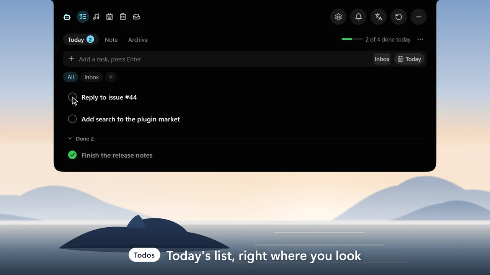
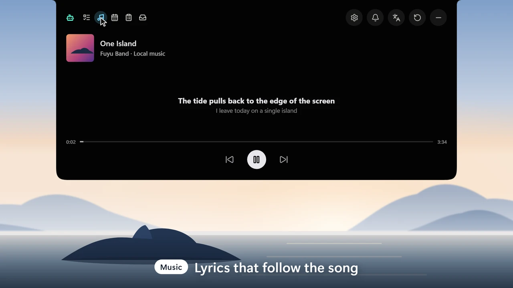
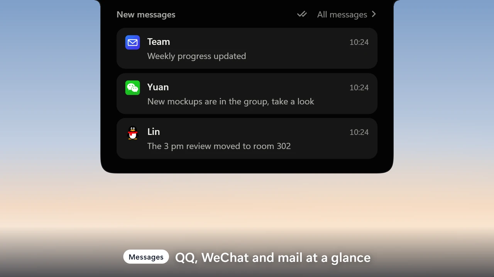
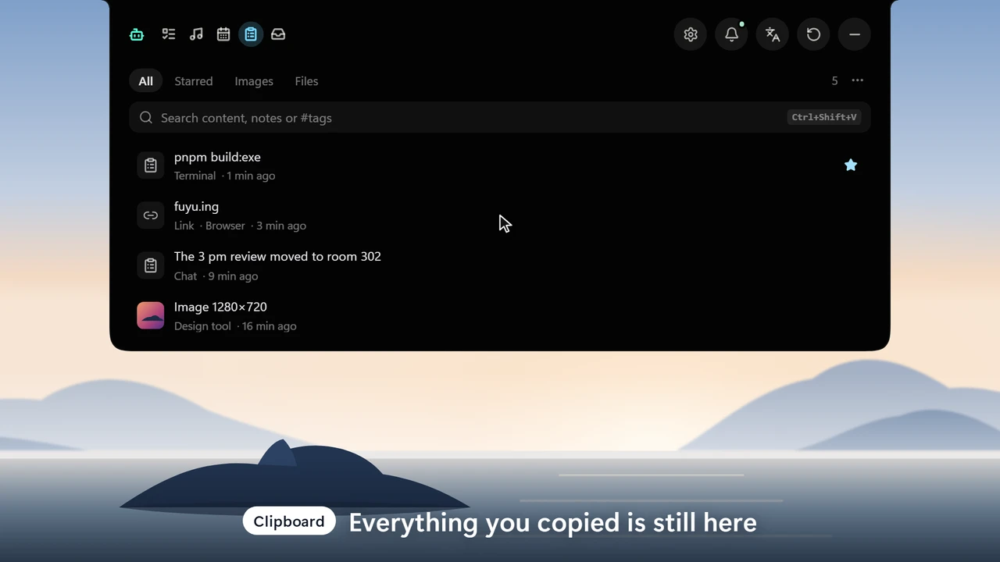
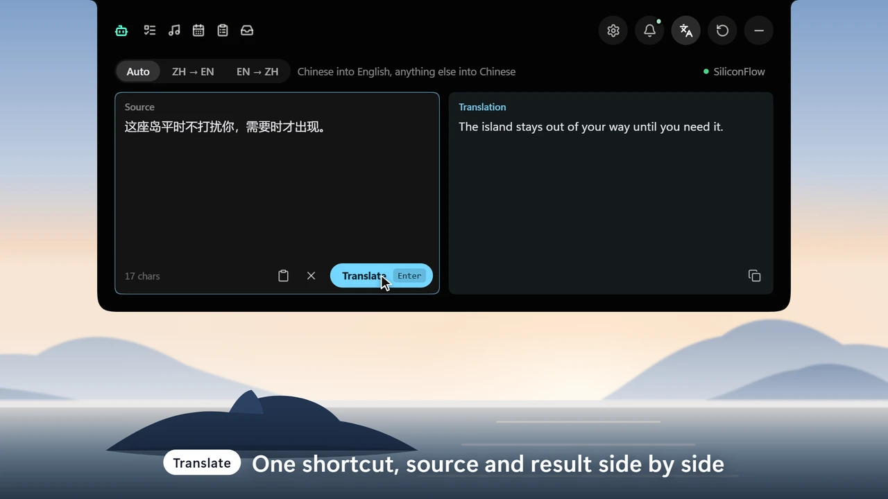
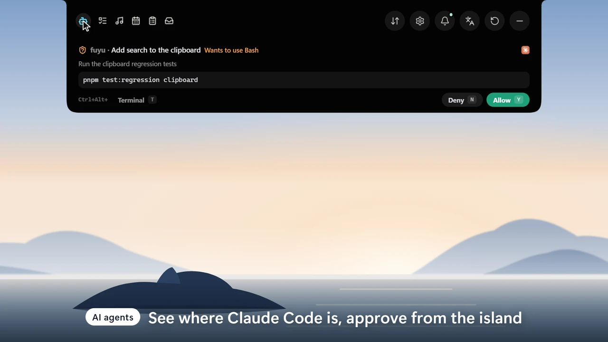

<div align="center">
  <a name="readme-top"></a>
  <a href="https://fuyu.ing"></a>

  <h1>Fuyu</h1>

  <p><b>One island for your desktop</b></p>

  <p>A desktop island for Windows and macOS: tasks, clipboard, messages, translation, music and AI status on one small island at the top of your screen.</p>

  <p>
    <a href="https://github.com/TixXin/fuyu/releases/latest"></a>
    &nbsp;
    <a href="https://github.com/TixXin/fuyu/releases"></a>
    <br>
    <a href="https://fuyu.ing/#mac-install"></a>
  </p>

  <p>
    <a href="https://github.com/TixXin/fuyu/releases/latest"></a>
    
    
    <a href="LICENSE"></a>
    <a href="https://github.com/TixXin/fuyu/stargazers"></a>
  </p>

  <p>
    <a href="README.md"><b>中文</b></a>
    ·
    <a href="https://fuyu.ing">Website</a>
    ·
    <a href="https://fuyu.ing/plugins/">Plugin market</a>
    ·
    <a href="docs/plugins/README.md">Write a plugin</a>
    ·
    <a href="https://github.com/TixXin/fuyu/issues">Report an issue</a>
  </p>

  <p>
    <a href="docs/assets/promo-001-one-island-en.mp4"></a>
    <br>
    <sub>The whole tour in 43 seconds. The island on screen is the real frontend, not a screen recording (<a href="video/README.md">how it is made</a>, in Chinese) · <a href="docs/assets/promo-001-one-island-en.mp4">Watch the full video with sound</a> · <a href="docs/assets/promo-004-one-day-en.mp4">A day with Fuyu (46 seconds, narrated)</a></sub>
  </p>
</div>

## What is this?

Fuyu (浮屿, "floating islet") is a lightweight, borderless, always-on-top floating island. It sits at the top of the screen, expands when you need it and tucks away when you are done, so the things you use all day are one glance away instead of one window switch away.

<p align="center">
  
  <br>
  <sub>Collapsed, it takes only this strip at the top of the screen; here it is following a song with lyrics and a waveform</sub>
</p>

## What is on the island

<p align="center">
  
  
  
  
  
  
</p>

<table>
  <tr>
    <td valign="top"><code>01</code></td>
    <td><b>Tasks and notes</b><br>Today's tasks, the one you are focused on, a daily note and past archives.</td>
  </tr>
  <tr>
    <td valign="top"><code>02</code></td>
    <td><b>Music</b><br>Control what is playing, with a live audio waveform and synced lyrics.</td>
  </tr>
  <tr>
    <td valign="top"><code>03</code></td>
    <td><b>Messages</b><br>QQ and WeChat alerts and several mailboxes, with mail you can read and answer on the island.</td>
  </tr>
  <tr>
    <td valign="top"><code>04</code></td>
    <td><b>Clipboard and file shelf</b><br>Text and image clipboard history; drop files on the island and drag them into another app later.</td>
  </tr>
  <tr>
    <td valign="top"><code>05</code></td>
    <td><b>Quick translation</b><br>One shortcut away, with a choice of LLM translation services.</td>
  </tr>
  <tr>
    <td valign="top"><code>06</code></td>
    <td><b>AI agents</b><br>The state and usage of your Claude Code and Codex sessions; approve a request right on the island, click a session to jump to its window, and get pushed to your phone while you are away.</td>
  </tr>
  <tr>
    <td valign="top"><code>07</code></td>
    <td><b>Calendar</b><br>Today's and tomorrow's events next to a month view with lunar dates and holidays, a countdown on the island before a meeting, and one-click join.</td>
  </tr>
  <tr>
    <td valign="top"><code>08</code></td>
    <td><b>System hints</b><br>Volume and brightness changes, and which app is using your camera or microphone.</td>
  </tr>
  <tr>
    <td valign="top"><code>09</code></td>
    <td><b>Plugins and themes</b><br>Extend the island from the plugin market (sensitive data needs your permission), and pick a ready-made look from the theme market.</td>
  </tr>
</table>

The look, size, tucking, shortcuts and every feature can be adjusted in the Settings window, and the app updates itself. Your data stays on your computer.

## Resource use

Collapsed and idle with no music playing (default settings, no plugins):

| | Measured |
|---|---|
| CPU | About **10%** of one core (about 0.5% of a 20-core machine in total) |
| Memory | About **16 MB** for Fuyu itself |
| The Agent page reading the session list once a second | **0.1%** of one core |
| Each PowerShell plugin | About **60 MB** more |

How it was measured, with the numbers: [idle-usage.md](docs/investigations/idle-usage.md) (in Chinese).

## Getting started

1. **Download and install**: get the installer from [Releases](https://github.com/TixXin/fuyu/releases/latest).
   - **Windows**: get the `_x64-setup.exe`. The installers are not code-signed; if SmartScreen warns, choose "More info → Run anyway".
   - **macOS**: in the [release list](https://github.com/TixXin/fuyu/releases), get the `_aarch64.dmg` from the newest release that has one (a pre-release above the latest stable one, if the stable one has none) and drag Fuyu into Applications. The first time, open System Settings > Privacy & Security and click "Open Anyway"; see the [Mac install guide](https://fuyu.ing/#mac-install) for every step.
2. **Open the island**: move the pointer onto the island at the top of the screen to expand it; the gear button or the tray icon (the menu bar icon on a Mac) opens Settings. On a Mac the welcome guide walks you through the system permissions Fuyu needs.
3. **Set up once**: mail, translation and AI agents need a one-time setup in Settings. See [mail](docs/features/mail.md), [AI agents](docs/features/agent-status-hooks.md), [QQ](docs/features/qq-notifications.md) and [WeChat](docs/features/wechat-reminders.md) (in Chinese).

> [!NOTE]
> Fuyu runs on Windows 10 and 11 and on macOS 15 or later (Apple silicon). A few things differ on the Mac: QQ and WeChat show only unread counts, not message text, and media control and brightness use private system APIs. [platforms.md](docs/architecture/platforms.md) lists every feature on both systems (in Chinese).

## Plugins

If the island is missing something, add it yourself. A plugin is a folder: a manifest plus a program the island starts (a PowerShell script, an exe, or a Node.js script). Plugins only send data; the island draws pages, the collapsed bar and settings from templates, so a plugin looks like the rest of the island.

```sh
npm create fuyu-plugin@latest
```

- **Install one**: from Settings → Plugin market on the island, or browse the [plugin market on the website](https://fuyu.ing/plugins/) first.
- **Write one**: the [quick start](docs/plugins/quickstart.md) takes you from nothing to a working plugin in about an hour, and the [plugin docs](docs/plugins/README.md) cover the rest (both in Chinese).
- **Share one**: add it to the [plugin market](https://github.com/TixXin/fuyu-plugins), or keep it on your own computer; see [publishing](docs/plugins/publish.md) (in Chinese).

## Build from source

- **Windows**: you need Windows 10/11, Node.js, pnpm, Rust, Visual Studio C++ Build Tools and WebView2 Runtime.
- **macOS**: you need macOS 15 or later, the Xcode command line tools (`xcode-select --install`), Node.js, pnpm and Rust.

```sh
git clone https://github.com/TixXin/fuyu.git
cd fuyu
pnpm install
pnpm tauri dev      # development
pnpm tauri build    # installers
```

Built with Tauri 2, React 19 + TypeScript and Rust. Releases and in-app updates are described in [docs/features/updater.md](docs/features/updater.md) (in Chinese).

## Community

Questions, ideas, or just want to chat? Scan to join our WeChat user group (mostly in Chinese):

<p align="center">
  
</p>

## Contributing

<a href="https://fuyu.ing/logo/"></a>

Fuyu is a shared effort, and there is room for you:

- **Report a problem or an idea**: open an [issue](https://github.com/TixXin/fuyu/issues) and say what gets in your way or what you are missing.
- **Change code, docs or translations**: open a pull request. [CONTRIBUTING.md](CONTRIBUTING.md) covers how, and which checks to run first; [AGENTS.md](AGENTS.md) explains how the code is laid out (in Chinese).
- **Write a plugin**: no need to touch the island itself; publish it to the [plugin market](https://github.com/TixXin/fuyu-plugins).
- **Draw a logo**: Fuyu has no real logo yet, and the [logo call](https://fuyu.ing/logo/) is open; the empty slot on the right is waiting for it.

<a href="https://github.com/TixXin/fuyu/graphs/contributors"></a>

## Star trend

Every star keeps Fuyu moving.

<p align="center">
  <a href="https://star-history.com/#TixXin/fuyu&amp;Date">
    <picture>
      <source media="(prefers-color-scheme: dark)" srcset="https://api.star-history.com/svg?repos=TixXin/fuyu&amp;type=Date&amp;theme=dark">
      
    </picture>
  </a>
</p>

## License

[GPL-3.0](LICENSE). Plugin authors choose their own license. Third-party dependencies and bundled assets keep their own licenses; see the [third-party notices](docs/THIRD_PARTY_NOTICES.md) for where they come from, and the [font notices](src/assets/fonts/README.md) for bundled fonts.

> [!NOTE]
> This project is maintained together by [TixXin](https://github.com/TixXin) and [ShengLin1001](https://github.com/ShengLin1001); it was renamed from fly-island to Fuyu in November 2026. The original author, [flyl1u](https://github.com/flyl1u/fly-island), prefers a lean, minimal island. To give the island more to do, and to let more people put their own DIY features on it, this project went its own way as a jointly maintained one and grew a plugin market. Pull requests are welcome (see [Contributing](CONTRIBUTING.md)), and so are your own components in the [plugin market](https://github.com/TixXin/fuyu-plugins), or plugins you install locally (see the [plugin docs](docs/plugins/README.md)).

<p align="center">
  <a href="#readme-top"></a>
  <br>
  <sub>Done? It tucks itself away · <a href="#readme-top">Back to top</a></sub>
</p>
