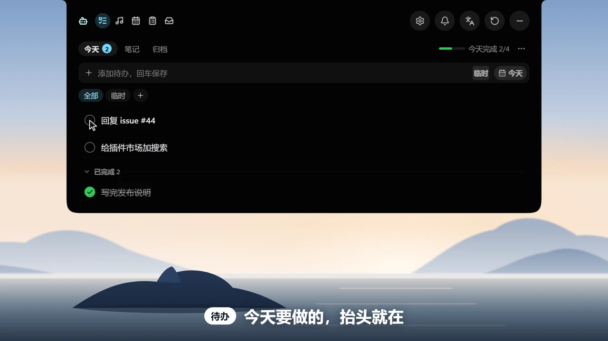
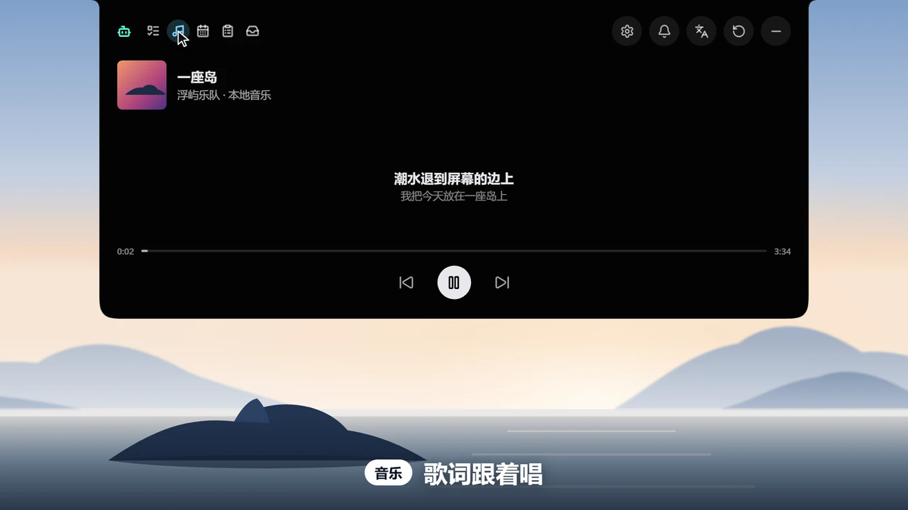
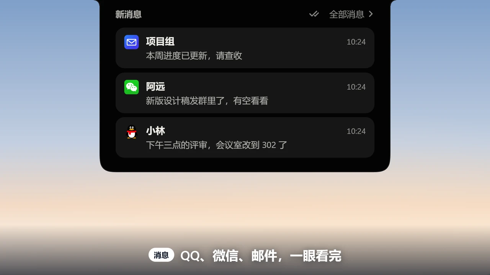
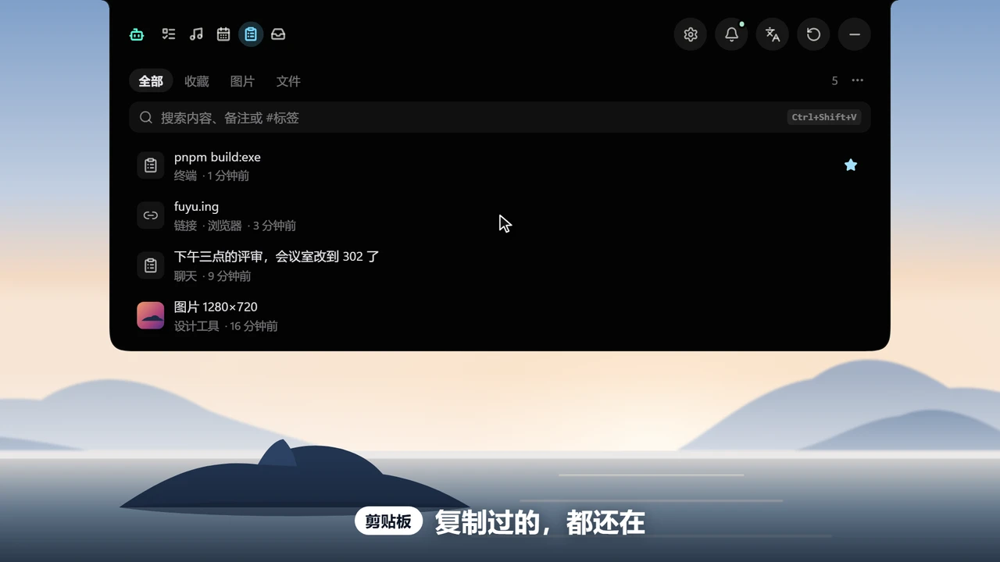
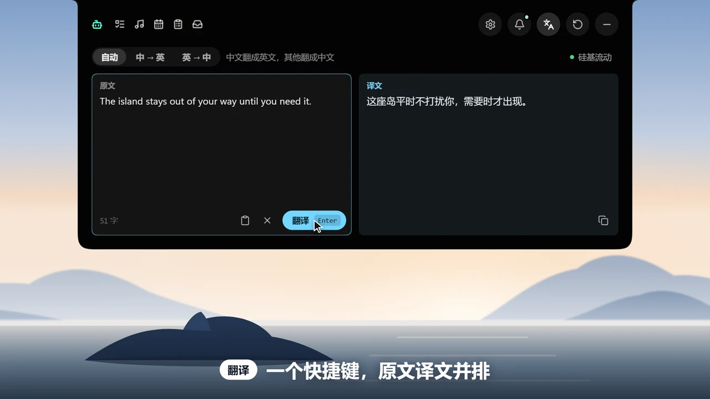
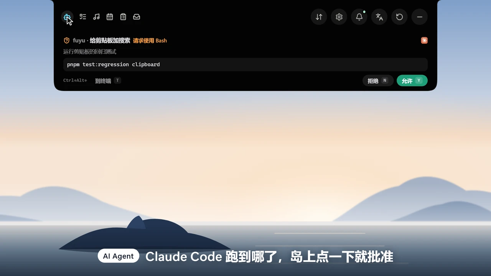

<div align="center">
  <a name="readme-top"></a>
  <a href="https://fuyu.ing/zh/logo/"></a>

  <h1>浮屿 Fuyu</h1>

  <p><b>一座岛，收下桌面的零碎</b></p>

  <p>Windows 和 macOS 上的桌面灵动岛：待办、剪贴板、消息、翻译、音乐和 AI 状态，都在屏幕顶部的一座小岛上。</p>

  <p>
    <a href="https://github.com/TixXin/fuyu/releases/latest"></a>
    <a href="https://github.com/TixXin/fuyu/releases"></a>
  </p>

  <p>
    <a href="https://github.com/TixXin/fuyu/releases/latest"></a>
    
    
    <a href="LICENSE"></a>
    <a href="https://github.com/TixXin/fuyu/stargazers"></a>
  </p>

  <p>
    <a href="README.en.md"><b>English</b></a>
    ·
    <a href="https://fuyu.ing/zh/">官网</a>
    ·
    <a href="https://fuyu.ing/zh/plugins/">插件市场</a>
    ·
    <a href="docs/plugins/README.md">写插件</a>
    ·
    <a href="https://github.com/TixXin/fuyu/issues">反馈问题</a>
  </p>

  <p>
    <a href="docs/assets/promo-001-one-island.mp4"></a>
    <br>
    <sub>43 秒看一圈。画面里的岛就是真的前端，不是录屏（<a href="video/README.md">怎么做的</a>）· <a href="docs/assets/promo-001-one-island.mp4">看带声音的完整视频</a></sub>
  </p>
</div>

## 这是什么

浮屿（Fuyu）是一座轻量、无边框、始终置顶的悬浮岛。平时收在屏幕顶部，需要时展开，用完自动收回。常用的东西都放在岛上，不用为了看一眼信息来回切窗口。

<p align="center">
  
  <br>
  <sub>收起时只占屏幕顶部这一小条，图里它正跟着歌显示歌词和音频波形</sub>
</p>

## 岛上有什么

<p align="center">
  
  
  
  
  
  
</p>

<table>
  <tr>
    <td valign="top"><code>01</code></td>
    <td><b>待办与笔记</b><br>每天的任务、当前专注的事项、每日笔记和历史归档。</td>
  </tr>
  <tr>
    <td valign="top"><code>02</code></td>
    <td><b>音乐</b><br>控制正在播放的媒体，显示音频波形和同步歌词。</td>
  </tr>
  <tr>
    <td valign="top"><code>03</code></td>
    <td><b>消息</b><br>QQ、微信提醒和多个邮箱，邮件可以直接在岛上阅读和回复。</td>
  </tr>
  <tr>
    <td valign="top"><code>04</code></td>
    <td><b>剪贴板与文件中转</b><br>图文剪贴板历史；把文件先拖到岛上暂存，再拖去别的程序。</td>
  </tr>
  <tr>
    <td valign="top"><code>05</code></td>
    <td><b>快捷翻译</b><br>一个快捷键打开，支持多家大模型翻译服务。</td>
  </tr>
  <tr>
    <td valign="top"><code>06</code></td>
    <td><b>AI Agent</b><br>显示 Claude Code 和 Codex 会话的运行状态和用量，要你确认时直接在岛上批准，点一下切到对应窗口；离开电脑时可以推送到手机。</td>
  </tr>
  <tr>
    <td valign="top"><code>07</code></td>
    <td><b>日历</b><br>今天和明天的日程、带农历和节假日的月历，会议快开始时在岛上倒计时，可一键加入。</td>
  </tr>
  <tr>
    <td valign="top"><code>08</code></td>
    <td><b>系统提示</b><br>音量、亮度变化，摄像头和麦克风正在被哪个程序使用。</td>
  </tr>
  <tr>
    <td valign="top"><code>09</code></td>
    <td><b>插件与主题</b><br>从插件市场安装插件来扩展岛屿，敏感数据需要你单独授权；主题市场里挑现成的外观。</td>
  </tr>
</table>

岛屿的外观、大小、收起方式、快捷键和每个功能都可以在设置窗口里调整，支持应用内自动更新。数据都保存在本机。

## 占用

收起、闲着、不放音乐时（默认设置，不装插件）：

| | 实测 |
|---|---|
| CPU | 约占单核的 **10%**（20 核电脑上约占总量的 0.5%） |
| 内存 | 浮屿本身约 **16 MB** |
| Agent 页每秒刷新一次会话列表 | 单核的 **0.1%** |
| 每装一个 PowerShell 插件 | 约多 **60 MB** |

测量方法和数据见 [idle-usage.md](docs/investigations/idle-usage.md)。

## 上手

1. **下载安装**：从 [Releases](https://github.com/TixXin/fuyu/releases/latest) 下载安装包并安装。
   - **Windows**：下载 `_x64-setup.exe`。安装包没有代码签名，SmartScreen 提示时点「更多信息 → 仍要运行」。
   - **macOS**：下载 `_aarch64.dmg`，把 Fuyu 拖进「应用程序」。第一次打开要在「系统设置 → 隐私与安全性」里点「仍要打开」，步骤见[在 Mac 上安装浮屿](docs/features/macos-install.md)。
2. **展开小岛**：鼠标移到屏幕顶部的岛上即可展开，点齿轮或托盘图标（Mac 上是菜单栏图标）打开设置。Mac 上新手引导会带你打开要用到的系统权限。
3. **配置一次**：邮箱、翻译和 AI Agent 需要先在设置里配置一次，具体见各自的说明：[邮箱](docs/features/mail.md)、[AI Agent](docs/features/agent-status-hooks.md)、[QQ 通知](docs/features/qq-notifications.md)、[微信提醒](docs/features/wechat-reminders.md)。

> [!NOTE]
> 支持 Windows 10 / 11 和 macOS 15 以上（Apple 芯片）。Mac 版有几处和 Windows 不同：QQ、微信只显示未读数，读不到消息内容；媒体控制和亮度用到了系统私有接口。每个功能在两个平台上的情况见 [platforms.md](docs/architecture/platforms.md)。

## 插件

岛上缺什么，可以自己加。一个插件就是一个文件夹：一份清单，加一个由岛屿启动的程序（PowerShell 脚本、exe 或 Node.js 脚本）。插件只发数据，页面、收起条和设置页由岛屿按模板画，所以和岛上其他内容风格一致。

```sh
npm create fuyu-plugin@latest
```

- **装现成的**：在岛屿的「设置 → 插件市场」里安装，也可以先在[官网的插件市场](https://fuyu.ing/zh/plugins/)看看有哪些。
- **自己写**：跟着[快速开始](docs/plugins/quickstart.md)从零做出一个插件，大约一小时；完整说明见[插件文档](docs/plugins/README.md)。
- **分享给别人**：放进[插件市场](https://github.com/TixXin/fuyu-plugins)，或者只在自己的电脑上用，步骤见[发布](docs/plugins/publish.md)。

## 从源码构建

- **Windows**：需要 Windows 10/11、Node.js、pnpm、Rust、Visual Studio C++ Build Tools 和 WebView2 Runtime。
- **macOS**：需要 macOS 15 以上、Xcode 命令行工具（`xcode-select --install`）、Node.js、pnpm 和 Rust。

```sh
git clone https://github.com/TixXin/fuyu.git
cd fuyu
pnpm install
pnpm tauri dev      # 开发模式
pnpm tauri build    # 打包安装程序
```

技术栈：Tauri 2、React 19 + TypeScript、Rust。发布与应用内更新见 [docs/features/updater.md](docs/features/updater.md)。

## 用户交流群

用着有问题、有想法，或者只是想聊聊，欢迎扫码进微信群：

<p align="center">
  
</p>

## 参与贡献

<a href="https://fuyu.ing/zh/logo/"></a>

浮屿是大家一起做的，欢迎你来添一块：

- **提问题和想法**：到 [Issues](https://github.com/TixXin/fuyu/issues) 说说哪里不好用、还想要什么。
- **改代码、文档或翻译**：直接提 PR。怎么提、提之前跑哪些检查，见 [CONTRIBUTING.md](CONTRIBUTING.md)；代码怎么组织，见 [AGENTS.md](AGENTS.md)。
- **写插件**：不用改岛屿本体，做好了放进[插件市场](https://github.com/TixXin/fuyu-plugins)。
- **画一个 Logo**：浮屿还没有正式的 Logo，[征集页](https://fuyu.ing/zh/logo/)一直开着，右边这个空位就是留给它的。

<a href="https://github.com/TixXin/fuyu/graphs/contributors"></a>

## Star 趋势

每一颗 Star 都是浮屿往前走的动力。

<p align="center">
  <a href="https://star-history.com/#TixXin/fuyu&amp;Date">
    <picture>
      <source media="(prefers-color-scheme: dark)" srcset="https://api.star-history.com/svg?repos=TixXin/fuyu&amp;type=Date&amp;theme=dark">
      
    </picture>
  </a>
</p>

## 开源协议

[GPL-3.0](LICENSE)。插件作者可以自己选协议。第三方依赖和内置资源遵循各自的许可证，内置字体见[字体说明](src/assets/fonts/README.md)。

> [!NOTE]
> 本项目由 [TixXin](https://github.com/TixXin) 和 [ShengLin1001](https://github.com/ShengLin1001) 共同维护，2026 年 11 月由 fly-island 改名为浮屿。原作者 [flyl1u](https://github.com/flyl1u/fly-island) 偏向于精简的灵动岛界面；为了进一步丰富灵动岛的功能，让更多用户把自己 DIY 的功能放上岛，本项目另起一支，由大家共同维护，并发展出了插件市场模式。欢迎大家提 PR 贡献代码（见[参与贡献](CONTRIBUTING.md)），把自己的组件上传到[插件市场](https://github.com/TixXin/fuyu-plugins)，或者在本地安装自己的插件（见[插件文档](docs/plugins/README.md)）。

<p align="center">
  <a href="#readme-top"></a>
  <br>
  <sub>用完，它自己收回去 · <a href="#readme-top">回到顶部</a></sub>
</p>
