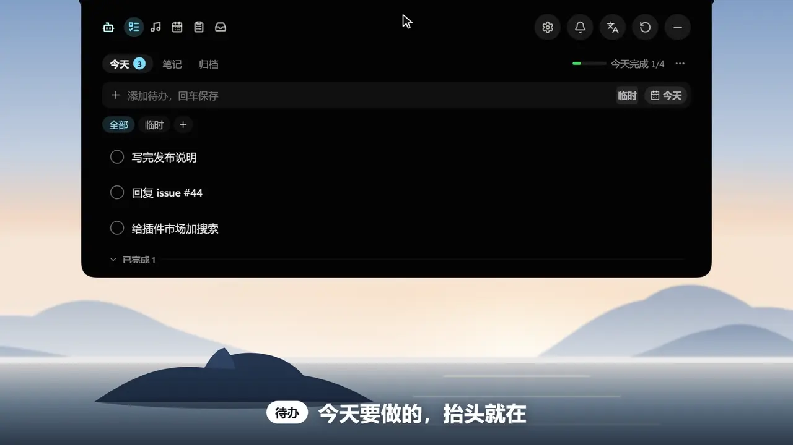
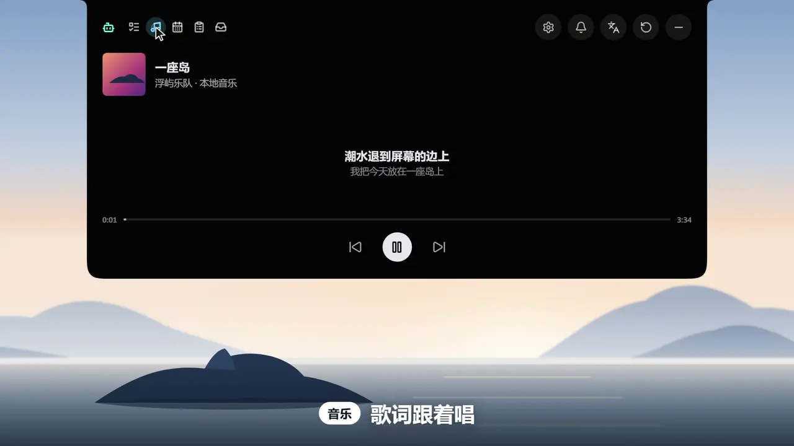
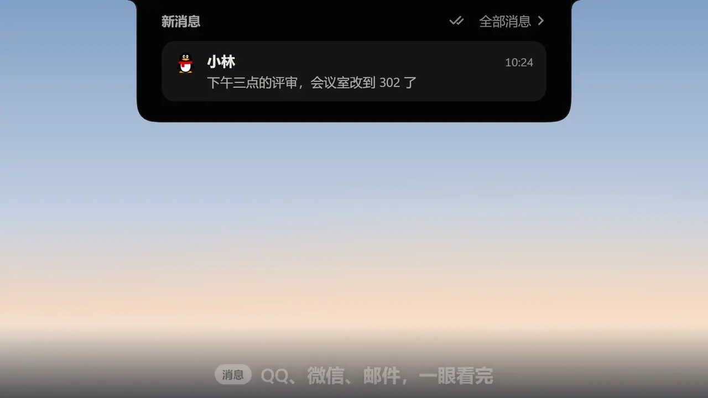
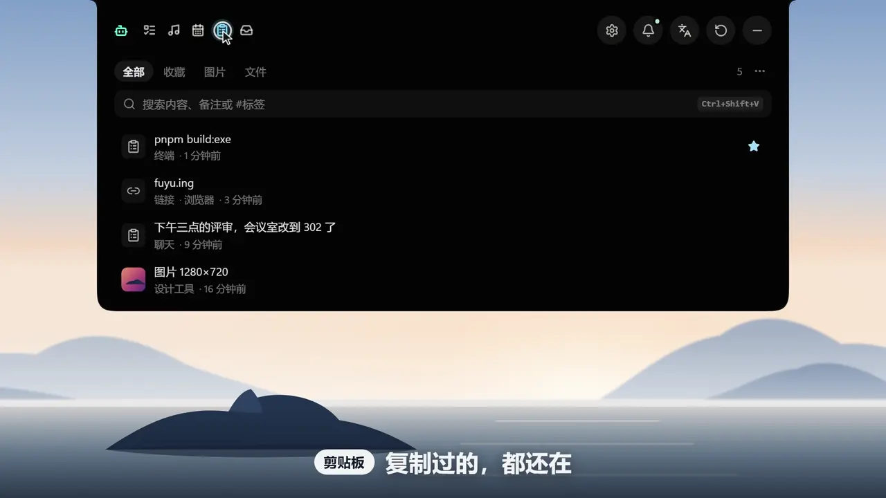
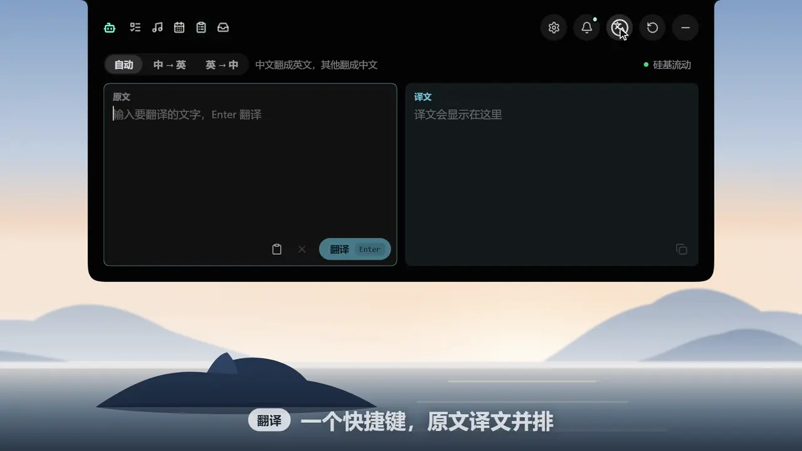
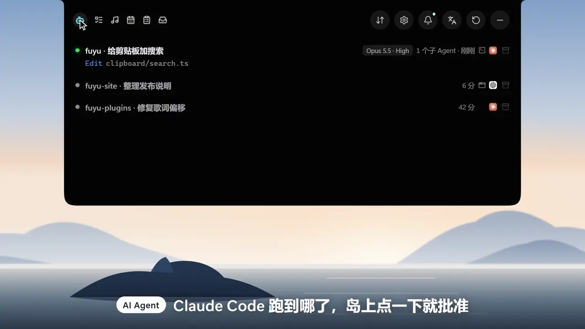

<div align="center">
  <a name="readme-top"></a>
  <a href="https://fuyu.ing/zh/"></a>

  <h1>浮嶼 Fuyu</h1>

  <p><b>一座島，收納桌面上的零碎</b></p>

  <p>Windows 和 macOS 上的桌面動態島：待辦、剪貼簿、訊息、翻譯、音樂和 AI 狀態，全都在螢幕頂端的一座小島上。</p>

  <p>
    <a href="https://github.com/TixXin/fuyu/releases/latest"></a>
    &nbsp;
    <a href="https://github.com/TixXin/fuyu/releases"></a>
    <br>
    <a href="https://fuyu.ing/zh/#mac-install"></a>
  </p>

  <p>
    <a href="https://github.com/TixXin/fuyu/releases/latest"></a>
    
    
    <a href="LICENSE"></a>
    <a href="https://github.com/TixXin/fuyu/stargazers"></a>
  </p>

  <p>
    <a href="README.md">简体中文</a>
    ·
    <b>繁體中文</b>
    ·
    <a href="README.en.md">English</a>
    ·
    <a href="README.ja.md">日本語</a>
    ·
    <a href="README.ko.md">한국어</a>
    ·
    <a href="README.es.md">Español</a>
  </p>
  <p><sub>本文譯自 2026-11-15 的<a href="README.md">簡體中文 README</a>，內容可能稍有落後，歡迎以繁體中文為母語的朋友協助修正。</sub></p>

  <p>
    <a href="https://fuyu.ing/zh/">官網</a>
    ·
    <a href="https://fuyu.ing/zh/plugins/">外掛市集</a>
    ·
    <a href="docs/plugins/README.md">開發外掛</a>
    ·
    <a href="https://github.com/TixXin/fuyu/issues">回報問題</a>
  </p>

  <p>
    <a href="docs/assets/promo-001-one-island.mp4"></a>
    <br>
    <sub>43 秒看一輪。畫面裡的島就是真正的前端，不是螢幕錄影（<a href="video/README.md">怎麼做的</a>）· <a href="docs/assets/promo-001-one-island.mp4">觀看有聲音的完整影片</a> · <a href="docs/assets/promo-004-one-day.mp4">《浮嶼的一天》（41 秒，有旁白）</a></sub>
  </p>
</div>

## 這是什麼

浮嶼（Fuyu）是一座輕巧、無邊框、永遠置頂的懸浮島。平常收在螢幕頂端，需要時展開，用完自動收回。常用的東西都放在島上，不必為了看一眼資訊而在視窗之間切來切去。

<p align="center">
  
  <br>
  <sub>收起時只佔螢幕頂端這一小條，圖中它正跟著歌曲顯示歌詞和音訊波形</sub>
</p>

## 島上有什麼

<p align="center">
  <a href="https://fuyu.ing/zh/#day"></a>
  <a href="https://fuyu.ing/zh/#day"></a>
  <a href="https://fuyu.ing/zh/#day"></a>
  <a href="https://fuyu.ing/zh/#day"></a>
  <a href="https://fuyu.ing/zh/#day"></a>
  <a href="https://fuyu.ing/zh/#agent"></a>
  <br>
  <sub>點任一張圖，到官網親手玩玩這座島</sub>
</p>

<table>
  <tr>
    <td valign="top"><code>01</code></td>
    <td><b>待辦與筆記</b><br>每天的任務、目前專注的事項、每日筆記和歷史封存。</td>
  </tr>
  <tr>
    <td valign="top"><code>02</code></td>
    <td><b>音樂</b><br>控制正在播放的媒體，顯示音訊波形和同步歌詞。</td>
  </tr>
  <tr>
    <td valign="top"><code>03</code></td>
    <td><b>訊息</b><br>QQ、微信提醒和多個信箱，郵件可以直接在島上閱讀和回覆。</td>
  </tr>
  <tr>
    <td valign="top"><code>04</code></td>
    <td><b>剪貼簿與檔案中轉</b><br>圖文剪貼簿紀錄；先把檔案拖到島上暫放，再拖到其他程式。</td>
  </tr>
  <tr>
    <td valign="top"><code>05</code></td>
    <td><b>快速翻譯</b><br>一個快速鍵就能開啟，支援多家大型語言模型翻譯服務。</td>
  </tr>
  <tr>
    <td valign="top"><code>06</code></td>
    <td><b>AI Agent</b><br>顯示 Claude Code 和 Codex 工作階段的執行狀態和用量，需要你確認時直接在島上核准，點一下就切到對應的視窗；離開電腦時可以推播到手機。</td>
  </tr>
  <tr>
    <td valign="top"><code>07</code></td>
    <td><b>行事曆</b><br>今天和明天的行程、附農曆和節假日的月曆，會議快開始時在島上倒數，可一鍵加入。</td>
  </tr>
  <tr>
    <td valign="top"><code>08</code></td>
    <td><b>系統提示</b><br>音量、亮度變化，以及攝影機和麥克風正被哪個程式使用。</td>
  </tr>
  <tr>
    <td valign="top"><code>09</code></td>
    <td><b>外掛與佈景主題</b><br>從外掛市集安裝外掛來擴充島嶼，敏感資料需要你另外授權；佈景主題市集裡有現成的外觀可挑。</td>
  </tr>
</table>

島嶼的外觀、大小、收起方式、快速鍵和每項功能都可以在設定視窗裡調整，並支援應用程式內自動更新。資料全都儲存在本機。

## 資源佔用

收起、閒置、沒有播放音樂時（預設設定，未安裝外掛）：

| | 實測 |
|---|---|
| CPU | 約佔單核心的 **10%**（20 核心電腦上約佔總量的 0.5%） |
| 記憶體 | 浮嶼本身約 **16 MB** |
| Agent 頁每秒重新整理一次工作階段清單 | 單核心的 **0.1%** |
| 每安裝一個 PowerShell 外掛 | 約多 **60 MB** |

量測方法和數據請見 [idle-usage.md](docs/investigations/idle-usage.md)。

## 快速上手

1. **下載安裝**：從 [Releases](https://github.com/TixXin/fuyu/releases/latest) 下載安裝檔並安裝。
   - **Windows**：下載 `_x64-setup.exe`。安裝檔沒有程式碼簽章，SmartScreen 跳出提示時點「其他資訊 → 仍要執行」。
   - **macOS**：在 [Releases 清單](https://github.com/TixXin/fuyu/releases)裡找最新一個附有 `_aarch64.dmg` 的版本下載（最新正式版裡沒有的話，就在它上方的測試版裡），把 Fuyu 拖進「應用程式」。第一次開啟時要到「系統設定 → 隱私權與安全性」裡點「強制打開」，逐步說明請見 [Mac 安裝教學](https://fuyu.ing/zh/#mac-install)。
2. **展開小島**：把滑鼠移到螢幕頂端的島上就會展開，點齒輪或系統匣圖示（Mac 上是選單列圖示）開啟設定。在 Mac 上，新手導覽會帶你開啟需要用到的系統權限。
3. **設定一次**：信箱、翻譯和 AI Agent 需要先在設定裡設定一次，詳見各自的說明：[信箱](docs/features/mail.md)、[AI Agent](docs/features/agent-status-hooks.md)、[QQ 通知](docs/features/qq-notifications.md)、[微信提醒](docs/features/wechat-reminders.md)。

> [!NOTE]
> 支援 Windows 10 / 11 和 macOS 15 以上（Apple 晶片）。Mac 版有幾處和 Windows 不同：QQ、微信只顯示未讀數，讀不到訊息內容；媒體控制和亮度用到了系統私有 API。每項功能在兩個平台上的支援情況請見 [platforms.md](docs/architecture/platforms.md)。

## 外掛

島上缺什麼，可以自己加。一個外掛就是一個資料夾：一份清單，加上一個由島嶼啟動的程式（PowerShell 指令碼、exe 或 Node.js 指令碼）。外掛只負責送出資料，頁面、收起列和設定頁由島嶼依範本繪製，因此和島上其他內容的風格一致。

```sh
npm create fuyu-plugin@latest
```

- **安裝現成的**：在島嶼的「設定 → 外掛市集」裡安裝，也可以先到[官網的外掛市集](https://fuyu.ing/zh/plugins/)看看有哪些。
- **自己寫**：跟著[快速入門](docs/plugins/quickstart.md)從零做出一個外掛，大約一小時；完整說明請見[外掛文件](docs/plugins/README.md)。
- **分享給別人**：上架到[外掛市集](https://github.com/TixXin/fuyu-plugins)，或者只在自己的電腦上使用，步驟請見[發佈](docs/plugins/publish.md)。

## 從原始碼建置

- **Windows**：需要 Windows 10/11、Node.js、pnpm、Rust、Visual Studio C++ Build Tools 和 WebView2 Runtime。
- **macOS**：需要 macOS 15 以上、Xcode 命令列工具（`xcode-select --install`）、Node.js、pnpm 和 Rust。

```sh
git clone https://github.com/TixXin/fuyu.git
cd fuyu
pnpm install
pnpm tauri dev      # 開發模式
pnpm tauri build    # 打包安裝程式
```

技術棧：Tauri 2、React 19 + TypeScript、Rust。發佈與應用程式內更新請見 [docs/features/updater.md](docs/features/updater.md)。

## 使用者交流群組

使用上有問題、有想法，或者只是想聊聊，歡迎掃描 QR Code 加入微信群組：

<p align="center">
  
</p>

## 參與貢獻

<a href="https://fuyu.ing/zh/logo/"></a>

浮嶼是大家一起打造的，歡迎你也來添一塊：

- **提出問題和想法**：到 [Issues](https://github.com/TixXin/fuyu/issues) 說說哪裡不好用、還想要什麼。
- **修改程式碼、文件或翻譯**：直接提 PR。怎麼提、提之前要跑哪些檢查，請見 [CONTRIBUTING.md](CONTRIBUTING.md)；程式碼怎麼組織，請見 [AGENTS.md](AGENTS.md)。
- **寫外掛**：不用改動島嶼本體，做好後上架到[外掛市集](https://github.com/TixXin/fuyu-plugins)。
- **畫一個 Logo**：浮嶼還沒有正式的 Logo，[徵稿頁](https://fuyu.ing/zh/logo/)一直開放著，右邊這個空位就是留給它的。

<a href="https://github.com/TixXin/fuyu/graphs/contributors"></a>

## Star 趨勢

每一顆 Star 都是浮嶼繼續前進的動力。

<p align="center">
  <a href="https://star-history.com/#TixXin/fuyu&amp;Date">
    <picture>
      <source media="(prefers-color-scheme: dark)" srcset="https://api.star-history.com/svg?repos=TixXin/fuyu&amp;type=Date&amp;theme=dark">
      
    </picture>
  </a>
</p>

## 授權條款

[GPL-3.0](LICENSE)。外掛作者可以自行選擇授權條款。第三方相依套件和內建資源遵循各自的授權：來源和聲明請見[第三方聲明](docs/THIRD_PARTY_NOTICES.md)，內建字型請見[字型說明](src/assets/fonts/README.md)。

> [!NOTE]
> 本專案由 [TixXin](https://github.com/TixXin) 和 [ShengLin1001](https://github.com/ShengLin1001) 共同維護，2026 年 11 月由 fly-island 更名為浮嶼。原作者 [flyl1u](https://github.com/flyl1u/fly-island) 偏好精簡的動態島介面；為了進一步豐富動態島的功能，讓更多使用者把自己 DIY 的功能放上島，本專案另闢一支，由大家共同維護，並發展出了外掛市集模式。歡迎大家提 PR 貢獻程式碼（請見[參與貢獻](CONTRIBUTING.md)），把自己的元件上傳到[外掛市集](https://github.com/TixXin/fuyu-plugins)，或者在本機安裝自己的外掛（請見[外掛文件](docs/plugins/README.md)）。

<p align="center">
  <a href="#readme-top"></a>
  <br>
  <sub>用完，它會自己收回去 · <a href="#readme-top">回到頂端</a></sub>
</p>
