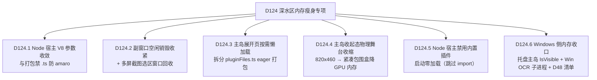

# 浮屿深水区内存优化方案（D124）

> 日期：2026-11-25。目标：在完整保留第 3 版「万物皆插件」生态与现有前端资产的前提下，系统压低 Windows 与 macOS 双端常驻闲置内存与 GPU 显存/共享内存占用，并消除长期运行的慢性膨胀。
>
> 关联实测与前序文档：[内存占用与性能优化调研](../research/memory-and-performance.md) · [Mac 上的内存占用](../investigations/macos-memory.md) · [第二轮性能审计](../research/fuyu-performance-audit-v2.md) · [插件平台第 3 版方案](plugins/v3-everything-plugin.md)

## 一、现状与内存账单基线

截至 `0.3.14-beta.2`，团队已完成前几轮表层与中层治理（Mac 图标 70 MB TIFF 替换、后台线程 `autoreleasepool`、孤儿 `perl` 回收、Mac OCR 短命子进程、水母循环动画独立成层、Mac 剪贴板默认不预热、主岛折叠态卸载 `IslandPages`、i18n 按需拆分、D49–D52、D97.1–D97.6、Windows D117 隐藏窗口同步 `SetIsVisible(false)`）。

当前仍残留在常驻内存里的主要开销分布如下：

| 进程 | macOS 正式版收起闲置 | Windows 0.3.12 快照 | 当前主要问题 |
|---|---|---|---|
| **主岛 WebContent / 渲染进程** | 127–132 MB（偶发飙至 630–670 MB） | ~222 MB（主岛 + 默认预热剪贴板，2 个渲染进程） | `pluginFiles.ts` 全量 `eager` 加载 20 个展开页与 24 个 runner，初始 JS > 1.25 MB；Win 剪贴板常驻 |
| **GPU 进程** | 平日 2 MB，展开/重绘冲回 49–70 MB | **~157 MB** | 收起态物理窗口仍长期维持至少 `820×460` 透明画布 |
| **WebView 浏览器 / 网络进程** | ~7 MB | ~60–70 MB | WebView2 固定底座 |
| **插件宿主 Node** | 45–56 MB | **~80 MB** | 无 V8 堆与新生代约束；启动即全量加载所有内置插件；防运行期 `.ts` 导入触发 `amaro` WASM |
| **Rust 主进程 `fuyu`** | 55 MB（含 Foundation 缓涨 25→42 MB） | 起步 30 MB（0.3.8 长跑曾出现 +26–29 MB/h，待复验） | Windows WinRT `OcrEngine` 仍在主进程内执行，模型缓存风险未隔离 |
| **合计** | **~250–360 MB**（偶发 800+ MB） | **~480–550+ MB** | — |

## 二、总体优化架构与六大专项

### 1. Node 插件宿主 V8 内存参数收敛与防回退（D124.1）

- **现状**：`src-tauri/src/plugin_kernel/mod.rs` 的 `host_args` 仅传入 `--disallow-code-generation-from-strings`。在 16 GB+ 内存机器上，Node 22+ 默认新生代半空间约 16–32 MB、老生代上限达 4 GB，V8 极少主动回收，导致轻量宿主常驻 50–80 MB；此外内置插件若残留运行期 `.ts` 导入，会唤醒 Node 内置 TypeScript 剥离器 `amaro`（额外 ~7 MB 源码与 WASM 缓冲）。
- **方案**：
  1. 在 `host_args` 默认注入轻量级 V8 约束：`--max-semi-space-size=2`（降低新生代常驻脏页）与 `--max-old-space-size=192`（倒逼低水位老生代回收，同时为第三方插件留足空间，并支持通过 `FUYU_PLUGIN_HOST_MAX_OLD_SPACE_MB` 覆盖）。
  2. 为 `scripts/plugins-v3/` 打包产物增加静态检查单测：确认打进发布包的内置插件不残留 `.ts` / `.tsx` 运行期导入。

### 2. 副窗口空闲销毁周期收紧 + 多屏截图选区窗口空闲回收（D124.2）

- **现状**：
  - `translation` 与非预热 `clipboard` 窗口的空闲销毁延迟为 **10 分钟**；在 macOS 上每个 WKWebView 对应独立 WebContent 进程（40–80 MB），高频轻用后会在后台同时滞留数个进程。
  - `screenshot-<n>` 选区窗口为每个显示器建一个全屏透明 WebView，在多显示器场景下体量最大，目前在截图结束/取消后仅隐藏、未做空闲自动销毁。
- **方案**：
  1. 将 `translation` 与非预热 `clipboard` 空闲销毁时间从 10 分钟收紧至 **3 分钟**；`tray-menu` 与 `clipboard-preview` 核查收紧至 **2 分钟**（或保持更短值）。
  2. 为 `screenshot/session.rs` 增加基于代际计数器的空闲销毁定时器：所有选区窗口隐藏后 **60 秒**内无新截图会话即自动销毁 `screenshot-<n>` 窗口，新截图启动时取消定时器并按需重建。

### 3. 主岛展开页按需懒加载拆分（D124.3）

- **现状**：`src/windows/island/slots/pluginFiles.ts` 同步 `eager: true` 收集全部 20 个 `features/*/plugin/island.tsx`、24 个 `runners.tsx` 等文件，导致主岛在收起闲置时即同步加载编译 > 1.25 MB JS（`IslandApp.js` 556 KB + `index.js` 472 KB + 共享大块 211 KB）。
- **方案**：
  1. 保留 `island.tsx` 里极轻的插槽元数据（`id`、排序、标题、条件等），将重量级展开面板组件改为 `React.lazy(() => import(...))` 懒加载模块，由 `IslandPages` 统一包一层无闪烁 `Suspense` 边界，并结合 `isPreparing` / hover 预热当前激活页。
  2. 核查未启用内置功能在 `runners.tsx` 中是否真正零订阅/零定时器，减少收起态无效状态更新。

### 4. 主岛收起态物理舞台按需收缩（D124.4）

- **现状**：`src-tauri/src/island/geometry.rs` 中 `STAGE_WINDOW_WIDTH = 820.0`、`STAGE_WINDOW_HEIGHT = 460.0`。哪怕主岛处于 `340×38` 的收起胶囊态，底层透明窗口也一直维持至少 `820×460`（2x 屏即 `1640×920`），致使 Windows WebView2 GPU 进程高达 ~157 MB、macOS 每次重绘整窗即冲至 49–70 MB。
- **方案**：
  1. 复用并扩展 `geometry.rs` 已有的 `resize_stage` / `shrink_stage`（展开瞬间放大，收起延迟收缩）机制，引入严格的纯函数计算收起态紧凑舞台尺寸（覆盖胶囊宽度、展开触发阴影、左右圆角、收起提醒弹条高度 `grown_collapsed_height` 及安全边距）。
  2. 仅在标准顶部/底部收起态且无展开、无拖拽、无全屏引导覆盖时延迟收缩物理舞台；一旦进入 hover 预热、展开、弹横幅或高度增长，立即同步扩回完整舞台并保持居中对齐与前端坐标零跳变。
  3. 用 Rust 单元测试完整覆盖多缩放比、刘海、贴边、自定义位置与横幅高度等全部几何边界。

### 5. Node 宿主禁用内置插件零加载（D124.5）

- **现状**：`packages/plugin-base/src/host/` 启动时对内置插件目录扫描与加载流程需确保被用户关闭的内置插件跳过模块 `import()`，避免白占 V8 堆与模块缓存，在用户重新开启时再按需加载。
- **方案**：
  1. 审查宿主加载器（`packages/plugin-base/src/host/`）的禁用插件路径：未启用插件仅登记清单状态为 `disabled`，不执行动态 `import()`；
  2. 补充单元测试验证禁用插件不触发入口加载、切换启用后再加载并正常运行。

### 6. Windows 侧内存收口：托盘隐藏主岛 `SetIsVisible`、Win OCR 子进程化与 D48 验收（D124.6）

- **现状**：
  1. `src-tauri/src/webview_visibility.rs` 将 `main` 排除在 `SetIsVisible` 同步之外；但 v3 插件后台逻辑已迁至 Node 宿主与 Rust 主进程，主岛隐藏到托盘时允许同步 `SetIsVisible(false)` 停掉渲染与动画帧。
  2. `src-tauri/src/win32/ocr.rs` 仍在主进程内调用 WinRT `OcrEngine`，存在与 macOS Vision OCR（常驻 55 MB 模型）相同的模型滞留风险。
  3. `D48`（`MemoryUsageTargetLevel = Low`）与 `D47`（0.3.14 8 小时长跑）仍需在 Windows 真机完成验收收口。
- **方案**：
  1. 将 `main` 窗口的托盘隐藏/恢复显式联动 `webview_visibility`（仅托盘隐藏时设不可见，贴边收起和正常显示仍保持可见）；
  2. 将 Windows `win32/ocr.rs` 改为复用 `--fuyu-ocr` 短命子进程架构（与 macOS `ocr_worker.rs` 对齐，识别结束进程退出即彻底归还 WinRT OCR 模型内存）；
  3. 整理清晰的 Windows 真机实测清单（D48 默认开启判定、Win OCR 子进程内存对比、0.3.14 长跑确认）。

## 三、预期收益与物理底线

- **macOS 正式版收起闲置**：预期从 ~260–360 MB 降至 **~140–180 MB**，减少多副窗口滞留与 GPU 峰值。
- **Windows 正式版收起闲置**：预期从 ~480–550 MB 降至 **~180–240 MB**（关闭剪贴板预热时 ~150–190 MB），消除多屏截图常驻与 OCR 模型滞留。
- **物理底线说明**：保留系统 WebView 与常驻 Node 宿主的前提下，跨进程基础底座（主进程 + 单主岛 WebView + 轻量化 Node 宿主）的物理底线约在 macOS ~120 MB、Windows ~160 MB 左右；本方案旨在在**不牺牲 v3 插件生态**的前提下，将内存尽可能压近这条底线。

## 四、任务拆解看板（D124）

| 编号 | 职责 | 主要文件范围 |
|---|---|---|
| `D124` | 父任务：浮屿深水区内存瘦身专项 | `docs/architecture/memory-optimization-plan.md` |
| `D124.1` | Node 插件宿主 V8 内存参数收敛与防 `.ts` 导入门禁 | `src-tauri/src/plugin_kernel/`, `scripts/plugins-v3/`, `tests/unit/` |
| `D124.2` | 副窗口空闲销毁收紧与多屏截图选区窗口空闲回收 | `src-tauri/src/translation/`, `src-tauri/src/clipboard_history/`, `src-tauri/src/tray_menu/`, `src-tauri/src/screenshot/` |
| `D124.3` | 主岛展开页按需懒加载拆分（解除 `pluginFiles.ts` 全量 `eager`） | `src/windows/island/`, `src/features/*/plugin/` |
| `D124.4` | 主岛收起态物理舞台按需收缩（降低 GPU 合成层内存） | `src-tauri/src/island/`, `src/windows/island/` |
| `D124.5` | Node 宿主禁用内置插件启动零加载 | `packages/plugin-base/src/host/`, `tests/unit/` |
| `D124.6` | Windows 内存收口：托盘主岛 `SetIsVisible`、Win OCR 子进程化与实测清单 | `src-tauri/src/webview_visibility.rs`, `src-tauri/src/win32/ocr.rs`, `src-tauri/src/lib.rs`, `src-tauri/src/tray.rs` |
