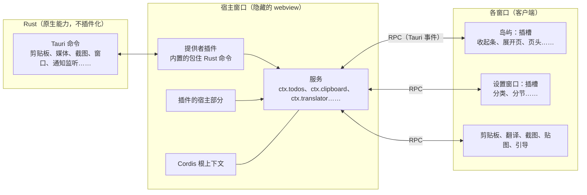

# 插件平台第 3 版：万物皆插件（方案）

> 状态：**方案，等用户批准后开工**（2026-11-14，会话「Issue处理优先级」）。外部做法见 [everything-is-a-plugin.md](../../research/everything-is-a-plugin.md)。
>
> 用户 2026-11-14 定的四件事：
> 1. 目标是 DeepSeek Harness 那样的「万物皆插件」，插件什么都能改。
> 2. **只有一种插件：完整插件**，和浮屿同权，不再有权限表。
> 3. 插件内核用 **Cordis，拷进仓库**（和 DeepSeek Harness 一样）。
> 4. 宿主用**隐藏的 webview**（下文「架构」）。**不兼容第 2 版的插件系统和已有插件**：这是一套全新的系统，旧插件要按新接口重写。

## 一句话

浮屿变成一棵插件树：内置的每个功能都是插件，每项能力都是一个可以被替换的服务，每块界面都是可以往里加、改、拿掉东西的插槽；第三方插件和内置插件用同一套接口，开发时改代码立刻生效。

## 架构



- **Rust 层**：继续负责一切要碰系统接口的事，以 Tauri 命令提供。它不插件化，但它提供的每项能力都由一个**提供者插件**接到服务上，所以从插件的角度看，Rust 只是某些服务的默认实现。
- **宿主窗口**：一个看不见、常驻的 Tauri webview，跑 Cordis 的根上下文。服务、提供者、插件的宿主部分都在这里，相当于 DeepSeek Harness 的 Node 宿主。它和界面窗口分开，界面窗口关掉或重载时，插件的状态和后台工作不受影响。
- **客户端**：每个界面窗口有一棵自己的 Cordis 上下文树，只放界面：往插槽注册 React 组件。客户端通过 RPC 调宿主的服务、订阅它的事件，相当于 DeepSeek Harness 的 Web 端。
- **为什么不用 Node**：带一个 Node 运行时要多几十 MB、多签一个程序，现有 Rust 和前端的通信也要重做。webview 已经是 JS 运行时，插件要的文件、进程这类能力由 Rust 包成服务提供（`ctx.fs`、`ctx.subprocess`）。

## 核心概念（照 Cordis）

| 概念 | 在浮屿里 |
|---|---|
| **插件** | `apply(ctx, config)` 函数或 `Service` 子类。内置功能、提供者、第三方插件都是 |
| **上下文** | 宿主一棵、每个窗口一棵。服务挂在 `ctx.<名字>` 上 |
| **服务** | 按名字找，不导入实现。另一个插件注册同名服务就替换了它 |
| **依赖** | `inject: ["todos", "notify"]`，依赖就绪才启动，加载顺序靠依赖决定 |
| **事件** | 类型化，五种分发方式：`emit`、`waterfall`（中间件链，可以改写、拦截）、`parallel`、`serial`、`bail` |
| **副作用** | 所有注册都经 `ctx.effect()` / `ctx.on()`，插件停用、重载时自动撤销。这是热重载和「随时开关」的基础 |
| **插槽** | 拥有那块界面的插件声明插槽，别的插件往里注册组件。插槽有类型、数量限制（单个或列表）、所属窗口；拥有者卸载时，往里注册的东西一起撤掉。插件之间不直接引用对方的组件 |
| **接缝** | 一项能力 = 接口定义 + 提供者 + 使用者。翻译引擎、歌词来源、日历来源、AI 代理接入、剪贴板动作、截图后动作、消息来源都做成接缝 |

## 内置功能怎么变成插件

`features/` 下的每个领域都变成一个插件包：

| 现在 | 第 3 版 |
|---|---|
| `windows/island/features.ts` 里写死的 `IslandFeatures` 类型和 `BUILTIN_PAGE_ORDER` 列表 | 去掉。页面、收起条项目、页头按钮都是插件往插槽里注册的；顺序和开关存在插件配置里 |
| `features/todos/` 里的组件、`api.ts`、`storage.ts` | `@fuyu/todos` 插件：宿主部分注册 `ctx.todos` 服务（包住 Rust 命令），客户端部分往岛屿的「展开页」「收起条」、设置窗口的「待办」分节注册界面 |
| 功能之间直接 import（例如消息页引用待办） | 只通过服务和事件互相调用 |
| 设置窗口写死的分类 | 设置窗口的分类和分节是插槽，每个插件带自己的设置界面 |

关掉一个内置插件，它的服务、界面、后台工作全部撤掉；装一个提供同名服务的插件，就把它换掉了。

## 插件配置

学 DeepSeek Harness 的「配置即组装」，但不做 profile 和组合包这些多层机制：

- 一份 `~/.fuyu/plugins.yml`，列出每个插件条目：`id`、来源（内置 / 已安装）、`enabled`、`config`。内置插件的默认值随程序提供，这份文件只记和默认值不同的部分。
- 设置窗口的「插件」页读写它，改了立刻生效：宿主的加载器重载受影响的条目，副作用自动撤销再注册。
- **安全模式**：启动时按住 Shift，或连续两次启动失败，就只加载内置插件，并在岛屿上提示，免得一个坏插件让浮屿打不开。

## 插件包

全新格式，不认第 2 版的 `fuyu-plugin.json`：

```json
{
  "name": "@someone/fuyu-weather",
  "version": "1.0.0",
  "fuyu": {
    "minAppVersion": "0.4.0",
    "platforms": ["windows", "macos"],
    "host": "dist/host.js",
    "client": { "island": "dist/island.js", "settings": "dist/settings.js" }
  }
}
```

- 宿主部分和各窗口的客户端部分分开打包，窗口只加载自己用得到的代码。
- 插件文件经自定义协议从 `~/.fuyu/plugins/<名字>/` 提供，不放进 Tauri 的前端资源里。
- 用 TypeScript 写，类型声明随 npm 包 `fuyu-plugin` 2.0 发布（和 1.x 不兼容）。

## 安装、市场和信任

完整插件和浮屿同权，能读你的待办、剪贴板、凭据，能读写文件、开进程。能做的保护是：

| 保护 | 做法 |
|---|---|
| **安装前说清楚** | 安装确认写明「这个插件拥有和浮屿一样的权限」，列出作者、发布者、是否作者签名、是否与源码一致 |
| **作者签名** | 沿用 [author-signing.md](author-signing.md)：首次信任后固定密钥，换了密钥的更新要用户确认 |
| **与源码一致** | 沿用 E25：市场只收 Release 附件和标签处源码一致的版本 |
| **撤销名单** | 沿用：恶意插件被撤销后，已装的自动停用或卸载 |
| **市场审核** | 第一次上架由维护者读源码 |
| **出错隔离** | 一个插件的 `apply` 或事件处理抛错，只停用这个插件，记日志、在插件页标出来；反复出错就自动关掉 |
| **安全模式** | 见上一节 |

不再有权限表、敏感权限确认、调用记录：完整插件绕得过它们，留着只会让人误以为有保护。

市场换新的索引格式（`fuyu-plugins` 仓库里另起一份 `index.v3.json`，签名链照旧）。旧索引冻结，只给还没升级的旧版岛屿读。

## 开发体验

- `npm create fuyu-plugin@latest` 生成 TypeScript 项目：宿主部分、岛屿页面、设置分节各一个示例。
- **开发模式**：岛屿从你的项目文件夹加载插件，改了代码自动重载这一个插件（Cordis 的热重载），不用重启岛屿。
- 文档全部重写：概念（插件、服务、插槽、事件）、每个服务和插槽的参考（从类型声明生成）、教程。

## 下线什么

| 第 2 版的东西 | 去向 |
|---|---|
| 进程插件：子进程监督、JSON-RPC、`plugins.json`、权限表、敏感权限确认 | 删除。插件要跑外部程序就用 `ctx.subprocess` |
| 模板（list、detail、form、status）和插件视图 | 删除。插件直接往插槽里放 React 组件；常用的列表、表单组件作为共享组件提供 |
| WebView2 自定义网页（`webviews.rs`、`win32/webview_page.rs`） | 删除。插件界面就是 React 组件；Mac 上的网页问题（G1.15）也随之消失 |
| 插件自己的窗口（E34，实验） | 用新接口重做成服务 `ctx.windows` |
| 内置插件（本地接口、cc-connect、SSH 隧道） | 变成第 3 版的内置插件 |
| 7 个官方插件（PowerShell） | 用新接口重写。只能在 Windows 上做的（系统监控）通过 `ctx.subprocess` 调 PowerShell，或者给它加 Rust 提供者 |
| 两个第三方插件（ShengLin1001） | 通知作者，帮他迁移 |
| npm 包 `fuyu-plugin` 1.x、PowerShell 模块 | 停止更新；2.0 是新接口 |

**对已安装用户的影响**：升级到第 3 版后，装过的第 2 版插件都不能用。升级说明和岛屿上的一次性提示要写清楚，并指向重写后的官方插件。

## 分阶段

每阶段一个任务、配 issue。第 5 阶段之前的接口都算实验接口，可以随时改（E30）。

| 阶段 | 内容 | 做完的标志 | 规模 |
|---|---|---|---|
| **1. 内核** | Cordis 及需要的官方插件（加载器、热重载）拷进 `vendor/`；宿主窗口；每个窗口的客户端上下文；宿主和客户端之间的 RPC；插槽注册表；`plugins.yml` 读写；出错隔离；安全模式 | 一个演示插件在宿主注册服务、往岛屿插槽放一个组件；在设置里关掉它，两样都撤掉；改代码热重载 | 1–2 周 |
| **2. 插槽化** | 岛屿（收起条、展开页、页头、通知）、设置窗口（分类、分节）、菜单改成插槽，去掉写死的列表。先搬迁、零行为变化，一块界面一个提交 | 现有功能照常，但都经插槽注册 | 2 周 |
| **3. 内置功能插件化** | Rust 能力的提供者插件；`features/` 每个领域变成插件；设置的插件页列出全部内置插件，能单独关掉。先拿计时器、翻译打样，再逐个迁 | 每个内置功能都能关掉，关掉后不留界面、不跑后台 | 4–6 周 |
| **4. 接缝** | 翻译引擎、歌词来源、日历来源、AI 代理接入、剪贴板动作、截图后动作、消息来源做成接缝 | 写一个插件就能换掉其中任何一个内置实现 | 2–3 周 |
| **5. 第三方插件** | 插件包格式、从 `~/.fuyu/plugins` 加载、开发模式、`fuyu-plugin` 2.0 和脚手架、新的市场索引、签名、源码核对、撤销、安装确认、文档重写；接口转正 | 外部作者从脚手架到上架走通一遍 | 3–4 周 |
| **6. 下线第 2 版** | 删掉进程插件、模板、WebView2 页面；重写 7 个官方插件；通知第三方作者；升级提示 | 仓库里没有第 2 版的代码 | 2–3 周 |

合计约 4–5 个月的会话工作量。第 1–4 阶段对用户基本没有可见变化，可以随常规版本发布；第 5、6 阶段一起作为一个大版本（例如 0.4.0）发布。

## 仓库规则要跟着改

- `vendor/` 是拷进来的第三方代码：不受行数上限和「不写注释」的约束，`check:size`、ESLint 都跳过它；在 `vendor/README.md` 记录上游版本、提交号和本地改动（学 DeepSeek Harness）。
- `src/AGENTS.md` 的目录地图和分层规则改成插件结构：功能只能通过服务和事件互相调用，不能直接 import。
- `docs/architecture/contracts.md`：第 2 版的插件契约（清单、JSON-RPC、`plugins.json`、相关命令）在第 6 阶段整体移除；第 3 版的服务名、插槽名、包格式、`plugins.yml` 登记为新契约。
- `docs/architecture/overview.md`、`platforms.md` 每阶段同步。

## 风险

- **安全**：完整插件和浮屿同权，签名和源码核对只能证明「是作者发的、和源码一致」，不能证明代码无害。DeepSeek Harness 在安全说明里也这样写。
- **性能**：多一个常驻的隐藏 webview，内存会涨，第 1 阶段做完就要量；每个窗口只加载自己的插件代码。
- **改动面**：第 2、3 阶段几乎碰到全部前端。按仓库规则搬迁和改写分开提交，每一步都能单独验证。
- **Cordis 4.0 还是 RC**：拷进仓库后版本固定，升级时手动同步、回归。
- **用户的旧插件全部失效**：要在升级说明里讲清楚，官方插件要在同一个版本里重写好。

## 第一步

你批准这份方案后：给「插件平台第 3 版」建一个 GitHub issue 和父任务，各阶段建子任务；然后开始第 1 阶段，先把 Cordis 拷进 `vendor/` 并跑通宿主窗口和一个演示插件。
