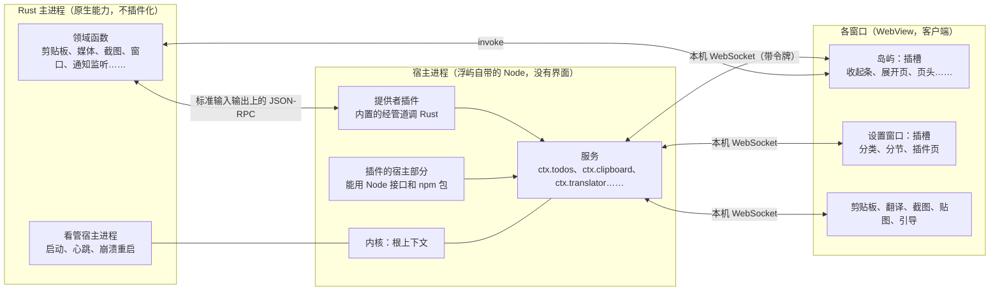

# 插件平台第 3 版：万物皆插件（方案）

> 状态：**方向和 15 项决定都已定，下一步是第 0 阶段（可行性验证）**（2026-11-14，会话「Issue处理优先级」）。2026-11-14 按三份联网调研全面审查过一遍；同日用户定了宿主改成独立的 Node 进程（[框架对比](../../research/desktop-frameworks.md)里的路线 1b）。改动见最后一节「审查记录」。

浮屿变成一棵插件树：内置的每个功能都是插件，每项能力都是一个可以被替换的服务，每块界面都是可以往里加、改、拿掉东西的插槽。第三方插件和内置插件用同一套接口。

## 目录

1. [怎么读这份文档](#怎么读这份文档)
2. [名词](#名词)
3. [已经定下的](#已经定下的)
4. [实现时再定的细则](#实现时再定的细则)
5. [架构](#架构)
6. [核心概念](#核心概念)
7. [宿主进程](#宿主进程)
8. [宿主和窗口怎么通信](#宿主和窗口怎么通信)
9. [插件代码怎么加载](#插件代码怎么加载)
10. [服务的替换和冲突](#服务的替换和冲突)
11. [插槽的规则](#插槽的规则)
12. [接口分层和版本](#接口分层和版本)
13. [启动和性能](#启动和性能)
14. [资源监控和出错处理](#资源监控和出错处理)
15. [内存](#内存)
16. [内置功能怎么变成插件](#内置功能怎么变成插件)
17. [插件配置](#插件配置)
18. [插件包](#插件包)
19. [安装、市场和信任](#安装市场和信任)
20. [开发体验](#开发体验)
21. [从 rutis 借鉴的](#从-rutis-借鉴的)
22. [基座做成开源项目](#基座做成开源项目)
23. [下线什么](#下线什么)
24. [分阶段](#分阶段)
25. [仓库规则要跟着改](#仓库规则要跟着改)
26. [风险](#风险)
27. [审查记录](#审查记录)

## 怎么读这份文档

- 只想知道要做什么、要多久：读「已经定下的」「分阶段」。
- 怎么开工、要准备什么、开不开分支、每个阶段怎么走：读 [v3-workflow.md](v3-workflow.md)。
- 想知道安全上靠什么：读「安装、市场和信任」，尤其是其中「每项保护管什么、不管什么」。
- 插件作者关心的：读「核心概念」「插件包」「开发体验」。
- 依据都在四份调研里：
  - [DeepSeek Harness 和 Cordis](../../research/everything-is-a-plugin.md)
  - [同类插件架构](../../research/plugin-architectures.md)
  - [同权插件的安全](../../research/plugin-security.md)
  - [技术可行性](../../research/plugin-host-feasibility.md)
  - [MyGo 和 Tauri 的对比](../../research/mygo-vs-tauri.md)（结论：第 3 版继续用 Tauri）
  - [哪些桌面框架能做「万物皆插件」](../../research/desktop-frameworks.md)（结论：不换框架；建议第 0 阶段对照一下「宿主放独立的 Node / Bun 进程」）
  - [有没有人已经做了这个基座](../../research/tauri-plugin-base-prior-art.md)（结论：没有完整的；内核那一块 `arcships/rutis` 做得很深，建议第 0 阶段评估它）
  - [内核用 Cordis 还是 rutis](../../research/cordis-vs-rutis.md)（结论：维持用 Cordis；第 3 阶段开始前再看要不要让 rutis 接管「Rust 和宿主之间」那一段）

## 名词

| 名词 | 意思 |
|---|---|
| 完整插件 | 第 3 版唯一的一种插件：跑在浮屿里，和浮屿同权，没有权限表 |
| 内核 | 管插件加载、服务、事件、插槽的那一层，基于 Cordis |
| Cordis | 一个开源的插件框架（MIT），Koishi 和 DeepSeek Harness 都建在它上面 |
| 宿主 | 浮屿自带的一个 Node 进程，没有界面，插件的后台逻辑在里面运行 |
| 客户端 | 每个看得见的窗口里负责界面的那部分 |
| 服务 | 一项能力，挂在 `ctx.<名字>` 上，例如 `ctx.todos`。插件按名字用它，不关心是谁实现的 |
| 提供者 | 实现某个服务的插件。内置的提供者多数是包住 Rust 命令 |
| 插槽 | 界面上一块可以往里放东西的位置，例如「岛屿的展开页」「设置的分节」 |
| 接缝 | 「接口定义 + 提供者 + 使用者」三样合起来的一项可替换能力，例如翻译引擎 |
| 副作用 | 插件做的每一次注册。都能撤销，所以插件能随时开关 |
| 实验接口 | 还没承诺不变的接口，只有内置插件和开发模式能用（E30） |

## 已经定下的

| # | 决定 | 理由 |
|---|---|---|
| 1 | 目标是 DeepSeek Harness 那样的「万物皆插件」，插件什么都能改 | 用户定 |
| 2 | **只有一种插件：完整插件**，和浮屿同权，不再有权限表 | 用户定 |
| 3 | 内核用 **Cordis，拷进仓库的 `vendor/`** | 用户定 |
| 4 | Rust 层不插件化；宿主是**浮屿自带的一个独立的 Node 进程**（原来定的是隐藏的 webview 窗口，2026-11-14 改） | 用户定。Cordis 的加载器和热重载是照着 Node 写的；隐藏的 WebView 会被系统降速；DeepSeek Harness 桌面版就是用一个 Node 子进程跑 Cordis 宿主 |
| 5 | **不兼容第 2 版**的插件系统和已有插件 | 用户定 |
| 6 | 往窗口发消息**不用 Tauri 的 `emit`，也不用 `Channel`** | 两者有同一个收不回的内存泄漏 |
| 7 | 第三方插件放在作者自己的仓库，经官方市场 `TixXin/fuyu-plugins` 上架 | 沿用现在的做法；插件同权，更需要一个把关的市场 |
| 8 | **每个版本都审**，不只审首次上架 | 用户定。查到的事故大多是首版干净、靠更新下毒，被调查的市场里已经没有只审首次的 |
| 9 | **更新冷静期 3 天**：新版本进市场 3 天后才自动安装；可以手动立刻更新；安全修复可以标成立即推送 | 用户定。成本最低的一项保护，给别人留出发现问题的时间 |
| 10 | **市场构建**：市场 CI 从作者提交的那个提交号的源码构建，用户装的是市场构建的包；作者签的是提交号 | 用户定。审过的源码和装上的包天然是同一份；跨系统的构建做不到逐字节相同，比对会误报 |
| 11 | **先做第 0 阶段**（一周的可行性验证）再做内核 | 用户定。整套方案还没有一行代码跑过，关键假设都是从文档和源码推出来的 |
| 12 | 宿主**默认用 Node**；第 0 阶段把 Node 和 Bun 都测一遍，Bun 只要小改就能跑而且内存明显更低的话再换 | 用户定。Cordis 的加载器依赖 Node 的内部接口（读源码推断，没实测），DeepSeek Harness 用的也是 Node |
| 13 | 内核不依赖 rutis，但**把它想清楚了的设计搬过来**（见「从 rutis 借鉴的」） | 用户定。它的风险（太新、接口在变）不用我们承担，它在跨进程规则和质量保证上的做法直接受益。对比见 [cordis-vs-rutis.md](../../research/cordis-vs-rutis.md) |
| 14 | 插件的安装包后缀是 **`.fuyu`**（内容是 zip），双击由浮屿打开安装确认 | 用户定。一眼看得出是浮屿插件，不用自己找安装入口；VS Code 的 `.vsix` 也是换了后缀的 zip |
| 15 | **基座做成独立的开源项目**，给别的 Tauri 应用也能用。从第一天起就写成不依赖浮屿业务的独立包，**先在浮屿里做出来，跑过内核和两三个内置功能之后再公开发布** | 用户定。GitHub 上没有人完整做过（[调研](../../research/tauri-plugin-base-prior-art.md)）；先发框架再找用法容易设计错，接口变得太快别人会放弃（deepseek-harness-hub 就是因此归档的） |

## 实现时再定的细则

决定 8、9、10 定的是方向，它们在第 5 阶段才实现，细则到时按实际情况定：

| 决定 | 到时要定的 | 现在的想法 |
|---|---|---|
| 8 逐版审核 | 哪些更新能快速通过 | CI 自动贴出两个版本的源码差异，标出有没有新增联网、运行程序、读写文件、新依赖；没有这些变化的（改文案、修 bug）扫一眼就过，有的才认真看。现在第三方插件只有 2 个，负担很小；插件多到审不过来时，再改成只对热门的和有敏感变化的做人工审核 |
| 9 冷静期 | 天数 | 先按 3 天。被发现的投毒多数在几小时到几天内曝光；设 7 天更稳，但用户等得更久 |
| 10 市场构建 | 有特殊构建需求的插件怎么办；以后要不要支持插件自带可执行程序 | 先只支持统一的 `fuyu-plugin build`。市场的 CI 要跑别人的代码，按「在跑恶意代码」来设计（见「谁来构建」） |
| 12 Node 或 Bun | 看第 0 阶段的数据 | 见决定 12 |
| 14 `.fuyu` 安装包 | 不走市场的手动安装默认开还是关 | 倾向默认关、在设置里打开一次（Obsidian 对社区插件就是这样）。见「不走市场的安装」 |
| 15 开源基座 | 项目的名字、仓库放哪、许可证、什么时候公开 | 名字和仓库到公开前再定；许可证倾向 MIT（和 Cordis、rutis、Tauri 一致）；公开的条件见「基座做成开源项目」 |

**要心里有数的一件事**：这套系统做完后，浮屿的安全主要靠维护者审核插件，同权的插件没有技术上的兜底。插件生态做大以后，审核的人力会是真实的负担。这是选「只有完整插件」（决定 2）时就接受了的代价。

## 架构



- **Rust 主进程**：继续负责一切要碰系统接口的事，并负责启动和看管宿主进程。它不插件化，但每项能力都由一个提供者插件接到服务上，所以插件可以把它换掉。
- **宿主进程**：浮屿自带的一个 Node，作为子进程常驻，没有界面，跑内核的根上下文。服务、提供者、插件的后台部分都在这里。它不是 WebView，所以没有隐藏窗口被降速的问题；窗口关掉或重载时，插件的状态和后台工作不受影响。
- **客户端**：每个界面窗口（WebView）有一棵自己的上下文树，只放界面：往插槽注册 React 组件。组件过不了进程的边界，所以每个插件分两部分：宿主部分（逻辑，跑在 Node 里）和各窗口的界面部分（跑在 WebView 里），两边只传能序列化的数据。
- **插件的后台部分能直接用 Node 的接口和 npm 包**：文件、进程、网络不用浮屿逐个包成服务。浮屿自己的系统能力（剪贴板、媒体、截图……）仍然经服务提供。
- 这个结构和 DeepSeek Harness 桌面版一样（它是 Electron 外壳 + 一个按 Node 方式运行的子进程跑 Cordis 宿主 + 网页界面），只是外壳换成 Tauri。

## 核心概念

| 概念 | 在浮屿里 |
|---|---|
| **插件** | `apply(ctx, config)` 函数。内置功能、提供者、第三方插件都是 |
| **上下文** | 宿主进程里一棵、每个窗口一棵。服务挂在 `ctx.<名字>` 上 |
| **服务** | 按名字找，不导入实现。接口的类型定义放在中立的类型包里，实现它的插件和使用它的插件都只依赖类型 |
| **依赖** | 清单里声明要哪些服务；依赖就绪才启动，加载顺序靠依赖决定，不手工排 |
| **事件** | 类型化，五种分发方式：通知、`waterfall`（中间件链，可以改写、拦截）、`parallel`、`serial`、`bail` |
| **副作用** | 所有注册都经内核提供的方法，插件停用、重载时自动撤销。定时器、事件监听、样式也要用内核提供的受管版本，否则撤不掉 |
| **插槽** | 见「插槽的规则」 |
| **接缝** | 翻译引擎、歌词来源、日历来源、AI 代理接入、剪贴板动作、截图后动作、消息来源都做成接缝 |

**插件不直接用 Cordis。** Cordis 4.0 还是 RC，README 写明接口不稳定。插件 `import` 的是 `fuyu-plugin` 包，它把 Cordis 包一层再导出；Cordis 有不兼容的变化时，由这一层消化，不传给第三方插件。DeepSeek Harness 也是把 Cordis 拷进仓库、换成自己的包名。

## 宿主进程

| 事项 | 做法 |
|---|---|
| **用什么** | Node 的官方程序，作为 Tauri 的附带程序（sidecar）随安装包发布，跟着浮屿一起更新。Bun 是备选（决定 12） |
| **怎么启动** | Rust 在启动时拉起它，放进作业对象（Windows）或进程组（macOS），浮屿退出或崩溃时它一定跟着结束。第 2 版看管插件进程的那套代码（`plugin_host/runtime`、`win32/job`、`macos/job`）改用在这里 |
| **启动参数** | Cordis 的加载器要拿 Node 内部的模块加载器：加 `--expose-internals`（DeepSeek Harness 的做法）。另加 `--disallow-code-generation-from-strings`，宿主里不能用 `eval` 和 `new Function` |
| **卡死和崩溃** | Rust 定时发心跳；没回应或进程退出就重启宿主，插件从保存的状态恢复。所以**插件的状态不能只放在内存里** |
| **和 Rust 通信** | 标准输入输出上的 JSON-RPC。这条路不经过 WebView，没有 `emit` 的泄漏 |
| **Mac 上的签名** | 多一个要签名、公证的程序；Node 的 JS 引擎要即时编译，加固运行时下需要对应的授权（第 0 阶段确认） |
| **调试** | 开发模式下带 `--inspect` 启动，可以用 Chrome 的开发者工具连上宿主，看断点、CPU 和堆 |
| **不做的** | 不在用户电脑上跑 `npm install`；插件的依赖在打包时打进它自己的文件里。插件包里暂不支持 Node 的原生扩展（`.node`），理由和「暂不支持带可执行程序」一样：没法从源码审核 |

要在第 0 阶段确认的：空载和加载内核后的内存、安装包增加多少、冷启动多花多少时间；睡眠唤醒和所有窗口都隐藏时，宿主的定时器是否正常（它是普通进程，预期正常，但 macOS 会对后台进程做节能调度）。

## 宿主和窗口怎么通信

一共三条通道：

| 两端 | 通道 | 说明 |
|---|---|---|
| **窗口 ↔ 宿主** | **本机 WebSocket** | 宿主监听 `127.0.0.1` 上系统分配的端口，只接受带令牌的连接；令牌每次启动随机生成，窗口用 `invoke` 向 Rust 要。DeepSeek Harness 桌面版也是「本地页面连到带认证的宿主」。消息直接在窗口和宿主之间走，不经过 Rust |
| **宿主 ↔ Rust** | 标准输入输出上的 JSON-RPC | 宿主里的提供者插件调 Rust 的能力；Rust 把系统事件（媒体变化、通知、热键）推给宿主 |
| **窗口 ↔ Rust** | `invoke` | 窗口自己要的系统操作（拖动、调整大小、穿透）照旧 |

- **不用 `emit` 和 `Channel` 往窗口发消息**：它们把消息拼进一段脚本交给 WebView 执行，每条内容不同的消息留下约 0.75 KB 收不回的内存（tauri#12724、wry#1489、WebView2Feedback#5780 都还开着）。插件相关的消息全走 WebSocket；现有代码里的 `emit` 由任务 [D49](/docs/tasks/D/D49.md) 处理，可以改成「Rust → 宿主 → WebSocket → 窗口」。
- **后备**：macOS 上页面的地址是 `tauri://localhost`，WKWebView 可能把连 `ws://127.0.0.1` 当成不安全的混合内容拦掉（第 0 阶段实测）。不通的话改成经 Rust 中转：窗口用 `invoke` 发、用 `invoke` 长轮询收（`invoke` 的回应走 `ipc://` 的 fetch，不执行脚本）。
- 通信协议自带握手、序号和快照：窗口打开、重载，或宿主重启后，先取一份当前状态，再接增量。发给窗口的事件在它准备好之前先存着（MyGo 的做法）。
- 应用的 CSP 要放行 `ipc:` 和这个本机 WebSocket 地址。
- 本机端口的风险：电脑上别的程序能连这个端口，所以必须验令牌，只监听回环地址，令牌不写进文件。

## 插件代码怎么加载

插件的两部分分别加载：

**宿主部分（Node 里）**
- 用 Cordis 自带的加载器，从 `~/.fuyu/plugins/<名字>/` 按文件路径加载。Cordis 的热重载也能直接用（开发模式）。
- 重载一个插件会留下旧模块（Node 的模块缓存同样删不干净）；正式使用时，插件更新后重启宿主进程来回收，重启由 Rust 看管，用户感觉不到。

**界面部分（各窗口的 WebView 里）**
- 文件经一个自定义协议提供，窗口用 `import()` 加载。这个协议和页面不同源，所以要自己回 CORS 头和正确的 MIME，文件不存在时回 404。
- **共用一份 React，不靠 import map**（macOS 15.0–15.3 自带的 WebKit 不支持动态 import map）。做法照 Koishi：浮屿提供几个固定地址的转接模块（`react`、`react/jsx-runtime`、`react-dom`、`fuyu-plugin`），`fuyu-plugin build` 把插件里对这些包的引用改写成转接模块的地址。
- 样式由打包器打进 JS，经内核的受管方法插入，插件停用时一起撤掉。
- 窗口里的这部分加载器要自己写（Cordis 的加载器只能在 Node 里跑），参考 Koishi 控制台的做法；它只管界面，比较小。
- 重载同样只能换地址再加载；重载窗口时回收。

每个插件打成自己独立的文件，不和别的插件合并：出错和性能分析时，靠文件地址就能分清是谁。

## 服务的替换和冲突

Cordis 里同一个名字的服务不能同时有两个提供者，第二个注册会直接报错。所以「替换」要设计成一个明确的动作：

- 清单里的 `provides` 和 `replaces` 在**启用时**就检查：要启用的插件和已启用的插件提供同一个服务时，提示用户选一个，另一个的那项服务被停用；不等运行时报错。
- 提供者被换掉时，依赖它的插件会被卸载再加载。所以依赖方的状态要能恢复。
- 内置的提供者和第三方的地位一样：换掉内置的翻译，就是停用内置翻译插件、启用另一个。
- **缺依赖不会报错，只会一直等**（Cordis 的行为）。内置功能都是插件以后，这表现为「某个功能悄悄没了」。所以插件页要有**状态视图**：每个插件是运行中、等待（在等哪个服务）、出错还是已停用；内置插件启动后一段时间还在等待，就在岛屿上报出来。

## 插槽的规则

每个插槽的规则写在它的定义里，照 DeepSeek Harness 的类型化插槽表：

| 规则 | 内容 |
|---|---|
| **数量** | 单个（只能有一个）或列表。岛屿很小，列表型插槽要写明最多显示几个、超出的去哪（例如收进「更多」） |
| **顺序** | 每项有 `order`；用户可以在设置里调，调过的以用户的为准 |
| **替换** | 用同一个 `id` 注册就是替换那一项，包括内置的。替换是显式的，插件页能列出「谁替换了什么」 |
| **每个插件的上限** | 一个插件在同一个插槽里最多放几项，防止占满 |
| **名字带版本** | 例如 `island.page/v1`。规则要做不兼容的修改时出新名字，旧的保留一段时间 |
| **出错隔离** | 每一项单独包一层错误边界和加载占位；出错时只有这一项显示错误提示 |
| **没声明的不生效** | 往不存在的插槽注册，插件启动时就失败并提示 |

## 接口分层和版本

| 层 | 谁能用 | 承诺 |
|---|---|---|
| **稳定接口** | 所有插件 | 转正后只增不改；要废弃先标记并给出替代，过几个版本再删，每次附迁移说明 |
| **实验接口** | 内置插件；开发模式下的插件 | 随时可以改。要在清单的 `experimental` 里逐个按名字写明；写了的不能上架（E30） |
| **内部** | 只有内核 | 不对外。插件碰了内部的东西，审核不通过 |

不分层的话，内置插件用过的每个内部接口都会被第三方依赖上，变成事实上的公开接口（VS Code 就是靠这种分层让内置扩展先用未稳定的接口）。

版本：
- 清单用 `engines.fuyu` 写兼容的浮屿版本范围（DeepSeek Harness 先用了别的写法，后来不得不做一次不兼容的迁移）。
- 市场索引保留每个版本各自的范围，旧版浮屿会拿到「它能用的最新版本」，不是简单地显示不兼容。

## 启动和性能

Cordis 没有「用到时才加载」：挂上去的插件依赖一就绪就运行。内置功能全是插件以后，默认就是所有插件在启动时全跑，这正是 Obsidian 最大的痛点。对策：

- **`apply` 只做注册**，重活放到第一次用到或空闲时。内核给每个插件的 `apply` 计时，记下来，超过阈值在插件页提示。
- **清单里静态声明**命令、快捷键、设置项、用到的插槽：不运行插件也能把它们列出来；界面部分的代码在窗口打开、页面第一次显示时才 `import()`。
- 启动顺序：先起内核和岛屿必需的内置插件，岛屿能用之后再起其余的。
- 冷启动时间是第 1 阶段起每个阶段的验收项，不能比现在慢。

## 资源监控和出错处理

同一个进程里没有真正的隔离（Figma 在同一个 JS 环境里做的沙箱被攻破后改成了独立虚拟机；Obsidian 明说无法可靠地限制插件）。能做的是找到是谁、把损失止住：

| 看什么 | 能做到什么 |
|---|---|
| **每个插件的 CPU** | **近似**：内核给经它登记的回调计时。`await` 之后的部分、插件自己建的定时器会漏算，死循环量不出来。所以要求插件用内核的受管定时器和监听器。宿主是 Node，开发模式下可以直接用它的 CPU 分析按文件地址归到插件 |
| **每个插件的资源数** | 能：定时器、监听器、注册项各有多少 |
| **宿主的总内存和 CPU** | 能，精确：宿主是一个独立的进程，Rust 直接读它的内存和 CPU 时间，插件页显示总数和走势 |
| **每个插件的内存** | 不能：同一个 JS 堆里分不出来。开发模式可以拍堆快照给作者排查 |

出错时：
- 界面：每个插槽项的错误边界只管渲染时的错；事件处理、异步代码里的错由全局监听按文件地址归到插件。
- 一个插件反复出错或长期占用过高：自动停用，在插件页说明原因。**这是稳定性功能，不是安全措施**：恶意插件不报错也不占 CPU。
- 宿主卡死或崩溃：Rust 发现心跳没回应或进程退出，就重启宿主进程；窗口重连后取一份当前状态。界面窗口本身不受影响。
- **安全模式分两档**：只停第三方插件（内置功能照常），或只留最小的一组内置插件。启动时按住 Shift、加启动参数、或连续两次启动失败时进入。
- **二分排查**：自动每次停用一半第三方插件，帮用户找出是哪个插件造成的问题（VS Code 的 extension bisect）。

## 内存

浮屿收起闲置时私有内存约 330 MB，Rust 主进程只占 16 MB，其余都在 WebView2（[idle-usage.md](../../investigations/idle-usage.md)）。

| 变化 | 影响 | 依据 |
|---|---|---|
| 多一个 Node 宿主进程 | **待测**。空的 Node 进程约 12 MB（Raycast 的测量）；加载内核和内置提供者之后是多少，第 0 阶段量 | Raycast 2.0 的技术说明；它的 Node 后端带着数据库和全部扩展时是 150–200 MB，那是上限的参考 |
| 不再有插件子进程 | 每个插件约 −63 MB | 本机 4 个 PowerShell 示例插件各约 63 MB |
| 不再有 WebView2 自定义网页 | 打开插件网页时约 −25 MB | P8 实测 |
| 插件代码进了宿主和窗口 | 每个插件几 MB | 估计，第 1 阶段量 |
| 插件重载留下旧模块 | 每次重载涨一点，重启宿主进程或重载窗口时回收 | 见「插件代码怎么加载」 |

- 没装第三方插件时会比现在多出一个 Node 进程的内存，目标是**不超过 40 MB**（第 1 阶段的验收线）。
- 装了插件以后，每个插件从「一个约 63 MB 的独立进程」变成「宿主里的几 MB」，装得越多省得越多。
- 安装包会变大：多一个 Node 程序，具体多少第 0 阶段量。
- 比起隐藏 WebView 当宿主（约 +25 MB），Node 进程可能多占一些，换来的是不被降速、Cordis 的加载器原样可用、插件能用 npm。第 0 阶段会顺手量一下隐藏 WebView 的数字作对照。

## 内置功能怎么变成插件

`features/` 下的每个领域都变成一个插件：

| 现在 | 第 3 版 |
|---|---|
| `windows/island/features.ts` 里写死的 `IslandFeatures` 类型和 `BUILTIN_PAGE_ORDER` 列表 | 去掉。页面、收起条项目、页头按钮都是插件往插槽里注册的 |
| `features/todos/` 里的组件、`api.ts`、`storage.ts` | 待办插件：宿主部分注册 `ctx.todos` 服务（包住 Rust 命令），界面部分往岛屿和设置窗口的插槽注册 |
| 功能之间直接 import | 只通过服务和事件互相调用 |
| 设置窗口写死的分类 | 设置窗口的分类和分节是插槽 |

**Rust 能力多一个入口**：现在 325 个 Tauri 命令只能从窗口用 `invoke` 调。宿主进程在 WebView 之外，要经管道调 Rust，所以每个领域的函数要多接一个入口（窗口的 `invoke` 和宿主的 JSON-RPC 调同一套领域函数）。仓库规则本来就要求命令函数保持薄，这一步主要是接线，在第 3 阶段随每个功能一起做。接线不手写：学 rutis 给 Rust 函数加标记、自动生成入口和 TypeScript 类型（见「从 rutis 借鉴的」）。

**边界**：插件的界面部分跑在应用的页面里，调得到 Tauri 命令；宿主部分跑在 Node 里，有用户的全部权限。所以：

- 命令要按「调用方可能有问题」来写：参数都校验，不会因为乱传参数破坏数据。
- **密码、令牌这类数据不回到 JS**：只在 Rust 一侧使用，没有任何命令把明文返回给前端或宿主。这是同权模型下少数真正有效的减损办法，因为它不依赖分清是谁在调用。
- 按窗口收紧 Tauri 的 capability：每个窗口只能调它用得到的命令。

## 插件配置

- 一份 `~/.fuyu/plugins.yml`，列出每个插件条目：`id`、来源（内置 / 已安装）、`enabled`、`config`。内置插件的默认值随程序提供，这份文件只记和默认值不同的部分。
- 设置窗口的「插件」页读写它，改了立刻生效：加载器重载受影响的条目，副作用自动撤销再注册。
- 用户调过的插槽顺序、服务冲突时的选择也存在这里。

## 插件包

全新格式，不认第 2 版的 `fuyu-plugin.json`。清单就是 `package.json`，浮屿的字段放在 `fuyu` 下。下面是**全部字段**（对照 VS Code、Obsidian、Raycast、Koishi、DeepSeek Harness、Joplin、Grafana、JupyterLab、Zed 的清单逐项核对过，对照表见[同类插件架构](../../research/plugin-architectures.md)）：

```json
{
  "name": "@someone/fuyu-weather",
  "version": "1.2.0",
  "type": "module",
  "description": "Weather on the island",
  "author": { "name": "someone", "url": "https://example.com" },
  "license": "MIT",
  "homepage": "https://example.com/weather",
  "repository": "github:someone/fuyu-weather",
  "bugs": "https://github.com/someone/fuyu-weather/issues",
  "funding": "https://github.com/sponsors/someone",
  "keywords": ["weather", "forecast"],
  "files": ["dist", "assets"],
  "engines": { "fuyu": ">=0.4.0" },
  "fuyu": {
    "manifest": 1,
    "displayName": { "zh-CN": "天气", "en": "Weather" },
    "description": { "zh-CN": "岛上看天气和降雨提醒", "en": "Weather and rain alerts on the island" },
    "icon": "assets/icon.png",
    "categories": ["information"],
    "screenshots": [
      { "path": "assets/forecast.png", "caption": { "zh-CN": "预报页", "en": "Forecast page" } }
    ],
    "preview": false,
    "platforms": ["windows", "macos"],
    "host": "dist/host.js",
    "client": { "island": "dist/island.js", "settings": "dist/settings.js" },
    "inject": { "required": ["notify", "http"], "optional": ["calendar"] },
    "requires": { "@fuyu/location": "^1.0.0" },
    "provides": ["weather"],
    "replaces": [],
    "slots": ["island.page/v1", "island.bar/v1", "settings.section/v1"],
    "commands": [
      { "id": "weather.refresh", "title": { "zh-CN": "刷新天气", "en": "Refresh weather" }, "keybinding": "Ctrl+Alt+W" }
    ],
    "network": ["api.open-meteo.com"],
    "config": "dist/config.schema.json",
    "experimental": [],
    "nodeApis": ["fs", "http"],
    "builtWith": "2.0.0"
  }
}
```

**npm 的标准字段**

| 字段 | 必填 | 用途 |
|---|---|---|
| `name` | 是 | 插件的唯一标识，也是安装目录和数据目录的名字。`@fuyu/*` 留给官方；名字去掉标点后不能和已有插件或官方名字相同 |
| `version` | 是 | semver。带预发布标记的算预发布版 |
| `type` | 是 | 固定 `"module"`：入口都是 ES 模块，默认导出插件 |
| `engines.fuyu` | 是 | 兼容的浮屿版本范围；不满足的不能安装，旧版浮屿会拿到它能用的最新版本 |
| `description`、`author`、`license`、`homepage`、`repository`、`bugs`、`funding`、`keywords` | `license`、`repository` 必填 | 市场详情页：作者、许可证、主页、源码仓库、报告问题、赞助作者；`keywords` 用于搜索 |
| `files` | 否 | 哪些文件进包；`package.json`、README、CHANGELOG、LICENSE 总会带上 |

**`fuyu` 下的字段**

| 字段 | 必填 | 用途 |
|---|---|---|
| `manifest` | 是 | 清单格式的版本，现在是 `1` |
| `displayName`、`description` | 是 | 名字和一句话介绍，按语言写；现在要 `zh-CN` 和 `en` |
| `icon` | 是 | PNG 或 SVG，方形，至少 256 像素，深色和浅色的岛上都要看得清 |
| `categories` | 是 | 市场分类，从固定的列表里选 |
| `screenshots` | 否 | 详情页的截图，最多 6 张，带按语言写的说明 |
| `preview` | 否 | `true` 表示还不稳定，市场上标「预览」 |
| `platforms` | 否 | 能用的系统，不写就是都能用 |
| `host` | 否 | 宿主部分的入口，跑在 Node 里，可以用 Node 的接口。只加界面的插件可以没有 |
| `client` | 否 | 各窗口的界面入口，键是窗口名；窗口只加载自己的那份 |
| `inject` | 否 | 用到哪些服务：`required` 缺了就不启动，`optional` 有就用。市场据此显示这个插件会用到浮屿的什么（剪贴板、待办、媒体……） |
| `requires` | 否 | 依赖的其他插件和版本范围；安装时一起装上 |
| `provides`、`replaces` | 否 | 提供哪些服务、替换哪些内置服务。启用时用来检查冲突；市场和安装确认会写明「这个插件会替换内置的翻译」 |
| `slots` | 否 | 往哪些插槽放界面 |
| `commands` | 否 | 命令和默认快捷键；不运行插件也能列出来、检查冲突 |
| `network` | 否 | 要连的域名。审核时看，安装确认里显示；页面的 CSP 只放行这些域名，内核提供的 `ctx.http` 也只放行这些。**它不是沙箱**：宿主部分能直接用 Node 的网络接口，Node 的权限开关是整个进程的、分不到单个插件，所以这里靠的是打包时的扫描和审核。它的作用是让「悄悄把数据发到陌生服务器」必须先在审核里露面 |
| `config` | 否 | 设置项的 schema（含默认值）：设置窗口自动生成表单 |
| `experimental` | 否 | 用到的实验接口，逐个按名字写。写了的只能在开发模式加载或作为内置插件，市场拒收 |
| `nodeApis` | 自动 | 打包时扫描出来的、宿主部分用到的 Node 内置模块（`fs`、`child_process`、`net`、`http`……）。市场和安装确认据此显示「会读写文件」「会运行程序」「会联网」；作者不能自己填 |
| `builtWith` | 自动 | 打包时写入的 SDK 版本 |

**声明和实际要对得上。** `inject`、`provides`、`replaces`、`slots`、`commands`、`network`、`nodeApis` 在三处核对：`fuyu-plugin build` 打包时对照代码；市场审核时；加载时内核发现实际做了没声明的事，就在插件页标「和声明不符」。不核对的话，这些声明会像 Koishi 的那样和代码慢慢对不上。

**有意不放进清单的**

| 东西 | 在哪 |
|---|---|
| 发布者、签名公钥、已验证的域名 | 市场的提交文件：要由市场核实，不能由包自己说了算 |
| 是否作者签名、审核过的版本、点赞、下载地址和哈希 | 市场索引，由 CI 生成 |
| 权限 | 没有：完整插件和浮屿同权 |
| 什么时候启动 | 不用声明：见「启动和性能」 |
| 音效、主题这类不带代码的内容 | 主题继续走单独的主题市场；音效包是只有 `host` 的插件 |
| 按系统带不同的可执行程序 | 暂不支持，以后要支持时加一个可选字段 |

**怎么保证以后不用推倒重来**

- 浮屿和市场忽略不认识的字段，`fuyu-plugin validate` 对它们给告警。以后加字段只会是新增可选字段。
- 只有不兼容的变化才升 `manifest`，那时浮屿同时认新旧两版。
- 第 5 阶段转正前都算实验，还可能按实现时的发现微调；转正后只增不改。

### 发布包是什么文件

一个后缀是 `.fuyu` 的文件：`<名字>-<版本>.fuyu`，内容就是 zip（决定 14）。市场构建出来的、作者自己用 `fuyu-plugin pack` 打出来的都是这个格式。里面是：

```text
package.json          清单
dist/host.js          宿主部分（单个文件，跑在 Node 里，npm 依赖都打进去）
dist/island.js        各窗口的界面部分（React 和 fuyu-plugin 由浮屿提供，不打进去）
dist/settings.js
dist/config.schema.json
assets/               图标、截图、插件自己的图片和音效
README.md             市场详情页的说明（可以有 README.zh-CN.md）
CHANGELOG.md          市场详情页的版本历史
LICENSE
```

- 不带 `node_modules`：依赖在打包时打进 `dist/`，不在用户电脑上跑 `npm install`。不能带 Node 的原生扩展（`.node`）和可执行程序。
- 代码不能混淆，不能在运行时再去下载代码来执行，不能自己更新自己（见「市场规则」）。
- 上限沿用 20 MB。
- 浮屿在系统里登记 `.fuyu` 这个后缀（Windows 的文件关联、macOS 的文档类型）：双击就打开安装确认。这个后缀是对外契约，登记进 [contracts.md](../contracts.md)。

### 三种装法

| 装法 | 作者要做什么 | 给谁用 |
|---|---|---|
| **从市场装** | 不用打包：打标签、把提交号交给市场，市场从源码构建出 `.fuyu` | 所有用户，默认的方式 |
| **手动装一个 `.fuyu` 文件** | `fuyu-plugin pack` 打出 `.fuyu`，自己发给别人 | 内部工具、还没上架的插件、不想上架的插件 |
| **从文件夹加载** | 不用打包 | 开发模式 |

### 谁来构建

第 3 版的插件都要构建，第 2 版「有构建步骤的跳过核对」那条不能再用。走「市场构建」（决定 10）：

- 作者在自己的仓库打标签，向市场提交这个版本的**提交号**（不是标签名：标签可以被移动），并用自己的密钥给提交号签名。
- 市场 CI 取这个提交的源码，用统一的 `fuyu-plugin build` 构建、打包，把这个包发布出去。用户装的是市场构建的包，所以「看过的源码」和「装上的代码」天然是同一份（Zed、F-Droid、Raycast 都是这样）。
- **把这个 CI 任务当作在跑恶意代码来设计**：没有任何密钥、令牌只读、不用共享缓存、依赖按锁文件安装且不运行安装脚本、打包配置由市场提供而不是用作者仓库里的；签名在另一个任务里做，只接收构建任务给出的文件哈希（E26 已经把构建和签名分开）。
- 不选「作者上传 zip、市场重建后比对」，是因为它要求不同电脑上的构建结果逐字节相同：esbuild 只保证同版本、同输入、同平台下一致，Windows 的路径分隔符还进过 source map；Rollup 和 Vite 有过并行和绝对路径导致不一致的 bug。

### 市场里显示什么

| 来源 | 信息 |
|---|---|
| 清单 | 名字、介绍、图标、截图、分类、关键词、作者、许可证、主页、仓库、报告问题和赞助的链接、兼容的版本和系统、会用到浮屿的什么、会不会读写文件 / 运行程序 / 联网、要连的域名、依赖的插件、提供和替换的服务、用到的插槽、命令和快捷键、设置项、是否预览版 |
| 包里的文件 | README、CHANGELOG |
| 市场加上的 | 发布者和是否已验证、是否作者签名、**哪个版本被人审核过**、包大小、发布时间、历史版本、点赞数、是否被撤销 |

图标和截图不进索引，由市场 CI 从包里取出，放在 `fuyu-plugins` 仓库的固定地址，索引里只记地址和哈希。

## 安装、市场和信任

完整插件和浮屿同权，能读你的待办、剪贴板，能读写文件、开进程。**审核是唯一真正的防线**，其余都是辅助。

### 保护措施

| 保护 | 做法 |
|---|---|
| **每个版本都审**（决定 8） | 首次上架由维护者读源码；之后每个版本是一个 PR，CI 贴出源码差异、依赖变化、新出现的敏感调用（联网、`eval`、动态加载、运行程序、写插件目录以外的文件）。没有这些变化的快速通过 |
| **更新冷静期**（决定 9） | 新版本进市场 3 天后才自动安装；可以手动立刻更新；安全修复可以标成立即推送 |
| **市场构建**（决定 10） | 见「谁来构建」 |
| **禁止远程代码** | 规则禁止，并尽量用技术手段强制：页面的 CSP 不允许 `eval` 和远程脚本；宿主的 Node 带 `--disallow-code-generation-from-strings` 启动，不能 `eval`。「下载一个文件再加载它」技术上拦不住，靠审核时看 `nodeApis` 和源码差异 |
| **联网白名单** | 清单的 `network` |
| **密钥不回到 JS** | 见「内置功能怎么变成插件」 |
| **作者签名** | 首次信任后固定密钥。**作者换密钥、换人、换仓库，一律当作重新上架**：重新审核，已安装的用户看到「这个插件的作者或签名密钥已更换」并要重新确认，这次更新不自动装 |
| **索引和撤销名单** | 签名之外加**版本号和过期时间**：浮屿拒绝比见过的更旧的索引，过期后提示「市场信息过期」。撤销名单取不到时不停用任何东西，只提示 |
| **撤销** | 停用而不是删除；公开理由；分级（提示、停用）；作者可以申诉；撤销用的签名密钥离线保管 |
| **安装确认** | 写明「这个插件拥有和浮屿一样的权限，能读写你的文件、运行程序」，列出作者、它会用到什么（含 `nodeApis`）、要连的域名、替换哪些内置功能、当前版本是否被审核过 |
| **安全模式和二分排查** | 见「资源监控和出错处理」 |

### 每项保护管什么、不管什么

界面和文档里都要照这张表如实地写，不用「已验证」「安全」这类不带限定的词：

| 保护 | 管得住 | 管不住 |
|---|---|---|
| 审核 | 审过的那个版本里看得出来的问题 | 没审的版本；审核的人没看出来的 |
| 市场构建 | 「源码干净，发布包里另外塞了东西」 | 源码本身有问题：作者作恶、作者账号被盗、依赖被投毒 |
| 作者签名 | 市场或下载渠道被攻破 | 作者的电脑被攻破（密钥会一起丢）；作者把插件卖给别人 |
| 冷静期 | 给别人留出发现问题的时间 | 潜伏期比冷静期长的 |
| 联网白名单 | 让偷偷联网必须先在审核里露面 | 宿主里的代码能直接用 Node 的网络接口，技术上拦不住 |
| 安装确认 | 告知用户、划清责任 | 用户习惯性点掉 |
| 撤销名单 | 事后清理 | 发现之前的损失；也可能误伤（微软曾误撤一个有几百万用户的主题扩展） |
| 出错或占用过高自动停用 | 有 bug 的插件 | 恶意插件：它们不报错、不占 CPU |

### 没有采用的：轻量隔离

SES、ShadowRealm（还在提案阶段）、把插件放进 WASM 里的 QuickJS 都和「插件什么都能改」冲突。Figma 用过同环境沙箱，出漏洞后放弃；Obsidian 明说无法可靠地限制插件。现在不做。Node 有进程级的权限开关（限制文件、网络、子进程），但它管的是整个宿主，分不到单个插件，而内置功能自己就要用这些能力。以后如果要给不放心的插件单独一层限制，可以让它跑在另一个带限制的宿主进程或 Worker 线程里（Raycast 旧版就是每个扩展一个 Worker、有内存上限）；插件的接口都走内核给的 `ctx`，为这条路留了余地。

### 市场规则

写成一页开发者规则，上架即同意：

- 不能混淆代码，不能运行时下载代码执行，不能自己更新自己。
- 名字：去掉标点后不能和已有插件或官方名字相同；`@fuyu/*` 和含 `fuyu` 的名字留给官方。
- 必须开源，写明许可证。
- 下架和申诉的流程；所有权转移要先告知市场，按重新上架处理。
- 怎么报告插件的安全问题。

市场仓库自身：维护者账号用硬件密钥两步验证，Actions 按提交号固定（E26 已做），索引签名密钥不出现在会跑第三方代码的任务里（E26 已做）。`main` 的规则集还没加（见 [market-ops.md](market-ops.md)），第 5 阶段前要解决。

### 不走市场的安装

手动装 `.fuyu` 文件是整套保护里最弱的一环：审核、冷静期、市场构建都管不到它，只剩安装时那一次确认。所以：

- 安装确认明确写「**这个插件没有经过浮屿市场的审核**」，和市场安装的确认用不同的样式，不能一眼带过；仍然列出它会用到什么（`nodeApis`、要连的域名、替换哪些内置功能）。
- 手动装的插件在插件页一直带「未经审核」的标记，不会自动更新。
- 包里如果带作者签名，照样显示是谁签的，并固定密钥；没有签名的照实写「没有签名」。
- 撤销名单对手动装的插件同样生效（按名字和版本）。
- 默认开还是关，实现时定（见「实现时再定的细则」）。

### 插件放在哪

| | 浮屿第 3 版 | DeepSeek Harness（对照） |
|---|---|---|
| 内置插件 | 浮屿仓库里，随程序发布 | 仓库里的包，随安装提供 |
| 官方的可选插件 | 浮屿仓库的 `plugins/`，由市场列出 | 按需从 npm 装 |
| 第三方插件 | 作者自己的 GitHub 仓库；向 `TixXin/fuyu-plugins` 提交，审核后由市场构建、上架 | npm 包或 git 仓库 |
| 市场 | 一个官方市场，有审核、签名、撤销 | 没有默认市场，用户自己添加索引地址，不验证索引里的说法 |

市场换新的索引格式（`index.v3.json`）。旧索引冻结，只给还没升级的旧版岛屿读。

## 开发体验

- `npm create fuyu-plugin@latest` 生成 TypeScript 项目：宿主部分、岛屿页面、设置分节各一个示例，带类型检查和 lint 规则（不许绕过内核直接加监听器、定时器、样式）。
- **开发模式**：从项目文件夹加载插件，改了代码自动重载这一个插件；插件页能看它的 CPU、资源数、`apply` 耗时；宿主带 `--inspect` 启动，可以用 Chrome 的开发者工具打断点、看 CPU 和堆；可以用实验接口。
- 文档全部重写：概念、每个服务和插槽的参考（从类型声明生成）、教程、迁移说明。

## 从 rutis 借鉴的

[rutis](https://github.com/arcships/rutis)（MIT）是 Rust 写的 Cordis 式插件运行时。我们不依赖它（决定 13），但下面这些做法照着做。能搬的是设计和做法；它的内核是 Rust 写的、自成一套，和 Cordis 接不上，代码只有 Rust 一侧的几块可以注明出处后参考。

| rutis 的做法 | 在浮屿里变成什么 | 用在哪个阶段 |
|---|---|---|
| **给 Rust 类型加一个标记就成为服务** | 一个小的过程宏或登记表：每个领域的 Rust 函数标一下，自动生成给宿主调用的入口和对应的 TypeScript 类型，窗口的 `invoke` 和宿主的管道调同一套函数，不用手工接两遍 | 第 0 阶段看它怎么实现、照着做要多少代码；第 3 阶段用 |
| **诊断视图** | 每个插件的状态、在等哪个服务、谁提供了什么；`fuyu-plugin check` 不运行插件就能查出「依赖的服务没人提供」 | 第 1 阶段的状态视图；第 5 阶段的命令行工具 |
| **跨进程的边界规则** | 写成一页规则：只传能序列化的值；同步等待不能跨进程成环；做不到的事明确报错，不悄悄降级 | 第 1 阶段，宿主和 Rust、宿主和窗口之间的协议 |
| **保证清单，每条配测试** | 把内核的承诺逐条写下来并配测试：依赖没就绪不启动；每个清理恰好执行一次；加载失败回滚；提供者换掉时使用者自动重启；反复装卸不留东西 | 第 1 阶段的验收；以后做成开源基座时，这是别人敢用的依据 |
| **故障注入和长跑** | 杀掉宿主进程、断开连接、加延迟，看恢复；每晚跑一小时，反复加载卸载，看内存、句柄、线程涨不涨 | 第 0 阶段的第 5 项；第 1 阶段的验收；之后放进 CI |
| **按配置调和** | 加载器不手写启动停止的顺序：`plugins.yml` 描述目标状态，加载器把运行中的系统调过去 | 第 1 阶段。Cordis 的加载器已经是这个思路，照着核对一遍 |
| **错误信息写明双方** | 服务冲突、缺依赖时，错误里写清楚是哪两个插件、缺的是什么服务 | 第 1 阶段的出错处理 |
| **每次不兼容的改动配迁移说明** | 写明谁受影响、怎么改、怎么确认 | 接口转正之后（第 5 阶段起） |

不搬的：多语言运行时（Python、Go、Swift 写的插件，每多一种语言就多一个进程）、跨机器的节点连接、它的 Rust 内核本身。

第 3 阶段开始前回头看一次 rutis（它稳下来没有、有没有别人在用），再决定「Rust 和宿主之间」那一段继续自己写，还是让它接管（它能直接挂 Cordis 插件）。

## 基座做成开源项目

第 3 版里和浮屿的业务无关的那部分，做成一个独立的开源项目，别的 Tauri 应用装上就能有同样的插件系统（决定 15）。

### 哪些属于基座

| 层 | 属于基座 | 留在浮屿 |
|---|---|---|
| 内核 | 包在 Cordis 外面的那层接口（插件、服务、事件、副作用、状态视图、保证清单和测试） | — |
| Tauri 外壳层 | 看管宿主进程（启动、心跳、重启）；Rust 和宿主之间的管道；「标记即服务」的宏；窗口和宿主之间的通信 | 浮屿自己的 Rust 能力（剪贴板、媒体、截图……） |
| 界面 | 插槽注册表和规则、窗口里的加载器、共用 React 的转接模块、每项的错误边界 | 岛屿、设置窗口有哪些插槽；所有内置功能的界面 |
| 插件包 | 清单格式、`build` / `pack` / `check` 命令行、脚手架、类型声明 | 清单里 `fuyu` 这个键名和 `.fuyu` 后缀（基座里做成宿主应用可以配置的） |
| 市场 | 索引格式、市场构建和逐版审核的 CI、签名、撤销、冷静期的客户端逻辑 | 浮屿自己的市场仓库和审核规则 |
| 配置和安全 | `plugins.yml` 的加载器、安全模式、二分排查、资源统计 | — |

内核本身不自己做：用 Cordis（决定 3），做法上借鉴 rutis（决定 13）。

### 怎么做才不会设计错

1. **从第一天起就是独立的包**：基座的代码放在 `packages/` 下自己的几个包里（Rust 的部分是独立的 crate），不 import 浮屿的业务代码，用 lint 规则强制；浮屿通过这些包的公开接口用它，和将来的外部用户一样。
2. **浮屿是第一个用户**：基座里的每个接口，都要先有浮屿的一个真实用法才加，不为想象中的别的应用预留。
3. **公开发布的条件**（都满足才发）：
   - 第 1 阶段做完，内核的保证清单都有测试；
   - 第 3 阶段里至少有三个内置功能已经是插件（计时器、翻译，再加一个界面重的），而且期间接口没有因为新功能再大改；
   - 有一个不带浮屿业务的最小示例应用能跑起来：证明它确实不依赖浮屿；
   - 写好了文档和每条保证的说明。
4. **公开之后接口变动要慢**：按「接口分层和版本」走，不兼容的改动配迁移说明。发布前可以随便改，发布后别人会因为接口变得太快而放弃。
5. **公开前再定的**：项目的名字、放在哪个仓库、许可证（倾向 MIT）。浮屿专有的名字（`fuyu` 键、`.fuyu` 后缀、`~/.fuyu` 目录）在基座里都做成可配置的，现在就这么写，免得以后改。

### 和已有项目的关系

| 项目 | 关系 |
|---|---|
| Cordis | 内核，直接用 |
| rutis | 借鉴做法；第 3 阶段开始前再评估要不要用它接管「Rust 和宿主之间」那一段 |
| tauri-plugin-js | 同样是「Tauri 起一个 JS 进程」，但它没有插件模型，而且用 `emit` 转发会泄漏；可以参考它把 TS 编译成独立程序的做法 |
| Piral、Lumino | 界面插槽的参考；第 2 阶段开始前看 Piral 能复用多少 |

## 下线什么

| 第 2 版的东西 | 去向 |
|---|---|
| 进程插件：JSON-RPC 的插件协议、`plugins.json`、权限表、敏感权限确认 | 删除。看管子进程的那部分代码（作业对象、进程组、标准输入输出）留下，改用来看管宿主进程。插件要跑外部程序就在宿主部分用 Node 的 `child_process` |
| 模板（list、detail、form、status）和插件视图 | 删除。常用的列表、表单组件作为共享组件提供 |
| WebView2 自定义网页 | 删除。Mac 上的网页问题（G1.15）随之消失 |
| 插件自己的窗口（E34，实验） | 用新接口重做成服务 `ctx.windows` |
| 内置插件（本地接口、cc-connect、SSH 隧道） | 变成第 3 版的内置插件 |
| 7 个官方插件（PowerShell） | 用新接口重写 |
| 两个第三方插件（ShengLin1001） | 通知作者，帮他迁移 |
| npm 包 `fuyu-plugin` 1.x、PowerShell 模块 | 停止更新；2.0 是新接口 |

**对已安装用户的影响**：升级到第 3 版后，装过的第 2 版插件都不能用。升级说明和岛屿上的一次性提示要写清楚，并指向重写后的官方插件。

## 分阶段

每阶段一个任务、配 issue。第 5 阶段之前的接口都算实验接口。

| 阶段 | 内容 | 做完的标志 | 规模 |
|---|---|---|---|
| **0. 可行性验证**（决定 11） | 在两个系统上实测：(1) Node 和 Bun 各当一次宿主：Cordis 的内核、加载器、热重载能不能跑，空载和加载后的内存，启动时间，安装包多多少；(2) 附带程序在 Mac 上的签名、公证和即时编译授权，Windows 上的打包；(3) 窗口到宿主的本机 WebSocket 在 WebView2 和 WKWebView 上通不通，不通时 `invoke` 长轮询的并发表现；(4) 自定义协议上的 `import()` 和 React 转接模块；(5) 宿主崩溃、卡死后的重启和窗口重连；(6) 睡眠唤醒、所有窗口隐藏时宿主的定时器；(7) 对照：隐藏 WebView 当宿主时的内存；(8) 花一天做 rutis 的小样（嵌进最小的 Tauri 程序，Rust 里标一个服务让 TS 插件调），看它「标记即服务」和进程恢复是怎么做的 | 一份实测报告（`docs/investigations/`）。前 3 项有不成立的，先改架构再往下走 | 1 周 |
| **1. 内核** | 基座的包结构（独立的包和 crate，不依赖浮屿业务）；Cordis 拷进 `vendor/` 并包成 `fuyu-plugin` 的接口；Node 附带程序的打包和签名；Rust 看管宿主进程（启动、心跳、重启）；宿主和 Rust 之间的管道；窗口和宿主之间的 WebSocket；窗口里的小加载器和客户端上下文；插槽注册表；`plugins.yml`（按配置调和）；状态视图；跨进程的边界规则；内核的保证清单和对应的测试；出错处理；安全模式；CPU 和资源数统计 | 一个演示插件在宿主注册服务、往岛屿插槽放一个组件；关掉它两样都撤掉；改代码能重载；杀掉宿主进程后几秒内恢复；保证清单里的每一条都有测试；反复加载卸载演示插件 1000 次后内存、句柄、定时器数回到原样；插件页看得到它的状态和占用；没装第三方插件时私有内存比现在多不超过 40 MB，跑 8 小时不持续增长；冷启动不比现在慢 | 2–3 周 |
| **2. 插槽化** | 岛屿、设置窗口、菜单改成插槽，去掉写死的列表。先搬迁、零行为变化，一块界面一个提交 | 现有功能照常，但都经插槽注册 | 2 周 |
| **3. 内置功能插件化** | 开始前回头评估一次 rutis；服务的类型包；给 Rust 函数加标记自动生成宿主入口和 TypeScript 类型；Rust 能力的提供者插件；`features/` 每个领域变成插件；先拿计时器、翻译打样 | 每个内置功能都能关掉，关掉后不留界面、不跑后台；密钥类数据不再经过 JS | 4–6 周 |
| **4. 接缝** | 翻译引擎、歌词来源、日历来源、AI 代理接入、剪贴板动作、截图后动作、消息来源 | 写一个插件就能换掉其中任何一个内置实现；冲突时有提示 | 2–3 周 |
| **5. 第三方插件** | 插件包（`.fuyu`）、文件关联、手动安装和它的确认；`fuyu-plugin build`；`fuyu-plugin` 2.0 和脚手架；市场构建、逐版审核的 CI、冷静期、索引的版本号和过期时间、撤销分级；安装确认；二分排查；开发者规则；文档；接口转正 | 外部作者从脚手架到上架走通一遍；一次模拟的恶意更新被审核流程拦下 | 4–5 周 |
| **6. 下线第 2 版** | 删掉进程插件、模板、WebView2 页面；重写 7 个官方插件；通知第三方作者；升级提示 | 仓库里没有第 2 版的代码 | 2–3 周 |

**基座公开发布**不单独算一个阶段：满足「基座做成开源项目」里的条件（大约在第 3 阶段中段）就发第一个公开版本，之后和浮屿的各阶段一起往前走。

合计约 4.5–5.5 个月的会话工作量，每个阶段都在 Windows 和 Mac 的真岛上验收。第 1–4 阶段对用户基本没有可见变化，可以随常规版本发布；第 5、6 阶段一起作为一个大版本（例如 0.4.0）发布。D49（现有代码的 `emit` 泄漏）和这些阶段互不依赖，随时可以做。

## 仓库规则要跟着改

- `vendor/` 是拷进来的第三方代码：不受行数上限和「不写注释」的约束，`check:size`、ESLint 都跳过它；在 `vendor/README.md` 记录上游版本、提交号和本地改动。
- `src/AGENTS.md` 的目录地图和分层规则改成插件结构：功能只能通过服务和事件互相调用，不能直接 import；副作用只能经内核。
- `docs/architecture/contracts.md`：第 2 版的插件契约在第 6 阶段整体移除；第 3 版的服务名、插槽名、包格式、`plugins.yml`、索引格式登记为新契约。
- 基座的包放在 `packages/` 下（Rust 部分是 `src-tauri/` 之外的独立 crate），不能 import 浮屿的业务代码（`src/features/`、`src-tauri/src/` 里的领域模块），加 lint 规则检查；根 `AGENTS.md` 的目录总览同步。
- `.fuyu` 后缀登记进 `contracts.md`。
- `docs/architecture/overview.md`、`platforms.md` 每阶段同步。

## 风险

| 风险 | 说明 | 应对 |
|---|---|---|
| **安全** | 插件同权，审核是唯一真正的防线，而审核靠人 | 逐版审核、冷静期、市场构建、如实告知 |
| **审核跟不上** | 每个版本都审，插件多了以后维护者忙不过来 | CI 把没有敏感变化的更新标出来快速通过；必要时只对热门和有敏感变化的做人工审核 |
| **多带一个 Node** | 安装包变大、多一份内存、Mac 上多签一个程序；Node 有安全更新时要跟着发版 | 第 0 阶段量清楚；Node 跟浮屿一起更新；内存超出验收线就回头评估 Bun 或隐藏 WebView |
| **本机端口** | 窗口和宿主经本机 WebSocket 通信，电脑上别的程序可能来连 | 只监听回环地址、每次启动换令牌、令牌不落盘 |
| **先例不完全对得上** | 「外壳 + Node 子进程跑 Cordis + 网页界面」有 DeepSeek Harness 桌面版这个先例，但它的外壳是 Electron；Tauri 加 Node 附带程序做插件宿主没找到先例 | 第 0 阶段；每阶段在真机上验收 |
| **一个插件拖慢全部** | 插件共用宿主进程，一个卡住全部都慢；但界面窗口是另外的进程，不会跟着卡 | CPU 统计、自动停用、心跳超时重启宿主 |
| **启动变慢** | 所有插件启动时全跑 | 见「启动和性能」；冷启动是每阶段的验收项 |
| **Cordis 不稳定** | 4.0 还是 RC；加载器要用 Node 的内部接口，Node 升级时可能失效 | 拷进仓库固定版本；Node 的版本也固定；包一层再给插件 |
| **改动面** | 第 2、3 阶段几乎碰到全部前端 | 搬迁和改写分开提交，每一步都能单独验证 |
| **开源基座分散精力** | 维护一个给别人用的项目要写文档、回 issue、保持接口稳定 | 先内后外：在浮屿上验证过再公开；公开前不对外承诺 |
| **旧插件全部失效** | 用户升级后装过的插件都不能用 | 升级说明；官方插件在同一个版本里重写好 |

## 审查记录

2026-11-14，按三份联网调研审查后改了这些：

| 改动 | 原因 |
|---|---|
| 新增「还要你定的」四件事：逐版审核、冷静期、市场构建、第 0 阶段 | 查到的事故大多是靠更新下毒；可重现构建跨系统不可靠；8 项技术假设没人实测过 |
| 新增「宿主窗口的限制」；定时改由 Rust 负责；加看门狗（宿主改成 Node 进程后这一节换成了「宿主进程」） | 隐藏的窗口会被降速或挂起 |
| 通信去掉 `MessagePort` 和 `Channel`，只留 `BroadcastChannel` 和 `invoke` 长轮询；CSP 要放行 `ipc:`（宿主改成 Node 进程后，主通道换成了本机 WebSocket） | `MessagePort` 在窗口之间建不起来；`Channel` 和 `emit` 是同一个泄漏 |
| 新增「插件代码怎么加载」：自定义协议要回 CORS 头；用转接模块共用 React；重载会留下旧模块；自己写加载器 | import map 在 macOS 15.0–15.3 上不能用；Cordis 的加载器只能在 Node 里跑 |
| 插件不直接用 Cordis，经 `fuyu-plugin` 包一层 | Cordis 4.0 还是 RC，接口不稳定 |
| 新增「服务的替换和冲突」和状态视图 | Cordis 里同名服务第二次注册会报错；缺依赖只会静悄悄地等 |
| 新增「插槽的规则」 | 数量、顺序、替换、上限要写进插槽的定义 |
| 新增「接口分层和版本」；清单的 `minAppVersion` 改成 `engines.fuyu` | 内置插件用过的内部接口会变成事实上的公开接口；DeepSeek Harness 在版本字段上做过一次不兼容的迁移 |
| 新增「启动和性能」 | Cordis 没有按需加载，这是 Obsidian 最大的痛点 |
| CPU 统计从「精确」改成「近似」；安全模式分两档；加二分排查 | 包住回调计时会漏算异步部分；内置功能也是插件时，安全模式不能把内置的也停掉 |
| 保护措施重写：加了禁止远程代码、联网白名单、密钥不回 JS、换密钥当重新上架、索引加版本号和过期时间、撤销分级；新增「每项保护管什么、不管什么」和「市场规则」 | 原来的措施里有几项容易让人误以为有保护 |
| 清单加了 `engines.fuyu`、`network`、`preview`；插槽名带版本；声明和代码在打包、审核、加载三处核对 | 对照九个系统的清单；Koishi 的声明没人核对，会和代码对不上 |
| 「还要你定的」五件事都定了（用户 2026-11-14，都按建议），并入「已经定下的」第 8–12 条；原来那一节改成「实现时再定的细则」 | 用户定 |
| 决定 14：安装包后缀定为 `.fuyu`（内容是 zip），新增「三种装法」和「不走市场的安装」。决定 15：基座做成独立的开源项目，先在浮屿里做出来再公开，新增「基座做成开源项目」一节 | 用户 2026-11-14 定 |
| 新增「从 rutis 借鉴的」和决定 13：内核用 Cordis、不依赖 rutis，但照它的做法做「标记即服务」、诊断、边界规则、保证清单、故障注入；第 0、1、3 阶段的内容和验收跟着补 | 调研发现 rutis 在「Rust 和 JS 插件之间」和质量保证上做得好，但太新、窗口那一半帮不上（[cordis-vs-rutis.md](../../research/cordis-vs-rutis.md)）；用户 2026-11-14 定 |
| **宿主从隐藏的 WebView 改成独立的 Node 进程**（用户 2026-11-14 定）：重写「架构」「宿主进程」「宿主和窗口怎么通信」「插件代码怎么加载」「内存」；窗口和宿主改用本机 WebSocket；Rust 能力多一个给宿主的入口；清单加自动生成的 `nodeApis`；第 0、1 阶段的内容跟着改 | 框架调研发现 Cordis 的加载器依赖 Node、隐藏 WebView 会被降速，DeepSeek Harness 桌面版用的就是 Node 子进程 |
| 加了目录、「怎么读这份文档」「名词」；分阶段加了第 0 阶段，第 1、5 阶段扩充，总工期从 4–5 个月调成 4.5–5.5 个月 | 用户要求；新增的工作 |
