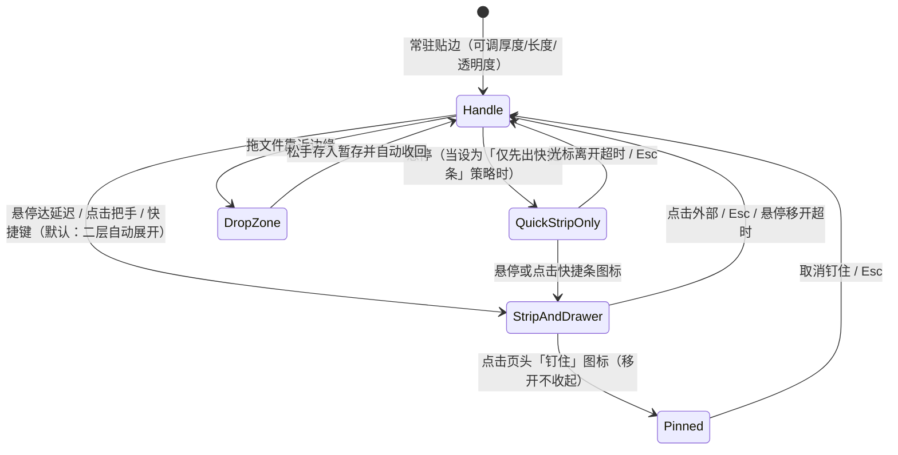
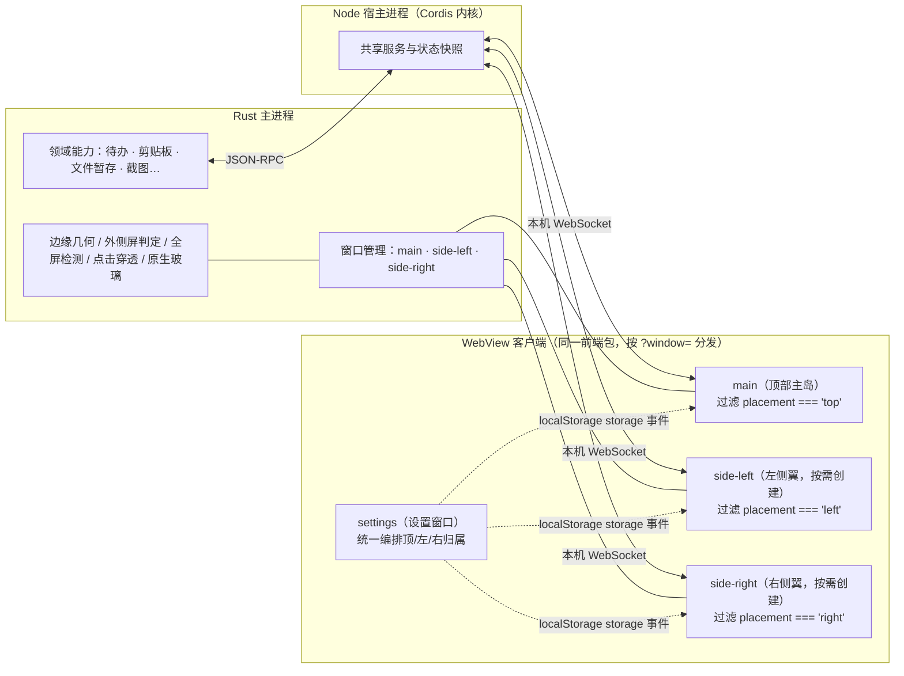

# 屏幕左右侧独立入口（侧边翼 / Side Docks）方案

> 进度（2026-11-26）：Phase 0–2 已随 [C182](/docs/tasks/0-archive/C/C182.md) 合入；Phase 3（原生玻璃、`side-dock.action/v1` 插槽、回归页）是 [C187](/docs/tasks/C/C187.md)，做完后本文移到 `history/`。
>
> 状态：**方向与 6 项问题已确认（2026-11-25，用户确认全部按推荐来）**；Phase 0 交互预览页：[side-docks-preview.html](../investigations/side-docks-preview.html)。参考用户提供的 MagIsland 磁吸岛侧边交互截图，结合浮屿当前主岛形态、侧边吸附（[island-docking-plan.md](history/island-docking-plan.md)）与插件平台第 3 版（[v3-everything-plugin.md](plugins/v3-everything-plugin.md)）起草。

## 1. 背景与要解决的问题

### 1.1 顶部主岛已经接近承载上限

目前主岛（`main` 窗口）需要同时承接：

- **10 个内置展开页**：`agents`、`todo`、`calendar`、`music`、`clipboard`、`shelf`、`screenshots`、`timer`、`qq`、`translation`；
- **自定义面板**：`panel:fuyu`（Fuyu 首页）；
- **v3 插件页面**：仓库内官方插件已有 14 个，后续第三方插件还会继续增加。

即使已经做了 `fuyu-island-pages` 的排序/隐藏和页头「更多」折叠收纳（`NotchHeaderMore`），顶部一排页头按钮仍越来越挤，找页面、切页面的心智与操作成本都在上升。

### 1.2 更本质的问题是“空间形态错配”

- **顶部岛屿**天生是**横宽竖矮、强视觉感知**的位置，最适合**状态提示、一眼扫过、低频短操作**的内容。
- **屏幕左右边缘**天生是**纵长高密度、贴边易触达（菲茨定律）**的位置，最适合**长列表浏览、高频工作台、文件拖拽投放**的内容。

把待办清单、剪贴板历史、截图库、文件暂存架这类纵长内容硬塞进顶部主岛，要么受限于高度一屏只能看几条，要么面板拉太长挡住屏幕正中工作区。

### 1.3 与现有「侧边吸附（C54.1）」的区别

现有 [island-docking-plan.md](history/island-docking-plan.md) 里的左右侧抽屉，是把**唯一的主岛**整座搬到屏幕左/右边（顶边就没有岛了）。本方案则是**多入口并存**：顶部主岛照常负责强感知与实时状态，同时在屏幕左侧和/或右侧新增独立的**侧边翼（Side Dock）**入口，把顶岛里拥挤的 Tab 分流出来。

---

## 2. 产品定位与页面分流原则

### 2.1 入口分工心智

| 入口 | 空间形态 | 核心角色 | 推荐承载的功能 |
|---|---|---|---|
| **顶部主岛**（`main`） | 横向窄条 + 中等横板 | **感知中心 & 瞬时提醒** | AI Agent 状态与审批、音乐/歌词、计时器/番茄钟、QQ/微信/邮件到达提醒、系统监控、天气、Fuyu 面板 |
| **侧边翼**（左 / 右，独立可开） | 极窄边缘把手 + 纵向抽屉卡片 | **高频工作台 & 长列表 & 拖拽投放** | 待办/便签、剪贴板历史、文件暂存架、截图历史、日历日程、快捷翻译、列表型插件（如 GitHub Issues） |

### 2.2 核心原则：入口是容器，页面是流动的

- **不写死归属**：不规定“待办只能在右边”或“音乐只能在顶上”。所有注册在 `island.page/v1` 上的页面（内置页、`panel:fuyu`、第三方插件页）都可以在**顶部 / 左侧 / 右侧**之间自由分配。
- **默认克制**：不要一上来把顶、左、右三面全塞满。提供清晰的一键分流预设，但允许用户按习惯自由移动。
- **多侧独立**：左侧和右侧可各自独立开关（可以只开一侧，也可以双侧同开，例如左侧放文件暂存 + 剪贴板，右侧放待办 + 日历 + 笔记类插件）。

---

## 3. 交互设计：三态渐进 + 二层抽屉默认自动展开

借鉴 MagIsland 的侧边交互，同时减少多余点击：默认采用**触发即自动联动展开（贴边把手 → 快捷条 + 二层抽屉同步展开）**，并把展开节奏、圆角尺寸、快捷条与导航样式做成高度可自定义项。



### 3.1 状态一：休眠贴边态（Handle / 边缘把手）

- **外观**：贴合屏幕外侧边缘的一条利落窄条（默认 `9px` 宽 × `84px` 高，外侧圆角默认 `7px`，不再做过大胶囊圆角；贴边侧与屏幕齐平并带克制的反向圆弧，默认 `6px`，复用 C106「一条轮廓」）。
- **状态弱提示**：平时低存在感（休眠透明度默认 `75%`，可调至 `20%` 近乎隐形）；可选显示状态微点（文件暂存非空、待办到期、剪贴板暂停）。
- **位置**：沿屏幕侧边垂直居中（默认 `along = 0.5`），支持按住上下拖动调整垂直位置或滑块精调，按 0–1 比例持久化。

### 3.2 状态二：快捷条（Quick Strip）与文件拖拽投放

- **角色**：贴着屏幕边缘展开的竖向功能条（宽 `64px`，纯图标紧凑模式下 `50px`），放 **2–5 个高频页面入口或速办动作**（如「新建待办」「截图」「快速翻译」）。
- **二层抽屉自动展开策略（用户确认：默认自动展开）**：
  - **自动展开（默认）**：悬停/点击把手后，快捷条与二层抽屉**同步展开**，直接呈现上次停留（或指定默认）的页面内容，零二次点击；贴边快捷条同时充当侧翼快速切页/速办条。
  - **悬停图标再展开（可选）**：先只滑出快捷条，光标移到某个图标上才顺势展开二层抽屉。
  - **仅点击再展开（可选）**：先只滑出快捷条，点击某一项才开抽屉，最省屏幕空间。
- **文件拖拽直达区**：拖动系统文件靠近侧边把手时，只弹开紧凑的「丢进文件暂存」投放区，松手即入暂存架并自动收回，不展开大抽屉。

### 3.3 状态三：完整抽屉面板（Drawer Panel）

```text
                                        ┌──────────────────────────────┐ ┌──────┐
                                        │ [待办] [剪贴板] [暂存]   📌 ✕ │ │ 待办 │
                                        ├──────────────────────────────┤ │      │
                                        │  搜索 / 筛选栏               │ │剪贴板│ ← 贴合屏幕右边缘
                                        │                              │ │      │   (快捷条 / 可隐藏顶栏
                                        │  纵向长列表内容区             │ │ ＋记 │    直接靠这里切页)
                                        │  (默认 380×560，圆角 14px)   │ └──────┘
                                        │                              │
                                        │                              │
                                        └──────────────────────────────┘
```

- **克制圆角与同心层级（用户确认：圆角降低）**：外框圆角默认降为 **`14px`**（可调 `6–22px`），内层卡片与输入框按同心原则自动取 `max(6px, r − 6px)`（默认 `8px`），整体视觉更利落、接近原生效率工具。
- **导航去重可选**：在同时显示侧边快捷条时，支持开启**「隐藏抽屉顶部 Tab 栏，直接用侧边快捷条切页」**，为长列表多释放约 `44px` 纵向阅读高度。
- **钉住常驻（Pin）**：页头提供图钉按钮，钉住后光标移开或点击外部桌面均不收起，方便一边对照待办/剪贴板/日历一边在主窗口工作。
- **关闭与焦点**：沿用 [design/island.md](../design/island.md) 的不抢焦点原则；支持方向键 `← / →` 翻页、`Alt+1~9` 直达、`Esc` 由里往外退。

---

## 3.5 高度自定义体系（6 大维度）

侧边翼沿袭浮屿「可高度自定义」的基因，左右两侧支持**共用外观预设或按侧独立覆写**：

| 维度 | 可自定义项 | 默认值 |
|---|---|---|
| **1. 几何与圆角** | 抽屉宽度（`300–520px`）、抽屉高度（`420–660px` 或工作区高度百分比）、外框圆角（`6–22px`）、贴边反向圆弧（`0–12px`）、抽屉与快捷条间距（`0–14px`）、把手宽度（`6–16px`）、把手高度（`56–160px`）、沿边垂直比例（`14%–86%`） | 宽 `380px`、高 `560px`、圆角 `14px`、反向弧 `6px`、间距 `6px`、把手 `9×84px`、居中 `50%` |
| **2. 触发与展开** | 展开结构（三态 / 两态）、二层抽屉策略（**自动展开** / 悬停图标展开 / 点击展开）、触发方式（悬停 / 仅点击 / 仅快捷键隐藏把手）、悬停延迟（`0–600ms`）、移开收起延迟（`150–1500ms`）、记住上次页 vs 固定默认页、钉住常驻 | 三态 + **二层自动展开**、悬停 `200ms`、收起 `360ms`、记住上次页 |
| **3. 外观与材质** | 跟随主岛主题或独立覆写（深色 / 浅色）、材质（液态玻璃 / 纯色）、背景不透明度（`45%–100%`）、玻璃模糊强度（`8–36px`）、强调色（跟随主岛或独立自选）、休眠把手不透明度（`20%–100%`）、把手状态微点开关 | 跟随主岛、液态玻璃、休眠把手 `75%`、微点开 |
| **4. 快捷条与布局** | 快捷条样式（图标+短字 / 纯图标窄条）、是否隐藏抽屉顶部 Tab 栏（靠快捷条切页）、抽屉 Tab 样式（图标+文字 / 纯图标）、快捷条动作勾选与排序、列表密度（舒适 / 紧凑） | 图标+短字、显示顶栏、舒适密度 |
| **5. 内容与页面分流** | 每个 `island.page/v1` 页面自由归属 `top / left / right`、侧内页序与隐藏、一键预设（「清爽分流」「双侧工作台」「全部回顶岛」） | 新老用户默认关，提供一键分流预设 |
| **6. 多屏与免打扰** | 所在显示器策略（主屏外侧 / 指定屏 / 跟随鼠标外侧屏）、拼接边强保护、拖文件靠近自动弹出暂存开关、全屏/游戏免打扰隐藏、悬停接管键盘开关、独立全局呼出快捷键 | 主屏外侧、拼接边禁用、拖拽暂存开、免打扰开 |

---

## 3.6 设置界面交互设计（可视化与拖拽）

沿袭 [design/settings.md](../design/settings.md) 的「实时预览 + 缩略图选择卡 + 空间示意图」原则，不把侧边翼做成一堆枯燥的文本开关与滑块堆砌，而是围绕**直接操作（Direct Manipulation）**设计四块可视化工作台，嵌入「设置 → 岛屿布局」与「外观 → 位置与尺寸」：

1. **三停靠区空间拖拽画布（Spatial Layout Board）**
   - 按真实屏幕方位排布：**上方顶部主岛槽**、**左侧翼槽**、**右侧翼槽**，底部为**隐藏池**。
   - 用户直接用鼠标跨区域拖拽任意内置页 / 插件页芯片，并在槽内拖拽排序；拖入尚未开启的一侧时**自动激活该侧边翼**并给出轻提示，减少往返找开关的摩擦。
   - 顶栏提供 4 套一键预设（「默认利落」「极简窄栏」「双侧工作台」「全部回顶岛」），一点即切换，不满意一键恢复。
2. **显示器边缘可视化定位与拖边调尺寸（Interactive Monitor Stage）**
   - 绘制支持单屏 / 双屏切换的交互式显示器示意图，直观标出物理外侧边（蓝光可停靠）与双屏拼接边（红色虚线禁用）。
   - **直接拖动边缘把手**上下滑动调整沿边比例 `along`（50% 处带磁吸居中线）；**直接拖动微缩抽屉内边/底边**即可直观改抽屉宽高（或点「紧凑 / 标准 / 宽大」三档图卡）。
3. **带微缩结构图的视觉选择卡（Visual Cards）**
   - 展开结构与二层策略（「三态 · 二层自动展开」「三态 · 悬停图标再开」「两态 · 把手直达」）、圆角手感（「利落 8px」「均衡 14px」「柔和 18px」「自定义」）、导航去重（「完整双导航」「纯图标窄条 + 隐藏重复顶栏」等）均用**结构缩略图卡片**表达，一眼看懂差异。
4. **快捷条动作可视化拖拽编排（Quick Strip Builder）**
   - 左侧画出 1:1 微缩竖向快捷条，支持**上下拖拽排序**与移除；右侧是动作与页面库，拖入或点击即可加入快捷条（最多 5 项），实时预览快捷条形态。
   - 高级细调项（悬停/收起毫秒数、玻璃模糊、休眠把手透明度等）收进按需展开的「精细参数」卡片，做到**首屏零负担、进阶全可调**。

---

## 4. 关键边界与冲突处理

### 4.1 与现有「主岛侧边吸附（C54.1）」的关系

| 场景 | 处理方式 |
|---|---|
| 主岛在顶边 / 底边 / 刘海 / 任务栏 | 左侧翼、右侧翼均可独立启用，互不干扰 |
| 主岛拖到并吸附在**右侧** | 若右侧翼已开启，右侧翼自动让位暂停（避免两个窗口叠在同一条边上），并在设置页提示「主岛当前停靠在右侧」；左侧翼照常可用 |
| 主岛从右侧拖回顶边 | 右侧翼自动恢复显示 |

> 长期演进上，如果侧边翼体验成熟，可再评估是否将 C54.1 的侧边模式与侧边翼收拢为同一套底层的停靠渲染器。

### 4.2 多显示器防误触（核心底线）

侧边悬停入口在双屏/三屏交界处极易造成灾难性误触，必须从第一天立死规则：

1. **只认物理外侧边**：复用 `src-tauri/src/island/side.rs` 的相邻屏幕判定——两块显示器拼接共享的那条边**禁止**出现侧边翼。例如左屏 + 右屏横向排列时，左侧翼只能贴左屏最左边，右侧翼只能贴右屏最右边。
2. **指定显示器策略**：设置里支持「主显示器（默认，若该侧有相邻屏则自动落到最外侧屏）」「指定某块显示器」「跟随鼠标所在屏（仅当该屏这一侧为外侧边时显示）」。
3. **防误触三保险**：
   - 把手热区高度受限（不铺满整条屏幕边），避开窗口右上角关闭按钮、编辑器滚动条和顶部菜单栏/任务栏；
   - 悬停展开带可调延迟（默认 `260ms`），快速甩过边缘不触发；
   - 支持切换为「仅点击把手展开」或「仅快捷键唤起（平时可隐藏把手）」。
4. **全屏与游戏免打扰**：复用 `foreground-fullscreen-changed`，前台进入全屏应用或游戏模式时侧边翼同步隐藏。

### 4.3 与现有独立窗口（剪贴板、翻译）的协同

- 原有的 `clipboard`、`translation` 独立弹窗及全局快捷键**全部保留**，不破坏老用户的肌肉记忆（在光标附近瞬时弹出后即走）。
- 同时，剪贴板页、翻译页可以作为 Tab 分配到侧边翼中常驻浏览。两者共用同一套 Rust 服务与宿主状态，内容实时一致。

### 4.4 全局快捷键与 `Alt+数字`

- `Alt+1 ~ Alt+9` 按**当前获焦窗口**内的页面顺序生效：在主岛里按切主岛的页，在侧边翼里按切侧边翼的页。
- 左右侧边翼各增加一个可选全局快捷键（如打开/收起左侧翼、右侧翼），默认留空不抢系统热键，由用户自行绑定。
- 某页面被分配到侧边翼后，若从托盘菜单、通知或插件请求打开该页面（`openPage`），系统自动定位到它所在的容器（顶岛 / 左侧翼 / 右侧翼）并展开对应页面，用户不会迷路。

---

## 5. 技术架构与复用到现有 v3 体系

Fuyu 已经完成 v3 插件架构与插槽拆分，本功能可以直接建在现有地基上，不需要推倒重来。



### 5.1 窗口与原生层（独立窗口，零污染 `main` 状态机）

- **按需创建，关闭零开销**：新增窗口标签 `side-left`、`side-right`，URL 为 `?window=side&edge=left` 和 `?window=side&edge=right`。未开启的侧边翼**不创建 WebView**，不占内存和 GPU。
- **不把侧边翼塞进 `main` 窗口**：主岛的透明舞台已经有刘海、贴顶、贴底、任务栏、悬停变胖、四合一改尺寸等复杂状态机。拆分独立窗口后，顶岛和侧边翼的展开/收起、动画、点击穿透完全隔离，互不拖累。
- **复用原生底层**：
  - 现有 `src-tauri/src/island/` 中的 `screen.rs`（屏幕工作区与相邻屏判定）、`passthrough.rs` / `passthrough_macos.rs`（透明舞台穿透）、`glass.rs` / `glass_macos.rs`（液态玻璃原生透出）、`focus.rs`（不抢焦点与焦点归还）可抽成共享辅助或封装进 `src-tauri/src/side_dock/` 模块；
  - 新增一组对称命令（例如 `side_dock_set_layout`、`side_dock_set_hit_rects`、`side_dock_set_along`），由前端上报把手 / 快捷条 / 抽屉矩形，原生精确计算穿透区域。

### 5.2 插槽与页面分流（零改造成本兼容全部内置页与插件）

核心设计：**不新建一套“侧边专用页面插槽”**，直接复用现有 `island.page/v1`！

1. **页面归属配置**：在现有 `fuyu-island-pages`（`src/lib/settings/islandPages.ts`）里扩展一个可选字段 `placement`：

   ```ts
   export type DockZone = "top" | "left" | "right";

   export type IslandPagesLayout = {
     order: string[];
     hidden: string[];
     icons?: Record<string, string>;
     placement?: Record<string, DockZone>;
   };
   ```

   - **100% 向后兼容**：`version` 维持 `1`，缺省或未登记的页面默认归属 `"top"`；老版本岛屿读取时自动忽略未知字段，不破坏设置备份与跨设备同步（仍属于 `collapsedItems` 同步组）。
   - **安全回退**：如果某个页面配在 `"right"`，但用户临时关掉了右侧翼，则自动回退到 `"top"` 显示（或按设置保留隐藏、在设置页提示），保证功能不会“凭空消失”。

2. **跨容器页面路由**：
   - 抽出一层轻量的页面打开分发（如通过宿主或跨窗口事件 `fuyu-open-page-request`）：无论从托盘菜单、通知卡片还是插件调用 `openPage(id)`，先查该页当前归属哪个容器，再唤醒对应窗口切到那一页。

3. **纵向布局适配（不重写页面）**：
   - 侧边翼窗口根节点挂 `data-dock="side"` 与 `data-dock-edge="left" | "right"`，提供纵向容器的 CSS 变量（宽度约 `380px`、高度 `100%`）；
   - 各内置页面已有响应式/滚动基础，只需针对 `340–420px` 窄宽场景做少量 CSS 样式兜底（如双栏折叠成单栏、工具栏紧凑排列、去除多余外边距），第三方 v3 插件也能直接可用。

4. **快捷条动作**：
   - 第一期先提供一组内置快捷动作（打开指定页、新建待办、文件暂存投放、截图、翻译），由 `fuyu-side-docks` 配置；
   - 后续按需要再在 `@fuyu/plugin-base/protocol` 增设 `side-dock.action/v1` 插槽，让第三方插件也能往快捷条放高频按钮。

### 5.3 对外契约新增预估（实现时同步写入 `contracts.md`）

| 类别 | 新增项 | 说明 |
|---|---|---|
| 窗口 label | `side-left`、`side-right` | `?window=side&edge=left\|right`，按需创建 |
| `localStorage` | `fuyu-island-pages` 新增可选 `placement` | `{ [pageId]: "top" \| "left" \| "right" }`，进设置备份与同步 |
| `localStorage` | `fuyu-side-docks` | 左右侧各自开关、沿边比例 `along`、显示器策略、触发方式与延迟、是否开启快捷条段、抽屉宽高、快捷条动作列表 |
| 原生事件 | `side-dock-hover-changed`、`side-dock-drag-edge` | 对应侧的光标悬停命中与系统文件拖近边缘感知 |

---

## 6. 分阶段实施路线

### Phase 0：交互与布局预览验证（零侵入）

- 在 `docs/investigations/` 制作一个静态 HTML 交互预览页（沿用浮屿已有习惯），把**休眠把手 → 快捷条 → 纵向抽屉**的动效、贴边反向弧度、亮暗/玻璃外观，以及待办/剪贴板/文件暂存/截图在 `380px` 窄宽下的视觉效果先跑出来确认。

### Phase 1：单侧翼 MVP（先跑通闭环）

- 实现单个侧边翼窗口（用户可选放左或放右，默认关闭，开启后提供一键推荐分流：`todo`、`clipboard`、`shelf`、`screenshots`）；
- 先实现「把手 ↔ 完整抽屉」两态，打通外侧屏判定、点击穿透、不抢焦点、全屏隐藏、`placement` 分流与跨容器 `openPage` 路由；
- 适配上述 4 个核心内置页在窄宽纵向面板中的排版；
- 在「设置 → 岛屿布局」中支持为每个页面选择归属位置（顶部 / 侧边）。

### Phase 2：三态快捷条 + 拖拽投放 + 双侧同开

- 补齐第一段「快捷条（Quick Strip）」与自定义高频快捷按钮；
- 实现「拖文件靠近屏幕边缘把手自动滑出文件暂存投放区」；
- 开放 `side-left` 与 `side-right` 同时启用，设置页升级为可视化三栏拖拽分配（左侧翼 / 顶部主岛 / 右侧翼）。

### Phase 3：视觉精修与插件生态开放

- 接入原生液态玻璃实时透出（Windows DXGI / macOS `NSVisualEffectView`）与一条轮廓反向圆弧；
- 开放 `side-dock.action/v1` 插件插槽，补齐回归测试页与平台差异文档（[platforms.md](platforms.md)）。

---

## 7. 已确认决策（2026-11-25）

用户确认以下 6 项**全部按推荐方案执行**，并在首轮预览后补充 3 条明确要求：**① 圆角降低（默认 `14px`，同心内圆角 `8px`）；② 全维度高度自定义（几何、触发、外观、快捷条、内容分流、多屏 6 大类）；③ 二层抽屉默认自动展开（触发即联动开快捷条 + 抽屉，同时支持在设置中切回悬停/点击展开）**。

| # | 问题 | 已定方案 | 备选方案与取舍（留作记录） |
|---|---|---|---|
| **1** | **默认开启策略** | **新老用户默认关闭**，在设置里提供开关 +「一键分流常用长列表到右侧」按钮 | 默认开启右侧翼并迁走 4 个页：会冲击老用户心智 |
| **2** | **展开结构与二层自动展开** | **Phase 1 先做两态（把手 → 抽屉），Phase 2 补上快捷条成为三态；三态下二层抽屉默认自动展开**（并支持切回悬停/点击展开与钉住常驻） | 一期直接做三态：范围和穿透矩形复杂度更大 |
| **3** | **单侧起步 vs 双侧起步** | **数据模型一次支持 `top / left / right`，Phase 1 UI 先只放开单侧（左或右任选）** | Phase 1 直接放开左右双侧同开 |
| **4** | **与主岛侧边吸附（C54.1）的关系** | **保留 C54.1，同侧自动互斥让位**（主岛吸右时暂停右侧翼） | 弱化/合并 C54.1 |
| **5** | **产品命名与设置归属** | 中文叫**「侧边翼」**（英文 `Side Docks`），设置入口放在「外观 / 位置」与「岛屿布局」里联动 | 叫「侧边栏」或「边屿」；或在设置侧栏单独给一级菜单 |
| **6** | **平台优先顺序** | **两台机器/双端尽量同步接口，按当前开发机先跑通一端（macOS 或 Windows）再立刻补齐另一端** | 只先做单端、另一端标 `unsupported` |
