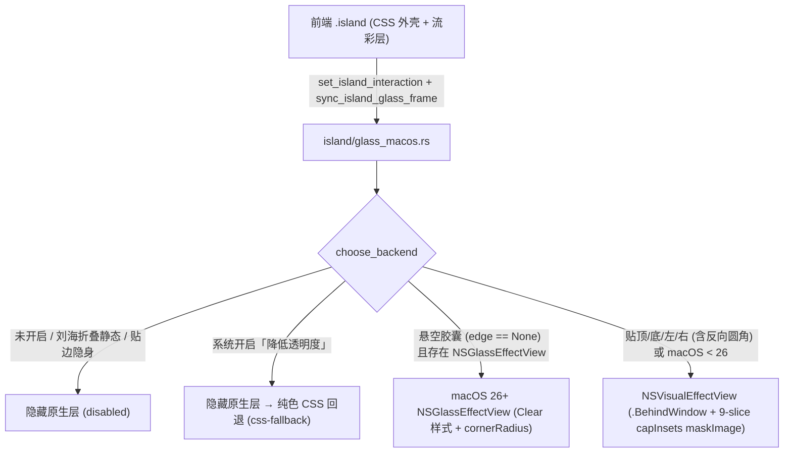

# macOS 液态玻璃原生透出实验报告（C90 / #422）

日期：2026-11-18  
平台：macOS 27.2（Build `26B123`，Apple Silicon）

## 背景与目标

前端 `WKWebView` 透明窗口中的 CSS `backdrop-filter` 只能模糊同一 WebView 内部的元素，拿不到悬浮岛下方的其他应用窗口与桌面（C87 调研见 [liquid-glass.md](../research/liquid-glass.md) §3）。C97 通过采样静态桌面壁纸实现了壁纸毛玻璃，但岛后方有浏览器、终端或编辑器窗口经过时不会实时透出。

本实验验证在 `820 × 460` 透明 `NSPanel` 舞台窗口的 `contentView` 最底层（`WKWebView` 下方）挂载一个**仅与岛同尺寸、同轮廓**的 AppKit 原生玻璃子视图，在保持舞台其余区域完全透明穿透的前提下，实时磨砂岛正后方的窗口与桌面，并评估对齐精度、系统兼容性与资源开销。

## 架构与双后端选型

### `NSGlassEffectView` 与 `NSVisualEffectView` 能力对比

在 macOS 26+ SDK（`AppKit/NSGlassEffectView.h`）核对公开接口后，两者的分工如下：

| 特性 | `NSGlassEffectView`（macOS 26+） | `NSVisualEffectView`（macOS 10.10+） |
|---|---|---|
| 光学效果 | 系统原装 Liquid Glass 边缘折射 + 窗后模糊 | `CABackdropLayer` 实时窗后高斯模糊 + 鲜明度 |
| 圆角与轮廓 | 仅公开四角统一 `cornerRadius`，无 `maskImage` | 支持带 `capInsets` 的九宫格拉伸 `maskImage` |
| 反向圆弧（`C106` 一条轮廓） | 无法裁出贴边方角 + 两侧内凹圆弧 | 4x 超采样生成一次模板图，GPU 按 `capInsets` 零开销缩放 |
| 旧版 SDK 链接兼容 | GitHub Actions macOS 14/15 runner 无此符号，需 `AnyClass::get(c"NSGlassEffectView")` + `msg_send!` 动态调用 | 全版本直接链接 |

因此采用混合双后端策略：
1. **悬空药丸 / 脱离边缘的展开面板（`edge == None`）**在 macOS 26+ 上优先使用 `NSGlassEffectView`（`NSGlassEffectViewStyleClear`），四角对称圆角直接传 `setCornerRadius:`，获得原装系统液态玻璃边缘折射。
2. **贴顶、贴底、贴左、贴右形态（含方角与两侧反向圆角 `topFilletRadius`）**以及 **macOS 26 以下系统**使用 `NSVisualEffectView`（`.BehindWindow` + `.Active`，深色岛配 `HUDWindow` / `VibrantDark`，浅色岛配 `Popover` / `VibrantLight`），通过九宫格 `capInsets` 模板遮罩精确贴合超椭圆/圆角与反向圆弧。

## 关键对齐与边界处理

### 1. 一条轮廓九宫格遮罩（`capInsets`）

贴边岛的外接盒比岛宽（顶/底贴边）或岛高（左/右贴边）多出 `2 * filletRadius`。`macos/island_glass.rs` 只对四个角区加中间 `6pt` 可拉伸带做 4x 超采样栅格化（例如 `2x` Retina 下顶边贴合仅生成一张 `136 × 76 px`、约 `965 B` 的 Alpha 模板图），设 `NSImageResizingMode::Stretch` 与 `capInsets` 后缓存复用。展开、收起过程中只要圆角半径与缩放未变，**全程零次重绘遮罩位图**，仅更新视图 `frame`。

### 2. 展开收起逐帧同步且闲置零开销

岛的开合由 CSS `@property`（弹性、平滑、快速、Q 弹弹簧）驱动。若只在 `set_island_interaction` 时一次性改原生视图尺寸，原生层会在第 0 毫秒跳到终点尺寸而闪烁。

前端 `useNativeGlassSync.ts` 只监听 `.island` 自身的几何属性过渡（`transitionrun` / `transitionend`）与 `ResizeObserver`：
- 过渡期间用 `requestAnimationFrame` 读取 `.island.getBoundingClientRect()` 与四角的计算圆角，经轻量命令 `sync_island_glass_frame` 投递到主线程更新 `frame`，与所有开合曲线严丝合缝。
- 静止状态下不跑任何定时器或 `rAF`，按钮悬停等子元素过渡也不会触发同步。

### 3. 鼠标命中穿透、刘海纯黑与无障碍退化

- **点击与悬停不受影响**：承载原生层的 `FuyuIslandGlassHostView` 重写 `hitTest:` 恒返回 `nil`，并插入在 `WKWebView` 下方（`NSWindowOrderingMode::Below`），所有指针事件仍直达 `WKWebView` 与既有的透明穿透逻辑。
- **刘海折叠保持纯黑（`G1.11`）**：`mode == Collapsed && notch.is_some()` 静止时原生玻璃直接隐藏并返回 `"disabled"`，折叠刘海与物理摄像头黑区融为纯黑 `#000000`；展开时激活，从展开收起回刘海的过渡期内跟随外壳收缩并在落定瞬间隐藏，无突兀闪断。
- **降低透明度自动退化**：每次同步检查 `NSWorkspace.sharedWorkspace.accessibilityDisplayShouldReduceTransparency`，开启时隐藏原生层并返回 `"css-fallback"`，前端自动回退纯色玻璃。

## 实测性能数据

使用独立探测程序 `cargo run --release --example macos_native_glass_probe` 在真实 `820 × 460` 透明 `NSPanel` 上采样 `proc_pid_rusage(RUSAGE_INFO_V2)` 的 `ri_phys_footprint` 与进程 CPU 占用（每阶段 1.2 秒，动画阶段以 60fps 连续往返 `340 × 38` ↔ `560 × 420`）：

| 阶段 | `phys_footprint` | 相对基线增量 | 进程 CPU |
|---|---:|---:|---:|
| 0. 基线透明 `NSPanel`（原生透出关闭，静止） | `9.63 MB` | — | `0.02%` |
| 1. `NSVisualEffectView` 九宫格贴顶遮罩（静止） | `12.55 MB` | `+2.92 MB` | `0.01%` |
| 2. `NSVisualEffectView` 60fps 连续展开/收起 | `16.24 MB` | `+6.61 MB` | `0.26%` |
| 3. `NSGlassEffectView` 悬空胶囊（静止） | `16.38 MB` | `+6.75 MB` | `0.02%` |
| 4. `NSGlassEffectView` 60fps 连续展开/收起 | `16.39 MB` | `+6.76 MB` | `0.20%` |

补充指标：
- 九宫格遮罩冷生成耗时（Release）：`136 × 76 px`（`965 B` PNG）耗时 **`626 µs`（`0.63 ms`）**，命中缓存后为 `0 µs`。

## 结论与落地方式

1. **可行且开销极低**：静止时本进程 CPU 接近 `0%`（窗后模糊由 WindowServer 合成器承担），内存增量约 `3–7 MB`，60fps 开合动画期间本进程 CPU 仅 `0.20%–0.26%`。
2. **作为可选实验项接入设置**：已在 macOS 端的「设置 → 外观 → 液态玻璃 → 玻璃背后」中加入 **「原生透出（实验）」**（`glassBackdrop: "native"`），默认仍保持「桌面壁纸」不变，用户可按喜好自由切换「无 / 桌面壁纸 / 原生透出（实验）」。
