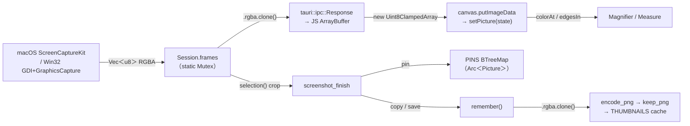

# 截图功能内存泄漏排查报告

## 概述

对截图功能的全部代码（Rust 后端 19 个文件、前端 35+ 个文件）进行了完整排查，并结合 Tauri 2 / WebView / Canvas API 的最新内存管理资料，定位出 **4 个高优问题** 和 **5 个中等问题**。

> [!IMPORTANT]
> 最可能造成「截一次屏内存就涨一截、时间长了居高不下」的元凶是 **问题 1（截图窗口隐藏但不释放像素数据）** 和 **问题 2（贴图 RGBA 在全局 Map 里无上限堆积）**。其余问题是加剧因素。

## 数据流概览



## 高优问题（🔴）

### 问题 1：截图窗口隐藏后，前端像素数据未释放

| 项目 | 值 |
|---|---|
| 位置 | [useScreenshotFrame.ts](../../src/windows/screenshot/useScreenshotFrame.ts#L45-L62)、[ScreenshotOverlay.tsx](../../src/windows/screenshot/ScreenshotOverlay.tsx#L53) |
| 每次截图增量 | 8 MB（1080p）/ 33 MB（4K）× 2–3 份拷贝 |
| 释放时机 | `screenshot-ended` 事件触发 → `setPicture(null)` + `canvas.width = 0` |

**现象**：截图窗口在 Tauri 侧是 `hide()` 而非 `destroy()`（[session.rs L407-412](../../src-tauri/src/screenshot/session.rs#L407-L412)），WebView 进程常驻。每次截图：

1. `getScreenshotFrame()` 从 Rust 拿到完整 RGBA 的 `ArrayBuffer`（8–33 MB）
2. `new Uint8ClampedArray(buffer)` 创建一份视图
3. `new ImageData(data, width, height)` 可能再拷贝一份
4. `setPicture({ id, width, height, data })` 把 `Uint8ClampedArray` 存入 React state

**泄漏风险**：
- 如果 `screenshot-ended` 事件因时序问题未到达（窗口已隐藏、事件竞争），`picture` state 永远不会被置空，8–33 MB 的 `Uint8ClampedArray` 一直挂在 React state 上。
- 即使事件正常到达，WebView（尤其是 WKWebView / WebView2）的 GC 对大型 TypedArray 和 canvas backing store 的回收有延迟，`canvas.width = 0` 能释放 GPU buffer 但 JS heap 上的 `Uint8ClampedArray` 要等 GC。
- 截图窗口不销毁 → WebView 进程不退出 → 内存不归还给 OS。

**修复方案**：

```typescript
// useScreenshotFrame.ts — 在 ended 回调里更彻底地清理
listenScreenshotEnded(() => {
  setSession(null);
  setPicture(null);
  const canvas = canvasRef.current;
  if (canvas) {
    const ctx = canvas.getContext("2d");
    if (ctx) ctx.clearRect(0, 0, canvas.width, canvas.height);
    canvas.width = 0;
    canvas.height = 0;
  }
});
```

此外，考虑在 `session::end()` 的 Rust 侧、hide 窗口之后立即给前端发一个显式的「清空画布」指令，不依赖事件竞争。

---

### 问题 2：贴图（Pin）的 RGBA 数据在全局 Map 里无上限堆积

| 项目 | 值 |
|---|---|
| 位置 | [pin.rs L40, L142](../../src-tauri/src/screenshot/pin.rs#L40) |
| 每次贴图增量 | 8–33 MB（取决于选区大小和分辨率） |
| 释放时机 | 仅在用户手动关闭贴图时 |

**现象**：

```rust
static PINS: Mutex<BTreeMap<String, Pin>> = Mutex::new(BTreeMap::new());

// 每次贴图都 insert，picture 是完整 RGBA：
pins().insert(label.clone(), Pin { picture: Arc::new(picture), margin, density, session });
```

- 没有最大贴图数限制
- `toggle_all()`（隐藏所有贴图）只改可见性，不释放数据
- 只有 `close()` / `close_all()` 才从 Map 中移除
- 用户如果习惯贴图但不关闭，10 张 1080p 贴图 = 80 MB 常驻

**修复方案**：

```rust
// 方案 A：加上限，超过时自动关闭最早的贴图
const MAX_PINS: usize = 20;

fn place(...) -> Result<(), String> {
    // ... 现有逻辑 ...
    let mut guard = pins();
    while guard.len() >= MAX_PINS {
        if let Some(oldest) = guard.keys().next().cloned() {
            guard.remove(&oldest);
            if let Some(window) = app.get_webview_window(&oldest) {
                let _ = window.destroy();
            }
        }
    }
    guard.insert(label.clone(), Pin { ... });
    // ...
}

// 方案 B（更彻底）：Pin 只存文件路径，需要时从磁盘读
// 贴图时先 encode_png 写临时文件，Pin 结构只存路径
// 前端通过 asset protocol 加载图片，不走 IPC 传大 buffer
```

---

### 问题 3：`session::frame()` 每次 IPC 调用都 clone 整个 RGBA

| 项目 | 值 |
|---|---|
| 位置 | [session.rs L319-321](../../src-tauri/src/screenshot/session.rs#L319-L321) |
| 每次调用增量 | 8–33 MB 临时分配 |
| 释放时机 | IPC 传输完成后 |

```rust
pub(crate) fn frame(label: &str) -> Option<Vec<u8>> {
    session().as_ref()?.frames.iter()
        .find(|frame| frame.label == label && !frame.rgba.is_empty())
        .map(|frame| frame.rgba.clone())  // ← 每次都 clone
}
```

在一次截图会话中，这个数据不会变。clone 是不必要的。

**修复方案**：

```rust
// 把 Frame.rgba 改成 Arc<Vec<u8>>，frame() 返回 Arc 的 clone（只增引用计数）
struct Frame {
    label: String,
    origin: (i32, i32),
    width: u32,
    height: u32,
    scale: f64,
    rgba: Arc<Vec<u8>>,  // ← 改这里
}

pub(crate) fn frame(label: &str) -> Option<Arc<Vec<u8>>> {
    session().as_ref()?.frames.iter()
        .find(|frame| frame.label == label && !frame.rgba.is_empty())
        .map(|frame| Arc::clone(&frame.rgba))
}

// tauri::ipc::Response 接受 Into<Vec<u8>>，
// 对 Arc<Vec<u8>> 可以用 Arc::try_unwrap 或在最后一次使用时 take
```

---

### 问题 4：`remember()` 和 `thumbnail()` 各 clone 一次完整 RGBA

| 项目 | 值 |
|---|---|
| 位置 | [mod.rs L290-301](../../src-tauri/src/screenshot/mod.rs#L290-L301)、[output.rs L144-153](../../src-tauri/src/screenshot/output.rs#L144-L153) |
| 每次截图增量 | 8–33 MB × 2（remember 一份 + thumbnail 一份） |
| 释放时机 | 后台线程结束后 |

```rust
// remember() — clone 给后台线程
let copy = Picture { ..., rgba: picture.rgba.clone() };
std::thread::spawn(move || {
    output::encode_png(&copy) ...  // 编码时又分配一个 PNG Vec
});

// thumbnail() — 再 clone 一份做缩略图
let image = image::RgbaImage::from_raw(..., picture.rgba.clone())?;
```

一次截图保存时，内存峰值 = 原始 RGBA + remember clone + PNG 编码 buffer + thumbnail clone ≈ **4× 原始大小**。

**修复方案**：

```rust
// remember() 改为接收所有权，不 clone
fn remember(app: &AppHandle, picture: Picture) { // ← 不用 &
    let app = app.clone();
    std::thread::spawn(move || {
        // picture 已经 move 进来，不需要 clone
        match output::encode_png(&picture).and_then(|png| output::keep_png(&app, &png)) {
            ...
        }
    });
}

// thumbnail() 用切片引用而不是 clone
pub(super) fn thumbnail(picture: &Picture) -> Option<String> {
    // 直接借用 picture.rgba，不 clone
    let image = image::RgbaImage::from_vec(
        picture.width, picture.height,
        // 不用 clone——thumbnail 只在 announce() 的同步路径上调用
        // 但 from_raw 需要所有权...
        // 解决：直接用 image::imageops::resize 接受 view
    )?;
    // 或者：手动缩放，避免 image crate 的所有权要求
}
```

---

## 中等问题（🟡）

### 问题 5：`drawMosaic()` 每次绘制创建临时 canvas，不回收

| 项目 | 值 |
|---|---|
| 位置 | [drawAnnotations.ts L20-31](../../src/features/screenshot/drawAnnotations.ts#L20-L31) |
| 频率 | 每个马赛克标注 × 每次重绘（鼠标移动时持续触发） |

```typescript
function drawMosaic(context, picture, rect, block) {
  const small = document.createElement("canvas");  // ← 每次都新建
  // ... 画完后 small 成为垃圾，但 WebView GC 可能延迟回收 GPU buffer
}
```

**修复**：在模块级复用一个 canvas，或在画完后 `small.width = 0`：

```typescript
const mosaicScratch = document.createElement("canvas");

function drawMosaic(context, picture, rect, block) {
  mosaicScratch.width = Math.max(1, Math.ceil(width / block));
  mosaicScratch.height = Math.max(1, Math.ceil(height / block));
  const shrink = mosaicScratch.getContext("2d");
  // ...
}
```

---

### 问题 6：`composeArea()` 创建的临时 canvas 未清理

| 项目 | 值 |
|---|---|
| 位置 | [drawAnnotations.ts L117-128](../../src/features/screenshot/drawAnnotations.ts#L117-L128) |
| 频率 | 每次点「完成」时一次 |

```typescript
export function composeArea(...): ImageData | null {
  const canvas = document.createElement("canvas");
  canvas.width = area.width;  // 可能很大
  canvas.height = area.height;
  // ... getImageData ...
  return context.getImageData(0, 0, area.width, area.height);
  // canvas 未清理，GPU backing buffer 滞留
}
```

**修复**：提取完 ImageData 后立即释放 canvas：

```typescript
const result = context.getImageData(0, 0, area.width, area.height);
canvas.width = 0;
canvas.height = 0;
return result;
```

---

### 问题 7：PinWindow 的 Object URL 存在竞态泄漏

| 项目 | 值 |
|---|---|
| 位置 | [PinWindow.tsx L48-66](../../src/windows/screenshot/PinWindow.tsx#L48-L66) |
| 触发条件 | `info` 快速变化（多次 `listenPinAssigned` 事件） |

```typescript
useEffect(() => {
  let made: string | null = null;
  getPinImage().then(async (png) => {
    made = URL.createObjectURL(new Blob([png]));
    // ... await image.decode() ...
    if (cancelled) return;  // ← cancelled 阻止 setUrl，但不 revoke
    setUrl(made);
  });
  return () => {
    cancelled = true;
    if (made) URL.revokeObjectURL(made);
    // ← 如果 cleanup 在 then resolve 之前执行，made 还是 null
    //   then resolve 后创建的 Object URL 永远不会被 revoke
  };
}, [info]);
```

**修复**：在 `cancelled` 路径上也 revoke：

```typescript
getPinImage().then(async (png) => {
  const url = URL.createObjectURL(new Blob([png], { type: "image/png" }));
  const image = new Image();
  image.src = url;
  await image.decode();
  if (cancelled) {
    URL.revokeObjectURL(url);  // ← 加这一行
    return;
  }
  made = url;
  setUrl(url);
});
```

---

### 问题 8：长截图循环中帧数据多次 clone

| 项目 | 值 |
|---|---|
| 位置 | [long.rs L189-237](../../src-tauri/src/screenshot/long.rs#L189-L237) |
| 额外内存 | ~16–24 MB 常驻（热循环期间） |

```rust
let mut previous = first.clone();  // 8 MB
let mut tried = first;             // 8 MB（moved）
// 循环中：
tried = previous.clone();          // 又 8 MB
match stitcher.push(previous.clone()) { ... }  // 再 8 MB
```

同一帧被复制了 2–3 份。可以通过 `Arc` 或调整所有权减少拷贝。

---

### 问题 9：截图历史面板加载全部缩略图 base64

| 项目 | 值 |
|---|---|
| 位置 | [history.rs L20](../../src-tauri/src/screenshot/history.rs#L20)、[ScreenshotHistoryPanel.tsx](../../src/features/screenshot/ScreenshotHistoryPanel.tsx) |
| 内存 | ~1 MB（100 张 × ~10 KB） |

`THUMBNAILS` 是一个 `HashMap<PathBuf, (SystemTime, String)>`，缓存所有历史截图的 base64 缩略图。`list()` 调用时 `retain` 清理已删除文件的条目，但在调用之间只增不减。受 `KEEP_FILES=100` 约束，实际影响不大。

---

## 已确认无泄漏的部分（🟢）

| 部分 | 结论 |
|---|---|
| macOS ScreenCaptureKit | `CGImage`、`SCShareableContent` 等都是引用计数，`to_rgba()` 的临时分配在函数返回后释放 |
| Win32 GDI / GraphicsCapture | RAII wrapper（`ScreenDc`、`MemoryDc`、`Bitmap`）有正确的 `Drop`；COM 引用计数正确 |
| Session.frames 生命周期 | `session::end()` 调用 `session().take()` 正确 drop 所有 Frame |
| 前端事件监听器 | 全部遵循 `cancelled` + `unlisten` 模式，清理正确 |
| 前端 setTimeout/setInterval | 全部在 cleanup 里 `clearTimeout` / `clearInterval` |
| React ref canvas | `Magnifier`、`AnnotationLayer` 的 canvas 由 React ref 管理，session 结束时 `canvas.width = 0` |
| WebView2 内存级别 | `webview_memory.rs` 已实现隐藏窗口降低内存（需 `FUYU_WEBVIEW_LOW_MEMORY=1`） |
| IPC 传输方式 | `tauri::ipc::Response` 传 raw bytes，已是最优做法 |
| Pin spare 窗口池 | 预建复用，符合最佳实践 |

## 修复优先级与预估影响

| 优先级 | 问题 | 修复复杂度 | 预估节省 |
|---|---|---|---|
| **P0** | 问题 1：前端 Picture state 未可靠释放 | 低（改 cleanup 逻辑） | 8–33 MB / 次截图 |
| **P0** | 问题 2：Pin RGBA 无上限堆积 | 中（加上限 + 可选落盘） | 8–33 MB / 张贴图 |
| **P1** | 问题 3：`frame()` 不必要的 clone | 中（Frame.rgba 改 Arc） | 8–33 MB 峰值 |
| **P1** | 问题 4：`remember()` + `thumbnail()` clone | 中（改所有权 / 借用） | 16–66 MB 峰值 |
| **P2** | 问题 5：drawMosaic 临时 canvas | 低（模块级复用） | 数 MB GC 压力 |
| **P2** | 问题 6：composeArea canvas 不清理 | 极低（加一行 `width=0`） | 数 MB GC 压力 |
| **P2** | 问题 7：PinWindow Object URL 竞态 | 低（cancelled 路径加 revoke） | 数 MB / 次竞态 |
| **P3** | 问题 8：长截图帧 clone | 中（改 Arc 或所有权） | 16–24 MB 峰值 |
| **P3** | 问题 9：历史缩略图 base64 | 低（已有上限） | ~1 MB |

## 进一步优化建议（来自业界资料）

1. **用 Tauri Asset Protocol 替代 IPC 传大图**：截图写临时文件 → 前端 `` 加载，零 JS heap 压力。
2. **Pin 数据落盘**：贴图时先 `encode_png` 写临时文件，`Pin` 结构只存路径，前端通过 asset protocol 或 `convertFileSrc()` 显示。
3. **启用 WebView2 低内存模式**：`FUYU_WEBVIEW_LOW_MEMORY=1` 已实现但需要环境变量开启。考虑对截图窗口默认启用（它们在截图间隔期间完全空闲）。
4. **Canvas 清理最佳实践**：临时 canvas 用完后 `canvas.width = 0; canvas.height = 0;` 强制释放 GPU backing store。
5. **检查 Tauri 版本**：Tauri 2 的 GitHub PR #15604、#15617 修复了 `window.destroy()` 后事件监听器未清理的问题，确认已包含在当前版本中。
