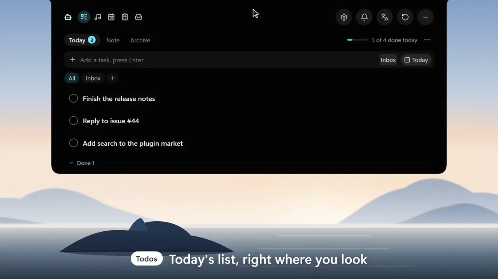
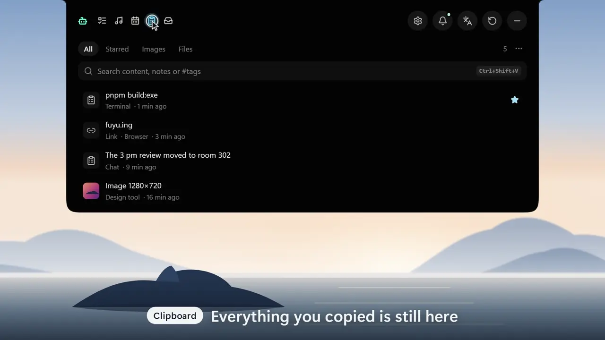
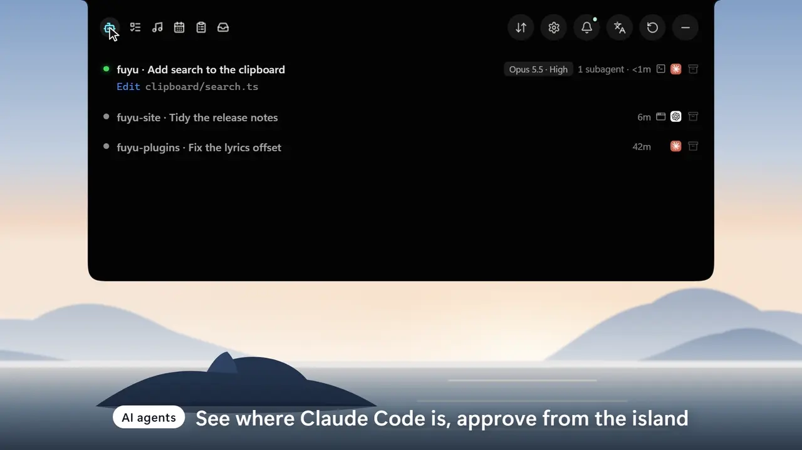

<div align="center">
  <a name="readme-top"></a>
  <a href="https://fuyu.ing"></a>

  <h1>Fuyu</h1>

  <p><b>デスクトップの細々したものを、ひとつの島に</b></p>

  <p>Windows と macOS のデスクトップ用ダイナミックアイランドです。ToDo、クリップボード、Telegram・Discord・WhatsApp などのメッセージ、翻訳、音楽、AI の状態が、画面上端の小さな島にまとまります。</p>

  <p>
    <a href="https://github.com/TixXin/fuyu/releases/latest"></a>
    &nbsp;
    <a href="https://github.com/TixXin/fuyu/releases"></a>
    <br>
    <a href="https://fuyu.ing/#mac-install"></a>
  </p>

  <p>
    <a href="https://github.com/TixXin/fuyu/releases/latest"></a>
    
    
    <a href="../../LICENSE"></a>
    <a href="https://github.com/TixXin/fuyu/stargazers"></a>
  </p>

  <p>
    <a href="../../README.md">简体中文</a>
    ·
    <a href="README.zh-TW.md">繁體中文</a>
    ·
    <a href="README.en.md">English</a>
    ·
    <b>日本語</b>
    ·
    <a href="README.ko.md">한국어</a>
    ·
    <a href="README.es.md">Español</a>
    ·
    <a href="README.fr.md">Français</a>
    ·
    <a href="README.de.md">Deutsch</a>
    ·
    <a href="README.ru.md">Русский</a>
    ·
    <a href="README.pt-BR.md">Português</a>
  </p>

  <p><sub>この文書は 2026-11-15 時点の<a href="../../README.md">簡体字中国語版 README</a> から翻訳したもので、最新の内容に追いついていない場合があります。ネイティブの方からの修正を歓迎します。</sub></p>

  <p>
    <a href="https://fuyu.ing">公式サイト</a>
    ·
    <a href="https://fuyu.ing/plugins/">プラグインマーケット</a>
    ·
    <a href="../plugins/README.md">プラグインを書く</a>
    ·
    <a href="https://github.com/TixXin/fuyu/issues">問題を報告</a>
  </p>

  <p>
    <a href="../assets/promo-001-one-island-en.mp4"></a>
    <br>
    <sub>43 秒でひととおり紹介します。映っている島は画面録画ではなく本物のフロントエンドです（<a href="../../video/README.md">作り方</a>、中国語）· <a href="../assets/promo-001-one-island-en.mp4">音声付きの完全版を見る</a> · <a href="../assets/promo-004-one-day-en.mp4">Fuyu の一日（46 秒、ナレーション付き）</a></sub>
  </p>
</div>

## これは何？

Fuyu（浮屿）は、軽量でフチのない、常に最前面に表示される浮遊島です。ふだんは画面上端に収まり、必要なときに広がって、使い終わると自動で閉じます。よく使うものはすべて島の上にあるので、ちょっと情報を見るためにウィンドウを切り替える必要はありません。

<p align="center">
  
  <br>
  <sub>閉じているときは画面上端のこの細い帯だけ。画像では曲に合わせて歌詞と音声波形を表示しています</sub>
</p>

## 島にあるもの

<p><sub>機能名をクリックすると開閉します。アニメーションをクリックすると、公式サイトで島を実際に操作できます</sub></p>

<details open>
<summary><b>01 · ToDo とノート</b></summary>
<p>毎日のタスク、いま集中している項目、デイリーノートと過去のアーカイブ。</p>
<p><a href="https://fuyu.ing/#day"></a></p>
</details>

<details>
<summary><b>02 · 音楽</b></summary>
<p>再生中のメディアを操作し、音声波形と同期歌詞を表示します。</p>
<p><a href="https://fuyu.ing/#day"></a></p>
</details>

<details>
<summary><b>03 · メッセージ</b></summary>
<p>Telegram・Discord・WhatsApp・QQ・WeChat・WeCom・TIM・Feishu・DingTalk の新着メッセージを島で知らせ、クリックでそのアプリを開きます。複数のメールアカウントにも対応。メールは島の上でそのまま読んで返信できます。</p>
<p><a href="https://fuyu.ing/#day"></a></p>
</details>

<details>
<summary><b>04 · クリップボードとファイル中継</b></summary>
<p>テキストと画像のクリップボード履歴。ファイルをいったん島にドラッグして置いておき、あとで別のアプリへドラッグできます。</p>
<p><a href="https://fuyu.ing/#day"></a></p>
</details>

<details>
<summary><b>05 · クイック翻訳</b></summary>
<p>ショートカットキーひとつで開き、複数の大規模言語モデルの翻訳サービスに対応します。</p>
<p><a href="https://fuyu.ing/#day"></a></p>
</details>

<details>
<summary><b>06 · AI エージェント</b></summary>
<p>Claude Code と Codex のセッションの状態と使用量を表示します。確認を求められたら島の上でそのまま承認でき、クリックで該当するウィンドウに切り替わります。席を外しているときは Telegram・Discord・Feishu・Bark に通知でき、チャットからそのままエージェントに指示を続けられます。</p>
<p><a href="https://fuyu.ing/#agent"></a></p>
</details>

<details>
<summary><b>07 · カレンダー</b></summary>
<p>今日と明日の予定、旧暦と祝日入りの月カレンダー。会議が近づくと島でカウントダウンし、ワンクリックで参加できます。</p>
</details>

<details>
<summary><b>08 · システム表示</b></summary>
<p>音量や明るさの変化、カメラとマイクをどのアプリが使っているか。</p>
</details>

<details>
<summary><b>09 · プラグインとテーマ</b></summary>
<p>プラグインマーケットからプラグインを入れて島を拡張できます（機密データには個別の許可が必要です）。テーママーケットでは既製の外観を選べます。</p>
</details>

島の外観、サイズ、閉じ方、ショートカットキー、各機能はすべて設定ウィンドウで調整でき、アプリ内の自動更新にも対応しています。データはすべてこのコンピューター内に保存されます。

## リソース使用量

閉じた状態で何もせず、音楽も再生していないとき（初期設定、プラグインなし）：

| | 実測値 |
|---|---|
| CPU | 1 コアの約 **10%**（20 コアの PC では全体の約 0.5%） |
| メモリ | Fuyu 本体で約 **16 MB** |
| エージェントページが毎秒セッション一覧を更新 | 1 コアの **0.1%** |
| PowerShell プラグイン 1 つごと | 約 **60 MB** 増加 |

測定方法とデータは [idle-usage.md](../investigations/idle-usage.md)（中国語）をご覧ください。

## はじめかた

1. **ダウンロードとインストール**：[Releases](https://github.com/TixXin/fuyu/releases/latest) からインストーラーをダウンロードしてインストールします。
   - **Windows**：`_x64-setup.exe` をダウンロードします。インストーラーにはコード署名がないため、SmartScreen の警告が出たら「詳細情報 → 実行」を選んでください。
   - **macOS**：[リリース一覧](https://github.com/TixXin/fuyu/releases)から `_aarch64.dmg` を含む最新のリリースを探してダウンロードし（最新の正式版にない場合は、その上にあるプレリリースにあります）、Fuyu を「アプリケーション」にドラッグします。初回は「システム設定 → プライバシーとセキュリティ」で「このまま開く」をクリックする必要があります。詳しい手順は [Mac インストールガイド](https://fuyu.ing/#mac-install)をご覧ください。
2. **島を開く**：画面上端の島にマウスを乗せると開きます。歯車ボタンかトレイアイコン（Mac ではメニューバーアイコン）で設定を開きます。Mac では初回ガイドが、必要なシステム権限の許可まで案内します。
3. **一度だけ設定**：メール、翻訳、AI エージェントは、最初に設定画面で一度設定が必要です。詳しくはそれぞれの説明をご覧ください（中国語）：[メール](../features/mail.md)、[AI エージェント](../features/agent-status-hooks.md)、[QQ 通知](../features/qq-notifications.md)、[WeChat 通知](../features/wechat-reminders.md)、[スマートフォン通知](../features/cc-connect.md)。

> [!NOTE]
> Windows 10 / 11 と macOS 15 以降（Apple シリコン）に対応しています。Mac 版には Windows と異なる点がいくつかあります。QQ と WeChat は未読数のみの表示でメッセージ内容は読めません。メディア操作と明るさにはシステムの非公開 API を使っています。各機能の両プラットフォームでの対応状況は [platforms.md](../architecture/platforms.md)（中国語）をご覧ください。

## プラグイン

島に足りないものがあれば、自分で追加できます。プラグインは TypeScript か JavaScript で書きます。バックグラウンドの処理は島が起動する Node プロセスの中で動き、UI は React で書いて、島や設定ウィンドウに用意された場所（スロット）に置くので、島のほかの部分と並んで表示されます。マニフェストは `package.json` そのもので、配布はひとつの `.fuyu` ファイルです。

```sh
npm create fuyu-plugin@latest
```

- **既製のものを入れる**：島の「設定 → プラグインマーケット」からインストールできます。先に[公式サイトのプラグインマーケット](https://fuyu.ing/plugins/)で何があるか見てみることもできます。
- **自分で書く**：上のコマンドでプロジェクトを作り、その中で `npm run dev` を実行すると、動いている島に読み込まれ、変更するたびに再ビルドされます。詳しくは[プラグインのドキュメント](../plugins/README.md)と[コマンドライン](../plugins/cli.md)をご覧ください（どちらも中国語）。
- **ほかの人と共有する**：コミットを[プラグインマーケット](https://github.com/TixXin/fuyu-plugins)に渡すと、マーケットがソースからビルドし、バージョンごとに審査してから公開します。`.fuyu` ファイルにして自分で配ることもできます。手順は[公開](../plugins/publish.md)（中国語）をご覧ください。

## ソースからビルド

- **Windows**：Windows 10/11、Node.js、pnpm、Rust、Visual Studio C++ Build Tools、WebView2 Runtime が必要です。
- **macOS**：macOS 15 以降、Xcode コマンドラインツール（`xcode-select --install`）、Node.js、pnpm、Rust が必要です。

```sh
git clone https://github.com/TixXin/fuyu.git
cd fuyu
pnpm install
pnpm tauri dev      # 開発モード
pnpm tauri build    # インストーラーをビルド
```

技術スタック：Tauri 2、React 19 + TypeScript、Rust。リリースとアプリ内更新については [docs/features/updater.md](../features/updater.md)（中国語）をご覧ください。

## ユーザーコミュニティ

困ったこと、アイデア、ちょっとした雑談でも、[Discord サーバー](https://discord.gg/azu5aZFuRY) に参加するか、QR コードを読み取って WeChat グループにどうぞ（主に中国語です）：

<p align="center">
  
</p>

## コントリビュート

<a href="https://fuyu.ing/logo/"></a>

Fuyu はみんなで作っています。あなたもぜひ参加してください：

- **問題やアイデアを伝える**：[Issues](https://github.com/TixXin/fuyu/issues) で、使いにくいところや欲しい機能を教えてください。
- **コード、ドキュメント、翻訳を直す**：そのまま PR を送ってください。送り方と事前に実行するチェックは [CONTRIBUTING.md](../../CONTRIBUTING.md)、コードの構成は [AGENTS.md](../../AGENTS.md) をご覧ください（中国語）。
- **プラグインを書く**：島本体に手を入れる必要はありません。できたら[プラグインマーケット](https://github.com/TixXin/fuyu-plugins)に公開してください。
- **ロゴを描く**：Fuyu にはまだ正式なロゴがありません。[募集ページ](https://fuyu.ing/logo/)はずっと開いていて、右の空き枠はそのために空けてあります。

<a href="https://github.com/TixXin/fuyu/graphs/contributors"></a>

## スターの推移

ひとつひとつのスターが、Fuyu が前に進む力になります。

<p align="center">
  <a href="https://star-history.com/#TixXin/fuyu&amp;Date">
    <picture>
      <source media="(prefers-color-scheme: dark)" srcset="https://api.star-history.com/svg?repos=TixXin/fuyu&amp;type=Date&amp;theme=dark">
      
    </picture>
  </a>
</p>

## ライセンス

[AGPL-3.0](../../LICENSE)。プラグインの作者はライセンスを自由に選べます。サードパーティの依存関係と同梱リソースはそれぞれのライセンスに従います。出典と表記は[サードパーティ表記](../THIRD_PARTY_NOTICES.md)、同梱フォントは[フォントについて](../../src/assets/fonts/README.md)をご覧ください。

> [!NOTE]
> 本プロジェクトは [TixXin](https://github.com/TixXin) と [ShengLin1001](https://github.com/ShengLin1001) が共同でメンテナンスしており、2026 年 11 月に fly-island から Fuyu（浮屿）に改名しました。原作者の [flyl1u](https://github.com/flyl1u/fly-island) はシンプルなダイナミックアイランドの画面を志向しています。島の機能をさらに充実させ、より多くの人が自作の機能を島に載せられるように、本プロジェクトは別の系統として独立し、みんなで共同メンテナンスする形でプラグインマーケットを育ててきました。PR によるコードの貢献（[コントリビュート](../../CONTRIBUTING.md)を参照）、自作コンポーネントの[プラグインマーケット](https://github.com/TixXin/fuyu-plugins)への公開、自作プラグインのローカルへのインストール（[プラグインのドキュメント](../plugins/README.md)を参照）を歓迎します。

<p align="center">
  <a href="#readme-top"></a>
  <br>
  <sub>使い終わったら、自分で閉じます · <a href="#readme-top">トップに戻る</a></sub>
</p>
