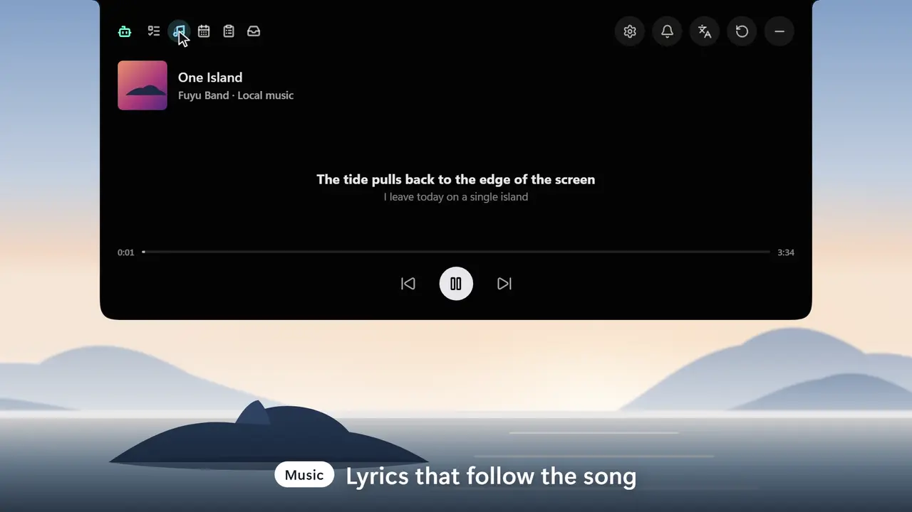
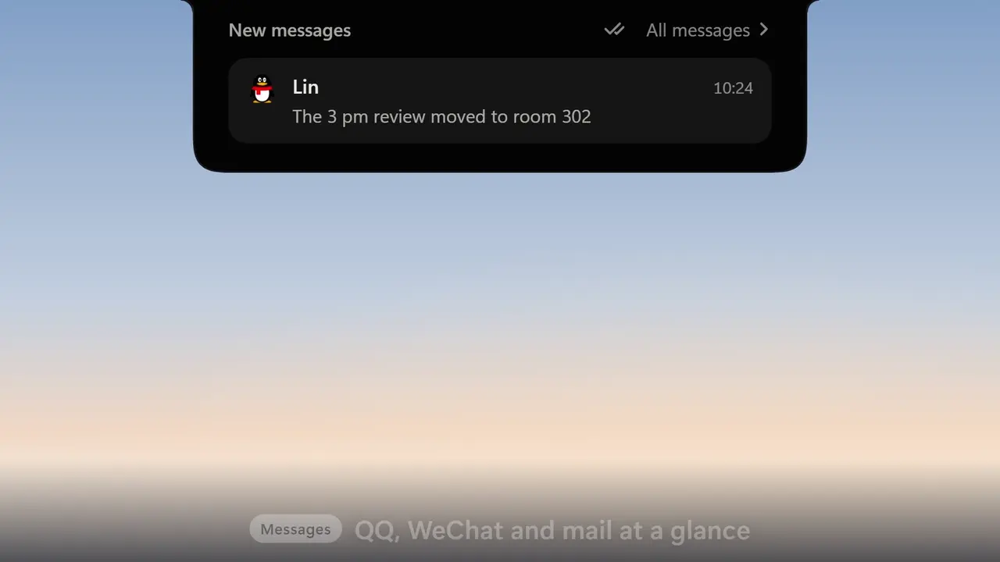

<div align="center">
  <a name="readme-top"></a>
  <a href="https://fuyu.ing"></a>

  <h1>Fuyu</h1>

  <p><b>데스크톱의 자잘한 일들을 섬 하나에</b></p>

  <p>Windows와 macOS용 데스크톱 다이내믹 아일랜드입니다. 할 일, 클립보드, Telegram·Discord·WhatsApp 등의 메시지, 번역, 음악, AI 상태를 화면 위쪽의 작은 섬 하나에 모았습니다.</p>

  <p>
    <a href="https://github.com/TixXin/fuyu/releases/latest"></a>
    &nbsp;
    <a href="https://github.com/TixXin/fuyu/releases"></a>
    <br>
    <a href="https://fuyu.ing/#mac-install"></a>
  </p>

  <p>
    <a href="https://github.com/TixXin/fuyu/releases/latest"></a>
    
    
    <a href="../../LICENSE"></a>
    <a href="https://github.com/TixXin/fuyu/stargazers"></a>
  </p>

  <p>
    <a href="../../README.md">简体中文</a>
    ·
    <a href="README.zh-TW.md">繁體中文</a>
    ·
    <a href="README.en.md">English</a>
    ·
    <a href="README.ja.md">日本語</a>
    ·
    <b>한국어</b>
    ·
    <a href="README.es.md">Español</a>
    ·
    <a href="README.fr.md">Français</a>
    ·
    <a href="README.de.md">Deutsch</a>
    ·
    <a href="README.ru.md">Русский</a>
    ·
    <a href="README.pt-BR.md">Português</a>
  </p>
  <p><sub>이 문서는 2026-11-15 기준 <a href="../../README.md">중국어 간체 README</a>를 번역한 것으로, 최신 내용보다 늦을 수 있습니다. 원어민의 수정 제안을 환영합니다.</sub></p>

  <p>
    <a href="https://fuyu.ing">웹사이트</a>
    ·
    <a href="https://fuyu.ing/plugins/">플러그인 마켓</a>
    ·
    <a href="../plugins/README.md">플러그인 만들기</a>
    ·
    <a href="https://github.com/TixXin/fuyu/issues">문제 신고</a>
  </p>

  <p>
    <a href="../assets/promo-001-one-island-en.mp4"></a>
    <br>
    <sub>43초 만에 한 바퀴 둘러보기. 화면 속 섬은 녹화가 아니라 실제 프런트엔드입니다(<a href="../../video/README.md">만든 방법</a>, 중국어) · <a href="../assets/promo-001-one-island-en.mp4">소리가 있는 전체 영상 보기</a> · <a href="../assets/promo-004-one-day-en.mp4">Fuyu와 함께하는 하루(46초, 내레이션 포함)</a></sub>
  </p>
</div>

## 무엇인가요

Fuyu(浮屿, '떠 있는 작은 섬')는 가볍고 테두리 없이 항상 맨 위에 떠 있는 섬입니다. 평소에는 화면 위쪽에 접혀 있다가 필요할 때 펼쳐지고, 다 쓰면 알아서 접힙니다. 자주 쓰는 것들을 섬에 모아 두었으니, 정보 하나를 보려고 창을 이리저리 전환할 필요가 없습니다.

<p align="center">
  
  <br>
  <sub>접혀 있을 때는 화면 위쪽의 이 좁은 띠만 차지합니다. 그림에서는 노래에 맞춰 가사와 오디오 파형을 보여 주고 있습니다</sub>
</p>

## 섬에 있는 것

<p align="center">
  <a href="https://fuyu.ing/#day"></a>
  <a href="https://fuyu.ing/#day"></a>
  <a href="https://fuyu.ing/#day"></a>
  <a href="https://fuyu.ing/#day"></a>
  <a href="https://fuyu.ing/#day"></a>
  <a href="https://fuyu.ing/#agent"></a>
  <br>
  <sub>아무 그림이나 누르면 웹사이트에서 섬을 직접 눌러 볼 수 있습니다</sub>
</p>

<table>
  <tr>
    <td valign="top"><code>01</code></td>
    <td><b>할 일과 노트</b><br>오늘의 할 일, 지금 집중하는 항목, 데일리 노트와 지난 기록 보관.</td>
  </tr>
  <tr>
    <td valign="top"><code>02</code></td>
    <td><b>음악</b><br>재생 중인 미디어를 제어하고, 오디오 파형과 동기화된 가사를 보여 줍니다.</td>
  </tr>
  <tr>
    <td valign="top"><code>03</code></td>
    <td><b>메시지</b><br>Telegram, Discord, WhatsApp, QQ, WeChat, WeCom, TIM, Feishu, DingTalk의 새 메시지를 섬에서 알려 주고, 클릭하면 해당 앱이 열립니다. 여러 메일 계정도 지원합니다. 메일은 섬에서 바로 읽고 답장할 수 있습니다.</td>
  </tr>
  <tr>
    <td valign="top"><code>04</code></td>
    <td><b>클립보드와 파일 임시 보관</b><br>텍스트와 이미지 클립보드 기록. 파일을 섬에 끌어다 놓아 잠시 보관했다가 다른 프로그램으로 끌어 옮길 수 있습니다.</td>
  </tr>
  <tr>
    <td valign="top"><code>05</code></td>
    <td><b>빠른 번역</b><br>단축키 하나로 열리고, 여러 LLM 번역 서비스를 지원합니다.</td>
  </tr>
  <tr>
    <td valign="top"><code>06</code></td>
    <td><b>AI 에이전트</b><br>Claude Code와 Codex 세션의 실행 상태와 사용량을 보여 줍니다. 확인이 필요할 때 섬에서 바로 승인하고, 한 번 클릭으로 해당 창으로 전환합니다. 자리를 비웠을 때는 Telegram, Discord, Feishu, Bark로 알림을 받고, 채팅에서 바로 에이전트에게 계속 지시할 수 있습니다.</td>
  </tr>
  <tr>
    <td valign="top"><code>07</code></td>
    <td><b>캘린더</b><br>오늘과 내일의 일정, 음력과 공휴일이 표시된 월간 달력. 회의가 곧 시작되면 섬에서 카운트다운하고, 클릭 한 번으로 참여할 수 있습니다.</td>
  </tr>
  <tr>
    <td valign="top"><code>08</code></td>
    <td><b>시스템 알림</b><br>볼륨과 밝기 변화, 그리고 어떤 프로그램이 카메라와 마이크를 사용 중인지 보여 줍니다.</td>
  </tr>
  <tr>
    <td valign="top"><code>09</code></td>
    <td><b>플러그인과 테마</b><br>플러그인 마켓에서 플러그인을 설치해 섬을 확장합니다. 민감한 데이터는 따로 허용해야 합니다. 테마 마켓에서 미리 만들어진 외관을 고를 수 있습니다.</td>
  </tr>
</table>

섬의 외관, 크기, 접히는 방식, 단축키와 각 기능은 모두 설정 창에서 조정할 수 있고, 앱 내 자동 업데이트를 지원합니다. 데이터는 모두 내 컴퓨터에 저장됩니다.

## 리소스 사용량

접힌 채로 쉬고 있고 음악을 재생하지 않을 때(기본 설정, 플러그인 없음):

| | 실측 |
|---|---|
| CPU | 코어 하나의 약 **10%**(20코어 컴퓨터 전체 기준 약 0.5%) |
| 메모리 | Fuyu 자체 약 **16 MB** |
| 에이전트 페이지가 1초마다 세션 목록을 새로 고칠 때 | 코어 하나의 **0.1%** |
| PowerShell 플러그인 하나를 설치할 때마다 | 약 **60 MB** 추가 |

측정 방법과 데이터는 [idle-usage.md](../investigations/idle-usage.md)(중국어)를 참고하세요.

## 시작하기

1. **다운로드와 설치**: [Releases](https://github.com/TixXin/fuyu/releases/latest)에서 설치 파일을 받아 설치합니다.
   - **Windows**: `_x64-setup.exe`를 받습니다. 설치 파일에는 코드 서명이 없으므로 SmartScreen 경고가 나오면 「추가 정보 → 실행」을 누릅니다.
   - **macOS**: [릴리스 목록](https://github.com/TixXin/fuyu/releases)에서 `_aarch64.dmg`가 있는 가장 최신 버전을 받고(최신 정식 버전에 없으면 그 위의 테스트 버전에 있습니다), Fuyu를 「응용 프로그램」으로 끌어다 놓습니다. 처음 열 때는 「시스템 설정 → 개인정보 보호 및 보안」에서 「그래도 열기」를 눌러야 합니다. 단계별 설명은 [Mac 설치 가이드](https://fuyu.ing/#mac-install)를 참고하세요.
2. **섬 펼치기**: 마우스를 화면 위쪽의 섬에 올리면 펼쳐집니다. 톱니바퀴나 트레이 아이콘(Mac에서는 메뉴 막대 아이콘)을 누르면 설정이 열립니다. Mac에서는 첫 실행 가이드가 필요한 시스템 권한을 여는 과정을 안내합니다.
3. **한 번만 설정하기**: 메일, 번역, AI 에이전트는 설정에서 한 번 구성해야 합니다. 자세한 내용은 각 설명을 참고하세요(중국어): [메일](../features/mail.md), [AI 에이전트](../features/agent-status-hooks.md), [QQ 알림](../features/qq-notifications.md), [WeChat 알림](../features/wechat-reminders.md), [휴대폰 알림](../features/cc-connect.md).

> [!NOTE]
> Windows 10 / 11과 macOS 15 이상(Apple 실리콘)을 지원합니다. Mac 버전은 Windows와 몇 가지가 다릅니다. QQ와 WeChat은 읽지 않은 메시지 수만 표시하고 내용은 읽지 못하며, 미디어 제어와 밝기에는 시스템 비공개 API를 사용합니다. 각 기능의 두 플랫폼 지원 현황은 [platforms.md](../architecture/platforms.md)(중국어)를 참고하세요.

## 플러그인

섬에 없는 기능은 직접 추가할 수 있습니다. 플러그인은 폴더 하나입니다. 매니페스트 하나와 섬이 실행하는 프로그램(PowerShell 스크립트, exe 또는 Node.js 스크립트)으로 이루어져 있습니다. 플러그인은 데이터만 보내고, 페이지와 접힌 바, 설정 페이지는 섬이 템플릿으로 그리기 때문에 섬의 다른 부분과 스타일이 맞습니다.

```sh
npm create fuyu-plugin@latest
```

- **만들어진 것 설치하기**: 섬의 「설정 → 플러그인 마켓」에서 설치하거나, 먼저 [웹사이트의 플러그인 마켓](https://fuyu.ing/plugins/)에서 어떤 것이 있는지 둘러볼 수 있습니다.
- **직접 만들기**: [빠른 시작](../plugins/quickstart.md)을 따라 하면 약 한 시간 만에 처음부터 플러그인을 만들 수 있습니다. 전체 설명은 [플러그인 문서](../plugins/README.md)를 참고하세요(모두 중국어).
- **다른 사람과 공유하기**: [플러그인 마켓](https://github.com/TixXin/fuyu-plugins)에 올리거나 내 컴퓨터에서만 쓸 수도 있습니다. 방법은 [게시하기](../plugins/publish.md)(중국어)를 참고하세요.

## 소스에서 빌드하기

- **Windows**: Windows 10/11, Node.js, pnpm, Rust, Visual Studio C++ Build Tools, WebView2 Runtime이 필요합니다.
- **macOS**: macOS 15 이상, Xcode 명령줄 도구(`xcode-select --install`), Node.js, pnpm, Rust가 필요합니다.

```sh
git clone https://github.com/TixXin/fuyu.git
cd fuyu
pnpm install
pnpm tauri dev      # 개발 모드
pnpm tauri build    # 설치 프로그램 빌드
```

기술 스택: Tauri 2, React 19 + TypeScript, Rust. 릴리스와 앱 내 업데이트는 [docs/features/updater.md](../features/updater.md)(중국어)를 참고하세요.

## 사용자 커뮤니티

쓰다가 문제가 있거나 아이디어가 있거나, 그냥 이야기를 나누고 싶다면 QR 코드를 스캔해 WeChat 그룹에 들어오세요(주로 중국어로 대화합니다):

<p align="center">
  
</p>

## 기여하기

<a href="https://fuyu.ing/logo/"></a>

Fuyu는 모두가 함께 만들고 있습니다. 여러분도 한 조각을 보태 주세요.

- **문제와 아이디어 제안하기**: [Issues](https://github.com/TixXin/fuyu/issues)에서 불편한 점이나 바라는 기능을 알려 주세요.
- **코드, 문서, 번역 고치기**: 바로 PR을 보내 주세요. 보내는 방법과 보내기 전에 돌릴 검사는 [CONTRIBUTING.md](../../CONTRIBUTING.md)를, 코드 구성은 [AGENTS.md](../../AGENTS.md)를 참고하세요(중국어).
- **플러그인 만들기**: 섬 본체를 고칠 필요 없이, 완성하면 [플러그인 마켓](https://github.com/TixXin/fuyu-plugins)에 올리면 됩니다.
- **로고 그리기**: Fuyu에는 아직 정식 로고가 없습니다. [모집 페이지](https://fuyu.ing/logo/)는 계속 열려 있고, 오른쪽의 빈자리가 바로 로고를 위한 자리입니다.

<a href="https://github.com/TixXin/fuyu/graphs/contributors"></a>

## Star 추이

Star 하나하나가 Fuyu가 앞으로 나아가는 힘이 됩니다.

<p align="center">
  <a href="https://star-history.com/#TixXin/fuyu&amp;Date">
    <picture>
      <source media="(prefers-color-scheme: dark)" srcset="https://api.star-history.com/svg?repos=TixXin/fuyu&amp;type=Date&amp;theme=dark">
      
    </picture>
  </a>
</p>

## 라이선스

[AGPL-3.0](../../LICENSE). 플러그인 작성자는 라이선스를 직접 고를 수 있습니다. 서드파티 의존성과 내장 리소스는 각자의 라이선스를 따릅니다. 출처와 고지는 [서드파티 고지](../THIRD_PARTY_NOTICES.md)를, 내장 글꼴은 [글꼴 안내](../../src/assets/fonts/README.md)를 참고하세요.

> [!NOTE]
> 이 프로젝트는 [TixXin](https://github.com/TixXin)과 [ShengLin1001](https://github.com/ShengLin1001)이 함께 관리하며, 2026년 11월에 fly-island에서 Fuyu(浮屿)로 이름을 바꿨습니다. 원작자 [flyl1u](https://github.com/flyl1u/fly-island)는 간결한 다이내믹 아일랜드 화면을 지향합니다. 다이내믹 아일랜드의 기능을 더 풍성하게 하고, 더 많은 사용자가 직접 만든 기능을 섬에 올릴 수 있도록 이 프로젝트는 따로 갈라져 나와 모두가 함께 관리하며 플러그인 마켓 방식으로 발전했습니다. PR로 코드를 기여하거나([기여하기](../../CONTRIBUTING.md) 참고), 직접 만든 컴포넌트를 [플러그인 마켓](https://github.com/TixXin/fuyu-plugins)에 올리거나, 내 컴퓨터에 직접 만든 플러그인을 설치해 보세요([플러그인 문서](../plugins/README.md) 참고).

<p align="center">
  <a href="#readme-top"></a>
  <br>
  <sub>다 쓰면 알아서 접힙니다 · <a href="#readme-top">맨 위로</a></sub>
</p>
