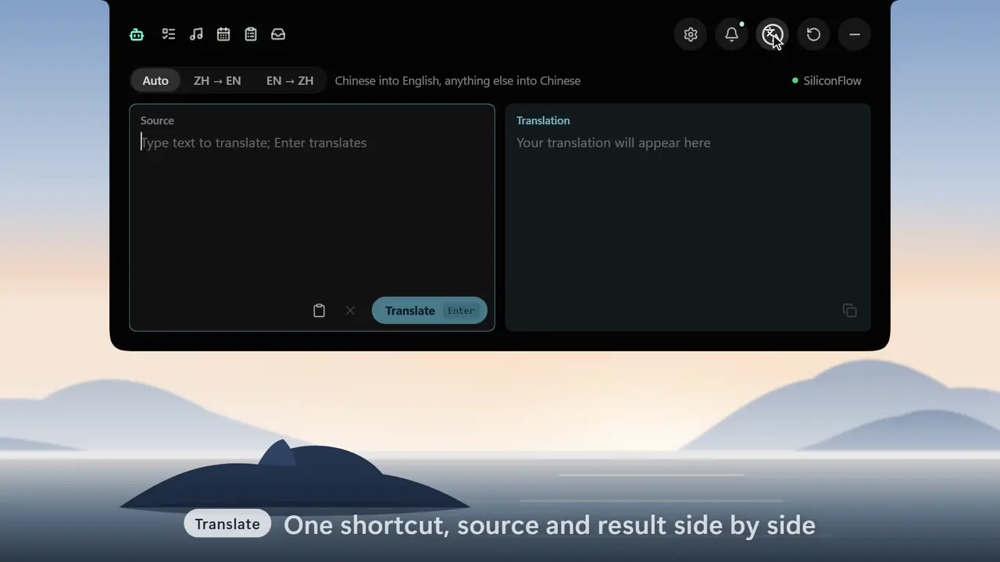

<div align="center">
  <a name="readme-top"></a>
  <a href="https://fuyu.ing/"></a>

  <h1>Fuyu</h1>

  <p><b>Остров, который собирает беспорядок на вашем рабочем столе</b></p>

  <p>Динамический остров для рабочего стола Windows и macOS: задачи, буфер обмена, сообщения, перевод, музыка и состояние ваших ИИ-агентов — всё на маленьком острове у верхнего края экрана.</p>

  <p>
    <a href="https://github.com/TixXin/fuyu/releases/latest"></a>
    &nbsp;
    <a href="https://github.com/TixXin/fuyu/releases"></a>
    <br>
    <a href="https://fuyu.ing/#mac-install"></a>
  </p>

  <p>
    <a href="https://github.com/TixXin/fuyu/releases/latest"></a>
    
    
    <a href="../../LICENSE"></a>
    <a href="https://github.com/TixXin/fuyu/stargazers"></a>
  </p>

  <p>
    <a href="../../README.md">简体中文</a>
    ·
    <a href="README.zh-TW.md">繁體中文</a>
    ·
    <a href="README.en.md">English</a>
    ·
    <a href="README.ja.md">日本語</a>
    ·
    <a href="README.ko.md">한국어</a>
    ·
    <a href="README.es.md">Español</a>
    ·
    <a href="README.fr.md">Français</a>
    ·
    <a href="README.de.md">Deutsch</a>
    ·
    <b>Русский</b>
    ·
    <a href="README.pt-BR.md">Português</a>
  </p>

  <p><sub>Переведено с <a href="../../README.md">README на упрощённом китайском</a> по состоянию на 2026-11-15; перевод может отставать. Будем рады исправлениям от носителей языка.</sub></p>

  <p>
    <a href="https://fuyu.ing/">Сайт</a>
    ·
    <a href="https://fuyu.ing/plugins/">Маркетплейс плагинов</a>
    ·
    <a href="../plugins/README.md">Написать плагин</a>
    ·
    <a href="https://github.com/TixXin/fuyu/issues">Сообщить о проблеме</a>
  </p>

  <p>
    <a href="../assets/promo-001-one-island-en.mp4"></a>
    <br>
    <sub>Весь обзор за 43 секунды. Остров на видео — настоящий фронтенд, а не запись экрана (<a href="../../video/README.md">как это сделано</a>, на китайском) · <a href="../assets/promo-001-one-island-en.mp4">Смотреть полное видео со звуком</a> · <a href="../assets/promo-004-one-day-en.mp4">Один день с Fuyu (46 секунд, с озвучкой)</a></sub>
  </p>
</div>

## Что это?

Fuyu (浮屿, «плавучий островок») — лёгкий плавающий остров без рамки, который всегда остаётся поверх других окон. Он свёрнут у верхнего края экрана, раскрывается, когда нужен, и сам сворачивается, когда вы закончили. Всё, чем вы пользуетесь каждый день, есть на острове, так что не нужно переключать окна, чтобы просто взглянуть.

<p align="center">
  
  <br>
  <sub>В свёрнутом виде занимает только эту полоску у верхнего края экрана; здесь он следит за песней — текст и звуковая волна</sub>
</p>

## Что есть на острове

<p align="center">
  <a href="https://fuyu.ing/#day"></a>
  <a href="https://fuyu.ing/#day"></a>
  <a href="https://fuyu.ing/#day"></a>
  <a href="https://fuyu.ing/#day"></a>
  <a href="https://fuyu.ing/#day"></a>
  <a href="https://fuyu.ing/#agent"></a>
  <br>
  <sub>Нажмите на любую картинку, чтобы самому попробовать остров на сайте</sub>
</p>

<table>
  <tr>
    <td valign="top"><code>01</code></td>
    <td><b>Задачи и заметки</b><br>Задачи на день, та, на которой вы сосредоточены, ежедневная заметка и архив прошлых дней.</td>
  </tr>
  <tr>
    <td valign="top"><code>02</code></td>
    <td><b>Музыка</b><br>Управление тем, что сейчас играет, со звуковой волной и синхронным текстом песни.</td>
  </tr>
  <tr>
    <td valign="top"><code>03</code></td>
    <td><b>Сообщения</b><br>Уведомления QQ и WeChat и несколько почтовых ящиков; письма можно читать и отвечать на них прямо на острове.</td>
  </tr>
  <tr>
    <td valign="top"><code>04</code></td>
    <td><b>Буфер обмена и лоток для файлов</b><br>История буфера обмена с текстом и изображениями; бросьте файлы на остров, а потом перетащите их в другое приложение.</td>
  </tr>
  <tr>
    <td valign="top"><code>05</code></td>
    <td><b>Быстрый перевод</b><br>Открывается сочетанием клавиш, поддерживает несколько сервисов перевода на основе LLM.</td>
  </tr>
  <tr>
    <td valign="top"><code>06</code></td>
    <td><b>ИИ-агенты</b><br>Состояние и расход ваших сессий Claude Code и Codex; одобряйте запросы прямо на острове, переходите к нужному окну одним щелчком и получайте уведомления на телефон, когда вы не за компьютером.</td>
  </tr>
  <tr>
    <td valign="top"><code>07</code></td>
    <td><b>Календарь</b><br>События на сегодня и завтра, календарь на месяц с лунными датами и праздниками, обратный отсчёт на острове перед каждой встречей и подключение одним щелчком.</td>
  </tr>
  <tr>
    <td valign="top"><code>08</code></td>
    <td><b>Системные подсказки</b><br>Изменения громкости и яркости, а также какое приложение использует камеру или микрофон.</td>
  </tr>
  <tr>
    <td valign="top"><code>09</code></td>
    <td><b>Плагины и темы</b><br>Расширяйте остров плагинами из маркетплейса (для чувствительных данных нужно ваше отдельное разрешение) и выбирайте готовое оформление в магазине тем.</td>
  </tr>
</table>

Внешний вид, размер, способ сворачивания, сочетания клавиш и каждая функция настраиваются в окне настроек, а приложение обновляется само. Все ваши данные остаются на вашем компьютере.

## Потребление ресурсов

В свёрнутом виде, в простое и без музыки (настройки по умолчанию, без плагинов):

| | Замер |
|---|---|
| CPU | Около **10%** одного ядра (около 0,5% от общей загрузки на 20-ядерной машине) |
| Память | Около **16 МБ** на сам Fuyu |
| Страница «Агенты», обновляющая список сессий каждую секунду | **0,1%** одного ядра |
| Каждый установленный плагин на PowerShell | Около **60 МБ** сверху |

Как проводились замеры и полные данные: [idle-usage.md](../investigations/idle-usage.md) (на китайском).

## Начало работы

1. **Скачайте и установите**: загрузите установщик со страницы [Releases](https://github.com/TixXin/fuyu/releases/latest).
   - **Windows**: скачайте `_x64-setup.exe`. Установщики не подписаны; если SmartScreen покажет предупреждение, выберите «Подробнее → Выполнить в любом случае».
   - **macOS**: в [списке релизов](https://github.com/TixXin/fuyu/releases) скачайте `_aarch64.dmg` из самой новой версии, где он есть (если в последней стабильной версии его нет, ищите в тестовой версии над ней), и перетащите Fuyu в «Программы». При первом запуске откройте «Системные настройки → Конфиденциальность и безопасность» и нажмите «Всё равно открыть»; пошаговая инструкция — в [руководстве по установке на Mac](https://fuyu.ing/#mac-install).
2. **Раскройте остров**: наведите указатель на остров у верхнего края экрана, чтобы раскрыть его; кнопка с шестерёнкой или значок в системном трее (на Mac — значок в строке меню) открывает настройки. На Mac приветственное руководство поможет включить нужные системные разрешения.
3. **Настройте один раз**: почту, перевод и ИИ-агентов нужно один раз настроить в настройках. Подробнее: [почта](../features/mail.md), [ИИ-агенты](../features/agent-status-hooks.md), [уведомления QQ](../features/qq-notifications.md) и [напоминания WeChat](../features/wechat-reminders.md) (на китайском).

> [!NOTE]
> Работает в Windows 10 / 11 и macOS 15 и новее (Apple silicon). На Mac есть несколько отличий от Windows: QQ и WeChat показывают только число непрочитанных сообщений, без их содержимого, а управление медиа и яркостью использует закрытые системные интерфейсы. В [platforms.md](../architecture/platforms.md) описано состояние каждой функции на обеих платформах (на китайском).

## Плагины

Если на острове чего-то не хватает, вы можете добавить это сами. Плагин — это папка: манифест и программа, которую запускает остров (скрипт PowerShell, exe или скрипт Node.js). Плагины только передают данные; страницы, свёрнутую полосу и настройки остров рисует по шаблонам, поэтому они выглядят так же, как весь остров.

```sh
npm create fuyu-plugin@latest
```

- **Установите готовый**: через «Настройки → Маркетплейс плагинов» на острове или сначала загляните в [маркетплейс плагинов на сайте](https://fuyu.ing/plugins/).
- **Напишите свой**: [быстрый старт](../plugins/quickstart.md) проведёт вас с нуля до работающего плагина примерно за час; [документация по плагинам](../plugins/README.md) охватывает всё остальное (обе на китайском).
- **Поделитесь им**: опубликуйте в [маркетплейсе плагинов](https://github.com/TixXin/fuyu-plugins) или используйте только на своём компьютере; шаги описаны в разделе [публикация](../plugins/publish.md) (на китайском).

## Сборка из исходного кода

- **Windows**: нужны Windows 10/11, Node.js, pnpm, Rust, Visual Studio C++ Build Tools и WebView2 Runtime.
- **macOS**: нужны macOS 15 или новее, инструменты командной строки Xcode (`xcode-select --install`), Node.js, pnpm и Rust.

```sh
git clone https://github.com/TixXin/fuyu.git
cd fuyu
pnpm install
pnpm tauri dev      # режим разработки
pnpm tauri build    # собрать установщики
```

Технологии: Tauri 2, React 19 + TypeScript и Rust. Выпуск версий и обновления внутри приложения описаны в [docs/features/updater.md](../features/updater.md) (на китайском).

## Сообщество

Есть вопросы, идеи или просто хотите пообщаться? Отсканируйте код, чтобы вступить в нашу группу пользователей в WeChat (в основном на китайском):

<p align="center">
  
</p>

## Как помочь проекту

<a href="https://fuyu.ing/logo/"></a>

Fuyu мы делаем все вместе, и для вас здесь тоже найдётся место:

- **Сообщайте о проблемах и идеях**: откройте [issue](https://github.com/TixXin/fuyu/issues) и расскажите, что мешает или чего не хватает.
- **Меняйте код, документацию или переводы**: присылайте pull request. В [CONTRIBUTING.md](../../CONTRIBUTING.md) описано, как это сделать и какие проверки запустить перед этим; в [AGENTS.md](../../AGENTS.md) — как устроен код (на китайском).
- **Напишите плагин**: трогать сам остров не нужно; когда будет готов, опубликуйте его в [маркетплейсе плагинов](https://github.com/TixXin/fuyu-plugins).
- **Нарисуйте логотип**: у Fuyu пока нет официального логотипа, и [конкурс](https://fuyu.ing/logo/) всё ещё открыт; пустое место справа ждёт именно его.

<a href="https://github.com/TixXin/fuyu/graphs/contributors"></a>

## История звёзд

Каждая звезда помогает Fuyu двигаться дальше.

<p align="center">
  <a href="https://star-history.com/#TixXin/fuyu&amp;Date">
    <picture>
      <source media="(prefers-color-scheme: dark)" srcset="https://api.star-history.com/svg?repos=TixXin/fuyu&amp;type=Date&amp;theme=dark">
      
    </picture>
  </a>
</p>

## Лицензия

[GPL-3.0](../../LICENSE). Авторы плагинов могут выбирать собственную лицензию. Сторонние зависимости и встроенные ресурсы распространяются под своими лицензиями: их происхождение и уведомления — в [уведомлениях о сторонних компонентах](../THIRD_PARTY_NOTICES.md), а встроенные шрифты — в [заметках о шрифтах](../../src/assets/fonts/README.md).

> [!NOTE]
> Проект совместно поддерживают [TixXin](https://github.com/TixXin) и [ShengLin1001](https://github.com/ShengLin1001); в ноябре 2026 года он был переименован из fly-island в Fuyu. Автор оригинала, [flyl1u](https://github.com/flyl1u/fly-island), предпочитает простой и минималистичный динамический остров. Чтобы дать острову больше возможностей и позволить большему числу людей добавлять на него свои самодельные функции, этот проект пошёл своим путём, развивается сообществом и обзавёлся маркетплейсом плагинов. Мы рады pull request'ам (см. [как помочь проекту](../../CONTRIBUTING.md)), а также вашим компонентам в [маркетплейсе плагинов](https://github.com/TixXin/fuyu-plugins) или собственным плагинам, установленным локально (см. [документацию по плагинам](../plugins/README.md)).

<p align="center">
  <a href="#readme-top"></a>
  <br>
  <sub>Когда вы закончили, он сворачивается сам · <a href="#readme-top">Наверх</a></sub>
</p>
