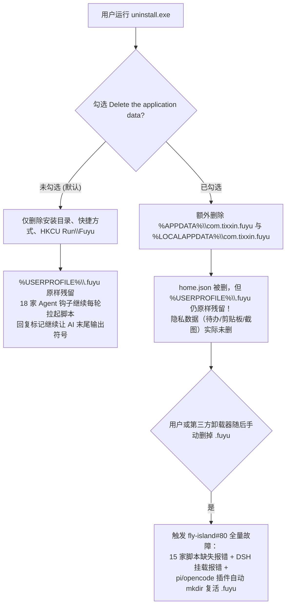
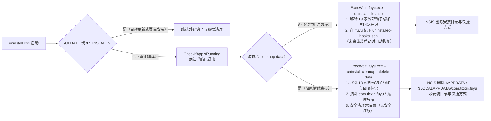

# AI 代理钩子与外部配置的卸载清理调研与修复方案

> 日期：2026-11-17。问题：`flyl1u/fly-island#80`（卸载时勾选删除应用数据后，AI hook 配置未同步清理）是否也是浮屿的问题？全网及开源项目如何处理此类外部注入配置的卸载？浮屿应如何彻底修复？范围：本仓库源码核查（`installer.nsi`、`agent_status/`、`home_dir/`、`rename_migration/`）、上游与同类灵动岛开源项目（`flyl1u/fly-island`、`Octane0411/open-vibe-island`、`wxtsky/CodeIsland`、`MioMioOS/MioIsland`、`farouqaldori/claude-island`、`erha19/ping-island`）、AI 钩子与开发工具（`PeonPing/peon-ping`、`entireio/cli`、`farion1231/cc-switch`、`git-ecosystem/git-credential-manager`）、Tauri v2 NSIS 安装包实践（`tauri-apps/tauri`、`andrealo20/crest`、`loss-and-quick/Kasumi-Proxy`、`clash-verge-rev/clash-verge-rev`）以及 Claude Code / Codex 官方钩子行为文档。相关任务：B73（B73.1、B73.2、B73.3）。

## 结论

### 1. 直接定性：是，且浮屿上的影响面比 `fly-island#80` 更广、有四层叠加问题

`flyl1u/fly-island#80` 报告的缺陷在浮屿中**完全存在**，并且因为浮屿后续演进了**家目录外迁（`~/.fuyu`，D30.3）**与**18 家 AI 代理全量接入 + 回复状态标记 + SSH 远程钩子 + 编辑器扩展**，实际表现为四个层面的叠加问题：

1. **Windows 卸载器完全未清理外部配置**：`src-tauri/windows/installer.nsi` 的 `Section Uninstall` 只删除安装目录、快捷方式与开机自启注册表项；勾选 `Delete the application data` 时只执行 `RmDir /r "$APPDATA\com.tixxin.fuyu"` 和 `$LOCALAPPDATA\com.tixxin.fuyu`，从未移除写入 18 家 AI 代理配置目录的钩子、插件脚本或全局提示词里的回复标记。
2. **家目录迁出后，`Delete the application data` 连 `~/.fuyu` 本身都漏删了（双刃剑效应）**：
   - **路径 A（普通用户运行 `uninstall.exe` 并勾选删除应用数据）**：2026-11-12 起浮屿把数据与 `fuyu-agent-*.{cmd,ps1}` 放在 `%USERPROFILE%\.fuyu`（或 `%APPDATA%\com.tixxin.fuyu\home.json` 指向的自定义目录）。卸载器只删了 `%APPDATA%\com.tixxin.fuyu`（把指针文件 `home.json` 删了），**`%USERPROFILE%\.fuyu` 整棵目录残留在硬盘上**——一方面违背了用户勾选「删除应用数据」清理待办、剪贴板、截图隐私数据的预期；另一方面因为脚本还在 `~/.fuyu`，18 家 AI 代理每次提问、调工具、结束仍会继续拉起 `cmd.exe` / `powershell.exe` / `curl.exe` 写状态文件并探测已关闭的 `127.0.0.1:47830` 审批端口，`CLAUDE.md` / `AGENTS.md` 里的回复标记也会让所有 AI 持续在回复末尾输出 `↩` / `⋯` / `✓`。
   - **路径 B（一旦补上删除 `~/.fuyu`，或用户手动删 `~/.fuyu` / 使用 Geek Uninstaller 等强力卸载工具 / 0.3.7 前未迁移路径）**：立刻触发比 `fly-island#80` 大 9 倍的故障面——15 家命令行钩子报脚本缺失错误；DeepSeek Harness 的 `cordis.patch.yml` 因找不到 `~/.fuyu/dsh-plugin/index.js` 加载插件失败；更隐蔽的是，残留在外部配置目录的 `opencode`、`MiMo Code`、`pi` 插件脚本内部写了 `mkdir(FUYU_DIR, { recursive: true })`，下次启动这些代理时会把刚删掉的 `~/.fuyu` **重新建出来（死灰复燃）**。
3. **应用内缺少「移除钩子」按钮，macOS 拖入废纸篓完全无卸载钩子机制**：macOS 采用 `.app` 分发，用户将 `Fuyu.app` 拖入废纸篓时操作系统不会运行任何卸载脚本；而浮屿设置页目前只有「安装/修复」，没有「移除钩子」，用户即使想在卸载前手动退订也无处操作。
4. **钩子命令缺少「脚本不存在时静默放行（fail-open）」自愈保护**：当前写入各家配置的命令直接调用 `/bin/sh '/.../.fuyu/fuyu-agent-*.sh'` 或 `powershell.exe -File "C:\...\.fuyu\fuyu-agent-*.ps1"`，只要脚本目录被外部手动删掉，解释器必然返回非零退出码（`1` 或 `127`）并在代理终端打出错误提示。

### 2. 核心建议（四道防线组合修复）

综合全网开源项目的成熟实践与踩坑教训，不应在 NSIS 脚本里手写正则或文本替换去改用户的 `settings.json` / `config.toml`（极易写坏格式），而应采用**「Rust 统一反安装器 + 应用内移除入口 + NSIS 卸载前自调用 + 钩子命令 fail-open 守卫」**四道防线：

1. **Rust 统一 `uninstall` 接口**：在 `harness::Hooks` 结构体中与 `install`、`check` 对称增加 `uninstall` 函数指针，编译器强制 18 家及未来新增代理全部实现精确卸载（保留用户自己的其他 hooks 与配置），并联动清理回复标记。
2. **应用内「移除钩子」按钮**：在「设置 → AI Agent → AI Agent 状态灯」卡片的「安装/修复」旁提供「移除钩子」操作（含已开启的 SSH 远程主机钩子清理），解决 macOS 卸载前清理与日常停用需求。
3. **Windows NSIS 卸载闭环（`fuyu.exe --uninstall-cleanup`）**：
   - 修复 NSIS `PageLeaveReinstall` 覆盖升级未传标记的陷阱（传 `/REINSTALL` 跳过卸载清理，与 `/UPDATE` 一致）；
   - 在 `Section Uninstall` 的 `CheckIfAppIsRunning` 之后、删除 `fuyu.exe` 之前，同步调用 `"$INSTDIR\fuyu.exe" --uninstall-cleanup`（勾选删除应用数据时附加 `--delete-data`）；
   - **所有真正卸载**均移除外部 AI 钩子与回复标记（若保留应用数据则写入 `uninstalled-hooks.json` 以便未来重装自动恢复）；**勾选删除应用数据时**额外清除 `com.tixxin.fuyu.*` 系统凭据，并安全删除默认 `~/.fuyu`（对 `home.json` 指向的用户自定义目录执行**受管文件白名单删除**，绝不对任意用户目录调 `remove_dir_all`）。
4. **钩子命令与外部插件 Fail-Open 兜底**：写入外部配置的命令统一包裹「脚本存在才执行，不存在直接 `exit 0`」，外部 JS 插件检测到 `FUYU_DIR` 下无浮屿核心脚本时直接静默跳过、不再 `mkdir` 重建目录——即使 macOS 用户直接拖废纸篓并 `rm -rf ~/.fuyu`，所有 AI 代理也零报错、零残留写盘。

---

## 开源项目与行业做法调研

### 一、同类 AI 灵动岛与钩子工具对比

以下数据均于 2026-11-17 经 GitHub API 与源码仓库核实：

| 项目 | 平台 / 技术栈 | Star（2026-11-17） | 外部钩子卸载设计 | 亮点与局限 |
|---|---|---|---|---|
| [flyl1u/fly-island](https://github.com/flyl1u/fly-island) | Windows / Tauri + Rust | 浮屿前身上游 | **未实现**（issue #80 于 2026-11-16 提出，截至 2026-11-17 `1d51890` 尚未推送修复提交）[1] | 仅接了 Codex 与 Claude Code 两家，问题集中在 NSIS 删了 `%APPDATA%` 下脚本但未删两处配置引用 |
| [Octane0411/open-vibe-island](https://github.com/Octane0411/open-vibe-island) | macOS / Swift | 2,084 | 独立 CLI `OpenIslandSetupCLI` 提供 `uninstall` 及分代理 `uninstallClaude` / `uninstallKimi` / `uninstallGrok` / `uninstallZcode` / `uninstallHermes` [2] | **清单追踪 + 修改前备份**：安装时写 `InstallerManifest`（如记录是否由它开启了 Codex `hooks` feature），卸载前生成 `.backup.<ISO8601>`，若无剩余钩子还能还原开关；局限是 macOS 直接删 `.app` 仍需用户先跑 CLI 或点应用内卸载 |
| [wxtsky/CodeIsland](https://github.com/wxtsky/CodeIsland) | macOS (Swift) + Windows (C# WPF) | 2,570 | `HookManager` 与 `CodeIsland.Hooks.Cli` 将 `Install / Repair / Uninstall` 做成对等三态，设置页每家工具行直接带「移除（Uninstall）」按钮 [3] | **UI 可达性最好**：把「移除」放在与「安装」「修复」同一排；独立 `backups/` 目录只建一份幂等备份，不污染 `~/.claude/` 目录；但尚未把卸载钩子联动进 Windows 安装包卸载流程 |
| [MioMioOS/MioIsland](https://github.com/MioMioOS/MioIsland) / `claude-island` 系 | macOS / Swift | 545（原仓 2,537） | `HookInstaller.swift` 实现纯函数 `pruneLegacyHookEntries` [4] | **防写坏校验**：清空事件数组则删事件 key，清空 `hooks` 则删顶层 `"hooks"` 键；写盘前做 `serialize → deserialize` 往返校验（round-trip check）确保 JSON 合法；局限是拖废纸篓后常留死路径，社区多篇排障帖教用户手删 `~/.claude/settings.json` |
| [erha19/ping-island](https://github.com/erha19/ping-island) | macOS / Swift | 1,145 | `RemoteConnectorManager` 带专门的 `.uninstalling` 状态与 `uninstallRemoteAgent`，另带 `IDEExtensionInstaller.uninstallExtensions` [5] | 覆盖了**SSH 远端桥接卸载**与 `.codebuddy` / `.qoder` **IDE 扩展目录清理**两个容易遗漏的角落 |
| [PeonPing/peon-ping](https://github.com/PeonPing/peon-ping) | 跨平台 / Shell + PowerShell + Python | 5,118 | 独立 `uninstall.sh` / `uninstall.ps1` 清理 Claude Code、Codex、TRAE、Kimi、OpenCode、Antigravity 等钩子 [6] | **目录门禁（Hard Gatekeeper）**：显式拦截 `/`、`$HOME` 等危险路径并校验特征文件存在才允许删除；只剥离带自身绝对/`~`路径前缀的钩子，不误伤其他工具同名 `notify.sh` |
| [entireio/cli](https://github.com/entireio/cli) | 跨平台 / Go | 5,342 | `entire disable --uninstall` 统一卸载多 Agent 钩子与 Git 钩子 [7] | 分步输出每项清理成功/跳过/失败及手动恢复命令，单个外部配置失败不中断其余项清理 |

### 二、桌面安装器（Tauri NSIS / 跨平台）卸载外部配置的通行模式

对 `git-ecosystem/git-credential-manager`、`tauri-apps/tauri`、`andrealo20/crest`、`loss-and-quick/Kasumi-Proxy`、`clash-verge-rev/clash-verge-rev` 等仓库的卸载实现横向对比后，行业结论高度一致：

1. **绝不在安装包脚本（NSIS / Inno Setup / pkg script）中直接解析或正则替换用户配置文件**：
   - `git-credential-manager` 在 Windows / macOS / Linux 卸载时统一调用自身二进制 `git-credential-manager unconfigure`（macOS pkg 卸载脚本用 `sudo -u $(/usr/bin/logname)` 切回当前登录用户执行），由主程序自己的配置模块安全读写 `~/.gitconfig` [8]。
   - Tauri v2 项目如 `andrealo20/crest`（在卸载前执行 `ExecWait '"$INSTDIR\${MAINBINARYNAME}.exe" --restore-banners'` 恢复被接管的系统状态）[9] 与 `loss-and-quick/Kasumi-Proxy`（`ExecWait '"$INSTDIR\kasumi-helper.exe" --uninstall'`）[10]，均采用**在删除二进制前同步调用自身 CLI 参数**的模式。
2. **Tauri NSIS 模板里的三个关键时序陷阱（必须避开）**：
   - **陷阱 A：`NSIS_HOOK_PREUNINSTALL` 早于 `CheckIfAppIsRunning`**。在 Tauri `installer.nsi`（第 855–860 行）中，`NSIS_HOOK_PREUNINSTALL` 在检测并关闭运行中实例**之前**执行。如果浮屿正在运行，用户在「需要关闭正在运行的 Fuyu」弹窗点了取消卸载，放在 `PREUNINSTALL` 里的钩子清理已经提前跑完，会导致应用留着但钩子没了；或者主程序后台线程（如 SSH 会话同步、设置回写）还在写文件时发生竞争。因此**清理调用必须放在 `CheckIfAppIsRunning` 之后、`Delete "$INSTDIR\${MAINBINARYNAME}.exe"` 之前**（浮屿本来就自维护了 `src-tauri/windows/installer.nsi`，可直接精确定位）。
   - **陷阱 B：手动覆盖安装（`PageLeaveReinstall`）运行 `uninstall.exe` 时 `$UpdateMode` 为 `0`**。Tauri 自动更新器传 `/P /UPDATE`，此时 `$UpdateMode = 1`；但用户手动双击新版安装包覆盖旧版、并保持默认第一项「先卸载旧版本再安装（`uninstallBeforeInstalling`）」（`installer.nsi` 第 291–410 行）时，`ExecWait` 调起旧 `uninstall.exe` **没有传 `/UPDATE`**！若不加区分，用户每次手动装新版安装包都会把已装好的 AI 钩子全卸掉。修复方法是在 `PageLeaveReinstall` 的升级/重装分支向 `uninstall.exe` 追加自定义参数 `/REINSTALL`，卸载端遇到 `$UpdateMode = 1` 或 `/REINSTALL` 均跳过外部配置清理。
   - **陷阱 C：不在 `PREINSTALL` 里调旧版 `fuyu.exe`**。如 `andrealo20/crest` 注释所警示 [9]：覆盖安装前磁盘上的旧版 `fuyu.exe` 还不认识新增的 `--uninstall-cleanup` 参数，若在安装钩子里调它，旧版会直接当作普通启动拉起 GUI 并阻塞安装进程。而在 `Section Uninstall` 中，`uninstall.exe` 与同目录的 `fuyu.exe` 永远是同一次安装写入的同版本产物，100% 认识该参数。
   - **陷阱 D：`tauri_plugin_single_instance` 与 GUI 子系统干扰**。浮屿使用 `windows_subsystem = "windows"`（Windows 下无黑框闪烁），但 `lib.rs` 注册了 `tauri_plugin_single_instance` 和 `home_dir::init`。因此 `--uninstall-cleanup` **必须在 `run()` 第一行、任何单实例锁与 WebView2 初始化之前拦截并直接 `std::process::exit(0)`**，否则既可能唤醒残留实例，又会在 `EBWebView` 目录重新生成缓存导致卸载删不干净。

---

## 浮屿自身现状盘点与残留影响矩阵

### 一、各渠道外部写入点全量清单

我们对 `src-tauri/src/` 进行了全量盘点，浮屿在自身安装目录之外共写入 **7 类外部位置**：

| 类别 | 涉及代理 / 模块 | 外部文件路径（Windows / macOS） | 卸载未清理且删掉 `~/.fuyu` 后的实际后果 |
|---|---|---|---|
| **1. JSON 共享配置（事件数组合并）** | Claude Code、WorkBuddy（2 目录）、Qoder / Qoder CN、CodeBuddy、Qwen Code、TRAE、TRAE CN、ZCode、Droid（共 **11 处**） | `~/.claude/settings.json`、`~/.workbuddy*/settings.json`、`~/.qoder*/settings.json`、`~/.codebuddy/settings.json`、`~/.qwen/settings.json`、`~/.trae*/hooks.json`、`~/.zcode/cli/config.json`、`~/.factory/{hooks,settings}.json`（及对应环境变量覆盖目录） | 每次会话启动、提问、工具调用、结束均尝试执行已删除的 `fuyu-agent-*.{cmd,ps1,sh}`，返回退出码 `1`/`127` 报错；Claude Code 的 HTTP `PermissionRequest` / `AskUserQuestion` 钩子持续向关闭的 `127.0.0.1:47830` 发请求 |
| **2. JSON 共享配置（顶层命名键）** | Antigravity（**1 处**） | `~/.gemini/config/hooks.json` 顶层 `"fuyu"` 键 | Antigravity IDE / CLI 每次调用和 `run_command` 前执行缺失脚本报错 |
| **3. JSON 独占钩子文件** | Grok CLI、GitHub Copilot CLI（**2 处**） | `~/.grok/hooks/fuyu-island.json`、`~/.copilot/hooks/fuyu-island.json` | 整份文件由浮屿独占创建，残留后每次会话和工具调用触发缺失脚本错误 |
| **4. TOML 标记区块** | Codex、Kimi Code（**2 处**） | `~/.codex/config.toml`（`# BEGIN/END Fuyu Agent Status Hooks` 及旧名 `FocuSD` 块）、`~/.kimi-code/config.toml`（`# BEGIN/END ... (Kimi Code)`） | Codex 每次提问、结束、权限请求均报 hook command failed；Kimi Code 每次事件触发失败 |
| **5. 外部 JS 插件与 Cordis 挂载** | opencode 1.x、MiMo Code、pi、DeepSeek Harness（**4 处**） | `~/.config/opencode/plugin/fuyu-island.js`、`~/.config/mimocode/plugin/fuyu-island.js`、`~/.pi/agent/extensions/fuyu-island.js`；DSH 各家目录 `cordis.patch.yml` 的 `id: fuyu-island` 挂载项 | **高危**：① DSH 启动时 Cordis 解析 `cordis.patch.yml` 找不到 `~/.fuyu/dsh-plugin/index.js` 直接报错；② `pi` / `opencode` / `mimo` 插件每次事件调用 `mkdir(FUYU_DIR, { recursive: true })` **把已删的 `~/.fuyu` 目录重新建出来**并不断写入孤儿文件 |
| **6. 全局提示词回复状态标记** | Claude Code、Codex、WorkBuddy、Antigravity、DSH、opencode、Qoder、CodeBuddy、Qwen、ZCode、Kimi、MiMo、Grok、Copilot、Droid、pi（**16 家 + 旧规则文件**） | 各家 `CLAUDE.md` / `AGENTS.md` / `GEMINI.md` / `CODEBUDDY.md` / `QWEN.md` 末尾的 `<!-- fuyu: reply marker v5 -->` 块、`~/.grok/rules/fuyu-island.md`、`~/.claude/rules/fuyu-reply-marker.md` | 浮屿已卸载，但所有 AI 在每次回复末尾仍被强制多输出一行 `↩` / `⋯` / `✓`，且提示词里写着「去 Fuyu 设置里关闭」而应用早已不在 |
| **7. SSH 远程主机、系统凭据与编辑器扩展** | SSH 远程（Claude Code / Antigravity / 回复标记）、凭据管理器 / Keychain、VS Code 系编辑器扩展 | 远端 `~/.claude/settings.json`、`~/.gemini/config/hooks.json`、远端提示词文件；本机凭据 `com.tixxin.fuyu.*`（邮箱、日历、翻译、Bark、用量、插件）；`~/.vscode/extensions/tixxin.fuyu-*` 等 7 款编辑器 | 远端钩子每次 `curl` 读不到 `approval-port` 后 `exit 1` 回退终端但仍往 `~/.fuyu/agent-notifications/` 堆积文件；勾选删除应用数据后本机邮箱授权码与 API Key 仍留在系统凭据库中 |

### 二、当前 Windows 卸载流程的断链示意

---

## 修复计划（四道防线）

建议新建一个 `B` 组（或跨 `B` + `D` 组）任务推进，拆分为 **4 个内聚步骤**（可按 2–3 个功能单元提交）：

### 第 1 步：Rust 侧补齐统一的钩子与外部配置反安装能力（`src-tauri/src/agent_status/`）

1. **扩展 `Harness` 的 `Hooks` 契约**（`harness.rs`）：
   - 将 `Hooks` 从 `{ install, check }` 扩展为 `{ install, check, uninstall }`（签名均为 `fn(&HookEnv) -> Result<(), String>`）。利用 Rust 编译器详尽性检查，保证当前 18 家代理一个不漏，且未来按 `fuyu-agent-harness` skill 新增代理时强制同时提供 `uninstall`。
2. **各类型代理的无损卸载实现**（严格只删浮屿受管项，保留用户与其他工具如 Vibe Island / CodeIsland 的配置）：
   - **Claude Code 及兼容格式（11 处：`claude_code`、`workbuddy`、`qoder`、`codebuddy`、`qwen`、`trae`、`traeCn`、`zcode`、`droid`）**：
     - 配置文件不存在时直接 `Ok(())`（绝不在卸载时新建空配置文件）；
     - 复用已有的 `install_claude_code_hook_events(hooks, Vec::new())`——该函数已具备遍历全部事件、按 `is_island_hook_text`（同时匹配 `fuyu-agent-` 与历史 `focusd-agent-` 签名及 `X-Fuyu-Hook` 头）剥离受管项并删除变空事件的能力；
     - 增补收尾：若 `"hooks"`（或 ZCode 的 `"hooks.events"`）整体变为空对象 `{}`，移除空的 `"hooks"` 键（ZCode 若 `events` 清空同步不再强设 `enabled`）；若修改前后 JSON 等价则不写盘，不扰动文件修改时间。
   - **Antigravity（`antigravity.rs`）**：若 `~/.gemini/config/hooks.json` 存在且含 `"fuyu"` 键，移除 `"fuyu"` 键后写回。
   - **TOML 标记块（`codex_hooks.rs`、`kimi_hooks.rs`）**：若 `config.toml` 存在，复用现成的 `remove_managed_codex_hook_block` / `remove_hook_blocks` 剥离标记块及旧版 `FocuSD` 钩子；内容有变化时原子写回。
   - **独占文件插件与钩子（`grok`、`copilot`、`opencode`、`mimo`、`pi`）**：直接删除 `hooks/fuyu-island.json`、`plugin/fuyu-island.js`、`extensions/fuyu-island.js`（`NotFound` 视为成功）。
   - **DeepSeek Harness（`dsh_hooks.rs`）**：
     - 删除应用数据目录下的 `dsh-plugin/` 文件夹及旧 `fuyu-dsh-hooks.json`；
     - 遍历已存在的 DSH 家目录：若 `cordis.patch.yml` 满足 `is_fuyu_managed_home_patch`（整份文件只有浮屿写入的 3 行 `- insert`），直接删除该 `cordis.patch.yml`；若用户自定义了 `cordis.patch.yml` 或 `profiles/*/cordis.patch.yml` 并手动粘贴了 `- id: fuyu-island` 块，精确移除该列表项并保留其余 YAML 内容。
   - **回复状态标记（`reply_marker.rs`）**：直接调用现成的 `Change::Disable` 清理全部 16 家提示词文件中的 `<!-- fuyu: reply marker ... -->` 块与旧 `rules/` 文件；对 Grok 独占的 `~/.grok/rules/fuyu-island.md`，若剥离后内容为空则直接删除该文件。
3. **汇总函数 `uninstall_all_local(app_dir: &Path) -> UninstallSummary`**：
   - 收集各家结果（某一家配置损坏报错时不中断其余家的清理），最后删除 `app_dir` 下的 `fuyu-agent-*.{cmd,ps1,sh}` 与旧名 `focusd-agent-*` 脚本。

### 第 2 步：应用内新增「移除钩子」入口与远程清理（前端 + Tauri 命令）

1. **新增远程卸载 `remote_setup::uninstall_hooks(&app_dir)`**：
   - 对已开启的远程电脑通过 SSH 移除远端 `~/.claude/settings.json` 中的浮屿钩子、`~/.gemini/config/hooks.json` 中的 `"fuyu"` 键、远端回复标记块，并清理远端 `~/.fuyu/agent-notifications` 与 `approval-port`（单机连接超时控制在 5 秒内）。
2. **新增 Tauri 命令 `uninstall_agent_status_hooks`**：
   - 执行本地全量钩子卸载（注：应用内点「移除钩子」只卸钩子与脚本，**不动**用户单独开关的「回复状态标记」，除非在整机卸载时才一并清理）+ 远程主机钩子卸载，返回清理结果与远端状态。
3. **设置页交互（`AgentHooksSettingsSection.tsx` + 中英文 i18n + `pnpm settings:index`）**：
   - 当 `agentHooksState` 显示至少有一家已安装（`current` 或 `outdated`）且非开发版隔离模式时，在「安装/修复」按钮旁显示次级按钮「移除钩子 / Remove hooks」，方便用户在卸载应用前（尤其是 macOS 拖废纸篓前）或排障时一键干净退订。
   - 同步更新 `fuyu-agent-harness` skill 与 `docs/features/agent-status-hooks.md`、`docs/architecture/contracts.md`。

### 第 3 步：Windows NSIS 卸载链路与安全数据清理（`lib.rs` + `installer.nsi`）

1. **进程入口最早拦截（`src-tauri/src/lib.rs`）**：
   - 在 `pub fn run()` 最顶部（早于 `rename_migration::before_start()`、`home_dir::init()`、`tauri_plugin_single_instance` 与任何窗口/WebView 创建）检查 `std::env::args()` 是否含 `--uninstall-cleanup`；
   - 命中后走纯原生同步清理模块 `src-tauri/src/uninstall_cleanup.rs`，不创建 WebView、不占单实例锁，执行完毕直接 `std::process::exit(0)`。
2. **「保留数据卸载」与「删除数据卸载」的分级策略**：
   - **未勾选 `Delete the application data`（仅 `--uninstall-cleanup`）**：
     - 先读取当前是否装有 Agent 钩子或回复标记，若有则在数据目录写一份极简的 `uninstalled-hooks.json`（`{ "hooks": true, "replyMarker": true }`）；
     - 随即移除全部本地 18 家外部钩子、外部插件与本地回复标记——避免用户卸载浮屿后终端一直空跑脚本、AI 一直输出回复标记；若用户日后重新安装浮屿，启动时检测到 `uninstalled-hooks.json` 即自动无感恢复钩子与回复标记并删掉该标记文件。
   - **勾选 `Delete the application data`（`--uninstall-cleanup --delete-data`）**：
     - 执行全部外部钩子、外部插件与回复标记清理；
     - 清理 Windows 凭据管理器（及 macOS Keychain 复用函数）中属于正式版 `com.tixxin.fuyu` 命名空间的条目（复用 `win32/credentials.rs` 枚举能力，只删 `*.com.tixxin.fuyu` / `com.tixxin.fuyu.*`，不动开发版与其他软件凭据）；
     - **家目录删除的安全红线（借鉴 `peon-ping` Gatekeeper）**：
       - 读取 `%APPDATA%\com.tixxin.fuyu\home.json`（必须在 NSIS `RmDir /r "$APPDATA\${BUNDLEID}"` **之前**由 `fuyu.exe` 读取！）；
       - 若家目录就是默认的 `%USERPROFILE%\.fuyu`（严格校验：路径有父目录、不等于 `%USERPROFILE%` / `%APPDATA%` / 盘符根目录、且末级目录名为 `.fuyu`），执行 `fs::remove_dir_all` 彻底删除；
       - 若家目录是用户通过 `home.json` 或 `FUYU_HOME` 指定的**自定义目录**（例如用户指到了 `D:\OneDrive\Sync` 甚至 `D:\Documents`），**绝对禁止对整个目录调用 `remove_dir_all`**，仅按浮屿受管文件名/子目录名清单（`todos.json`、`settings.json`、`clipboard-*`、`screenshots/`、`plugins*`、`backups/`、`agent-*`、`fuyu-*`、`dsh-plugin/`、`runtime/` 等）逐项删除，若删完后目录已空再尝试一次非递归 `fs::remove_dir`（非空自动保留用户自己的其他文件）。
3. **NSIS 模板精确接入（`src-tauri/windows/installer.nsi`）**：
   - 在 `PageLeaveReinstall`（第 406 行附近）非更新模式的重装卸载命令后追加 `/REINSTALL`，并在 `un.onInit` 中用 `${GetOptions} $CMDLINE "/REINSTALL"` 解析到 `Var ReinstallMode`；
   - 在 `Section Uninstall` 的 `!insertmacro CheckIfAppIsRunning`（第 859 行）**之后**、`Delete "$INSTDIR\${MAINBINARYNAME}.exe"`（第 863 行）**之前**加入 `; Fuyu:` 标记段：当 `$UpdateMode <> 1` 且 `$ReinstallMode <> 1` 时，根据 `$DeleteAppDataCheckboxState` 调用 `ExecWait '"$INSTDIR\${MAINBINARYNAME}.exe" --uninstall-cleanup [--delete-data]'`；
   - 保持 `installer.nsi` 纯 ASCII 编码，确保 `tests/scripts/nsis-template.test.mjs` 通过，并补充脚本单测校验卸载段落顺序。

### 第 4 步：钩子命令与外部插件自身的 Fail-Open 静默自愈（跨平台终极兜底）

为彻底覆盖「macOS 用户直接把 `Fuyu.app` 拖进废纸篓并手动删掉 `~/.fuyu`」以及「Windows 用户使用第三方强力卸载工具直接粉碎目录」的场景：

1. **命令钩子包裹存在性守卫**：
   - **Windows 命令行钩子（`codex_hooks.rs` 等）**：由直接调用脚本改为先在 `cmd.exe` 内置 `if exist` 判断脚本文件存在再执行，脚本不存在直接 `exit /b 0`（连 `powershell.exe` 进程都不必拉起，既零报错又零耗时）：
     - 运行标记：`cmd.exe /d /s /c "if exist \"<running.cmd>\" (\"<running.cmd>\" <provider>) else exit /b 0"`
     - 状态与审批：`cmd.exe /d /s /c "if exist \"<status.ps1>\" (powershell.exe -NoProfile -ExecutionPolicy Bypass -File \"<status.ps1>\" <provider> <phase>) else exit /b 0"`
   - **macOS / Unix 钩子**：`[ -f '<script.sh>' ] && exec /bin/sh '<script.sh>' <args...> || exit 0`（对 Claude Code 的 `command + args` 数组形式使用 `/bin/sh` 加 `-c '[ -f "$1" ] && exec /bin/sh "$@" || exit 0' sh <script.sh> ...`）。
   - 注意：`hooks_state.rs` 比对钩子是否为最新时本来就是与构造函数生成的目标条目比对，升级后旧格式显示为「需要更新」，用户点一次「安装/修复」即平滑升级到带守卫的新命令；同时 `is_island_hook_text` 签名识别完全不受影响。
2. **阻止外部 JS 插件「复活」已删的 `~/.fuyu`**：
   - 修改 `fuyu-opencode-plugin.js`（同时作用于 MiMo Code）、`fuyu-pi-extension.js`、`fuyu-dsh-plugin.js`：在写任何标记或通知文件前，先 `stat` 检查 `FUYU_DIR` 本身已存在（不再调用 `mkdir(FUYU_DIR, { recursive: true })` 创建顶层家目录，只对已存在的 `FUYU_DIR` 下的 `agent-notifications` / `agent-sessions` 建子目录）。一旦用户删除了 `~/.fuyu`，残留在外部目录的 JS 插件立即变为纯静默 no-op，绝不再往磁盘写出幽灵 `~/.fuyu` 目录。

---

## 已确认的产品决策（2026-11-17 用户定）

1. **未勾选 `Delete the application data` 卸载时的行为**：只要是真正卸载（非更新/覆盖重装），**一律清理外部 18 家 AI 钩子与回复标记**，并在 `~/.fuyu/uninstalled-hooks.json` 记一笔以便日后重装自动恢复；勾选删除数据时不再留标记。
2. **VS Code / Cursor 等 7 款编辑器的终端跳转扩展（`tixxin.fuyu`）**：勾选 `Delete the application data` 时顺带删除 `~/.vscode/extensions/tixxin.fuyu-*` 等已装副本；未勾选时保留。
3. **Windows 卸载器执行时对 SSH 远程电脑的处理**：本地 `uninstall.exe` 运行 `--uninstall-cleanup` 时**只清本机配置、不连 SSH**（避免网络不通或密钥口令阻塞卸载进度条）；SSH 远程钩子的清理由应用内新增的「移除钩子」按钮负责。

---

## 来源

1. [flyl1u/fly-island Issue #80: 卸载时勾选“Delete the application data”后，AI hook 配置未同步清理](https://github.com/flyl1u/fly-island/issues/80)（2026-11-16 提出，2026-11-17 核查最近提交 `1d51890`）
2. [Octane0411/open-vibe-island — `OpenIslandSetupCLI.swift`、`ClaudeHookInstallationManager.swift`、`CodexHookInstallationManager.swift`](https://github.com/Octane0411/open-vibe-island)（2,084 star，2026-11-17 查询）
3. [wxtsky/CodeIsland — `windows/CodeIsland.Hooks.Cli/Program.cs`、`windows/CodeIsland.Windows/SettingsWindow.xaml.cs`](https://github.com/wxtsky/CodeIsland)（2,570 star，2026-11-17 查询）
4. [MioMioOS/MioIsland — `ClaudeIsland/Services/Hooks/HookInstaller.swift`](https://github.com/MioMioOS/MioIsland)（545 star，2026-11-17 查询）
5. [erha19/ping-island — `PingIsland/Services/Remote/RemoteConnectorManager.swift`、`IDEExtensionInstaller.swift`](https://github.com/erha19/ping-island)（1,145 star，2026-11-17 查询）
6. [PeonPing/peon-ping — `uninstall.sh`、`uninstall.ps1`](https://github.com/PeonPing/peon-ping)（5,118 star，2026-11-17 查询）
7. [entireio/cli — `cmd/entire/cli/uninstall_output.go`](https://github.com/entireio/cli)（5,342 star，2026-11-17 查询）
8. [git-ecosystem/git-credential-manager — `unconfigure` 命令与卸载器设计](https://github.com/git-ecosystem/git-credential-manager/blob/main/docs/usage.md)（2026-11-17 查询）
9. [andrealo20/crest — `src-tauri/windows/hooks.nsh`（Tauri NSIS 卸载前回调自身二进制恢复系统状态及 PREINSTALL 旧版本陷阱说明）](https://github.com/andrealo20/crest/blob/main/src-tauri/windows/hooks.nsh)（2026-11-17 查询）
10. [loss-and-quick/Kasumi-Proxy — `src-tauri/installer-hooks.nsh`](https://github.com/loss-and-quick/Kasumi-Proxy/blob/main/src-tauri/installer-hooks.nsh)（2026-11-17 查询）
11. [Tauri v2 Documentation — Windows Installer / NSIS Installer Hooks](https://v2.tauri.app/distribute/windows-installer/)（2026-11-17 查询）
