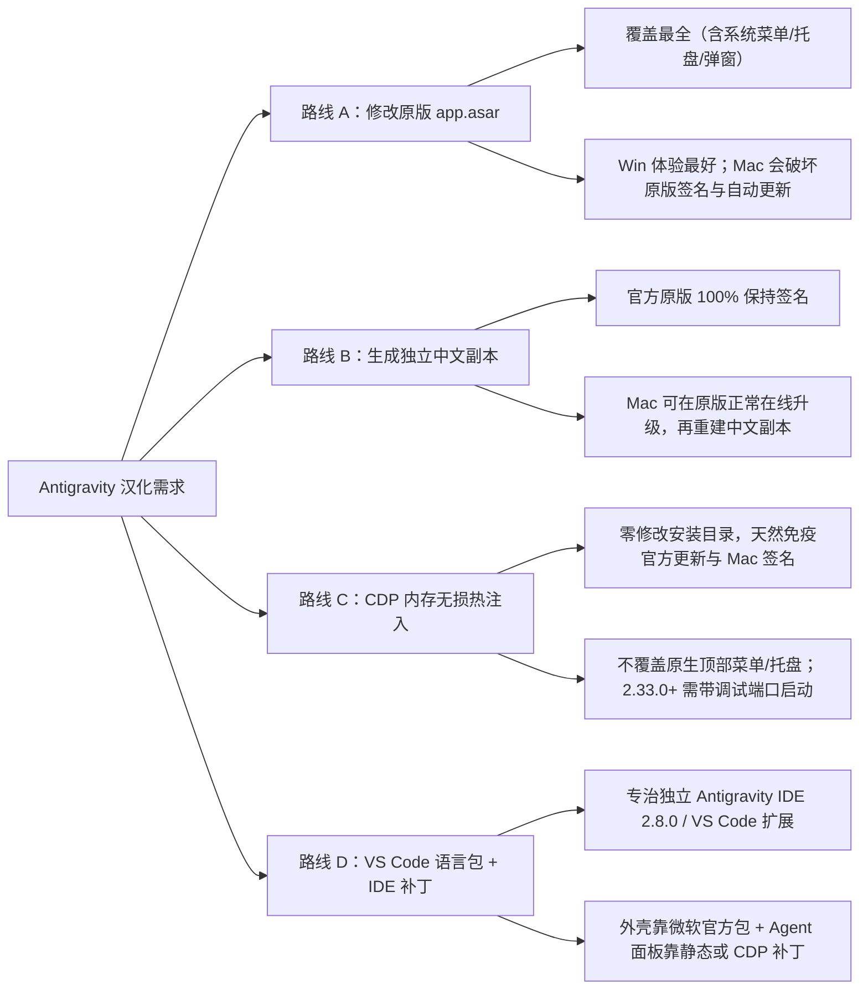

# Antigravity IDE / Desktop 汉化方案调研（macOS & Windows）

> 日期：2026-11-25。问题：调研目前 Google Antigravity（反重力）IDE 的汉化方案，覆盖 macOS 与 Windows 平台。范围：Google Antigravity 官方更新日志、GitHub 仓库检索（`antigravity 汉化` / `antigravity chinese` / `antigravity zh-cn` / `antigravity 中文` / `antigravity cn` / `antigravity2` / `antigravity-ide`）及头部 18 个开源仓库的实时元数据与一手 README、V2EX / 社区避坑讨论。相关任务：无

## 结论

截至 **2026-11-25**，Google 官方仍**未**为 Antigravity 独立桌面版（App `2.35.1`）提供内置简体中文界面；独立 IDE（`2.8.0`）也仅能通过微软 VS Code 语言包翻译编辑器外壳，无法覆盖 Antigravity 专属的智能体（Agent）面板、设置页与模型选择器。社区目前形成了 **ASAR 静态注入、独立中文副本、CDP 无损热注入、IDE 静态补丁** 四条成熟路线。

选方案前必须先分清你在用哪一个客户端形态（社区常统称“反重力 IDE”）：

| 你的使用形态 | macOS 推荐方案 | Windows 推荐方案 | 说明 |
|---|---|---|---|
| **Antigravity IDE（独立版 2.8.0）** 或 **IDE + App 都要** | **[yuexps/Antigravity-Hans](https://github.com/yuexps/Antigravity-Hans)**（`--ide` / `--app` CDP 动态模式，★651） | **[yuexps/Antigravity-Hans](https://github.com/yuexps/Antigravity-Hans)**（`--patch` IDE 静态补丁，免后台） | Go 单文件免环境；首次用 IDE 会引导安装微软官方简体中文语言包补齐编辑器菜单；自带右下角中英瞬切与「选项名保留英文」 |
| **Antigravity 2.0 桌面客户端（App 2.35.1）** | **稳妥/保自动更新**：`Antigravity-Hans`（CDP 动态）或 [Ace2025001/antigravity-desktop-zhcn](https://github.com/Ace2025001/antigravity-desktop-zhcn)（★118，独立中文副本，Apple Silicon 实测） **全界面含原生菜单**：[qqxpee/antigravity2-cn](https://github.com/qqxpee/antigravity2-cn)（★2,466）或 [Antigravity-Chinese-Localization](https://github.com/antigravity-cn-community/Antigravity-Chinese-Localization)（★2,362） | **首选（Node 环境）**：[qqxpee/antigravity2-cn](https://github.com/qqxpee/antigravity2-cn)（★2,466）或 [Antigravity-Chinese-Localization](https://github.com/antigravity-cn-community/Antigravity-Chinese-Localization)（★2,362） **免装环境开箱即用**：[Ace2025001/antigravity-desktop-zhcn](https://github.com/Ace2025001/antigravity-desktop-zhcn)（★118）或 [antigravity-zh-plugin](https://github.com/yunjuanyunshu114-byte/antigravity-zh-plugin)（★112，带冒烟自检自动回滚） | Windows 改 `app.asar` 几乎无副作用（更新覆盖后重跑即可）；macOS 直接改原版 `app.asar` 会破坏 Google 签名并导致内置自动更新失败，因此 Mac 更建议走 **CDP 无损注入** 或 **独立中文副本** |
| **VS Code 内的 Antigravity 扩展（1.13.0）** | [yiheng8023/antigravity-chinese](https://github.com/yiheng8023/antigravity-chinese)（`install:vscode`，★286；注：2.35.1 实测以 Win 为主） | [yiheng8023/antigravity-chinese](https://github.com/yiheng8023/antigravity-chinese)（`install:vscode`，★286） | 明确区分并适配 VS Code 扩展，不支持独立 IDE |

> **搭配必做**：所有界面汉化都不会改变 AI 回复语言。需在 Antigravity 的 `Settings → Customizations → Rules → +Global` 中添加全局中文规则（例如“始终使用简体中文回复”），才能让对话和任务输出默认中文。

## 产品形态与官方支持现状

Google Antigravity 桌面生态目前并行存在三种界面形态，底层打包方式完全不同，导致汉化工具并不通用：

1. **Antigravity App（又称 Antigravity 2.0 桌面客户端，当前最新版 `2.35.1`）**
   - 独立 Electron 应用，主进程与前端预加载代码封装在 `resources/app.asar`，包含 Sidecar 伴生面板、Swarm 协作面板与 `plugin://` 子框架。
   - **官方中文化状态**：未支持。查阅 [Google Antigravity 官方更新日志](https://antigravity.google/docs/changelog.md)（2026-11-25 核验），仅包含中文/日文/韩文粗体渲染、语音听写分词、终端 IME 光标等排版修复，没有原生界面语言切换选项；社区监测仓库 [ludanBig/antigravity-cn-status](https://github.com/ludanBig/antigravity-cn-status) 同样在 2026-11-25 标记为 `unsupported`。
2. **Antigravity IDE（独立版，当前最新版 `2.8.0`）**
   - 基于 VS Code 架构。编辑器外壳（菜单栏、文件树、命令面板、通用设置）可直接安装微软官方扩展 `MS-CEINTL.vscode-language-pack-zh-hans` 后执行 `Configure Display Language → zh-cn` 完成汉化。
   - 但 Antigravity 专属的 **Agent 侧边栏、独立设置页、模型选择器、内联审批卡** 为独立前端/跨域子帧，微软语言包完全覆盖不到，必须额外注入脚本或补丁。
3. **VS Code 扩展（当前最新版 `1.13.0`）**
   - 装在普通 VS Code 中的扩展，界面位于 Webview 内，需专门针对扩展清单与 Webview 本地代理做补丁。

## 四大技术路线对比

| 维度 | 路线 A：ASAR 原位注入 | 路线 B：独立中文副本 | 路线 C：CDP 无损热注入 | 路线 D：微软语言包 + IDE 补丁 |
|---|---|---|---|---|
| **代表项目** | `qqxpee/antigravity2-cn`、`Antigravity-Chinese-Localization`、`Silas-02/antigravity-desktop-cn`、`antigravity-zh-plugin` | `Ace2025001/antigravity-desktop-zhcn`（Mac 端）、`AI-Good-Tool/antigravity-zh-cn`（Win+Mac） | `yuexps/Antigravity-Hans`（动态模式）、`kdczyz/antigravity-chinese`、`antigravity-chinese-Zero-Touch` | `yuexps/Antigravity-Hans --patch`、`yiheng8023/antigravity-chinese`（VS Code 扩展） |
| **适用客户端** | 主要面向 App 2.0（`2.35.1`） | App 2.0（`AI-Good-Tool` 亦覆盖 IDE 2.8.0） | App 2.0 + 独立 IDE 2.8.0 | 独立 IDE 2.8.0 / VS Code 扩展 |
| **翻译完整度** | **最高**（前端 + 顶部菜单 + 托盘 + 右键菜单 + 原生弹窗 + Swarm/Sidecar） | **最高**（与路线 A 同级） | **中高**（前端、设置页、Agent/Swarm 面板全覆盖；无法汉化原生顶部菜单与托盘） | **高**（编辑器靠官方包，Antigravity 面板靠补丁） |
| **代码/正文防误伤** | 头部项目均具备 DOM 白名单/叶子节点改写，隔离 Monaco、输入框、AI Markdown 正文与思考链 | 同路线 A | 同样在 DOM 注入层隔离 `role="log"`、代码块与输入框 | 同路线 A / C |
| **macOS 签名与自动更新** | **痛点**：破坏 Google 签名，需本地 ad-hoc 重签；导致 `Squirrel.framework` 自动更新报 `did not pass validation`，升级须手动下 DMG 覆盖 | **优秀**：官方原版保持纯净签名，升级时切回原版完成官方更新，再重建中文副本 | **最优**：100% 不动官方 `.app`，签名、TCC 权限、官方自动更新全部无影响 | 静态补丁修改 IDE 文件会触发类似签名/完整性问题；用 CDP 动态模式则零影响 |
| **Windows 自动更新** | NSIS 更新退出时静默覆盖回英文，重新跑脚本或用自动检测启动器即可恢复 | 需切回官方版更新后再重建副本 | 无需重打补丁，重启后守护进程自动注入 | IDE 升级后重跑 `--patch` 即可 |
| **后台驻留开销** | **无**（随应用内置加载） | **无** | **有**（需轻量 Go/Python/Node 守护进程监听本地 CDP 端口） | 静态模式**无**；动态模式**有** |

## 主流开源方案横评

以下星标数、最后推送时间与最新版本均于 **2026-11-25** 通过 GitHub API 实时核验。

### 1. 头部活跃方案（适配至最新 2.35.1 / IDE 2.8.0）

| 项目 | Stars / 协议 | 最新版本 / 活跃度 | 目标客户端 | 平台支持 | 核心机制与亮点 | 主要短板 |
|---|---|---|---|---|---|---|
| **[qqxpee/antigravity2-cn](https://github.com/qqxpee/antigravity2-cn)** | ★2,466 · MIT | 适配 `v2.35.1+` 2026-11-25 更新 | App 2.0 | Win / macOS | 纯 Node.js 原生 ASAR 校验重包，**简繁双语**，覆盖原生菜单/托盘/弹窗/Sidecar/Swarm；自带 Win 自动检查启动脚本与可选免 TUN 代理联动（`antigravity-proxy`） | 需本机有 Node.js；不适配独立 IDE；macOS 重签后无法内置自动更新 |
| **[antigravity-cn-community/Antigravity-Chinese-Localization](https://github.com/antigravity-cn-community/Antigravity-Chinese-Localization)** | ★2,362 · MIT | `v2.35.1` 2026-11-25 更新 | App 2.0 | Win / macOS / Linux | 社区组织联合维护，**4,923 条零重复词典 + 65 组自动化测试**；自带本机 Web 控制中心（`127.0.0.1` + CSRF 鉴权）；Win 无 Node.js 可自动降级用离线预制 `app.asar.ready`；对 `[data-markdown-root]` 与代码区物理免疫做得极细 | 预制包严格绑定版本，更新当天需等社区跟进；macOS 同样存在原版签名失效问题 |
| **[yuexps/Antigravity-Hans](https://github.com/yuexps/Antigravity-Hans)** | ★651 · 未声明 License | `v0.5.1` 2026-11-25 更新 | **App `2.35.1` + 独立 IDE `2.8.0`** | Win / macOS (arm64 & amd64) / Linux | **目前覆盖独立 IDE 最成熟、双端最全的方案**。Go 单文件免装环境；支持 **CDP 动态模式**（不改安装目录）和 **IDE 静态补丁**（`--patch`）；右下角悬浮中英切换钮 + 可选「选项名保留英文」（保留 `Extra High` 等术语）+ 自定义词典 | 未签名 Go 单文件在 Windows 易触发杀软误报（可核对 `SHA256SUMS`）；动态模式不汉化系统菜单栏；仓库无正式 License 文件 |
| **[Silas-02/antigravity-desktop-cn](https://github.com/Silas-02/antigravity-desktop-cn)** | ★415 · MIT | `v2.35.1` 2026-11-25 更新 | App 2.0 | Win / macOS / Linux | Fork 自 `qqxpee` 并深度工程化重构，纯 Node.js 内存流式修补 ASAR；**内置上下文窗口占用圆环、生成速率与缓存命中率监控**；macOS 自动清隔离并由内而外自签名 | 需 Node.js；同样存在 macOS 重签与附加功能耦合（若只需要纯汉化略显多余） |
| **[yiheng8023/antigravity-chinese](https://github.com/yiheng8023/antigravity-chinese)** | ★286 · MIT | `v3.3.64` 2026-11-25 更新 | **App `2.35.1` + VS Code 扩展 `1.13.0`** | Win / macOS / Linux | 工程与合规边界写得最克制透明（不分发官方二进制、明确标注仅 Win x64 实测、明确说明不适配独立 IDE），也是多家上游词典来源；提供 `install:vscode` 专门汉化 VS Code 扩展 | 需 Node.js >= 18；官方明确不适配独立 Antigravity IDE |
| **[Ace2025001/antigravity-desktop-zhcn](https://github.com/Ace2025001/antigravity-desktop-zhcn)** | ★118 · MIT | `v3.1.6` 2026-11-25 更新 | App 2.0 | Win x64 / macOS Apple Silicon | **对小白最友好**：解压即用（内置运行时），1.7 万条词库；Win 端支持官方点「重启以更新」后 40 秒内自动跟进重汉化；**macOS 端保留官方原版不动，另建中文副本**；可选新词联网补译与纯英文会话标题翻译 | 仅适配 App 2.0，Intel Mac 未验证；默认引导开启的「联网补充翻译/标题翻译」会向 Google 翻译发送未收录界面文案与自动标题，隐私敏感环境建议在「汉化设置」中关闭 |
| **[yunjuanyunshu114-byte/antigravity-zh-plugin](https://github.com/yunjuanyunshu114-byte/antigravity-zh-plugin)** | ★112 · MIT | `v1.7.0` 2026-11-25 更新 | App 2.0 | Win（实测）/ macOS & Linux（同逻辑脚本未同版本实测） | 内置免安装 Python 运行时（约 11 MB zip），7,614 词条 + 314 正则；**只追加不改原代码 + `try/catch` 隔离 + 安装后 60 秒冒烟自检失败自动回滚**；支持写 `HKCU\...\Run` 开机自动修复 | macOS/Linux 脚本未做 2.35.1 实测；不适配独立 IDE |

### 2. 特色 / 细分路线参考

- **[kdczyz/antigravity-chinese](https://github.com/kdczyz/antigravity-chinese)**（★136，2026-11-17，v2.18.1）：纯 CDP 后台守护路线，macOS 注册 `LaunchAgent`、Windows 注册计划任务，需 Node.js >= 22，2,836 条词库，特色是支持直接把一句话发给 Antigravity Agent 自动安装并自动写入全局中文规则。
- **[antigravity-chinese/antigravity-chinese-Zero-Touch](https://github.com/antigravity-chinese/antigravity-chinese-Zero-Touch)**（★27，MIT，2026-11-21，v1.3.6，适配至 2.33.0）：纯 Python CDP 零接触方案，专门针对 **Antigravity 2.33.0+ 默认关闭 CDP 端口** 做了全平台无感处理（Win/Linux 自动改快捷方式加 `--remote-debugging-port=19222`，macOS 通过 `LaunchAgent` 首启 1~15 秒内安全接管重启，不破坏 `.app` 签名）。
- **[good9527/Antigravity-Chinese-Patch](https://github.com/good9527/Antigravity-Chinese-Patch)**（★27，MIT，2026-11-25）：主打 Windows `FileShare.ReadWrite` 内存流穿透写入与 `FileSystemWatcher` 后台更新自愈（不关客户端热生效），偏 Windows 重度优化。
- **[AI-Good-Tool/antigravity-zh-cn](https://github.com/AI-Good-Tool/antigravity-zh-cn)**（★2，2026-11-25）：小众但设计干净——在 **macOS 和 Windows 上均对 App 2.35.1 和独立 IDE 2.8.0 采用独立中文副本**，随时一键切回官方原版（基于社区 MIT 词库），适合想把原版和中文版物理隔离的用户。
- **繁体中文专项**：除了 `qqxpee/antigravity2-cn` 内置简繁双语外，另有 [workkkkkkez00m/antigravity2.0-zh-tw](https://github.com/workkkkkkez00m/antigravity2.0-zh-tw)（★255，2026-11-23）专做繁中 Win/Mac 套件。

### 3. 不建议新装（停更或平台受限）

- **[MIMICTE/Antigravity-zh-CN](https://github.com/MIMICTE/Antigravity-zh-CN)**（★654）：星标虽高，但停更在 `2026-10-08`（v2.21.1），落后当前 2.35.1 十余个版本，且 FAQ 明确说明主要支持 Windows。
- **[3169657175/Antigravity-Chinese](https://github.com/3169657175/Antigravity-Chinese)**（AGY Hub，★92）与 **[haoze-evolluling/AntigravityCN](https://github.com/haoze-evolluling/AntigravityCN)**（★74）：均为 **Windows 专属**，不支持 macOS；其中 AGY Hub 集成了多账号切换与本地 API 反代网关，超出纯汉化需求，需注意账号安全与合规边界。
- **[cshitian/antigravity_chinese](https://github.com/cshitian/antigravity_chinese)**（★84，2026-04 停更）与 **[Muskupecli/AntigravityChinesePack](https://github.com/Muskupecli/AntigravityChinesePack)**（★20，2026-02 停更）：针对早期 1.x 目录结构或旧版 VSIX，不再适配新版。

## macOS 与 Windows 实操避坑清单

### macOS 必知四坑

1. **改 `app.asar` 会破坏 Google 签名并锁死自动更新**：修改 `/Applications/Antigravity.app` 内部文件后，必须清除隔离属性并执行本地 ad-hoc 重签（`xattr -cr` + `codesign --force --deep --sign -`），否则 Apple Silicon 会直接报「应用已损坏，无法打开」。更隐蔽的副作用是：`Squirrel.framework` 在自动更新校验时会因 `cdhash` 不匹配而报 `did not pass validation` 导致无法在线更新，且**仅还原 `app.asar` 无法恢复整个 `.app` 的 Google 官方签名**——需要升级或彻底恢复时，必须重新下载官方 DMG 覆盖安装（详见 [yiheng8023/antigravity-chinese#12](https://github.com/yiheng8023/antigravity-chinese/issues/12) 与 `qqxpee` FAQ）。
2. **TCC 权限重置**：本地重签会改变应用代码身份，可能导致 macOS 此前授予 Antigravity 的屏幕录制、辅助功能、文件夹访问或钥匙串权限被重新询问。
3. **`.command` 双击拦截**：浏览器下载的脚本带 `com.apple.quarantine` 属性，直接双击会被 Gatekeeper 拦截；按住 `Control` 右键选「打开」，或在终端执行 `xattr -dr com.apple.quarantine <目录>` 即可放行。
4. **Antigravity 2.33.0+ 默认关闭 CDP 端口**：如果你走 CDP 动态汉化路线（`Antigravity-Hans` / `Zero-Touch`），必须通过工具生成的快捷方式或守护进程附带 `--remote-debugging-port` 启动，不能再直接裸点原版图标期待自动连上。

### Windows 必知三坑

1. **官方更新会静默还原英文**：Windows 版采用 `electron-updater`（NSIS）自动下载并在退出时覆盖 `resources\app.asar`，因此更新后变回英文属于正常现象。建议配合工具自带的「汉化并启动」快捷方式（如 `qqxpee` 的 `ensure_localized.js`、`Ace2025001` 的自动跟随更新、`antigravity-zh-plugin` 的 `HKCU\...\Run` 登录修复），或改用 `Antigravity-Hans` CDP 动态模式。
2. **后台残留进程锁文件**：关掉主窗口后，托盘进程和 Go 后端 `language_server.exe` 可能仍在后台占用 `app.asar`。执行 ASAR 注入前务必从托盘右键彻底退出，或由脚本自动结束进程后再替换。
3. **杀软误报与 SmartScreen**：Go 单文件（`Antigravity-Hans`）和 PyInstaller 打包版常被 Defender / 火绒启发式误报。优先通过 Release 页提供的 `SHA256SUMS` 校验哈希，或直接使用纯脚本开源版（Node.js / Python 源码运行，代码透明可审）。

### 安全与合规提醒

- 所有修改 `app.asar` 或动态注入的工具均为**非官方社区项目**，修改客户端二进制/归档包可能不符合官方服务条款，请自行评估。
- 避免使用来路不明、闭源打包或捆绑账号反代功能的“整合汉化版”；优先选 MIT 协议、代码可读、有自动化测试与明确还原脚本的仓库。
- 若使用带“联网补译”功能的汉化包（如 `Ace2025001`），涉及敏感企业项目时建议关闭联网翻译开关，纯本地词典运行。

## 来源

- Google Antigravity 官方更新日志（2026-11-25 核验）：https://antigravity.google/docs/changelog.md
- 官方中文支持状态监测（2026-11-25 核验）：https://github.com/ludanBig/antigravity-cn-status
- qqxpee/antigravity2-cn（★2,466，2026-11-25）：https://github.com/qqxpee/antigravity2-cn
- antigravity-cn-community/Antigravity-Chinese-Localization（★2,362，2026-11-25）：https://github.com/antigravity-cn-community/Antigravity-Chinese-Localization
- yuexps/Antigravity-Hans（★651，2026-11-25）：https://github.com/yuexps/Antigravity-Hans
- MIMICTE/Antigravity-zh-CN（★654，2026-10-08）：https://github.com/MIMICTE/Antigravity-zh-CN
- Silas-02/antigravity-desktop-cn（★415，2026-11-25）：https://github.com/Silas-02/antigravity-desktop-cn
- yiheng8023/antigravity-chinese（★286，2026-11-25）：https://github.com/yiheng8023/antigravity-chinese
- yiheng8023 macOS 签名与更新复现记录（Issue #12）：https://github.com/yiheng8023/antigravity-chinese/issues/12
- workkkkkkez00m/antigravity2.0-zh-tw（★255，2026-11-23）：https://github.com/workkkkkkez00m/antigravity2.0-zh-tw
- kdczyz/antigravity-chinese（★136，2026-11-17）：https://github.com/kdczyz/antigravity-chinese
- Ace2025001/antigravity-desktop-zhcn（★118，2026-11-25）：https://github.com/Ace2025001/antigravity-desktop-zhcn
- yunjuanyunshu114-byte/antigravity-zh-plugin（★112，2026-11-25）：https://github.com/yunjuanyunshu114-byte/antigravity-zh-plugin
- 3169657175/Antigravity-Chinese（★92，2026-11-23）：https://github.com/3169657175/Antigravity-Chinese
- cshitian/antigravity_chinese（★84，2026-04-16）：https://github.com/cshitian/antigravity_chinese
- haoze-evolluling/AntigravityCN（★74，2026-11-14）：https://github.com/haoze-evolluling/AntigravityCN
- antigravity-chinese/antigravity-chinese-Zero-Touch（★27，2026-11-21）：https://github.com/antigravity-chinese/antigravity-chinese-Zero-Touch
- good9527/Antigravity-Chinese-Patch（★27，2026-11-25）：https://github.com/good9527/Antigravity-Chinese-Patch
- Muskupecli/AntigravityChinesePack（★20，2026-02-12）：https://github.com/Muskupecli/AntigravityChinesePack
- AI-Good-Tool/antigravity-zh-cn（★2，2026-11-25）：https://github.com/AI-Good-Tool/antigravity-zh-cn
