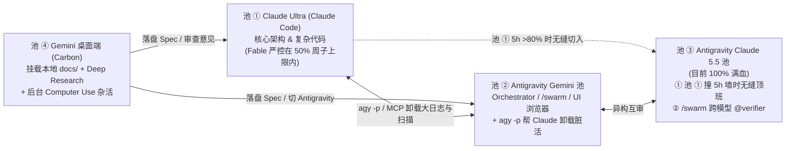

# 双顶配订阅协同：Claude Ultra 与 Google AI Ultra 20x（Antigravity + Gemini）多 Agent 工作流调研

> 日期：2026-11-25（同日按实际账号截图增补修订）。问题：同时订阅 Claude Ultra（原 Max 20x，\$200/月）与 Google AI Ultra 20x（\$199.99/月，含 Antigravity 与 Gemini macOS 桌面端）时，如何厘清各平台独立额度、设计合规的多 Agent 协同工作流，并最大化用好 Gemini 独立额度。范围：Anthropic 官方套餐与 Claude Code 文档、Google One / Google Antigravity 官方文档（`antigravity.google/docs/*.md`）、Gemini macOS 桌面端（Computer Use / Tasks / Connected Folders / Speak to Window）官方资料、GitHub 开源桥接项目与星标核验、Reddit 及中文开发者社区实践。相关任务：无（外部工具链与多 Agent 工作流调研）。

## 结论（按你的实测账号现状修订）

按你的实测截图，在不领取 Claude API 赠金的前提下，你当前手头真正活跃的是 **4 个彼此完全独立、且均带「5 小时滚动窗口 + 每周限额」的订阅算力池**（连重置时间都互不相同）：

1. **池 ① — Claude Ultra（仍带 5h 窗口 + 周限额，且 Fable 占周上限最多 50%）**：部分账号在通过自动验证前或特定阶段仍保留 5 小时会话限额；另外 Fable 是周限额内的 50% 子上限（不是额外赠送额度），不能拿来干重上下文杂活。
2. **池 ② — Antigravity · Gemini 模型池（5h + 周）**：主力并行编码、Orchestrator、`/boost` `/swarm` `/run-workflow` 与内置浏览器视觉验收。
3. **池 ③ — Antigravity · Claude 与 GPT 池（5h + 周，目前 100% 满血）**：与池 ② 彻底解耦的第二份 Claude 5.5 编程池——专门用来在**池 ① 撞 5h 墙时无缝顶班**，或在 `/swarm` 中担任跨模型 `@verifier`。
4. **池 ④ — Gemini macOS 桌面端池（5h + 周，目前周限额 0%）**：**实测证实与 Antigravity 完全独立**！虽然它没有 `agy -p` 式的官方无头 CLI，但自带 **Gemini 4 Carbon**、**本地文件夹挂载**、**后台隔离窗口 Computer Use（任务）**、**扩展程序 / MCP** 与 **Speak to Window**，可直接通过「本地目录契约文件 + 后台桌面任务 + 关掉自动选模强锁 Carbon」编进你的研发流。

核心操作建议（5 条直接落地）：
1. **四池错峰接力，彻底消灭 5h 断档**：日常用 **Claude ① + Antigravity Gemini ②** 双核并行；一旦池 ① 5h 窗口 >80%，直接无缝切到 **Antigravity Claude 池 ③** 续写，等池 ① 5h 重置再切回；全程把调研、文档、审查和 GUI 杂活分流给 **Gemini 桌面端池 ④**。
2. **马上改掉 Gemini 桌面端一个默认开关**：你截图里「自动选择模型」是开着的，在周限额 0% 的情况下这只会让它偷偷把请求降级到轻模型——**关掉它，强锁 `Carbon`**，专门白嫖最强的深度思考能力。
3. **把 Gemini 桌面端接入项目的最稳姿势是「挂载本地文件夹 + 契约文件接力」**：不要手动来回复制粘贴，也**绝对不要用 OAuth 反代**（2026 年两家均零警告封号）。在 Gemini 桌面端挂上你的项目 `docs/` 或仓库目录，让 Carbon 读本地代码/资料后直接写 Spec / 审查意见到本地 Markdown，Claude Code 和 Antigravity 直接读文件开工。
4. **用 Gemini 桌面端独有的「后台隔离窗口 Computer Use」干 CLI Agent 干不了的活**：在左侧「任务」里派发需要操作本机原生 macOS App、整理素材、填网页后台表单的杂活，它在虚拟后台窗口运行、**不抢你的主屏幕鼠标和键盘**。
5. **用 `agy -p` / 轻量 MCP Bridge 给 Claude Code 卸载高噪声大上下文任务**（大日志排查、全库考古、PR 复审），保住 Claude ① 的 5h 窗口和 Fable 50% 子配额；并把 Antigravity 的 **AI Credit Overages（`useG1Credits`）保持 `Never`** 防意外扣点。

---

## 详细

### 一、你的 4 个活跃 5h 独立池（实测核对）与完整权益版图（2026-11-25）

根据你提供的 3 张实测用量截图（且你明确不打算领取 Claude 赠予的 API 额度），你日常直接调度的是 **4 个完全独立的「5 小时滚动 + 每周限额」订阅池**，加上可选用的 Google 侧独立赠金/算力：

| 池编号 | 入口与模型 | 你的截图实测（2026-11-25） | 5h 窗口与周限额 | 最佳定位 |
|---|---|---|---|---|
| **池 ①** | **Claude Ultra**（Claude Code / Desktop / Web） | 当前会话 13%（22:40 重置）；本周 1%（周三 20:00 重置）；**Fable 占周上限最多 50%**（已用 0%） | **仍有 5h 锁** + 周限额（注：仅部分通过自动验证的旧账号免 5h 锁） | 核心架构、复杂 Rust/系统攻坚；Fable 仅用于最难卡点 |
| **池 ②** | **Antigravity · Gemini 模型池**（App / `agy` CLI / SDK / Remote Agents：Gemini 4 Neon / Carbon / Hydrogen + Orchestrator） | 5h 剩 95%（57m 后重置）；每周剩 86%（5d12h 后重置） | 5h 滚动 + 独立周限额（Gemini 4 各档共用） | 日常并行编码、`/boost` `/swarm` `/run-workflow`、内置浏览器 UI 验收、`agy -p` 卸载池 |
| **池 ③** | **Antigravity · Claude 与 GPT 池**（Claude Opus 5.5 / Sonnet 5.5 thinking） | 5h 剩 **100%**；每周剩 **100%** | **完全独立于池 ②** 的 5h + 周限额 | **池 ① 撞 5h 墙时的无缝顶班**；`/swarm` 里充当跨模型 `@verifier`；Orchestrator 的 Claude Planner |
| **池 ④** | **Gemini macOS 桌面端 + Gemini Web / Notebook**（Gemini 4 Carbon / Neon、Deep Research、Tasks 后台 Computer Use、Speak to Window） | 当前用量 16%（19:25 重置）；**每周已用 0%**（11/27 1:25 重置） | **完全独立于 Antigravity（池 ②/③）** 的 5h + 周限额 | 强锁 Carbon 做架构推演与代码复审、全网 Deep Research、挂载本地文件夹写 Spec、后台虚拟窗口 GUI 自动化 |
| *可选池* | **Google AI Studio / Cloud 赠金 + Colab** | Ultra 20x 含 \$100/月（有效期 12 个月）+ Colab 2,000 GPU 单元/月 | 独立于所有订阅对话池 | 离线批处理、Eval、翻译/文档脚本、重算力实验（不领 Claude API 也不影响用这部分） |

> 注：Antigravity 中 `Gemini 4 Argon`、`Gemini 3.8 Flash`、`GPT-OSS-120b`、`Claude 4.6` 将于 **2026-11-30** 下线，新工作流不要再绑定这些旧模型名。

---

### 一（补）、Gemini macOS 桌面端（池 ④）到底怎么操控与接入研发流？

很多人拿到 Gemini macOS 桌面端后不知道怎么编进多 Agent 开发——它不像 `agy` 或 Claude Code 有原生命令行，**但绝对不只是一个手动复制粘贴的网页框**。

#### 1. 先讲清边界：能不能被 Claude Code / Antigravity 用命令行远程调用？

- **不能直接用官方无头 CLI 静默调用**：Google 把所有命令行 / SDK / CI / MCP 编排入口统一收口到了 **Antigravity CLI（`agy -p`）** 和 **Antigravity Python SDK**（消耗的是池 ②，不是池 ④）。
- **绝对不要为了自动化去扒桌面端 Cookie / OAuth 做反代**：2026 年 Google 对非官方客户端重放 OAuth Token 封禁极严，得不偿失。
- **正确定位**：把 Gemini macOS 桌面端当成 **「带本地文件读写 + 扩展/MCP + 后台独立窗口 Computer Use 的高配副驾（Carbon 专用脑）」**，走下面 5 个零风控操控姿势：

#### 2. 5 个马上能用起来的实操操控方式

1. **先改一个关键开关：关掉「自动选择模型」，强锁 `Carbon`**
   - 你的图 1 里「每周限额已使用 0%」，但底部 **「自动选择模型」是打开的**——开启后它会为了帮你「省额度」把大量问题自动降级给轻模型。
   - **做法**：直接关闭「自动选择模型」，输入框固定选 **`Carbon`**。这样每一次提问、读文档和评审都吃满前沿深度思考模型，把每周 0% 的独立池真正用出价值。
2. **用「连接本地文件夹（Connected folders）」实现与 Claude Code / Antigravity 的零复制粘贴交接**
   - 在 Gemini 桌面端授权挂载你的项目目录（或单独挂载 `docs/`、`specs/` 目录）。
   - **典型接力流**：
     - 阶段一（池 ④ Carbon）：让 Gemini 桌面端直接读你本地代码和文档，做深度技术调研、拆解需求、或者审查某个大模块的架构缺陷，并让它**直接落盘写成 `docs/plans/xxx.md` 或 `review-notes.md`**；
     - 阶段二（池 ① Claude Code / 池 ② Antigravity）：直接告诉编码代理「按 `docs/plans/xxx.md` 实施 / 按 `review-notes.md` 逐条修复」。
   - 这样既不用手动来回拷贝代码，也完全不消耗任何编码 Agent 的 5h 额度。
3. **用「任务（Tasks）」+ 后台隔离窗口 Computer Use 接管 GUI 杂活**
   - 这是 Gemini macOS 桌面端相对 Claude Code 和 `agy` 最大的差异化能力（Apple Silicon + macOS Sequoia 及以上可用）：
   - 在左侧 **「任务」** 下达自然语言多步指令，它会在**后台独立虚拟窗口**里点击、打字、切菜单、操作本机应用与连接目录，聊天框里给实时小窗预览，**完全不抢你当前的鼠标和屏幕焦点**。
   - **适合派给它的开发周边活**：批量整理/重命名设计稿和截图素材、从本地 PDF/表格抽数据填进网页后台表单、帮你巡检/整理第三方平台后台（如应用商店/发布后台/工单面板的重复性点选），同时你在主屏幕继续开着 Claude Code 写代码。
4. **点开左侧「扩展程序（Extensions）」接通本机工具链与 MCP**
   - Gemini macOS 桌面端支持连接 Google Workspace（Docs / Drive / Gmail）及外部工具/连接器（含 Git、Obsidian、以及本地 MCP Server 等）。
   - 把你的知识库、文档源或只读工具接进来后，它可以直接跨工具汇总信息、起草设计文档和发布说明，不需要把几十页上下文喂进 Claude Code。
5. **全局快捷键 + `Speak to Window` 做「零切换看屏副驾」+ 右上角一键跳 Antigravity**
   - `Option + Space` 随时唤出迷你浮窗、`Option + Shift + Space` 打开主窗、长按 `Fn`（或启用设置里的 **Speak to Window**）边看当前 IDE/终端报错边直接口述提问。
   - 遇到需要多文件改代码或跑终端测试时，直接把 Carbon 梳理好的最终方案通过右上角 **`Antigravity`** 按钮切过去执行，或落盘交给 Claude Code。

#### 3. 四池 5h 错峰轮转策略（专为你的 4 个 5h 窗口设计）

既然你的 Claude Ultra 目前也有 5h 锁，最稳的日内节奏是**「双核并行 + 撞墙无缝切池」**：



---

### 二、合规红线：为什么不能用 OAuth 反代，应该怎么连

在 2026 年的中文社区（Linux.do / V2EX）与 GitHub 上，曾流行把 Claude 订阅或 Antigravity 订阅的 OAuth Token 抽出来包装成 OpenAI 兼容反代（如各类 `*-Manager` / `CLIProxyAPI` / 第三方 OpenClaw 包装器）。**现在这条路风险极高**：

- **Anthropic 政策**：明确规定消费级订阅（Pro / Max / Ultra）的 OAuth Token **仅限官方客户端使用**（Claude.ai / 官方 Claude Code）。服务端已部署客户端指纹与入口头检测（如 `CLAUDE_CODE_ENTRYPOINT`），并新增 `--bare` 无头标志要求脚本与 CI 走 `ANTHROPIC_API_KEY`。违规代理会触发零警告封号。
- **Google / Antigravity 政策**：同样严打第三方提取/重放 Antigravity OAuth 凭据，检测到异常脚本封装会直接返回 `403 Forbidden`（违反服务条款停用），申诉解封率极低。

**100% 合规的跨平台编排只有 4 种官方支持的路径**：

1. **官方无头 CLI 调用**：直接调用未修改的本机官方 `agy` 二进制：
   ```bash
   agy -p "分析这份 diff 中的并发与边界风险" \
     --model "gemini-4-neon-high" \
     --output-format json \
     --json-schema '{"type":"object","properties":{"issues":{"type":"array","items":{"type":"string"}},"verdict":{"type":"string"}},"required":["issues","verdict"]}'
   ```
   官方文档（`antigravity.google/docs/cli/headless.md`）明确鼓励将其用于脚本与 CI，并直接复用系统 keyring 中的登录态。
2. **官方 SDK 编排**：
   - Google 侧：官方 Python SDK [`google-antigravity/antigravity-sdk-python`](https://github.com/google-antigravity/antigravity-sdk-python)（约 4,220 star，2026-11-25），通过 `pip install google-antigravity` 打包官方运行时二进制（消耗池 ②）。
   - Anthropic 侧：若不领官方 API Credits，日常开发保持直接使用官方 Claude Code CLI / Desktop（消耗池 ①）即可，无需强上 API Key。
3. **官方协议与薄包装 MCP/ACP**：
   - **ACP（Agent Client Protocol）**：`agy acp` 可直接把 Antigravity 接入 Zed、JetBrains、VS Code、Xcode 等编辑器。
   - **薄 MCP Bridge**：在 Claude Code 里挂载只调用本机官方 `agy` 二进制（不窃取/转发 OAuth Token）的轻量 MCP 工具（详见第四节）。
4. **Git + 契约文件异步接力**：Claude Code 与 Antigravity 分别在各自官方客户端内运行，通过仓库内的 `AGENTS.md`（双方原生支持！）、任务板、设计文档与 Git 提交接力。这是**零风控、最稳定**的主力形态。

---

### 三、端到端多 Agent 协同工作流与原生原语选型

两家现在都有非常强的原生多 Agent 能力，**切忌盲目开最大编排**，按任务形状和你的 4 个 5h 池选型：

| 任务类型 | 推荐入口 | 使用原语 | 消耗池与注意事项 |
|---|---|---|---|
| **单人深度攻坚（架构重构、疑难系统 Bug）** | Claude Code | 单会话 + 少量只读 Haiku Subagent | **池 ①**（5h >80% 时切 **池 ③** 顶班）；Fable 严控在 50% 周子上限内；阶段完成即 `/clear` 或开新会话防上下文滚雪球 |
| **前置调研、Spec 撰写、大模块架构复审与后台 GUI 杂活** | Gemini macOS 桌面端 | **强锁 `Carbon`** + 本地文件夹 + **Tasks 后台 Computer Use** + `Speak to Window` | **池 ④**（独立 5h + 周限额，零消耗编码代理池） |
| **中等难度硬骨头（并发竞态、复杂算法、微妙回归）** | Antigravity App / `agy` | **`/boost`**（三阶段实现 → 挑战修复 → 独立验收） | **池 ②**。即开即用无需访谈，适合单会话解不动但又不需要大团队拆分的难题 |
| **可干净切分的并行改造（多文件测试、多模块同步）** | Antigravity App / `agy` | **`/swarm`**（共享留言板 + `@verifier` + `@monitor`） | **池 ② + 池 ③ 混排**。空闲 Worker 休眠零消耗；**明确在提示词里指定 `@verifier` 用异构模型**（如 Worker 用 Gemini 4 Neon/Hydrogen，Verifier 用 Claude 5.5） |
| **大批量扇出审计 / 固定阶段流水线（逐文件查错、迁移）** | Antigravity App / `agy` | **`/run-workflow`**（Python 脚本 `parallel()` / `pipeline()`） | **池 ②**。每个子代理在独立上下文执行并按 JSON Schema 返回结构化结果，**零污染主对话上下文**，脚本可复用 |
| **跨天/跨数十文件的大项目或深度仿真** | Antigravity App / `agy` | **`/teamwork`**（两阶段访谈 + Sentinel + Critic/Challenger/Auditor 门禁） | **池 ②**。里程碑间自动换新 Orchestrator 防上下文退化；消耗大，只给真正的大工程 |
| **前端 / UI / 交互回归与端到端冒烟** | Antigravity App | **Built-in Browser Subagent（`/browser`）** | **池 ②（默认跑轻量 Flash）**。自带渲染、截图、Console/Network 监控、移动端视口测试，完美补齐 Claude Code 缺原生视觉验证的短板 |
| **跨层多角色强协作（前后端同时探路、多假设并行排障）** | Claude Code | **Subagents（`isolation: worktree`）** 或 **Agent Teams** | **池 ①**。Agent Teams 在 Plan 模式下约 7 倍消耗，很容易迅速打穿 5h 窗口，非必要不用；普通独立子任务优先用 Subagents |
| **合盖休眠也能跑的后台修 Issue / 补单测 / 扫技术债** | Antigravity Web / `agy --remote-agent` | **Remote Agents**（接管原 Jules 场景） | **池 ②**。挂载 GitHub 仓库在 Google 托管远端环境跑，不占本地算力 |

---

### 四、榨干 Gemini 独立额度的 6 个高杠杆实战玩法

很多双订阅用户最常见的浪费是：**90% 的时间只泡在 Claude Code 里，直到周末撞周上限，结果 Antigravity 的 5 小时池、Gemini Web、AI Studio \$100 赠金和 Colab 几乎全闲置**。以下 6 个玩法可以把每个独立池的价值全部吃干抹净：

#### 玩法 1：开启 Antigravity Orchestrator 跨模型/跨档混编

Antigravity 官方在 Paid Pro 与 Ultra 上提供了 **Orchestrator**（不是简单路由器，而是同一轮任务内 Planner 与 Executor 双向交接：Planner 先只读探索写计划 → Executor 改代码跑测试 → 连续两次失败自动交回 Planner 修复计划 → 结束时 Planner 核验收尾）。

在 **Antigravity App → Settings → Models → Orchestrator Settings** 中，有两种黄金配法：
- **纯池 ② 省额配法**：Planner 选 `Gemini 4 Neon (High)` 或 `Gemini 4 Carbon (High)`，Executor 选 `Gemini 4 Hydrogen (Medium/High)`。因为 Neon/Carbon/Hydrogen 现已合并进同一个共享 Gemini 池，把大批量文件编辑、grep、编译测试重试交给 Hydrogen，能大幅拉长 5 小时窗口的续航。
- **跨池（池 ③ + 池 ②）顶配配法**：Planner 选 `Claude Opus 5.5 (thinking)`（吃池 ③），Executor 选 `Gemini 4 Hydrogen`（吃池 ②）。用极少的第三方 Claude 池 token 做架构把关，把 80% 的读写体力活甩给超宽裕的 20x Gemini 池。

#### 玩法 2：Claude Code 调用本地 `agy` 卸载「高 Token 脏活」

社区（Reddit / GitHub）最受欢迎的跨生态协作模式，是让 **Claude Code 当总控，把大上下文、高噪声任务卸载给本地官方 `agy` CLI**：
- 典型卸载清单：几千行报错日志定位、跨几十个文件的代码考古、第三方库源码通读、PR Diff 的独立安全/逻辑复审。
- **方式 A（零依赖，直接写进 Claude Code Skill / CLAUDE.md）**：教 Claude Code 在需要第二意见或大文件扫描时执行官方 `agy -p`：
  ```bash
  agy -p "只读分析以下目录的状态流转并指出潜在竞态，输出不超过 300 字要点" \
    --model "Orchestrator (Neon)" --output-format json
  ```
- **方式 B（轻量 MCP Bridge，免去手写命令与非 TTY 空输出坑）**：经 GitHub 核实（2026-11-25），目前较活跃且直接封装官方 `agy` 二进制的项目包括：
  - [`sshahzaiib/agy-bridge`](https://github.com/sshahzaiib/agy-bridge)（72 star）：专供 Claude Code 委派 `agy` 的 MCP Bridge，支持工具分级、模型回退、会话延续和输出截断（保护 Claude 上下文）。
  - [`rhishi99/agy-headless-bridge`](https://github.com/rhishi99/agy-headless-bridge)（22 star）：专门解决非 TTY 子进程调 `agy -p` 偶发空输出的伪终端问题（支持 POSIX pty 与 Windows ConPTY + MCP Server）。
  - [`PyModel/antigravity-mcp`](https://github.com/PyModel/antigravity-mcp)（15 star）与 [`VKirill/antigravity-for-claude-code`](https://github.com/VKirill/antigravity-for-claude-code)（15 star）：支持可恢复会话与多角色并行分发。

> 安全提示：选用任意第三方 MCP Bridge 前，务必检查源码确认其**只通过子进程调用本机官方 `agy` 二进制**，绝不读取/转发 `~/.gemini` 下的 OAuth Token 到自建代理服务。

#### 玩法 3：`/swarm` 异构互审，把池 ② 和池 ③ 绑成自动质检闭环

在 Antigravity 里用 `/swarm` 拆多模块任务时，直接在指令里写明模型分工，例如：
> `/swarm 分别给模块 A、B、C 补齐边界单测并修复暴露出的问题。Worker 统一用 Gemini 4 Hydrogen，@verifier 用 Claude Sonnet 5.5 (thinking) 做独立代码审查与测试证据核验。`

这样同一轮 `/swarm` 会并行消耗池 ②（写代码）和池 ③（审查），规避单一模型家族的同源盲区，同时盘活你截图里目前 100% 闲置的 Antigravity Claude 池。

#### 玩法 4：前置「调研 + 读文档 + 后台 GUI 杂活」彻底迁入池 ④（Gemini 桌面端 + Web + Notebook）

编码 Agent 最浪费 5h 额度的事，是在终端里让它一边搜网页一边啃 200 页规范文档：
- **技术选型 / 竞品调研 / 方案预研** → 用 **Gemini 桌面端（强锁 Carbon）+ Deep Research** 跑完并直接落盘到挂载的本地 `docs/` 目录。
- **长期参考手册 / SDK 规范 / 历史设计文档** → 全部丢进 **Gemini Notebook（原 NotebookLM）** 建立项目知识库，提问检索完全不扣 Antigravity 与 Claude 编码池。
- **非 CLI 桌面杂活** → 交给 Gemini macOS 桌面端的 **Tasks（后台隔离窗口 Computer Use）**。

#### 玩法 5（可选）：按需领 Google AI Studio 月度赠金，不碰 Claude API 也无妨

你不打算领 Claude 送的 API 额度完全没问题（跳过即可）；如果哪天需要做离线批处理、自动化翻译或 Eval，Google AI Ultra 20x 附带的 **\$100/月 Google Cloud / Gemini API Credits**（在 Google AI Studio 左侧栏认领，每笔有效期 **12 个月**，比按月清零宽容得多）和 **Colab 2,000 GPU 单元/月** 可以随时按需启用，与你的 4 个日常订阅池完全独立。

#### 玩法 6：按「5 小时窗口节律」安排定时巡检与远端异步任务

因为 Antigravity 的 5 小时窗口是**滚动重置**的，如果你只在下午写代码，早上和晚上的 5 小时窗口等于白送回去。利用 **Antigravity `/schedule`（Scheduled Tasks）** 与 **Remote Agents（`agy --remote-agent`）**：
- 在非编码时段（如清早或夜间）挂 1~2 个低打扰巡检任务：依赖安全检查、文档与代码一致性扫描、挂在 GitHub 上的小 Issue 预分析草稿。
- 白天打开电脑时，巡检报告与草稿 PR 已经躺在那里，既充分利用了闲置的 5 小时滚动池，又没碰过 Claude Ultra 的周配额。

---

### 五、并行工程纪律与配额防爆清单

双顶配环境下，真正的瓶颈很快会从「算力不够」变成**「多 Agent 改乱工作区」**和**「失控循环一晚烧穿周限额」**：

1. **隔离策略按项目编译成本选，别一刀切**：
   - **轻量 JS/Python/Go 仓库**：优先用 Git Worktree 隔离并行写入（Claude Code 子代理设 `isolation: worktree`；Antigravity `/swarm` 设 `workspace: "share"`），互不踩文件，失败即弃。
   - **重编译桌面/Rust 仓库（如本仓库 Fuyu）**：频繁建删 worktree 会丢失 `node_modules` 与 Rust 增量编译缓存，反而不如采用**「共享主工作区 + 显式范围认领 + 定向提交（只 `git add` 自己文件）+ 共享 `target/agents` 缓存 + 串行合并队列」**。此时可以让 Claude Code 负责 Rust 核心/后端目录，Antigravity 负责前端 UI / 回归页 / 浏览器视觉验收，按目录硬隔离。
2. **统一一套仓库规则文件，双方零维护成本共用**：
   - 经官方文档核实，Antigravity（App / `agy`）已原生读取仓库根目录的 **`AGENTS.md`**（与 `GEMINI.md` 并列），Claude Code 读 `CLAUDE.md`。保持 `AGENTS.md` 作为单一事实源（或在 `CLAUDE.md` 中 `@AGENTS.md` 引用），即可让双边代理遵守完全一致的代码风格、提交规范与验证命令。
3. **防配额蒸发检查清单**：
   - Antigravity 设置里把 **AI Credit Overages（`useG1Credits`）保持 `Never`**，需要临时冲刺再手动开。
   - 养成**任务切换即开新会话**、长会话及时 **`/compact`** 的习惯；在 `agy` 中定期用 `/usage` 看 Gemini 池与第三方池剩余比例，用 `/context` 清理闲置 MCP Server（冗余 MCP schema 每轮都会白吃 token）。
   - Claude Code 跑脚本或高并发 subagent 时，限制并发数并尽量让只读探索子代理走轻模型（Haiku），避免把 10x 周上限在两天内透支。

---

### 六、结合 Fuyu 本仓库的即用分工参考

如果直接把上述方案落到当前 **Fuyu（Tauri + React + Rust）** 日常开发中：

| Fuyu 常见任务 | 推荐引擎与池 | 理由 |
|---|---|---|
| 外部方案调研、竞品对比、Spec 起草（`docs/research/`） | 池 ④（Gemini 桌面端强锁 Carbon + 本地文件夹 + Deep Research） | 周额度目前 0%，直接落盘到 `docs/`，零消耗编码代理的 5h 窗口 |
| 岛屿 UI、动效（`fuyu-motion`）、设置页、回归页验收 | 池 ②（Antigravity + Built-in Browser Subagent） | 改完 CSS/React 直接在内置浏览器截图、查 Console 报错、验窄窗溢出，闭环最短 |
| Rust 核心（`src-tauri/`）、Windows/macOS 系统 API、复杂重构 | 池 ①（Claude Code / Claude Ultra）；5h >80% 切池 ③ 顶班 | 高精度推理，Fable 留给最硬卡点；撞 5h 墙无缝切 Antigravity Claude 5.5 不中断 |
| 官方 v3 插件批量补齐、多语言 i18n / README 同步 | 池 ②（Antigravity `/swarm` 或 `/run-workflow`） | 任务可按插件目录或语言文件干净切分，并行速度最快 |
| 合入前跨模型 PR / Diff 复审 | 池 ③（Antigravity Claude 5.5 `@verifier`）或池 ④（Gemini 桌面端 Carbon 读本地目录复审） | 不领 Claude API 也能做异构互审，把目前 100% 满血的池 ③ 与 0% 周消耗的池 ④ 盘活 |
| 录屏/截图素材整理、应用发布后台表单点选等 GUI 杂活 | 池 ④（Gemini 桌面端 Tasks 后台隔离窗口 Computer Use） | 不抢主屏幕鼠标，边跑杂活边在终端写代码 |

---

## 来源

- Google Antigravity 官方文档总索引：https://antigravity.google/llms.txt （2026-11-25 抓取）
- Google Antigravity 模型与 Orchestrator 官方文档：https://antigravity.google/docs/models.md （2026-11-25 抓取）
- Google Antigravity 套餐、刷新机制与 AI Credits 溢出官方文档：https://antigravity.google/docs/plans.md （2026-11-25 抓取）
- Google Antigravity 多 Agent 官方文档：
  - `/boost`：https://antigravity.google/docs/boost.md
  - `/swarm`：https://antigravity.google/docs/swarm.md
  - `/teamwork`：https://antigravity.google/docs/teamwork.md
  - `/run-workflow`：https://antigravity.google/docs/dynamic-workflows.md
  - Remote Agents：https://antigravity.google/docs/remote-agents.md
  - Browser use：https://antigravity.google/docs/browser.md
- Antigravity CLI 无头模式、ACP、配额与 Gemini CLI 迁移官方文档：
  - Headless mode：https://antigravity.google/docs/cli/headless.md
  - Agent Client Protocol (ACP)：https://antigravity.google/docs/cli/acp.md
  - CLI AI Credits：https://antigravity.google/docs/cli/credits.md
  - Gemini CLI Migration：https://antigravity.google/docs/cli/gcli-migration.md
- Google One AI 套餐官方页（Google AI Plus / Pro / Ultra 权益与 Gemini 4 Carbon / Colab / Cloud Credits）：https://one.google.com/about/google-ai-plans/ （2026-11-25 抓取）
- Google Antigravity 官方 Python SDK：https://github.com/google-antigravity/antigravity-sdk-python （2026-11-25 核验，4,220 star）
- Claude Code 与 Antigravity CLI 开源桥接项目（2026-11-25 GitHub API 核验）：
  - `sshahzaiib/agy-bridge`：https://github.com/sshahzaiib/agy-bridge （72 star）
  - `rhishi99/agy-headless-bridge`：https://github.com/rhishi99/agy-headless-bridge （22 star）
  - `VKirill/antigravity-for-claude-code`：https://github.com/VKirill/antigravity-for-claude-code （15 star）
  - `PyModel/antigravity-mcp`：https://github.com/PyModel/antigravity-mcp （15 star）
- Anthropic Claude Ultra（原 Max 20x）改名、取消 5 小时限额与 \$200 月度 API Credits 政策：通过 WebSearch 核验自 `claude.com` / `support.claude.com` 官方支持页及多方技术媒体 2026-10-30 公告汇总（详见 `claude.com` Billing 与 Usage Limits 文档）
- Jules 2026-11-11 只读及 2026-12-31 关停并入 Antigravity：通过 WebSearch 核验自 2026-11 公告与社区讨论（Hacker News / CryptoBriefing）
- Claude Code 多代理（Subagents / Agent Teams / Git Worktree）与 OAuth 反代 ToS 执法：通过 WebSearch 核验自 `code.claude.com`、`claude.com` 及 Reddit（`r/ClaudeCode`、`r/google_antigravity`）、Hacker News、V2EX / Linux.do 2026 年讨论
