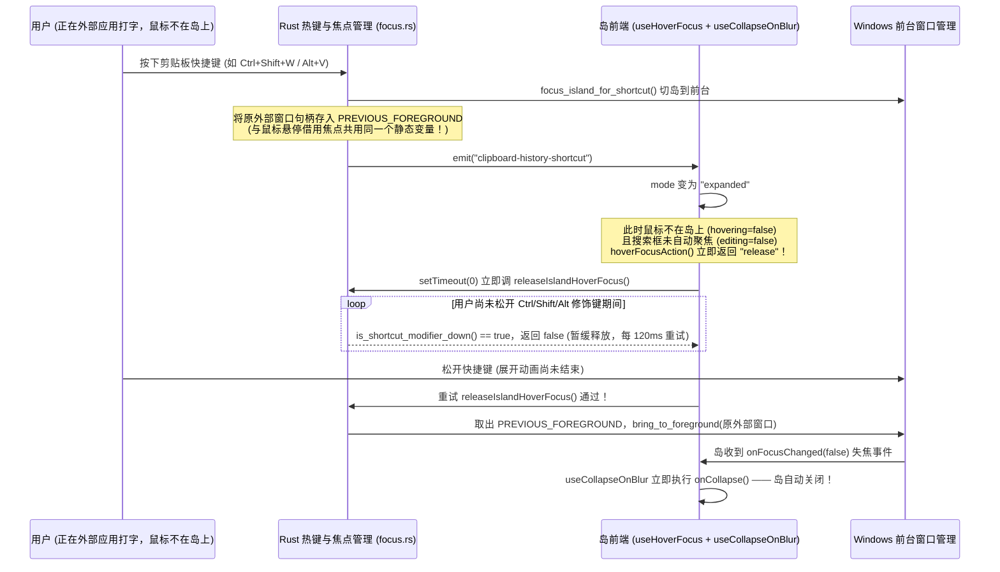

# 上游 fly-island#76 逐项核查与开源方案调研

> 日期：2026-11-17。问题：[flyl1u/fly-island#76](https://github.com/flyl1u/fly-island/issues/76) 里用户反馈的 6 大类（共 11 个具体问题与建议）是否也是浮屿（Fuyu）的问题？全网开源项目怎么处理同类需求与故障？我们该怎么取舍？范围：上游仓库 `flyl1u/fly-island` 默认分支源码、本仓库当前 `main` 源码与历史任务、GitHub 同类开源项目（Pot、STranslate、Easydict、ECDICT、MTranServer、EcoPaste、QuickClipboard、TieZ、Maccy、CopyQ、BoringNotch、FluentFlyout）源码与文档、Microsoft Learn Win32 / WebView2 技术文档。相关任务：关联已完成任务 B29、B72.3、C29、C37、C69、C106、D30、D66、D78、D79、E36.4.2；待用户拍板是否新建后续任务。

## 结论与全局对照

浮屿自 2026-11-10 脱离 `flyl1u/fly-island` 独立演进以来，**11 个子问题里已有 4 项彻底解决、3 项主体已解决（仅剩边角体验缺口）**；但核查代码后确认，**仍有 2 项功能诉求和 2 个隐蔽的 Windows 原生交互/线程阻塞 BUG 在浮屿现行代码中真实存在**（其中剪贴板快捷键松手即关的竞态在切回「岛上页面」模式时百分百同源复现，点击复制同步写盘阻塞 UI 主线程的隐患也尚未根除）。

### 11 项逐条判定总表

| 编号 | `#76` 反馈项 | 浮屿现状 | 核查结论摘要 | 建议动作 |
|---|---|---|---|---|
| **1** | 翻译默认快捷键无法像剪贴板那样单独开关 | **同样存在** | 可关闭整个 `translation` 插件，但开启功能时 `Ctrl+Shift+F` / `Ctrl+Alt+T` 无独立开关也无清空按钮，Rust 命令层拒绝空字符串 | **必做（小改）**：对齐截图/语音/计时器，加 `<X />`「置空即关闭单条快捷键」，不加冗余布尔开关 |
| **2** | 贴边自动隐藏后样式无法自定义（嫌露边宽、丑） | **半解决** | 已有四边吸附、模拟刘海（露 6px）、侧边 `12×72` 把手、反向弧调节；但顶/底贴边收起固定露 `10px` 硬编码，无细线或全隐档位 | **选做（轻量预设）**：不搞复杂样式面板，给顶/底收起加「标准露边 10px / 极简细线 4px / 贴边隐身（2px 热区）」三档 |
| **3** | 无展开大窗口自定义 R 角，上下 R 角不一致 | **主岛已解决** | 主岛已有 `islandCornerRadius`（16–40px）+ `squircle/round` + 折叠态 `22/30` 比例联动 + 悬空四角对称 + `C106` 单路径连续轮廓；仅独立弹窗圆角写死（16/18px） | **主岛不动**；独立工具窗维持克制圆角（避免 40px 大胶囊套矩形列表），可顺手统一 `corner-shape` |
| **4** | 增加必应/谷歌等免配大模型的简单翻译接口 | **功能仍缺，底座已就绪** | 内置 7 家全强制要求 API Key（含本地 `custom`），无词典释义；但 `E36.4.2` 刚开放 `translatorEngines.register` 免密钥引擎接缝 | **分层推进**：① **核心不内置灰产爬虫接口**（放到 v3 社区插件）；② 核心放开 `custom` 本地免 Key（接 Ollama / MTranServer）；③ 官方插件提供 **ECDICT 离线词典** |
| **5** | 接入字节 TRAE / TRAE CN | **已彻底解决** | `B29`、`A14`、`B72.3` 已完整内置双版本（钩子安装、三态灯、会话拼装、等你、岛上工具审批），仅剩 `B47` 真机核对 | **无需开发**，跟进 `B47` 真机验收即可 |
| **6-1** | 独立窗口备注只显示 5 个英文字符，拉宽也不变 | **主体已解，剩 2 处细节缺口** | 上游写死 `minmax(0, 64px)` 导致仅容 5 字符；浮屿 `C29/C37/C69` 已改双行弹性布局。**但发现**：① 空格预览窗与宽版右栏漏渲染 `item.note`；② 宽版左栏锁死 `330px` 比标准版 `380px` 更窄 | **顺手补齐**：在 `ClipboardPopupPreview.tsx` 补渲染完整备注，微调宽版分栏宽度 |
| **6-2** | 取消钉选后点击窗口外不自动关闭剪贴板 | **已彻底解决** | `C69/C101` 已实现默认未钉选失焦自动隐藏、钉选常驻，且排除空格预览编辑、截图与管理视图误关 | **无需改动**（默认即失焦关闭，无需再加开关） |
| **6-2.99** | 按类型检索剪贴板历史（图片/文件等） | **已彻底解决** | 已支持多类型胶囊（全部/收藏/图片/文件/链接/颜色/常用语/`#标签`/截图/书签）+ `/img` `/file` `/app:` 斜杠语法 + OCR + 拼音搜索 | **无需改动** |
| **6-3 & 6-5附** | 数据迁到软件目录；目录名与软件名不一致；找不到日志 | **已解大半，需避开反模式** | `D30` 已统一为 `~/.fuyu` 且设置内支持一键打开与改目录（上游仍残留 `focusd`）。**但不支持相对路径便携模式，设置内无日志入口与 Rust panic 落盘** | **拒绝「写进安装目录」**（UAC 报错 + 升级/卸载丢数据）；可按需补 `portable` 同级标记便携模式，并在设置加「打开日志」与 panic 钩子 |
| **6-4** | **BUG**：岛失焦时按剪贴板快捷键必须长按等动画完，否则松手即关 | **独立窗已避开；「岛上页面」模式同源复现！** | `focus_island_for_shortcut` 将旧窗口写入与悬停共用的 `PREVIOUS_FOREGROUND`，展开瞬间鼠标不在岛上，`useHoverFocus` 立即调 `releaseIslandHoverFocus()`，松开修饰键即切回旧窗口触发失焦收起（翻译「岛上页面」同理） | **高优先必修**：拆分快捷键聚焦与悬停借用聚焦状态（快捷键唤起期间禁止 `useHoverFocus` 释放焦点），先清 `WS_EX_NOACTIVATE` 再聚焦 |
| **6-5** | **BUG**：睡眠唤醒开剪贴板点复制卡死、全系统两秒 1 帧、移出闪退 | **已修两处大头，仍存 3 处真实隐患** | 已修键盘钩子独立线程（`e88766a2`）和隐藏窗口 IPC 积压（`D78/D79`）；**但**：① `copy_clipboard_history_item` 仍在 Win32 主线程同步解码图片、重试锁剪贴板并序列化写 5.4MB JSON；② 未恢复 `GPU_PROCESS_EXITED`；③ 未联动 `WM_POWERBROADCAST` | **高优先必修**：① 剪贴板复制命令改异步 `spawn_blocking` + JSON 异步合并落盘；② WebView2 恢复补齐 `GPU_PROCESS_EXITED` |

### 建议优先级排序

1. **第一优先级（修现存真 BUG，保护核心体验）**：
   - 修 **6-4**：隔离 `focus_island_for_shortcut` 与 `useHoverFocus` 的 `PREVIOUS_FOREGROUND`，修好剪贴板与翻译在「岛上页面」模式下松手即收起的问题。
   - 修 **6-5**：把 `copy_clipboard_history_item` / `copy_clipboard_history_item_as` 迁离 Win32 UI 主线程，将 `persist_locked` 大 JSON 写盘移出同步锁路径，并在 `webview_crash.rs` 中补齐 `COREWEBVIEW2_PROCESS_FAILED_KIND_GPU_PROCESS_EXITED` 重建/重载与 Rust panic 日志落盘。
2. **第二优先级（小改动解决高频痛点）**：
   - 做 **1**：给翻译的两个快捷键补上 `<X />` 清空即禁用能力。
   - 补 **6-1 缺口**：在剪贴板详情预览组件（`ClipboardPopupPreview.tsx`）里展示完整 `note` 备注。
   - 补 **4（第一阶段）**：放开翻译 `custom` 接口在本地回环地址（Ollama / MTranServer）下的免 API Key 限制，并在 `plugins/v3/official/` 新增一个基于 **ECDICT（MIT）** 的轻量离线词典/简明查词插件。
3. **第三优先级（按需选做）**：
   - **2**：顶/底贴边收起增加「细线（4px）」可选档位。
   - **4（第二阶段）**：必应/谷歌免 Key 网页接口作为独立第三方/社区 v3 插件提供，不进宿主二进制。
   - **6-3**：识别可执行文件同级 `portable` 标记文件支持真便携包，但不引导安装版用户把数据迁入程序目录。

---

## 一、翻译快捷键开关（第 1 项）

### 上游与浮屿现状对照

- **是否是浮屿的问题**：**是，完全同源。**
- **浮屿当前实现**：
  - 翻译已迁为第 3 版内置插件 `translation`（[/src/features/builtins.json](/src/features/builtins.json#L10)），关闭整个翻译插件时会注销全部后台热键（[/src-tauri/src/translation/background.rs](/src-tauri/src/translation/background.rs#L23-L56)）。
  - 但只要开启翻译功能，两个全局快捷键——「打开快捷翻译」（默认 `Ctrl+Shift+F`）和「翻译选中文字」（默认 `Ctrl+Alt+T`）——**全部强制注册，无法单独关闭其中某一个，也无法全部关掉只靠岛内顶栏图标点开翻译**：
    1. 前端 [/src/features/translation/TranslationShortcutRows.tsx](/src/features/translation/TranslationShortcutRows.tsx#L69-L96) 只有「恢复默认」和「录制」，没有开关也没有清除按钮；
    2. 前端存储 [/src/features/translation/storage.ts](/src/features/translation/storage.ts#L54-L56) 对空字符串强制回退默认值；
    3. 后端 [/src-tauri/src/translation/mod.rs](/src-tauri/src/translation/mod.rs#L267-L297) 的 `set_translation_shortcut` 与 `set_translation_selection_shortcut` 对空字符串直接报错 `shortcut.invalid`（尽管底层 `change_hotkey(None)` 已经支持传 `None` 注销热键，见 [/src-tauri/src/translation/hotkey.rs](/src-tauri/src/translation/hotkey.rs#L122-L128)）。

### 开源项目做法对比

查询日期：2026-11-17。

| 项目 | 快捷键单条禁用交互 | 底层实现 |
|---|---|---|
| [pot-app/pot-desktop](https://github.com/pot-app/pot-desktop)（★19.3k，GPL-3.0，Tauri） | 快捷键输入框右侧带「清除（Clear）」按钮，清空后即不注册该动作的热键（如只留划词翻译、关掉输入翻译热键） | `src-tauri/src/hotkey.rs`：配置值为空字符串 `""` 时跳过 `global_shortcut_manager().register(...)`，直接返回 `Ok(())` |
| [STranslate/STranslate](https://github.com/STranslate/STranslate)（★8.6k，MIT，WPF） | 每条全局热键录制框旁有清除按钮，清空后显示「无快捷键」 | 空键位不调 `RegisterHotKey`，互不影响其他翻译入口 |
| [EcoPasteHub/EcoPaste](https://github.com/EcoPasteHub/EcoPaste)（★7.6k，Apache-2.0，Tauri 2） | 快捷键录制控件支持一键清空取消绑定；特定系统键（`Win+V`）单列独立布尔开关 | 通用热键走空值解绑，特殊钩子走布尔开关 |
| **浮屿内部其他模块**（截图 / 语音输入 / 计时器） | 录制按钮旁统一放 `<X />` 清空按钮（`onClick={() => apply("")}`） | 空字符串 `""` 表示不注册该热键，功能本身仍可从界面点击使用 |

### 看法与建议

- **应该做，且应统一仓库内交互范式**。很多用户开启翻译后只用「选中文字按 `Ctrl+Alt+T`」，不想额外占掉 `Ctrl+Shift+F`（容易和 IDE 全局搜索冲突）；也有用户只想点岛顶栏翻译按钮，一个全局热键都不想占。
- **做法建议**：不要像剪贴板那样再加两个布尔开关行把设置页拉长，直接复用浮屿自己的截图（[/src/features/screenshot/ScreenshotShortcutRows.tsx](/src/features/screenshot/ScreenshotShortcutRows.tsx#L73-L77)）、语音输入、计时器已有的 **`<X />` 置空即关闭** 模式：前后端允许 `shortcut` / `selectionShortcut` 保存为 `""`，为空时底层调 `change_hotkey(None)` 注销热键即可，改动不到 50 行。

---

## 二、贴边自动隐藏样式自定义（第 2 项）

### 上游与浮屿现状对照

- **是否是浮屿的问题**：**上游更粗糙，浮屿已解决一半（形态分化），但顶/底露边像素仍是硬编码。**
- 上游 `fly-island` 只有顶部贴边一种形态，收起后是一截较宽的药丸底边，因此用户抱怨「露边上下边距过于宽了，有点丑」。
- 浮屿在 `C54.1`（左右侧吸附）、`C54.3`（底边吸附）、`C65`（贴顶/药丸/刘海三形态）之后已有更细的设计：
  - **左右侧边收起**：变成紧凑的 `12px × 72px` 把手，内嵌 `6px` Agent 状态圆点与 `4px` 未读点（[/src/windows/island/IslandSideHandle.tsx](/src/windows/island/IslandSideHandle.tsx#L12-L41)）。
  - **模拟刘海收起**：高度缩至 **`6px`** 纯黑窄边（`SIMULATED_NOTCH_TUCKED_VISIBLE = 6.0`，[/src-tauri/src/island/notch.rs](/src-tauri/src/island/notch.rs#L14-L18)）。
  - **顶边贴顶 / 悬空药丸 / 底边收起**：窗口缩进屏幕边缘后，**固定露出 `10px`**（`TUCKED_VISIBLE_EDGE_HEIGHT = 10.0`，[/src-tauri/src/island/geometry.rs](/src-tauri/src/island/geometry.rs#L46)），且保持折叠态全宽与原底色不透明度。在浅色壁纸或全屏阅读器顶栏上方，一条 200 多像素宽、`10px` 厚的深色条确实仍然偏显眼。

### 开源项目做法对比

| 项目 | 贴边隐藏视觉形态 | 可调参数 |
|---|---|---|
| [jimuzhe/tiez-clipboard](https://github.com/jimuzhe/tiez-clipboard)（★3.1k，GPL-3.0，Tauri 2） | 贴边隐藏后缩成极细边缘指示条，支持贴边半透明弱化 | 贴边触发延时、隐藏后透明度 |
| [mosheng1/QuickClipboard](https://github.com/mosheng1/QuickClipboard)（★2.1k，Apache-2.0，Tauri 2） | 窗口完全滑出屏幕外，仅留边缘极窄鼠标接近检测带（`edge_monitor.rs` 轮询距离 + `200ms` 防抖） | 开启/关闭贴边自动隐藏、弹出延迟 |
| [TheBoredTeam/boring.notch](https://github.com/TheBoredTeam/boring.notch)（★11.4k，GPL-3.0，SwiftUI） | 无刘海屏（非 Notch 显示器）支持把关闭态高度设为 `0`（完全隐身，仅保留顶部 `zeroHeightHoverPadding = 10` 的透明悬停唤醒热区）或窄条 | 非刘海屏高度模式、阴影开关 |
| Windows 11 自动隐藏任务栏 / macOS 自动隐藏 Dock | 完全滑出可视区，仅在屏幕最外沿留 `1–2px` 细线或纯透明热区 | 系统级开关 |

### 看法与建议

- **不要做自由像素级的「贴边样式编辑器」**（让用户自己配边距、长宽、颜色很容易破坏 `C106` 的反向圆弧轮廓与鼠标穿透命中区计算，设置项也会膨胀）。
- **值得做的是「三档收起露出预设」**（放在「设置 → 收起与露出」）：
  1. **标准露边（10px，默认）**：现行样式，看得清位置与反向圆弧；
  2. **极简细线（4px）**：类似 iOS 底部 Home Indicator 短横条，视觉存在感降一半以上；
  3. **完全隐身（0px 可视 + 2px 透明唤醒热区）**：对齐 BoringNotch 在无刘海屏上的零高度模式，平时完全不挡全屏应用顶栏，鼠标推到顶边即滑出（待办中的 `C77`「闲置变淡」也可与此互补）。

---

## 三、展开大窗口自定义 R 角与上下圆角一致性（第 3 项）

### 上游与浮屿现状对照

- **是否是浮屿的问题**：**对主岛而言已不是问题；仅独立弹窗圆角固定。**
- 用户在 `#76` 中吐槽的现象（「只有贴边圆角设定，没有展开窗口圆角设定，上下 R 角不一致逼死强迫症」）在浮屿里已经被多轮迭代彻底解决：
  1. **展开态大窗口 R 角可调**：「设置 → 主题 → 样式」已有「岛屿圆角 `islandCornerRadius`」滑块（**`16–40px`**，默认 `32px`）和「圆角样式 `islandCornerShape`」（**方圆 `squircle` / 正圆 `round`**），调的正是展开态外框圆角，折叠态按 `22 / 30` 比例自动联动（[/src/windows/island/IslandShell.css](/src/windows/island/IslandShell.css#L29-L34)），拖动滑块时主岛自动展开实时预览。
  2. **脱离贴边时上下四角严格对称**：2026-11-13 起，只要拖离顶边或处于悬空药丸形态（`.island--detached`），顶角强制等于底角（[/src/windows/island/IslandShell.css](/src/windows/island/IslandShell.css#L99-L105)）。
  3. **贴边处无缝衔接**：2026-11-17 刚合入的 `C106`（[/src/windows/island/islandOutline.ts](/src/windows/island/islandOutline.ts#L15-L134)）把贴边反向圆弧与岛本体合成为单条 `clip-path: shape()` 连续轮廓。
  4. **内外同心圆公式**：内层卡片圆角定义为 `--island-panel-radius: max(8px, calc(var(--island-radius) - 20px))`，与 `20px` 外框内边距严格同心。
- **唯一没联动的地方**：独立翻译窗口（写死 `18px`）、独立剪贴板窗口（写死 `16px`）、托盘卡片（写死 `16px`）。

### 开源项目与桌面设计规范对比

- **[TheBoredTeam/boring.notch](https://github.com/TheBoredTeam/boring.notch)**（`boringNotch/sizing/matters.swift` & `ContentView.swift:46-58`）：专门提供 `Defaults[.cornerRadiusScaling]` 开关，收起态 `(top: 6, bottom: 14)`，展开态放大到 `(top: 19, bottom: 24)`，内部音乐封面 `MusicPlayerImageSizes.cornerRadiusInset` 同步从 `4` 放大到 `13`，遵循同心圆角（Concentric Corners）原则。
- **Windows 11 Fluent 2（如 [unchihugo/FluentFlyout](https://github.com/unchihugo/FluentFlyout)，★4.9k）与 Apple HIG**：悬浮工具弹窗（Flyout / Popover）通常固定采用 `8px–16px` 圆角（Windows 11 `DWMWCP_ROUND` 为 `8px`，macOS Popover 为 `12–16px`），**不会**把灵动岛本体 `32–40px` 的大胶囊圆角套用到密集列表弹窗上——否则四角会切掉标题栏按钮和列表首尾行文字。

### 看法与建议

- **主岛已经做到业界标杆水准，无需再改**。
- **不建议让独立剪贴板/翻译窗口直接继承 `32–40px` 的 `islandCornerRadius`**；维持 `16–18px` 独立弹窗圆角是正确的视觉克制，最多让独立弹窗同步读取 `corner-shape: var(--island-corner-shape)`（方圆/正圆质感一致）即可。

---

## 四、免配置大模型的简单通用翻译接口（第 4 项）

### 上游与浮屿现状对照

- **是否是浮屿的问题**：**是，痛点完全成立；但浮屿刚刚铺好了比硬塞内置爬虫更优雅的 v3 插件底座。**
- **浮屿现状**：
  - 内置仅支持 7 个 OpenAI 兼容大模型接口（硅基流动、DeepSeek、火山方舟、通义千问、Kimi、OpenAI、自定义），**全部强制在系统凭据库校验 API Key**（[/src-tauri/src/translation/request.rs](/src-tauri/src/translation/request.rs#L18-L33)，甚至本地免密钥的 Ollama 走 `custom` 也会被 `translation.noKey` 拦住），且只有整段互译提示词，没有音标、词性、多义项的词典视图。
  - 新用户装好浮屿想随手查个英文单词，必须先去云厂商注册账号、实名认证、建 API Key、填模型名——门槛对低频查词用户确实太高。
  - **关键进展**：2026-11-17 刚完成的 `E36.4.2`（[/src/features/translation/host/engines.mjs](/src/features/translation/host/engines.mjs#L39-L93)）已经开放了 `ctx.translatorEngines.register(spec)`，支持注册 `hasSecret: true` 的免配密钥翻译引擎并直接出现在翻译设置下拉框中。

### 开源翻译项目全景调研

查询日期：2026-11-17。我们直接拆解了主流开源划词翻译工具的源码实现：

| 方案路线 | 代表开源项目与实现方式 | 优点 | 风险与代价 |
|---|---|---|---|
| **A. 逆向浏览器/客户端免 Key 接口（Bing Edge / Google GTX / 腾讯交互翻译）** | - **Pot**（`src/services/translate/bing/index.jsx`、`google/index.jsx`） - **STranslate**（`STranslate.Plugin.Translate.MicrosoftBuiltIn`、`GoogleBuiltIn`、`TransmartBuiltIn`、`ICibaBuiltIn`） - **Easydict**（★15.3k，GPL-3.0） 原理：Bing 先 `GET https://edge.microsoft.com/translate/auth` 拿 Edge 浏览器内置匿名 JWT（缓存约 5 分钟），再调 `api-edge.cognitive.microsofttranslator.com/translate`；Google 调 `translate.googleapis.com/translate_a/single?client=gtx`（自带词典音标、词性与多义项数组） | 零配置开箱即用、毫秒级响应（比大模型快 3–5 倍）、Google `gtx` 自带词典释义 | **非官方未公开接口**：违反服务商 ToS；Google 在国内无代理不可直连且高频易 `429`；微软曾多次调整 Edge Auth 校验头导致客户端集体断流，需持续发版抢修 |
| **B. 离线开源词典库（查单词首选）** | - **[skywind3000/ECDICT](https://github.com/skywind3000/ECDICT)**（★8.6k，**MIT 许可**） Pot（`ecdict` 服务）、GoldenDict、欧路等广泛采用 | 77 万英汉词条，含音标、柯林斯星级、牛津核心词、中英释义、词形变化（`exchange`）；**完全离线、0 延迟、0 费用、MIT 商用友好、永不断流** | 只能查单词/短语，不能翻长句；完整库几十 MB（精简高频版可压到 5–15 MB 按需下载，类似浮屿语音输入模型下载） |
| **C. 本地轻量离线机器翻译模型** | - **[xxnuo/MTranServer](https://github.com/xxnuo/MTranServer)**（★4.8k，Apache-2.0，Firefox Bergamot NMT 引擎，单语向模型几十 MB，内存占用极低，STranslate / Bob 均已接入） - **[LibreTranslate](https://github.com/LibreTranslate/LibreTranslate)**（★17.8k，AGPL-3.0，Argos Translate 内核） - 本地 **Ollama** | 句子也能翻、隐私不出本机、无额度焦虑 | 需用户本机装服务或按需下载模型包 |
| **D. 聚合免费额度 / 官方免费层 API** | 微软 Azure Translator 官方免费层（每月 200 万字符免费，需绑卡注册）、小牛翻译/有道/百度个人免费额度、硅基流动免费小模型（如 `Qwen2.5-7B-Instruct` 等，仍需注册拿 Key） | 合规稳定 | 仍绕不开注册账号填 Key |

### 看法与建议

这是**最体现浮屿「万物皆插件（v3）」架构优势**的一题，强烈建议**三步分层走，切忌把灰产网页爬虫写死进 Rust 宿主二进制**：

1. **宿主核心保持干净合规，但立即修掉本地免 Key 阻碍**：允许 `custom` 自定义接口在地址为 `localhost` / `127.0.0.1`（或用户留空密钥）时不强制报 `translation.noKey`，让本机跑 Ollama 或 MTranServer（提供 OpenAI 兼容端点）的用户零密钥直连。
2. **官方插件解决「查单词折腾大模型」痛点**：用刚做好的 `translatorEngines.register` 做一个官方 v3 插件（如 `@fuyu/ecdict`），按需下载 MIT 许可的 ECDICT 精简库：输入单个英文单词/词组时瞬时返回音标、词性与中文释义；或者做成翻译面板的「单词释义副卡」。合规、离线、毫秒级响应。
3. **必应 / 谷歌免 Key 接口走社区/独立插件（参考 STranslate 插件化思路）**：用 `translatorEngines.register` 写成几十行 JS 的外部 v3 插件（调用 Edge Auth 或 Google `gtx`）。这样既满足想要零配置机翻的用户，又保证将来微软/谷歌改接口时**只需热更新该插件，不污染浮屿主仓库合规性，也不用被迫紧急发正式版客户端**。

---

## 五、接入字节 TRAE / TRAE CN（第 5 项）

### 上游与浮屿现状对照

- **是否是浮屿的问题**：**已经不是。浮屿在这块大幅领先上游。**
- 上游 `fly-island` 目前仅支持 Claude Code、Codex、DeepSeek Harness 和 WorkBuddy 4 家。
- 浮屿已在 `B29`（2026-11-15）、`A14`、`B72.3`（2026-11-17）完整内置了 **`TRAE`（`~/.trae/hooks.json`）与 `TRAE CN`（`~/.trae-cn/hooks.json`）**（源码见 [/src-tauri/src/agent_status/trae.rs](/src-tauri/src/agent_status/trae.rs#L1-L301)，已覆盖总计 16+ 种国内外编程代理）：
  - 支持一键安装/修复钩子、运行蓝灯/完成绿灯、基于钩子落盘拼装会话列表、等待确认提醒，以及在岛上直接审批 `RunCommand` / 文件增删改 / `mcp__*` 工具调用。
  - 文档 [/docs/features/agent-status-hooks.md](/docs/features/agent-status-hooks.md#L366-L377) 已明确记载了 TRAE 的三项自身机制限制（SQLCipher 会话库加密无历史透视、需开 TRAE「自动执行」模式配合岛上审批、需关闭 TRAE「沙盒运行 Hooks」和「导入 Claude Code hooks」）。

### 看法与建议

- **无需任何新开发**。等有安装 TRAE / TRAE CN 的环境时，按既有待办任务 `B47`（Agent 真机实测清单）勾选验收即可。

---

## 六、剪贴板功能与布局反馈（第 6-1、6-2、6-2.99、6-3 项）

### 6-1. 独立窗口长备注只显示 5 个字符、拉宽窗口也不变

- **上游根因定位**：我们在 `flyl1u/fly-island` 的 `src/windows/clipboard/ClipboardWindow.css:41` 抓到了精确现场：
  `grid-template-columns: minmax(0, 1fr) minmax(0, 64px) auto;`
  第二列备注最大宽度被死锁在 `64px`，扣除左右内边距 `16px`、图标 `12px`、间距 `5px` 后只剩 **`31px`**，在 `11px` 字号下刚好只能塞下 **5 个英文字母**，且因上限写死 `64px`，把窗口拉得再宽也纹丝不动。
- **浮屿现状**：
  - 主问题已在 `C29`（岛内改版）、`C37`（独立弹窗改版）、`C69`（管理视图）中通过**双行弹性布局**解决：第二行备注（`.island-list-row__meta` 与 `.clipboard-popup__note`）均无 `max-width` 限制，支持 `#标签` 拆分与最多 80 字备注。
  - **但本次核查抓出浮屿自己的两处细节遗漏**：
    1. **空格大预览窗与宽版右侧详情栏漏掉了备注正文**：[/src/features/clipboard/ClipboardPopupPreview.tsx](/src/features/clipboard/ClipboardPopupPreview.tsx#L60-L67) 底部的 `<dl className="clipboard-popup__pane-meta">` 渲染了「来源」「复制时间」「`#标签`」，唯独**漏掉了 `item.note`**！导致用户写了五六十的长备注在列表单行里被省略号截断后，按空格打开预览窗竟然也看不到完整备注。
    2. **宽版（640px）左侧列表偏窄**：[/src/features/clipboard/ClipboardPopup.css](/src/features/clipboard/ClipboardPopup.css#L135-L138) 将 `.clipboard-popup--wide .clipboard-popup__list` 固定为 `flex: 0 0 330px`，比标准窄版（`380px`）还窄了 `50px`。
- **开源参考与建议**：EcoPaste（`NoteAnnotation.tsx`）把非空备注直接作为条目高优先级多行批注展示并支持关键词高亮；Ditto 支持悬停完整浮层与详情预览。**建议我们在 `ClipboardPopupPreview.tsx` 补上 `item.note` 行**（几行代码即可闭环），让空格预览和宽版详情栏能完整读到长备注。

### 6-2. 取消钉选后点击窗口外自动关闭剪贴板

- **上游根因**：`flyl1u/fly-island` 的 `clipboard_window/mod.rs` 只监听了 `CloseRequested`，根本没有失焦（`Focused(false)`）隐藏逻辑，取消置顶只是清掉 `alwaysOnTop`，窗口依然挂在桌面上。
- **浮屿现状**：**已完整解决**（`fa0f2cc7`、`C69`、`C101.3/C101.4`）。[/src/windows/clipboard/ClipboardWindow.tsx](/src/windows/clipboard/ClipboardWindow.tsx#L47-L50) 与 [/src-tauri/src/clipboard_history/mod.rs](/src-tauri/src/clipboard_history/mod.rs#L554-L573) 实现了「未钉选时点击外部失焦自动收起，钉选时常驻并更新粘贴目标窗口」，且精细排除了空格预览编辑、正在截图、展开管理视图三种不应自动关窗的场景。这与 EcoPaste、QuickClipboard、Maccy、Ditto 的标准交互完全一致，**无需再加多余开关**。

### 6-2.99. 按类型检索剪贴板历史

- **浮屿现状**：**已全面超越该建议**（`C24`、`C37`、`C38`、`C41.13`、`C79`）。独立窗口顶栏自带 `全部 / 收藏 / 图片 / 文件 / 链接 / 颜色 / 常用语` 及高频 `#标签` 胶囊（支持 `Tab` 与方向键切换），搜索框还支持 `/img`、`/file`、`/link`、`/color`、`/json`、`/text`、`/fav`、`/today`、`/app:<程序名>` 斜杠语法、图片本地 OCR 文字检索与中文拼音首字母检索，体验已对齐 Raycast Clipboard 与 Paste。**无需改动**。

### 6-3 & 6-5 附带：数据目录放到软件目录下、目录名不一致、找不到日志

- **浮屿现状**：
  1. **目录命名与自定义搬迁已解决**：上游仍残留旧包名 `focusd` 导致用户找不到数据目录；浮屿在 `D30` 已统一迁至直观的 `~/.fuyu`（Windows 为 `%USERPROFILE%\.fuyu`），并在「设置 → 通用 → 数据文件夹」（[/src/windows/settings/sections/DataHomeSection.tsx](/src/windows/settings/sections/DataHomeSection.tsx#L68-L71)）提供**一键「在资源管理器中显示」**与**更换到任意磁盘目录（自动迁移旧数据）**，完全满足用户「复制东西多、不想占 C 盘默认位置」的核心诉求。
  2. **为什么绝不能引导安装版用户「把 data 放到软件安装目录下」**：
     - 在 Windows 标准安装路径（`C:\Program Files\...`）下，普通权限运行的进程写入同目录会直接触发 **UAC 权限拒绝**；
     - 即使装在用户目录（`%LOCALAPPDATA%\Programs\...`），**NSIS 自动更新或重装/卸载清理安装目录时极易把用户的剪贴板图片库、待办和笔记一并清空**！
  3. **开源项目怎么区分「改数据盘」和「便携模式（Portable）」**：
     - **QuickClipboard**（`src-tauri/src/services/settings/storage.rs:41-59`）、**STranslate**、**Everything**、**ShareX** 的通行做法是：**安装包版**数据一律放用户数据目录（支持在设置里指向 D 盘独立文件夹，如 `D:\FuyuData`，与程序目录解耦）；仅针对免安装绿色压缩包提供**标记文件便携模式**——检测到 `.exe` 同目录存在 `portable` / `portable.flag` 文件时，才把数据读写到 `./data/`（且禁用覆盖式卸载清理）。
  4. **浮屿目前真实欠缺的两小点**：
     - [/src-tauri/src/home_dir.rs](/src-tauri/src/home_dir.rs#L48-L62) 强制校验 `is_absolute()`，不支持同级 `portable` 标记文件；
     - 虽然 `D66` 已在 `~/.fuyu/webview-crashes.log` 记录 WebView2 渲染崩溃，但**设置页里没有「查看/打开诊断日志」入口，也没有注册 Rust `std::panic::set_hook` 把宿主原生崩溃写进 `~/.fuyu/crash.log`**——一旦发生 6-5 那样的原生闪退，用户打开数据目录也找不到对应崩溃记录。
- **看法与建议**：坚持「数据目录与安装目录分离」的安全原则（文档或设置提示里可点明切勿选软件安装目录）；补一个 **Rust panic 落盘日志 + 设置页「打开日志目录」小入口** 很有实用价值；`portable` 标记文件仅在未来发布免安装 `.zip` 便携版时再配套加入。

---

## 七、两项深度 BUG 根因剖析与开源排障对照（第 6-4、6-5 项）

### 6-4. BUG：岛不在焦点时，按剪贴板快捷键必须长按等动画完成，否则松手即自动关闭

#### 1. 浮屿是否受影响？

- 浮屿自 `C22` 起把剪贴板快捷键默认打开方式改成了**「独立窗口」（`OpenIn::Window`）**，走独立的 `popup::toggle` 链路，因此**默认设置下用户不会遇到这个问题**。
- **但只要用户在「设置 → 剪贴板 → 打开方式」切回「岛上页面」（`OpenIn::Island`），或者把快捷翻译设为「岛上页面」，浮屿现行代码存在与上游一模一样的竞态 BUG！**

#### 2. 代码级根因还原

我们在上游 `fly-island` 与浮屿当前 `main` 分支（[/src-tauri/src/island/focus.rs](/src-tauri/src/island/focus.rs#L41-L53)、[/src/windows/island/useHoverFocus.ts](/src/windows/island/useHoverFocus.ts#L34-L58)、[/src/windows/island/hoverFocus.ts](/src/windows/island/hoverFocus.ts#L13-L17)、[/src/windows/island/useCollapseOnBlur.ts](/src/windows/island/useCollapseOnBlur.ts#L19-L32)）中完整还原了触发全过程：

**为什么用户观察到「之后再按快捷键就不需要长按，直到岛再次失去焦点才复发」？**
因为一旦岛成功保持过一次聚焦，按快捷键收起岛时 `PREVIOUS_FOREGROUND` 已经被清空为 `0`，**折叠后的岛仍然停留在系统前台焦点上**（`foreground == island`）。下次再按快捷键时，`focus_island_for_shortcut` 发现 `foreground == island`，**不会往 `PREVIOUS_FOREGROUND` 写入旧窗口**（保持 `0`），于是 `releaseIslandHoverFocus()` 读到 `0` 什么都不做，岛就不会失焦自关——直到用户点一下别的软件让岛真正失去焦点，整条死循环再次武装！

此外，浮屿主岛在折叠态还带有 `WS_EX_NOACTIVATE`（[/src-tauri/src/island/focus.rs](/src-tauri/src/island/focus.rs#L75-L76)），`focus_island_for_shortcut` 在前端切到 `expanded` 清掉 `WS_EX_NOACTIVATE` 之前就调 `window.set_focus()`，也没有像 `take_focus` 那样先走 `activate_from_background`，进一步放大了焦点时序不稳。

#### 3. 修复建议

- **彻底解耦「快捷键唤起焦点」与「悬停临时借焦点」**：
  1. `useHoverFocus` 应当只在**「曾因鼠标进入岛内而接管过焦点（`tookHoverFocus === true`）」**的前提下，才在鼠标移出时调 `releaseIslandHoverFocus()`；鼠标从未进入过岛内（纯靠全局快捷键打开）时，绝不能在展开瞬间去调 `release` 把焦点踢回原窗口！
  2. 由快捷键打开的岛，应在用户按 `Esc`、再次按快捷键收起、或点击选中条目完成操作收起时，再把 `PREVIOUS_FOREGROUND` 归还给原窗口。
  3. Rust 侧 `focus_island_for_shortcut` 应先临时移除 `WS_EX_NOACTIVATE` 并走 `activate_from_background` 安全激活，避免与前端 `set_island_interaction` 赛跑。

---

### 6-5. BUG：系统刚唤醒按快捷键开剪贴板点击复制卡死、全系统两秒 1 帧、移出窗口闪退

#### 1. 为什么一个应用卡死会导致「整个 Windows 系统两秒 1 帧（约 0.5 FPS）」？

结合全网 Windows / Tauri / WebView2 排障案例与源码核查，「单应用卡死拖慢整个桌面帧率与鼠标响应」在 Windows 上只有两类底层机制能触发：

1. **低级输入钩子阻塞（`LowLevelHooksTimeout`）**：若进程安装了全局 `WH_MOUSE_LL` 或 `WH_KEYBOARD_LL`，且钩子所在线程的消息泵被同步锁、跨线程 `SendMessage` 或磁盘 I/O 卡住，Windows 对每次输入事件都会死等 `LowLevelHooksTimeout`（默认 `300ms–1000ms`），超过若干次后系统强行摘除钩子——表现分毫不差就是「系统一卡一顿几百毫秒到两秒一帧，随后恢复或崩掉」。
2. **睡眠唤醒后的透明合成窗口（DirectComposition / DWM）+ 主线程死锁 + `AttachThreadInput`**：Tauri 透明无边框窗口依赖 WebView2 DirectComposition 视觉树与 DWM 合成；笔记本睡眠唤醒（尤其 Modern Standby S0 低功耗待机恢复）瞬间，显卡驱动重置容易令 WebView2 的 **GPU 进程崩溃或挂起**，同时磁盘/安全软件/RDP 剪贴板链尚未就绪。此时若应用使用 `AttachThreadInput` 挂接前台输入队列，并在 **Win32 主 UI 线程**上执行阻塞式剪贴板锁争抢与大文件同步读写，主线程消息泵彻底停摆，光标悬停在该透明分层窗口上方时 DWM 命中测试与跨线程光标事件同步陷入等待，移出窗口脱离命中区或触发看门狗异常时进程直接闪退。

#### 2. 浮屿已修掉的部分 vs 仍然存活的 3 处隐患

浮屿在近期性能优化中已经精准修掉了两处上游还没有修的大雷：
- **已修 1（`e88766a2`，2026-11-14）**：把 `WH_KEYBOARD_LL` 从 `clipboard-listener` 线程拆到了**独立纯消息泵线程 `"fuyu-keyboard-hook"`**（[/src-tauri/src/win32/win_key_hook.rs](/src-tauri/src/win32/win_key_hook.rs#L213-L254)），回调只做微秒级原子读取和异步 `PostMessageW`，彻底消除了钩子线程被主线程拖死导致全局输入卡顿的路径（且浮屿全仓不使用 `WH_MOUSE_LL`）。
- **已修 2（`D78 / D79`，2026-11-16）**：在 [/docs/investigations/clipboard-winv-lag.md](/docs/investigations/clipboard-winv-lag.md) 中查明并修复了「剪贴板窗口隐藏在后台期间，睡眠/锁屏阶段积压大量含 base64 缩略图的 `getClipboardHistory` 渲染任务，唤醒首次按快捷键弹出时集中爆发卡死 WebView2」的问题。

**但核查确认，浮屿在「点击复制」与「睡眠唤醒恢复」链路上仍有 3 处未堵住的真实隐患**：

1. **隐患一（最直接）：`copy_clipboard_history_item` 与 `copy_clipboard_history_item_as` 仍是同步 `#[tauri::command] pub fn`！**
   - 位置：[/src-tauri/src/clipboard_history/mod.rs](/src-tauri/src/clipboard_history/mod.rs#L490-L502) 与 [/src-tauri/src/clipboard_history/service.rs](/src-tauri/src/clipboard_history/service.rs#L88-L162)。
   - 在 Tauri 2 中，不带 `async` 的命令直接在 **Win32 主线程（窗口消息循环线程）** 上同步运行！（独立窗口用的 `paste_clipboard_history_item` 虽标了 `async`，但也没包 `spawn_blocking`，直接在 Tokio 线程同步跑阻塞 I/O 并持锁阻塞其他线程）。
   - 点一下复制，主线程要串行干完三件重活：① 读磁盘 PNG 并解码成未压缩 RGBA 位图；② 调 `OpenClipboard`（唤醒瞬间剪贴板常被云同步/杀软锁住，`retry_clipboard_write` 在主线程硬睡最多 `280ms`）；③ **持有 `Mutex` 锁把整份最多 500 条、含内联 base64 缩略图的约 5.4 MB JSON 做 `to_string_pretty` 美化序列化并同步写盘替换**！系统刚从睡眠唤醒、SSD/机械盘或 Windows Defender 扫描刚启动时，这一步就能把 Win32 主线程卡死数秒。
2. **隐患二：WebView2 崩溃自愈漏掉了睡眠唤醒最高发的 `GPU_PROCESS_EXITED`**
   - 位置：[/src-tauri/src/win32/webview_crash.rs](/src-tauri/src/win32/webview_crash.rs#L55-L59)。
   - `D66` 目前只监听了 `RENDER_PROCESS_EXITED` 和 `RENDER_PROCESS_UNRESPONSIVE`，没有处理 `COREWEBVIEW2_PROCESS_FAILED_KIND_GPU_PROCESS_EXITED`。Windows 睡眠唤醒驱动重置导致 GPU 进程挂掉时，透明窗口会出现画面冻结无响应或合成异常。
3. **隐患三：未把剪贴板与窗口状态接入 `WM_POWERBROADCAST` 睡眠唤醒恢复**
   - [/src-tauri/src/win32/session_notifications.rs](/src-tauri/src/win32/session_notifications.rs#L79-L91) 已有现成的 `PBT_APMSUSPEND` / `PBT_APMRESUMEAUTOMATIC` 监听，但目前只给旧 v2 插件宿主发通知（无启用 v2 插件时甚至不启动）。

#### 3. 开源项目对标与修复建议

- **EcoPaste / QuickClipboard 的做法**：持久化改用 SQLite 单行 `UPDATE updated_at WHERE id = ?`（点击复制上浮到队首只需改一行时间戳，毫秒级，不重写几 MB 文件），缩略图存独立文件而非塞在主 JSON 里（注：上游 `fly-island` 近期也做了 `externalize_inline_thumbnails` 把内联缩略图拆出 JSON）。
- **对浮屿的具体建议（小步稳妥、立竿见影）**：
  1. **命令全面脱离主线程**：把 `copy_clipboard_history_item`、`copy_clipboard_history_item_as`、`paste_clipboard_history_item` 里的重 I/O 全部包进 `tauri::async_runtime::spawn_blocking`，绝不在 Win32 UI 线程调 `OpenClipboard`、解码图片或写文件。
  2. **落盘异步防抖与缩略图外置评估**：点击复制移动条目顺序后，先在内存更新状态并立即释放 `Mutex` 返回，由后台写盘 worker 合并防抖（例如 `200ms`）异步落盘，且无需用昂贵的 `to_string_pretty`（紧凑 `to_vec` 体积更小、序列化更快）。
  3. **增强唤醒自愈与可观测性**：在 `webview_crash.rs` 记录并处理 `GPU_PROCESS_EXITED`（必要时触发透明视觉表面刷新或重载），同时加一个极简的 Rust `panic` hook 把未捕获崩溃的时间、线程名和摘要追加到 `~/.fuyu/crash.log`。

---

## 来源

1. 上游议题与源码（查询日期：2026-11-17）：
   - [flyl1u/fly-island#76](https://github.com/flyl1u/fly-island/issues/76)：用户原始反馈与作者回复。
   - `flyl1u/fly-island` 默认分支源码（经 `gh api` 读取）：`src/windows/clipboard/ClipboardWindow.css`、`src-tauri/src/clipboard_window/mod.rs`、`src-tauri/src/island/focus.rs`、`src/windows/island/useHoverFocus.ts`、`src/windows/island/useIslandWindow.ts`、`src/features/translation/TranslationShortcutRows.tsx`。
2. 开源翻译与词典项目（查询日期：2026-11-17）：
   - [pot-app/pot-desktop](https://github.com/pot-app/pot-desktop)（★19,321，GPL-3.0）：[`src/services/translate/bing/index.jsx`](https://github.com/pot-app/pot-desktop/blob/master/src/services/translate/bing/index.jsx)、[`src/services/translate/google/index.jsx`](https://github.com/pot-app/pot-desktop/blob/master/src/services/translate/google/index.jsx)、[`src-tauri/src/hotkey.rs`](https://github.com/pot-app/pot-desktop/blob/master/src-tauri/src/hotkey.rs)。
   - [STranslate/STranslate](https://github.com/STranslate/STranslate)（★8,632，MIT）：[`src/Plugins/STranslate.Plugin.Translate.MicrosoftBuiltIn/Main.cs`](https://github.com/STranslate/STranslate/blob/main/src/Plugins/STranslate.Plugin.Translate.MicrosoftBuiltIn/Main.cs) 及 `src/Plugins/` 目录内置免配插件清单。
   - [tisfeng/Easydict](https://github.com/tisfeng/Easydict)（★15,347，GPL-3.0）。
   - [skywind3000/ECDICT](https://github.com/skywind3000/ECDICT)（★8,635，MIT）：开源英汉词典数据库。
   - [xxnuo/MTranServer](https://github.com/xxnuo/MTranServer)（★4,754，Apache-2.0）：轻量离线翻译模型服务。
   - [LibreTranslate/LibreTranslate](https://github.com/LibreTranslate/LibreTranslate)（★17,782，AGPL-3.0）。
3. 开源剪贴板与灵动岛/桌面浮窗项目（查询日期：2026-11-17）：
   - [EcoPasteHub/EcoPaste](https://github.com/EcoPasteHub/EcoPaste)（★7,572，Apache-2.0）：[`src/pages/Clipboard/components/cards/NoteAnnotation.tsx`](https://github.com/EcoPasteHub/EcoPaste/blob/master/src/pages/Clipboard/components/cards/NoteAnnotation.tsx) 及本仓库既有调研 [clipboard-managers.md](clipboard-managers.md)。
   - [mosheng1/QuickClipboard](https://github.com/mosheng1/QuickClipboard)（★2,061，Apache-2.0）：[`src-tauri/src/services/settings/storage.rs`](https://github.com/mosheng1/QuickClipboard/blob/main/src-tauri/src/services/settings/storage.rs)（便携模式检测）、[`src-tauri/src/windows/main_window/edge_monitor.rs`](https://github.com/mosheng1/QuickClipboard/blob/main/src-tauri/src/windows/main_window/edge_monitor.rs)（贴边唤醒监控）。
   - [jimuzhe/tiez-clipboard](https://github.com/jimuzhe/tiez-clipboard)（★3,099，GPL-3.0）。
   - [TheBoredTeam/boring.notch](https://github.com/TheBoredTeam/boring.notch)（★11,393，GPL-3.0）：[`boringNotch/ContentView.swift`](https://github.com/TheBoredTeam/boring.notch/blob/main/boringNotch/ContentView.swift)、[`boringNotch/sizing/matters.swift`](https://github.com/TheBoredTeam/boring.notch/blob/main/boringNotch/sizing/matters.swift)（展开/收起同心圆角缩放与零高度隐藏热区）。
   - [unchihugo/FluentFlyout](https://github.com/unchihugo/FluentFlyout)（★4,929，GPL-3.0）。
4. 系统与 WebView2 文档：
   - Microsoft Learn：[LowLevelMouseProc / LowLevelHooksTimeout](https://learn.microsoft.com/en-us/windows/win32/winmsg/lowlevelmouseproc)、[CoreWebView2ProcessFailedKind Enum](https://learn.microsoft.com/en-us/microsoft-edge/webview2/reference/win32/icorewebview2processfaileddeventargs)。
   - 本仓库既有文档：[agent-harnesses.md](agent-harnesses.md)、[china-coding-agents.md](china-coding-agents.md)、[clipboard-managers.md](clipboard-managers.md)、[clipboard-winv-lag.md](../investigations/clipboard-winv-lag.md)、[data-home.md](../features/data-home.md)。
