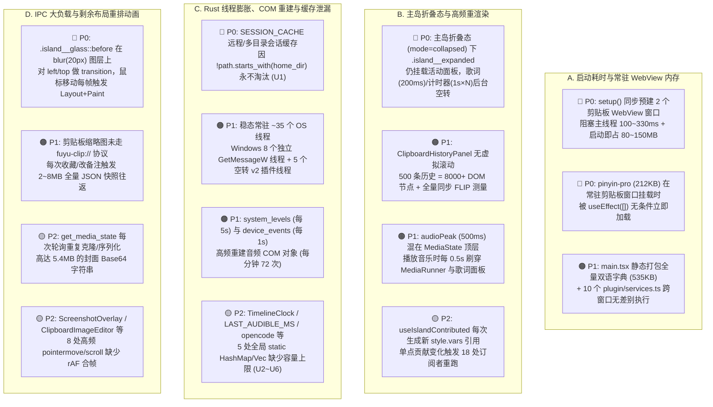

# 浮屿（Fuyu）第二轮全栈性能、内存与架构深度审查报告

> **审查基线**：2026-11-17 `HEAD`（已在第一轮完成 H1–H5、D88–D96、D49.1、D50–D52 等 15+ 项优化的基础上，对剩余深水区瓶颈进行全量代码与构建产物审计）
> **关联文档**：[第一轮性能审查](fuyu-performance-audit.md) · [截图内存泄漏分析](screenshot-memory-leak.md) · [内存与性能长期调研](memory-and-performance.md) · [总任务 D97](/docs/tasks/D/D97.md)（[#794](https://github.com/TixXin/Fuyu/issues/794)）

---

## 一、全局架构诊断与优化全景图

第一轮优化解决了「窗口关闭不销毁（#746）」、「截图帧克隆与贴图无上限（#752）」、「隐藏窗口 `setInterval` 空转（D51）」、「主岛游标轮询 83Hz 常驻（D91）」与「液态玻璃冗余模糊（D94）」等表层与中层问题。

第二轮深入到 **Rust 启动期窗口/I/O 链路**、**OS 线程与 COM 模型**、**IPC 大负载序列化**、**React 折叠态挂载树** 与 **Vite 入口分包依赖链** 后，定位出 **4 大类、22 项深层架构瓶颈**：

---

## 二、P0 级核心瓶颈（立竿见影、收益最大）

### P0-1. `setup()` 主线程同步预建 2 个剪贴板 WebView 窗口 + 同步反序列化 MB 级历史文件
- **位置**：
  - [lib.rs](/src-tauri/src/lib.rs#L166-L168) -> [clipboard_history/mod.rs](/src-tauri/src/clipboard_history/mod.rs#L649-L690) -> [clipboard_history/background.rs](/src-tauri/src/clipboard_history/background.rs#L60-L100)
- **根因分析**：
  1. `lib.rs:166` 调用 `plugin_kernel::builtins::init` 将 `Switches.ready` 设为 `true`（且该函数中 `read_disabled` 和 `read_config` 把同一个 `plugins.yml` 连续读取解析了 2 次）。
  2. 紧接着 `lib.rs:168` 调用 `clipboard_history::init`：
     - 第 662 行在主线程同步读取并反序列化整个 `clipboard-history.json`（含最多 500 条历史、Base64 缩略图、HTML，文件可达 **2–15 MB**），第 665 行又 `persisted.items.clone()` 深拷贝一份传给清理线程；
     - 第 688 行 `background::register` 因 `ready == true` 在主线程同步调用 `Windows::start()`，**当场在主线程同步构建 `clipboard` 和 `clipboard-preview` 两个隐藏 WebView 窗口**！
  3. 主岛窗口 `main` 的几何定位与初始化（已由 [D96](/docs/tasks/D/D96.md) 提前）此前还排在靠后顺位，被同步磁盘 I/O 和 2 个 WebView 子进程创建阻塞 **100ms–330ms**。
- **改造方案**：
  1. **剪贴板预览窗口 `clipboard-preview` 改为按需懒创建**（仅在用户在剪贴板窗口按空格预览时创建，关闭剪贴板窗口或空闲后销毁），立省 **1 个常驻 WebView 渲染进程（~40–70 MB 内存）**；`clipboard` 主弹窗延后到首帧就绪后再在后台预热或按需创建。
  2. **异步加载 `clipboard-history.json`**：将反序列化移入后台线程，清理孤儿图片只传文件名 `HashSet<String>`，消除全量 `items.clone()`。

---

### P0-2. 主岛折叠态（`mode === "collapsed"`）下，`.island__expanded` 内的活动面板仍常驻挂载并在后台高频重渲染
- **位置**：
  - [IslandShell.tsx](/src/windows/island/IslandShell.tsx#L199-L227) · [IslandShell.css](/src/windows/island/IslandShell.css#L142-L154) · [IslandPages.tsx](/src/windows/island/IslandPages.tsx#L30-L45)
- **根因分析**：
  - 主岛折叠时，`.island__expanded` 仅设置 `opacity: 0; pointer-events: none;`，而 `<IslandPages />` 始终挂载当前 `page` 对应的完整面板组件。
  - 因为主岛窗口在桌面上始终可见（`document.visibilityState === "visible"`），**所有 `useVisibilityInterval` 在主岛折叠时都不会暂停**！导致：
    1. 若上次打开的是 **音乐页（`page === "music"`）**，折叠后隐藏面板里的 [LyricsView.tsx](/src/features/media/lyrics/LyricsView.tsx#L26-L30)（**200ms / 5Hz**）和 [MusicProgress.tsx](/src/features/media/MusicProgress.tsx#L19-L23)（**500ms / 2Hz**）每秒触发 **7 次** 无意义的 React 状态更新与隐藏 DOM 排版；
    2. 若上次打开的是 **Agent 页（`page === "agents"`）**，每个运行中会话的 [SessionElapsed.tsx](/src/features/agent-status/SessionElapsed.tsx#L12-L15) 每秒触发重渲染，且每次会话变化时 [useListMotion.ts](/src/features/agent-status/useListMotion.ts#L106-L126) 仍对隐藏行执行 `getBoundingClientRect()` 和 FLIP 动画；
    3. 若上次打开的是 **剪贴板页（`page === "clipboard"`）**，每次用户按 `Ctrl+C` 复制时，隐藏的 [ClipboardHistoryPanel.tsx](/src/features/clipboard/ClipboardHistoryPanel.tsx#L120-L149) 都会重渲染数百行 DOM 并执行同步 `getBoundingClientRect()` FLIP 测量。
- **改造方案**：
  - 在 `IslandShell` / `IslandPages` 中，当主岛处于折叠态且未处于展开预备/收起过渡期时，卸载 `<IslandPages />` 子树（或向各面板注入 `isOpen={mode === "expanded"}` 门控所有内部定时器与 FLIP 测量，如同 `TimerPanel.tsx:28` 的做法）。

---

### P0-3. 液态玻璃高光层 `.island__glass::before` 在 `blur(20px)` 上对 `left`/`top` 做过渡，以及 3 处剩余 `width`/`height` 进度条动画
- **位置**：
  - [IslandGlass.css](/src/windows/island/IslandGlass.css#L58-L76)
  - [TodoIslandPage.css](/src/features/todos/island/TodoIslandPage.css#L103-L109) · [TodoIslandHeader.tsx](/src/features/todos/island/TodoIslandHeader.tsx#L14)
  - [UpdatePanel.css](/src/features/updater/UpdatePanel.css#L145-L151) · [UpdatePanel.tsx](/src/features/updater/UpdatePanel.tsx#L135)
  - [PluginStatusChip.css](/src/features/plugin-views/PluginStatusChip.css#L112-L118) · [PluginStatusChip.tsx](/src/features/plugin-views/PluginStatusChip.tsx#L65)
- **根因分析**：
  - `.island__glass::before` 带有 `filter: blur(20px)`，却配置了 `transition: left var(--motion-medium), top var(--motion-medium)`。鼠标在岛上移动时，每帧都在主线程触发 Layout + 20px 高斯模糊重绘（Paint）。
  - 待办完成进度条、自动更新下载进度条、折叠栏插件电池电量条仍在对 `width` / `height` 做过渡。
- **改造方案**：
  - 将 `.island__glass::before` 改为 `left: 0; top: 0; transform: translate3d(...)` + `transition: transform`；
  - 将上述 3 处进度条/电量条统一改为 `transform: scaleX(...)` / `scaleY(...)` 合成器动画。

---

### P0-4. `pinyin-pro`（212 KB）在常驻剪贴板窗口启动挂载时被无条件立即加载
- **位置**：
  - [ClipboardPopup.tsx](/src/features/clipboard/ClipboardPopup.tsx#L94-L96) · [useClipboardManager.ts](/src/features/clipboard/useClipboardManager.ts#L24-L26) · [useClipboardHistoryList.ts](/src/features/clipboard/useClipboardHistoryList.ts#L33-L38)
- **根因分析**：
  - 虽然 `popupQuery.ts` 写了动态 `import("pinyin-pro")`，但 `ClipboardPopup.tsx:94` 在 `useEffect(..., [])` 挂载时无条件调用了 `void loadPinyin()`！因为 `clipboard` 是常驻窗口，导致应用一启动就立即加载并驻留 **212.2 KB** 的 `pinyin-pro` 字典。
- **改造方案**：
  - 移除挂载时的无条件 `loadPinyin()`，统一改为仅当用户输入了包含英文字母的搜索词（`parsed.words.some((w) => /^[a-z]+$/.test(w))`）时才按需加载 `pinyin-pro`。

---

### P0-5. `agent_status` 的 `SESSION_CACHE` 远程与多目录会话缓存永不淘汰（U1）
- **位置**：
  - [session_scan.rs](/src-tauri/src/agent_status/session_scan.rs#L118-L125) 及 [session_scan.rs](/src-tauri/src/agent_status/session_scan.rs#L367-L376)
- **根因分析**：
  1. `scan()` 在第 118 行先调用 `forget_missing(home_dir, &sessions)`，在第 125 行才执行 `sessions.truncate(MAX_SESSIONS)`（12 条），导致 24 小时窗口内所有未进入前 12 名的历史 JSONL 会话缓存永远不会被 `forget_missing` 清理。
  2. `forget_missing` 使用 `!path.starts_with(home_dir)` 保护非当前扫描目录的缓存；当用户删除或切换远程 SSH 主机镜像目录（`remote-sessions/<host>`）后，旧主机目录下的 `CachedSession` 永远驻留内存。
- **改造方案**：
  - 将 `forget_missing` 移至 `sessions.truncate(MAX_SESSIONS)` 之后，并为 `SESSION_CACHE` 增加最后访问时间戳与硬性容量上限（如 `MAX_CACHED_SESSIONS = 128`），超时或超量即淘汰。

---

## 三、P1 级重要优化（包体积减半、线程精简与大列表加速）

### P1-1. 公共入口包 `index.js`（668 KB）瘦身：语言包按需加载 + 按窗口加载 `plugin/services.ts`
- **位置**：
  - [src/main.tsx](/src/main.tsx#L10-L17) · [src/i18n/index.ts](/src/i18n/index.ts#L4-L14) · [SettingsSidebar.tsx](/src/windows/settings/SettingsSidebar.tsx#L7)
- **问题量化**：
  - `src/i18n/` 全量中英双语字典（源码 **535.3 KB**，其中 `settings` 独占 **231 KB**）被静态打入所有窗口共用的 `index.js`（**668.3 KB**）。
  - `main.tsx:17` 的 `import.meta.glob("./features/*/plugin/services.ts", { eager: true })` 在 `pin`、`drag-grid`、`clipboard-preview`、`tray-menu`、`onboarding` 等完全不需要 `windowServices` 的轻量窗口中也全量执行，且在每个窗口启动时无条件发起 `get_builtin_plugins` IPC 请求。
  - `SettingsSidebar.tsx:7` 静态引入 **111.5 KB** 的 `searchIndex.json`，即使不搜索也占 `SettingsWindow` 20% 体积。
- **改造方案**：
  1. `i18n` 改为按当前激活语言动态 `import()`，并将 `settings` / `onboarding` 专用词典拆出按窗口加载；
  2. `main.tsx` 的 `loadWindow()` 按 `windowKind` 仅加载该窗口所需的 `plugin/services.ts`；
  3. `SettingsSidebar.tsx` 在搜索框聚焦或输入时动态 `import("./searchIndex.json")`；
  4. [useIslandNotices.ts](/src/features/messages/island/useIslandNotices.ts#L3) 改为从 `../mail/useMail` 导入 `useMail`，切断主岛常驻 runner 对 `MailPanel.tsx` 和 `dompurify` 的静态依赖。

---

### P1-2. 主岛剪贴板面板 `ClipboardHistoryPanel` 虚拟滚动与 FLIP 限流
- **位置**：
  - [ClipboardHistoryPanel.tsx](/src/features/clipboard/ClipboardHistoryPanel.tsx#L119-L149) · [ClipboardHistoryItemRow.tsx](/src/features/clipboard/ClipboardHistoryItemRow.tsx#L14) · [useClipboardHistoryList.ts](/src/features/clipboard/useClipboardHistoryList.ts#L50-L91)
- **问题量化**：
  - 独立剪贴板弹窗已用虚拟列表，但主岛内的 `ClipboardHistoryPanel` 仍直接 `.map()` 全量挂载最多 500 条记录（8,000+ DOM 节点 + 全部 Base64 缩略图），且 `ClipboardHistoryItemRow` 未 `React.memo`，每次变化时 `useClipboardHistoryList` 对全部 500 个节点同步调 `getBoundingClientRect()` 做 FLIP 动画。
- **改造方案**：
  - 复用 `useVirtualRows` 虚拟列表（或分页挂载），用 `React.memo` 包裹 `ClipboardHistoryItemRow`，图片加 `loading="lazy" decoding="async"`，FLIP 动画仅对前 20 个可见项执行。

---

### P1-3. 精简常驻 OS 线程（从 ~35 个降至 ~15 个）与高频音频 COM 重建
- **位置**：
  - [plugin_host/mod.rs](/src-tauri/src/plugin_host/mod.rs#L135-L141)
  - [system_levels/mod.rs](/src-tauri/src/system_levels/mod.rs#L67-L93) · [device_events/readers.rs](/src-tauri/src/device_events/readers.rs#L14-L25)
  - Windows 各模块 `hotkey.rs`（8 个独立 `GetMessageW` 线程）
- **问题量化**：
  1. 已冻结的 v2 `plugin_host` 在 `allow_third_party == false` 且无 v2 插件时，仍无条件常驻启动 **5 个 OS 线程**（`system-events`、`system-idle`、`plugin-hotkeys`、`plugin-lifecycle`、`plugin-updates`），且每次业务事件发布都在 `plugin_host/events.rs:84` 新 `spawn` 一个睡眠 200ms 的线程。
  2. `system_levels` 每 **5 秒**丢弃并重新激活一次默认音频端点 COM 对象；`device_events` 每 **1 秒**重新 `CoCreateInstance(MMDeviceEnumerator)` 枚举音频设备并查硬件属性（稳态每分钟合计 **72 次** COM 设备枚举与重建）。
  3. Windows 下剪贴板、翻译、截图、语音、计时器、插件、审批、壁纸各自独占一个 `GetMessageW` 隐藏窗口线程（共 **8–9 个**）。
- **改造方案**：
  1. v2 `plugin_host` 在未启用第三方插件时懒启动那 5 个线程，且 `events::publish` 在无订阅者时直接返回；
  2. `system_levels` 与 `device_events` 注册 `IMMDeviceNotificationClient` 监听默认设备与设备状态变化，变轮询重建为事件驱动；
  3. 逐步将慢速周期巡检线程与 Win32 消息循环合并（主岛 4 条看护线程已由 [D96](/docs/tasks/D/D96.md) 合并为单条 `island-watch`）。

---

### P1-4. 剪贴板缩略图接入 `fuyu-clip://` 协议与单项修改轻量化
- **位置**：
  - [image_protocol.rs](/src-tauri/src/clipboard_history/image_protocol.rs#L28-L37) · [clipboard_history/mod.rs](/src-tauri/src/clipboard_history/mod.rs#L621-L647)
- **问题量化**：
  - 缩略图文件明明已落盘在 `clipboard-images/<hash>-thumb.png`，却仍编码为 Base64 塞进 `clipboard-history.json` 和每次 `get_clipboard_history` IPC 快照（2–8 MB）；每次点收藏、改备注都全量克隆并返回整份 500 条快照，同时广播事件让多窗口再次拉取全量快照。
- **改造方案**：
  - 扩展 `fuyu-clip://` 支持缩略图读取，减少 JSON 内联 Base64；单项修改接口改为仅返回变更项或版本号。

---

## 四、P2 级打磨项（高频交互顺滑度与边界防护）

| 编号 | 模块与位置 | 问题描述 | 改造方案 |
|---|---|---|---|
| **P2-1** | [useAudioLevel.ts](/src/features/media/useAudioLevel.ts#L36-L91) [media/plugin/runners.tsx](/src/features/media/plugin/runners.tsx#L32-L44) | 播放音乐时 `audioPeak` 每 500ms 变化，因混在 `MediaState` 顶层，每 0.5s 触发 `MediaRunner`、歌词计算与整个 `MusicPlayerPanel` 重渲染；且展开音乐页显示歌词时仍在轮询音频峰值。 | 将 `audioPeak` 拆为独立小 store 仅由波形组件订阅；展开页有歌词时不轮询 `getAudioLevel`。 |
| **P2-2** | [islandContributions.ts](/src/features/plugin-kernel/islandContributions.ts#L102-L154) | `aggregateContributions` 每次重新生成 `style.vars` 等新引用，导致 18 处 `useIslandContributed()` 订阅者在无关字段更新时全量重渲染。 | 复用未变化的子对象引用，并支持 `useIslandContributed(selector)`。 |
| **P2-3** | [ScreenshotOverlay.tsx](/src/windows/screenshot/ScreenshotOverlay.tsx#L191) [ClipboardImageEditor.tsx](/src/windows/clipboard/ClipboardImageEditor.tsx#L100) [useVirtualRows.ts](/src/features/clipboard/useVirtualRows.ts#L12) 等 8 处 | 高频 `pointermove` / `scroll` 回调中直接同步 `getBoundingClientRect()` 并连续 `setState`，缺少 `requestAnimationFrame` 合帧。 | 拖拽开始时缓存容器 `getBoundingClientRect()`，用 `rAF` 合帧指针移动更新；虚拟列表仅在 `(start, end)` 行区间变化时更新 state。 |
| **P2-4** | [timeline_clock.rs](/src-tauri/src/media_control/timeline_clock.rs#L60) [audio_fallback.rs](/src-tauri/src/media_control/audio_fallback.rs#L45) [opencode.rs](/src-tauri/src/agent_status/opencode.rs#L55) [plugin_host/lifecycle.rs](/src-tauri/src/plugin_host/lifecycle.rs#L62) | 5 处全局 `static Mutex<HashMap/Vec>`（U2–U6）缺少容量上限或过期清理。 | 分别补齐 `retain` 过期清理与容量上限（如 32/64 条）。 |
| **P2-5** | [sound_packs.rs](/src-tauri/src/agent_status/sound_packs.rs#L63) [pets/mod.rs](/src-tauri/src/pets/mod.rs#L59) [file_shelf/availability.rs](/src-tauri/src/file_shelf/availability.rs#L60) | `import_sound_pack` / `pets` 在 `async fn` 中未用 `spawn_blocking` 直接做数 MB 文件 I/O；`file_shelf` 每次操作都为每个盘符 `thread::spawn` 探测线程且无正缓存。 | 补齐 `spawn_blocking`；为 `file_shelf` 盘符可达性增加 15s 正缓存 TTL。 |

---

## 五、任务拆分与落地看板（D97，#794）

全部优化项已按**文件范围零重叠**拆分为父任务 [D97](/docs/tasks/D/D97.md)（[#794](https://github.com/TixXin/Fuyu/issues/794)）下的 6 个独立子任务：

| 任务编号 | Issue | 覆盖审查项 | 核心目标 |
|---|---|---|---|
| [D97.1](/docs/tasks/D/D97.1.md) | [#795](https://github.com/TixXin/Fuyu/issues/795) | P0-3、P0-4、P1-1 局部 | 液态玻璃高光与 3 处进度条改 `transform`、`pinyin-pro` 字母词懒加载、`searchIndex.json` 动态加载、`useIslandNotices` 解耦 `dompurify` |
| [D97.2](/docs/tasks/D/D97.2.md) | [#796](https://github.com/TixXin/Fuyu/issues/796) | P0-2、P1-2 | 主岛折叠态卸载/休眠展开面板定时器、`ClipboardHistoryPanel` 虚拟滚动 + `React.memo` + FLIP 限流 |
| [D97.3](/docs/tasks/D/D97.3.md) | [#797](https://github.com/TixXin/Fuyu/issues/797) | P1-1 | `i18n` 双语字典按激活语言与窗口拆分、`main.tsx` 按 `windowKind` 按需注册 `plugin/services.ts` |
| [D97.4](/docs/tasks/D/D97.4.md) | [#798](https://github.com/TixXin/Fuyu/issues/798) | P2-1、P2-2、P2-3 | `audioPeak` 拆出 `MediaState`、`islandContributions` 子引用复用与 selector、8 处 `pointermove`/`scroll` `rAF` 合帧 |
| [D97.5](/docs/tasks/D/D97.5.md) | [#799](https://github.com/TixXin/Fuyu/issues/799) | P0-5、P2-4、P2-5 | `SESSION_CACHE` 淘汰修复、U2–U6 全局缓存上限、`sound_packs`/`pets` `spawn_blocking`、`file_shelf` 盘符正缓存 |
| [D97.6](/docs/tasks/D/D97.6.md) | [#800](https://github.com/TixXin/Fuyu/issues/800) | P0-1 局部、P1-3 局部、P1-4 | `clipboard-preview` 窗口懒创建、`clipboard-history.json` 异步加载、v2 `plugin_host` 5 线程懒启动、`fuyu-clip://` 缩略图协议 |
