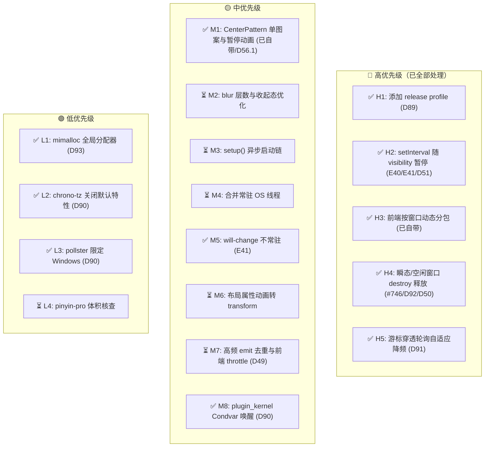

# 浮屿性能优化审查报告

> 审查时间：2026-11-17 | 基于 Tauri 性能调研 + 全代码库审计
> 更新：2026-11-17（同步标注 H1–H5、M1、M5、M8、L1–L3 的落地提交与代码库现状，避免后续重复排查）

本报告基于 [Tauri 性能优化调研](tauri-performance-optimization.md) 和 [#746](https://github.com/TixXin/Fuyu/issues/746) 实测数据，对浮屿代码进行逐项审查并跟踪落地状态。

## 进度速览

| 编号 | 优化项 | 状态 | 关联任务 / 提交 |
|---|---|---|---|
| **H1** | `[profile.release]` 编译优化配置 | ✅ 已解决 | D89（`9054c805`、`e3930e89`） |
| **H2** | `setInterval` 随页面可见性暂停与唤醒刷新 | ✅ 已解决 | E40、E41、D51、D78（`63617cb6`、`63ba8780`、`c5e44355`） |
| **H3** | 前端按窗口入口动态分包（Code Splitting） | ✅ 已自带处理 | [main.tsx](/src/main.tsx)（`7d584597`） |
| **H4** | 瞬态与低频窗口改为按需创建、关闭/空闲销毁 | ✅ 已解决 | #746、D92、D50（`5713333f`、`4d00b60e`、`62d774b9`、`408c7a51`） |
| **H5** | 主岛游标穿透轮询自适应降频（其余循环本为瞬态） | ✅ 已解决 | D91（`17ae888e`） |
| **M1** | `CenterPattern` 单图案挂载 + `data-paused` 暂停动画 + 合成层拆分 | ✅ 已自带处理 | [CenterPattern.tsx](/src/features/center-pattern/CenterPattern.tsx)、D56.1（`5514da0b`） |
| **M2** | 岛 `backdrop-filter: blur` 层数与收起态优化 | ⏳ 待做 | — |
| **M3** | `setup()` 非首帧关键子系统异步启动 | ⏳ 待做 | — |
| **M4** | 常驻低频轮询 OS 线程合并 | ⏳ 待做 | — |
| **M5** | 移除静态常驻 `will-change` | ✅ 已解决 | E41（`63ba8780`） |
| **M6** | `Spotlight.css` 等布局属性动画改为 `transform` | ⏳ 待做 | — |
| **M7** | Rust 高频 `emit` 去重与前端事件节流 | ⏳ 待做 | 关联 D49（#257） |
| **M8** | `plugin_kernel` 50ms 忙等改为 `Condvar` | ✅ 已解决 | D90（`02fab778`） |
| **L1** | 引入 `mimalloc` 全局内存分配器 | ✅ 已解决 | D93（`22c27806`） |
| **L2** | `chrono-tz` 关闭默认特性裁剪 | ✅ 已解决 | D90（`02fab778`） |
| **L3** | `pollster` 限定 Windows 平台编译 | ✅ 已解决 | D90（`02fab778`） |
| **L4** | `pinyin-pro` 打包体积与按需引入核查 | ⏳ 待做 | — |

> [!NOTE]
> H2（D51）与 H4（#746、D92、D50）的代码改动与自动化测试均已落地；Windows 10/11 真机上的 WebView2 `gpu-process` / `renderer` 回落幅度与闲置 CPU 前后采数见各任务交接清单。常驻剪贴板窗口的 WebView2 内存让出 API 另由 D48（#256）跟踪。

---

## 🔴 高优先级

### H1. `[profile.release]` 完全缺失 — ✅ 已解决（D89）

**位置：** [Cargo.toml](/src-tauri/Cargo.toml)

> **解决现状（D89，`9054c805` / `e3930e89`）：** 已在 `src-tauri/Cargo.toml` 添加 `[profile.release]`，开启 `lto = "thin"` 与 `strip = true`。`codegen-units = 1` 在 `e3930e89` 中移除以兼顾日常 `build:exe` 编译并行度与构建耗时；未开启 `panic = "abort"` 以保留标准栈展开语义。

**原问题记录：** 审查时 `src-tauri/Cargo.toml` 没有 `[profile.release]` 段，release 构建使用 Cargo 默认值（`lto = false`、`strip = "none"`），导致调试符号与跨模块未优化代码进入产物。

---

### H2. ~40 个 setInterval 在窗口隐藏时仍然运行 — ✅ 已解决（E40 / E41 / D51）

**影响：** 空闲 CPU、电池消耗

> **解决现状（E40 `63617cb6`、E41 `63ba8780`、D51 `c5e44355`、D78 `d559bffc`）：**
> 1. 新增 [useVisibilityInterval.ts](/src/lib/useVisibilityInterval.ts)（提供 `useVisibilityInterval` 与底层 `visibilityInterval`），在 `document.hidden` 时自动 `clearInterval`，并在页面恢复可见时**立即补跑一次回调**刷新最新数据后再恢复定时，避免唤起时先闪旧数据。
> 2. 全仓排查出的 52 处 `setInterval` 已全部受控：49 处业务与窗口轮询（含 `agent-status` 13 处、`media` 7 处、`timer`、`calendar`、`clipboard`、`screenshot`、`ssh-tunnel`、`cc-connect`、`settings`、`onboarding` 等）已统一接入 `visibilityInterval`；其余 3 处本身按可见性或短生命周期停表（`ClipboardPopup.tsx` 监听 `visibilitychange`、`IconButtonTooltip.tsx` 仅气泡显示期间运行、`useDemoHeartbeat.ts` 随引导窗口销毁）。
> 3. 暂停与唤醒立即刷新行为已有单元测试覆盖（[visibility-interval.test.mjs](/tests/unit/visibility-interval.test.mjs)），逐项清单归档于 [D51.md](/docs/tasks/0-archive/D/D51.md)。

---

### H3. 前端零 Code Splitting——所有窗口加载全量 Bundle — ✅ 已自带处理

**影响：** 每个窗口的 JS 堆和启动耗时

> **核查现状（`7d584597`）：** 代码库在 [main.tsx](/src/main.tsx) 的 `loadWindow()` 中已按 `?window=` 参数对全部窗口入口（`TranslationWindow`、`SettingsWindow`、`ClipboardWindow`、`ClipboardPreviewWindow`、`ScreenshotOverlay`、`PinWindow`、`TrayMenuWindow`、`DragGridWindow`、`OnboardingWindow` 以及默认主岛 `TodosGate` + `IslandApp`）使用动态 `await import(...)` 按需加载，Vite 构建时已自动拆分为各自独立的异步 chunk，无需重复改造。（注：`main.tsx` 顶层 `import.meta.glob("./features/*/plugin/services.ts", { eager: true })` 仅注册轻量前端服务契约，各窗口重型 UI 组件互不混载。）

---

### H4. 窗口 hide-on-close 导致 GPU 内存只涨不降 — ✅ 已解决（#746 / D92 / D50）

**影响：** GPU 进程内存（#746 实测每窗口 +43 MB GPU）

> **解决现状（`5713333f`、`4d00b60e`、`62d774b9`、`408c7a51`）：**
> 1. **瞬态与低频窗口销毁释放（#746、D92）：** `settings`、`tray-menu`、`drag-grid`、`screenshot-N`、`pin-N`、`onboarding` 已改为关闭或结束时直接 `destroy()`（不再拦截为 `prevent_close()` + `hide()`）；移除了启动时对 `tray-menu`、`screenshot-N`、`pin-1` 的预构建，修复了 macOS 销毁窗口时的 NSPanel 残留，并在 [useScreenshotFrame.ts](/src/features/screenshot/useScreenshotFrame.ts) 卸载清理中将画布宽高置零释放纹理，同时消除了长截图 `long.rs` 滚动拼接中的整帧冗余克隆。
> 2. **翻译窗口空闲自动销毁（D50）：** `translation` 窗口已改为按需创建（`create: false`），收起隐藏后空闲满 10 分钟自动 `destroy()`，再次唤起时按需重建并保留原有设置与状态（[translation/background.rs](/src-tauri/src/translation/background.rs)）。
> 3. **常驻窗口边界：** 仅快捷键延迟敏感的 `clipboard` / `clipboard-preview` 保持隐藏常驻（已配合 H2 在隐藏时停掉全部定时器；常驻隐藏窗口的 WebView2 `TrySuspend` / `MemoryUsageTargetLevel` 由 D48 单独跟进）。

---

### H5. 12ms 游标轮询——永久 83 Hz CPU 唤醒 — ✅ 已解决（D91）

**位置：** [island/passthrough.rs](/src-tauri/src/island/passthrough.rs)、[island/geometry.rs](/src-tauri/src/island/geometry.rs)

> **解决现状（D91，`17ae888e`）与逐项核查：**
> 1. **主岛游标穿透自适应三级降频：** `passthrough.rs` 与 `passthrough_macos.rs` 已接入 `passthrough_sleep_duration(visible, active)`——仅当光标进入舞台外扩 120px 唤醒区、悬停岛屿/横幅、按住修饰键调整或显式开启光标追踪时保持 `12ms`（~83 Hz）；光标远离舞台闲置时降频至 `48ms`（~21 Hz）；主岛隐藏时进一步降至 `240ms`（~4 Hz），大幅降低稳态空转唤醒。
> 2. **其余 3 处高频循环核查均非永久常驻：**
>    - [island/geometry.rs](/src-tauri/src/island/geometry.rs) 的 8ms 循环仅在位置滑动动画（320ms）触发时临时派生线程运行，`progress >= 1.0` 即刻退出；
>    - [island/mod.rs](/src-tauri/src/island/mod.rs) 的 8ms 循环仅在用户按住鼠标左键拖拽岛屿期间运行，松手即退出；
>    - [island/outside_click.rs](/src-tauri/src/island/outside_click.rs) 的 40ms 循环仅在主岛展开需要监听外部点击时运行（最长 120s，`watch = false` 时通过代数计数立即终止）。

---

## 🟡 中优先级

### M1. CenterPattern 13 个无限 CSS 动画同时运行 — ✅ 已自带处理（含 D56.1）

**位置：** [CenterPattern.tsx](/src/features/center-pattern/CenterPattern.tsx)、[CenterPattern.css](/src/features/center-pattern/CenterPattern.css)、[useCenterDecor.tsx](/src/features/center-pattern/useCenterDecor.tsx)

> **核查现状：**
> 1. **按需单挂载：** `CenterPattern.tsx` 按 `pattern` 条件分支渲染（`eyes` / `bird` / `orb` / `cat` / `mark` 五选一），DOM 中只存在当前选中的单个图案，不会 13 个动画同时运行。
> 2. **隐藏/暂停时停止合成器动画：** `useCenterDecor.tsx` 将 `paused || usePageHidden()` 合并为 `still` 传入组件并设置 `data-paused` 属性，`CenterPattern.css` 已配有 `.center-pattern[data-paused] * { animation-play-state: paused !important; }`（并在 `prefers-reduced-motion: reduce` 下彻底关闭 `animation` 与 `transition`）。
> 3. **合成层优化（D56.1，`5514da0b`）：** 状态灯标记（`center-mark`）的呼吸与展开动效已拆分为独立 `<span>` 图层的 `transform` / `opacity` 合成动画。

---

### M2. 岛 backdrop-filter blur 多层叠加 — ⏳ 待做

**影响：** 稳态 GPU 开销最大的单项

| 文件 | 值 | 状态 |
|---|---|---|
| [IslandGlass.css](/src/windows/island/IslandGlass.css) | `blur(var(--glass-panel-blur)) saturate(1.18)` | 始终开启 |
| [IslandApp.css](/src/windows/island/IslandApp.css) | `blur(var(--glass-panel-blur)) saturate(1.12)` | 始终开启 |
| [IslandGlass.css](/src/windows/island/IslandGlass.css) | `filter: blur(20px)` | 装饰层 |

2–3 层 blur 在透明置顶窗口上始终运行，是稳态下最大的 GPU 成本。#746 对照实验显示毛玻璃只值 ~27 MB GPU，但 CPU/GPU 合成开销主观上明显。

**建议：** 此项是产品核心外观，无法去掉。可以：
- 折叠态只保留 1 层 blur（减少合成层数）
- 贴边收起 / 隐藏时完全关闭 blur
- 经典外观模式下确认 blur 确实不激活

---

### M3. 同步启动链——25 个子系统顺序初始化 — ⏳ 待做

**位置：** [lib.rs](/src-tauri/src/lib.rs) `setup()` 闭包

约 25 个子系统在 `setup()` 中**顺序同步初始化**，包括：clipboard_history、translation、screenshot、voice_input、file_shelf、sync、todos、agent_approval、ssh_tunnel、cc_connect、plugin_host、plugin_kernel、mail、qq_notifications、wechat_reminders、media_control、agent_status 等。

启动延迟 = 所有 init 耗时之和。任何一个做了同步 I/O（文件读取、注册表查询、网络检查）都会阻塞。（注：D93 `22c27806` 已先行将剪贴板历史图片回填目录扫描移入后台线程。）

**建议：** 把非首帧关键子系统（mail、QQ、WeChat、SSH tunnel 等）移到后台异步启动，不阻塞首帧渲染。

---

### M4. 30–50+ 常驻 OS 线程 — ⏳ 待做

代码库中有 ~150 个 `thread::spawn` / `thread::Builder::new()`，稳态下估计有 30–50+ 个 OS 线程在运行。每个 OS 线程的栈空间 1–8 MB，50 个线程就是 50–400 MB 仅栈内存。

**建议：** 多个低频轮询（device_events 的电池/外设/电源检查，fullscreen 检查，coexist 检查）可以合并到同一个线程里做多速率轮询——`device_events/mod.rs` 已经是好的示范；Windows 媒体状态与音量轮询可按 D52（#260）改为 GSMTC / `IAudioEndpointVolumeCallback` 事件回调。

---

### M5. 3 处持久 `will-change` 违反自有 motion.md 规则 — ✅ 已解决（E41）

**位置：** [AgentCardEffects.css](/src/features/agent-status/AgentCardEffects.css)、[ClipboardImageViewer.css](/src/features/clipboard/ClipboardImageViewer.css)、[IslandGlassFlow.css](/src/windows/island/IslandGlassFlow.css)

> **解决现状（E41，`63ba8780`）：** 已删除 `AgentCardEffects.css` 与 `IslandGlassFlow.css` 中的静态常驻 `will-change`；`ClipboardImageViewer.css` 改为仅在 `.clipboard-picture.clipboard-picture--dragging img` 拖拽平移期间按需启用 `will-change: transform`，符合 `docs/design/motion.md` 规范。

---

### M6. Spotlight.css 同时 transition 5 个布局属性 — ⏳ 待做

**位置：** [Spotlight.css](/src/windows/onboarding/Spotlight.css)

```css
transition: left, top, width, height, border-radius;
```

同时 transition `left`、`top`、`width`、`height`、`border-radius` 五个布局属性，每帧强制完整布局重算。这是最重的布局触发动画。

另有 ~15 处 transition 使用了 `width`、`height`、`left` 等布局属性（详见 IslandGlass.css、UpdatePanel.css、TodoIslandPage.css、SettingsSidebarNarrow.css 等）。

**建议：** 用 `transform: translate() + scale()` 替代 `left/top/width/height` 动画。

---

### M7. 前端没有任何 throttle / debounce（及高频 emit 去重） — ⏳ 待做（关联 D49）

整个前端代码中搜索不到通用 `throttle` 或 `debounce`。高频事件（Rust 端 `emit` 的 resize、drag、media 变化）直接到达前端，没有速率控制；且在 WebView2 下每次 `emit` 都会生成不可回收的内联脚本，影响长跑内存增长。

**建议：** 结合任务 D49（#257）推进 Rust 侧高频 `emit` 内容去重（内容未变不重复发送），并在前端侧对窗口 resize、拖拽、媒体状态等高频事件补充 throttle。

---

### M8. plugin_kernel 50ms 忙等 — ✅ 已解决（D90）

**位置：** [plugin_kernel/builtins.rs](/src-tauri/src/plugin_kernel/builtins.rs)、[plugin_kernel/mod.rs](/src-tauri/src/plugin_kernel/mod.rs)

> **解决现状（D90，`02fab778`）：** `plugin_kernel/builtins.rs` 与 `plugin_kernel/mod.rs` 原有的 50ms `thread::sleep` 轮询等待已替换为 `Mutex + Condvar` 条件变量阻塞唤醒（带超时保护，关闭阶段 `notify_all()` 立即唤醒退出），消除忙等反模式。

---

## 🟢 低优先级

### L1. 无自定义内存分配器 — ✅ 已解决（D93）

> **解决现状（D93，`22c27806`）：** 已在 [Cargo.toml](/src-tauri/Cargo.toml) 引入 `mimalloc = { version = "0.1", default-features = false }`，并在 [main.rs](/src-tauri/src/main.rs) 注册 `#[global_allocator]`，降低长跑场景下的堆分配碎片。

### L2. `chrono-tz` 编译了完整时区数据库 — ✅ 已解决（D90）

> **解决现状（D90，`02fab778`）：** 已在 [Cargo.toml](/src-tauri/Cargo.toml) 将 `chrono-tz` 设为 `default-features = false`。

### L3. `pollster` 在全平台编译，仅 Windows 使用 — ✅ 已解决（D90）

> **解决现状（D90，`02fab778`）：** 已在 [Cargo.toml](/src-tauri/Cargo.toml) 将 `pollster = "0.4"` 移入 `[target.'cfg(windows)'.dependencies]`，macOS 不再编译该依赖。

### L4. `pinyin-pro` 可能有较大体积 — ⏳ 待做

中文拼音库，包含完整字典（估计 ~100 KB+），需确认是否被 tree-shake 以及是否仅在需要的窗口 chunk 中按需加载。

---

## 总览



## 做得好的地方

审查中也发现了多处已经做得很好的实践，值得保持：

| 项目 | 说明 |
|---|---|
| ✅ 窗口按需创建与销毁 | 除 `main` 与常驻剪贴板外均 `create: false` 按需创建，瞬态窗口用完即毁，翻译窗口空闲 10 分钟销毁 |
| ✅ 窗口级动态分包 | `main.tsx` 按 `?window=` 动态 `import()` 各窗口入口，互不混载重型面板 |
| ✅ `emit_to` 精准投递 | 截图、录制、托盘等事件只发送到目标窗口 |
| ✅ 自定义 URI 协议 | 剪贴板图片和插件资源走 async URI scheme，绕过 JSON 序列化 |
| ✅ `spawn_blocking` 广泛使用 | 100+ 处正确地将阻塞 I/O 卸载到 Tokio 线程池 |
| ✅ 可见性感知的定时器与动画 | `useVisibilityInterval` 统一暂停隐藏页面轮询并唤醒即刷，WebGL shader、波形与中心装饰随可见性暂停 |
| ✅ 依赖精简 | `image`、`reqwest`、`lettre`、`chrono-tz` 均关闭默认 feature，平台专属依赖按 target 隔离 |
| ✅ 前端依赖精简 | 无 moment、lodash-full 等重型库 |
| ✅ motion.md 设计体系 | 完善的动效 token、缓动曲线、按需 `will-change` 和 reduced-motion 支持 |
| ✅ 仅 27 次 invoke 调用 | IPC 表面积很小 |
