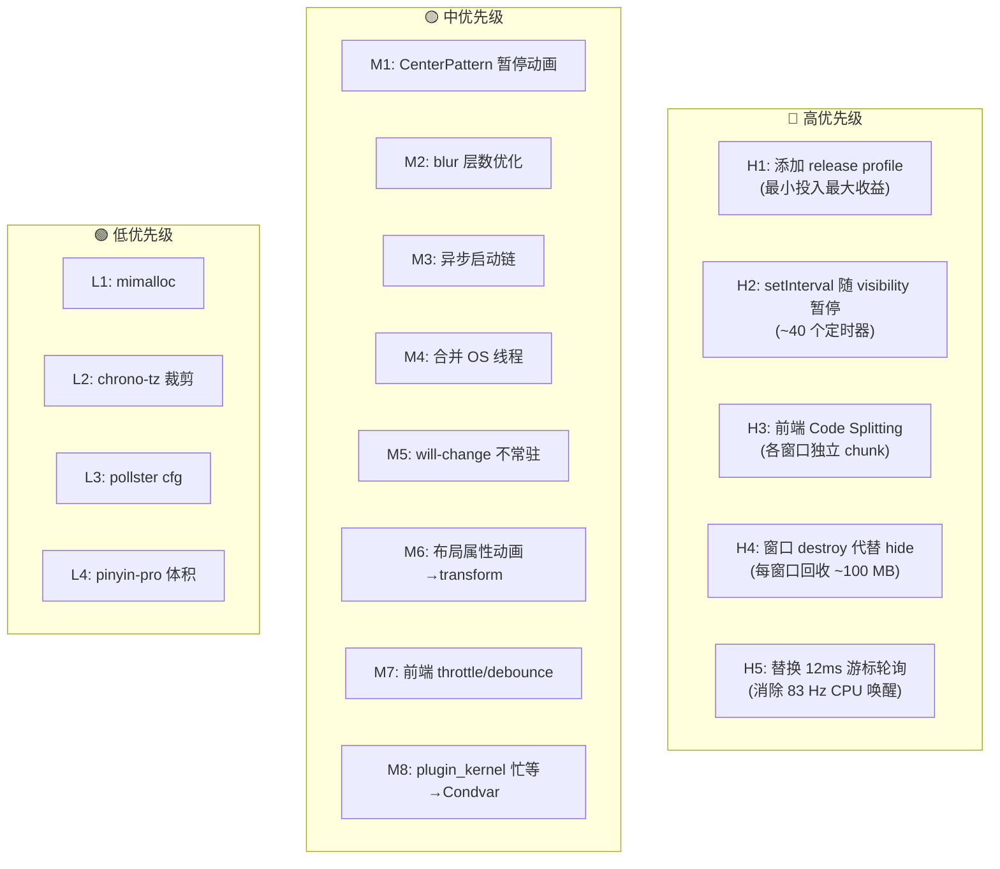

# 浮屿性能优化审查报告

> 审查时间：2026-11-17 | 基于 Tauri 性能调研 + 全代码库审计
> 代码规模：Rust ~104,400 行 / 前端 ~若干百文件

本报告基于 [Tauri 性能优化调研](tauri-performance-optimization.md) 和 #746 实测数据，对浮屿当前代码进行逐项审查，按优先级列出可操作的优化项。

---

## 🔴 高优先级

### H1. `[profile.release]` 完全缺失

**位置：** [Cargo.toml](file:///Users/tixxin/Desktop/projects/Fuyu/src-tauri/Cargo.toml)

当前 `src-tauri/Cargo.toml` 中**没有 `[profile.release]` 段**，release 构建使用 Cargo 默认值：
- `lto = false`（不做链接时优化）
- `codegen-units = 256`（阻止跨模块优化）
- `panic = "unwind"`（保留 unwinding 表，增大二进制）
- `strip = "none"`（保留调试符号）

**建议添加：**

```toml
[profile.release]
lto = "thin"
codegen-units = 1
panic = "abort"
strip = true
```

**预期收益：** 二进制体积减少 20–40%，运行时性能也有提升。这是所有优化项里投入最小、收益最大的一项。

> [!CAUTION]
> `panic = "abort"` 会让 `catch_unwind` 失效。需确认项目没有依赖它（快速搜索 `catch_unwind` 验证）。

---

### H2. ~40 个 setInterval 在窗口隐藏时仍然运行

**影响：** 空闲 CPU、电池消耗

项目已有 `usePageHidden()` hook（[usePageHidden.ts](file:///Users/tixxin/Desktop/projects/Fuyu/src/lib/usePageHidden.ts)），但**目前只在 4 个装饰性组件中使用**。约 40 个 `setInterval` 完全不检查 `document.hidden`，窗口最小化/隐藏后照样轮询。

最严重的模块：**`agent-status`**，单独有 14 个 setInterval：

| 文件 | 间隔 | 用途 |
|---|---|---|
| [useAgentStatus.ts](file:///Users/tixxin/Desktop/projects/Fuyu/src/features/agent-status/useAgentStatus.ts) | varies | 状态轮询 |
| [useAgentSessions.ts](file:///Users/tixxin/Desktop/projects/Fuyu/src/features/agent-status/useAgentSessions.ts) | `intervalMs` | 会话列表 |
| [useAgentUsages.ts](file:///Users/tixxin/Desktop/projects/Fuyu/src/features/agent-status/useAgentUsages.ts) | `REFRESH_MS` | 用量环 |
| [useRemoteHosts.ts](file:///Users/tixxin/Desktop/projects/Fuyu/src/features/agent-status/useRemoteHosts.ts) | `STATUS_POLL_MS` | 远程主机 |
| [AgentSubagents.tsx](file:///Users/tixxin/Desktop/projects/Fuyu/src/features/agent-status/AgentSubagents.tsx) | 1000ms | 时钟计时 |
| [AgentSessionsPanel.tsx](file:///Users/tixxin/Desktop/projects/Fuyu/src/features/agent-status/AgentSessionsPanel.tsx) | `AGE_REFRESH_MS` | 时钟计时 |
| [SessionElapsed.tsx](file:///Users/tixxin/Desktop/projects/Fuyu/src/features/agent-status/SessionElapsed.tsx) | 1000ms | 耗时显示 |
| …… | | 还有 7 个 |

其他模块：media（6 个）、calendar、plugins、ssh-tunnel、cc-connect、timer、todos、updater、screenshot 等也各有 1–3 个。

**建议：** 写一个 `useVisibilityInterval(callback, ms)` hook，内部在 `document.hidden` 时暂停。用它替换所有裸 `setInterval`。已有的 `usePageHidden()` 可以作为基础。

---

### H3. 前端零 Code Splitting——所有窗口加载全量 Bundle

**影响：** 每个窗口的 JS 堆和启动耗时

项目的 8 个窗口类型（main、translation、clipboard、clipboard-preview、settings、onboarding、tray-menu、drag-grid）共享同一个入口，通过 `?window=` 参数路由。**没有任何 `React.lazy` 或 `import()` 动态加载**，每个窗口都加载完整的前端 Bundle。

这意味着：
- 剪贴板窗口加载了 agent-status、media、calendar 等完全用不到的代码
- 设置窗口加载了截图、翻译、文件中转等代码
- 每个窗口的 JS 堆都因为加载不需要的模块而膨胀

**建议：**
1. 在 [vite.config.ts](file:///Users/tixxin/Desktop/projects/Fuyu/vite.config.ts) 中按窗口类型配置 `manualChunks`
2. 窗口入口组件用 `React.lazy` 按需加载各功能模块
3. 至少把 settings 和 onboarding 拆成独立 chunk——这两个窗口最不常用，代码量最大

---

### H4. 窗口 hide-on-close 导致 GPU 内存只涨不降

**影响：** GPU 进程内存（#746 实测每窗口 +43 MB GPU）

所有核心窗口的关闭行为都拦截为 `prevent_close()` + `hide()`：

| 窗口 | 代码位置 |
|---|---|
| settings | [settings_window/mod.rs:92](file:///Users/tixxin/Desktop/projects/Fuyu/src-tauri/src/settings_window/mod.rs#L92) |
| tray-menu | [tray_menu/window.rs:109](file:///Users/tixxin/Desktop/projects/Fuyu/src-tauri/src/tray_menu/window.rs#L109) |
| translation / clipboard / clipboard-preview | [lib.rs:132](file:///Users/tixxin/Desktop/projects/Fuyu/src-tauri/src/lib.rs#L132) |

#746 受控实测：设置窗口打开一次 → 全岛 +98 MB（renderer +53 MB、GPU +43 MB）→ 关闭后 **0 回落**。

translation 窗口已有 `window.destroy()` 路径（[translation/background.rs:81](file:///Users/tixxin/Desktop/projects/Fuyu/src-tauri/src/translation/background.rs#L81)），证明「销毁再重建」可行。

**建议：** 对偶尔使用的窗口（settings、onboarding）改为真正的 `destroy()`，下次按需 `from_config()` 重建。对需要秒开的窗口（clipboard、tray-menu），至少配合前端暂停（H2）和 `navigate("about:blank")` 释放页面纹理。

---

### H5. 12ms 游标轮询——永久 83 Hz CPU 唤醒

**位置：** [island/passthrough.rs:51](file:///Users/tixxin/Desktop/projects/Fuyu/src-tauri/src/island/passthrough.rs#L51)

一个专用 OS 线程以 12ms 间隔（~83 Hz）**永久运行**，轮询鼠标位置做透明窗口的点击穿透判定。这是整个应用最大的稳态 CPU 浪费——即使用户不碰鼠标，线程也在不停唤醒。

类似的高频轮询还有：

| 文件 | 间隔 | 频率 | 用途 |
|---|---|---|---|
| [island/geometry.rs:176](file:///Users/tixxin/Desktop/projects/Fuyu/src-tauri/src/island/geometry.rs#L176) | 8ms | 125 Hz | 窗口位置动画 |
| [island/mod.rs:282](file:///Users/tixxin/Desktop/projects/Fuyu/src-tauri/src/island/mod.rs#L282) | 8ms | 125 Hz | 岛展开/折叠动画 |
| [island/outside_click.rs:42](file:///Users/tixxin/Desktop/projects/Fuyu/src-tauri/src/island/outside_click.rs#L42) | 40ms | 25 Hz | 鼠标点击检测 |

**建议：**
- 游标追踪改用平台事件钩子（Windows `WM_MOUSEMOVE` / macOS `NSEvent` 鼠标追踪），不轮询
- 动画轮询改用系统定时器 API 或只在动画进行时激活
- 展开/折叠结束后停止 8ms 循环

---

## 🟡 中优先级

### M1. CenterPattern 13 个无限 CSS 动画同时运行

**位置：** [CenterPattern.css](file:///Users/tixxin/Desktop/projects/Fuyu/src/features/center-pattern/CenterPattern.css)

岛的中心装饰（眨眼、小鸟、光球呼吸、猫、标记呼吸）同时跑 13 个 `animation: ... infinite` 动画。虽然父组件 `useCenterDecor.tsx` 用了 `usePageHidden()` 控制渲染，但**只要元素在 DOM 中，CSS 动画就持续合成**，`usePageHidden()` 无法阻止 CSS 合成器的工作。

**建议：** 在 hidden 时添加 `animation-play-state: paused`，或直接 unmount 组件。

---

### M2. 岛 backdrop-filter blur 多层叠加

**影响：** 稳态 GPU 开销最大的单项

| 文件 | 值 | 状态 |
|---|---|---|
| [IslandGlass.css:27](file:///Users/tixxin/Desktop/projects/Fuyu/src/windows/island/IslandGlass.css#L27) | `blur(var(--glass-panel-blur)) saturate(1.18)` | 始终开启 |
| [IslandApp.css:115](file:///Users/tixxin/Desktop/projects/Fuyu/src/windows/island/IslandApp.css#L115) | `blur(var(--glass-panel-blur)) saturate(1.12)` | 始终开启 |
| [IslandGlass.css:70](file:///Users/tixxin/Desktop/projects/Fuyu/src/windows/island/IslandGlass.css#L70) | `filter: blur(20px)` | 装饰层 |

2–3 层 blur 在透明置顶窗口上始终运行，是稳态下最大的 GPU 成本。#746 对照实验显示毛玻璃只值 ~27 MB GPU，但 CPU 合成开销主观上明显。

**建议：** 此项是产品核心外观，无法去掉。可以：
- 折叠态只保留 1 层 blur（减少合成层数）
- 贴边收起时完全关闭 blur
- 经典外观模式下确认 blur 确实不激活

---

### M3. 同步启动链——25 个子系统顺序初始化

**位置：** [lib.rs](file:///Users/tixxin/Desktop/projects/Fuyu/src-tauri/src/lib.rs) `setup()` 闭包

约 25 个子系统在 `setup()` 中**顺序同步初始化**，包括：clipboard_history、translation、screenshot、voice_input、file_shelf、sync、todos、agent_approval、ssh_tunnel、cc_connect、plugin_host、plugin_kernel、mail、qq_notifications、wechat_reminders、media_control、agent_status 等。

启动延迟 = 所有 init 耗时之和。任何一个做了同步 I/O（文件读取、注册表查询、网络检查）都会阻塞。

**建议：** 把非关键子系统（mail、QQ、WeChat、plugins、agent_status、sync、SSH tunnel）移到 `tokio::spawn` 中异步初始化，不阻塞首帧渲染。

---

### M4. 30–50+ 常驻 OS 线程

代码库中有 ~150 个 `thread::spawn` / `thread::Builder::new()`，稳态下估计有 30–50+ 个 OS 线程在运行。每个 OS 线程的栈空间 1–8 MB，50 个线程就是 50–400 MB 仅栈内存。

**建议：** 多个低频轮询（device_events 的电池/外设/电源检查，fullscreen 检查，coexist 检查）可以合并到同一个线程里做多速率轮询——`device_events/mod.rs` 已经是好的示范。

---

### M5. 3 处持久 `will-change` 违反自有 motion.md 规则

**位置：**
- [AgentCardEffects.css:67](file:///Users/tixxin/Desktop/projects/Fuyu/src/features/agent-status/AgentCardEffects.css#L67) — `will-change: transform, opacity`
- [ClipboardImageViewer.css:31](file:///Users/tixxin/Desktop/projects/Fuyu/src/features/clipboard/ClipboardImageViewer.css#L31) — `will-change: transform`
- [IslandGlassFlow.css:56](file:///Users/tixxin/Desktop/projects/Fuyu/src/windows/island/IslandGlassFlow.css#L56) — `will-change: transform`

`docs/design/motion.md` 明确规定「不常驻 `will-change`」，但这 3 处是静态写在 CSS 中的，永久分配 GPU 合成层。

**建议：** 改为在动画开始前通过 JS 添加，动画结束后移除。

---

### M6. Spotlight.css 同时 transition 5 个布局属性

**位置：** [Spotlight.css:6](file:///Users/tixxin/Desktop/projects/Fuyu/src/windows/onboarding/Spotlight.css#L6)

```css
transition: left, top, width, height, border-radius;
```

同时 transition `left`、`top`、`width`、`height`、`border-radius` 五个布局属性，每帧强制完整布局重算。这是最重的布局触发动画。

另有 ~15 处 transition 使用了 `width`、`height`、`left` 等布局属性（详见 IslandGlass.css、UpdatePanel.css、TodoIslandPage.css、SettingsSidebarNarrow.css 等）。

**建议：** 用 `transform: translate() + scale()` 替代 `left/top/width/height` 动画。

---

### M7. 前端没有任何 throttle / debounce

整个前端代码中搜索不到 `throttle` 或 `debounce`。高频事件（Rust 端 emit 的 resize、drag、media 变化）直接到达前端，没有速率控制。

**建议：** 对窗口 resize、拖拽、媒体状态等高频事件做前端侧 throttle。

---

### M8. plugin_kernel 50ms 忙等

**位置：**
- [plugin_kernel/builtins.rs:383](file:///Users/tixxin/Desktop/projects/Fuyu/src-tauri/src/plugin_kernel/builtins.rs#L383) — 50ms `thread::sleep` 轮询就绪
- [plugin_kernel/mod.rs:263](file:///Users/tixxin/Desktop/projects/Fuyu/src-tauri/src/plugin_kernel/mod.rs#L263) — 50ms `thread::sleep` 等待 slot

这是经典的忙等反模式——用 `thread::sleep` 循环等条件满足。

**建议：** 改用 `Condvar`、channel 或 `tokio::sync::Notify`。

---

## 🟢 低优先级

### L1. 无自定义内存分配器

项目使用系统分配器，有 1,233 次 `.clone()`、大量 String/Vec 分配和 583 次 Mutex/Arc 操作。切换到 mimalloc 对长期运行的分配密集路径有小幅改善。

### L2. `chrono-tz` 编译了完整时区数据库

整个项目只在 `calendar/ics.rs` 一处使用 `chrono-tz`，但编译了 ~600 KB 的全球时区数据库。可以 `default-features = false`。

### L3. `pollster` 在全平台编译，仅 Windows 使用

`pollster` 只在 `media_control/session.rs`（Windows WinRT 异步操作）中使用，可以加 `#[cfg(windows)]`。

### L4. `pinyin-pro` 可能有较大体积

中文拼音库，包含完整字典（估计 ~100 KB+），需确认是否被 tree-shake。

---

## 总览



## 做得好的地方

审查中也发现了多处已经做得很好的实践，值得保持：

| 项目 | 说明 |
|---|---|
| ✅ 窗口 `create: false` | 除 main 外所有窗口按需创建 |
| ✅ `emit_to` 精准投递 | 截图、录制、托盘等事件只发送到目标窗口 |
| ✅ 自定义 URI 协议 | 剪贴板图片和插件资源走 async URI scheme，绕过 JSON 序列化 |
| ✅ `spawn_blocking` 广泛使用 | 100+ 处正确地将阻塞 I/O 卸载到 Tokio 线程池 |
| ✅ rAF 循环管理 | WebGL shader 有 paused prop、waveform 检查 document.hidden |
| ✅ 依赖精简 | `image`、`reqwest`、`lettre` 都已关闭默认 feature |
| ✅ 前端依赖精简 | 无 moment、lodash-full 等重型库 |
| ✅ motion.md 设计体系 | 完善的动效 token、缓动曲线和 reduced-motion 支持 |
| ✅ 仅 27 次 invoke 调用 | IPC 表面积很小 |
