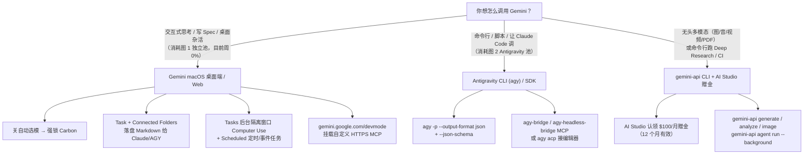

# 2026-11 Gemini 全渠道调用与操控方式调研

> 日期：2026-11-25。问题：在 2026 年底的生态现状下，Gemini（特别是 Google AI Ultra 订阅下的 Gemini macOS 桌面端 / Web 独立池、Antigravity 编程池以及 AI Studio API 赠金池）分别有哪些官方与社区调用、自动化操控和跨 Agent 接入方式，各自消耗哪个池子、合规与封号边界在哪里。范围：Google 官方支持文档（`support.google.com/gemini`、`gemini.google.com/devmode`、`antigravity.google/docs/*.md`）、官方 GitHub 仓库（`google-gemini/gemini-api-cli`、`google-gemini/gemini-cli`、`google-antigravity/antigravity-sdk-python`、`google-github-actions/run-gemini-cli`）实测抓取与星标核验、社区逆向/桥接项目及 Reddit / GitHub 风控反馈。相关任务：无（外部工具链专项调研）。

## 结论

截至 **2026-11**，Google 把 Gemini 的调用严格拆分成了 **3 条互不串池的官方轨道**，外加 **1 条高风险社区逆向轨道**。搞清楚「你到底想消耗哪一个池子」和「需不需要无头脚本调用」，选型就一步到位：

1. **想消耗「Gemini macOS 桌面端 / Web 独立池」（你的图 1，周限额 0%）**：
   - **没有官方无头 CLI 或开放 API**，无法像 `agy -p` 那样直接被 Claude Code 用命令行静默调。
   - **官方给的操控手段是 4 项 GUI/协议增强能力**：
     1. **Task 模式 + Connected Folders（挂载本机目录）**：直接读写/整理本机目录并自动做 24 小时临时备份，最适合与 Claude Code / Antigravity 走**本地文件落盘交接**；
     2. **后台隔离窗口 Computer Use + Scheduled Tasks**：在独立虚拟窗口里操控本机原生 App、定时或按 Gmail 事件触发，**不抢主屏幕鼠标**；
     3. **`gemini.google.com/devmode`（Gemini Apps Developer Mode）**：官方支持把你自己的 **HTTPS MCP Server** 接入 Gemini App/Web，让 Gemini 主动调用你的外部工具；
     4. **`Speak to Window`（`Fn` 听写直写任意窗口）+ `Option+Space` 全局浮窗 + 关掉「自动选择模型」强锁 `Gemini 4 Carbon`**。
2. **想用个人订阅额度跑「无头命令行 / SDK / 给 Claude Code 当子代理」（你的图 2 独立池）**：
   - 唯一官方合规通道是 **Antigravity CLI（`agy`）** 与 **Antigravity Python SDK**（2026-06-18 起旧版 `gemini-cli` 已停止服务个人 Google AI Pro/Ultra 登录）。支持 `agy -p --output-format json --json-schema`、`agy acp` 及本地轻量 MCP Bridge。
3. **想让 Claude Code / 脚本 / CI 无头调用「完整 Gemini 多模态 + Deep Research + 生图/音频/视频」（消耗 Ultra 20x 附带的 \$100/月 AI Studio 赠金，有效期 12 个月）**：
   - **最值得立刻装的官方新工具是 `google-gemini/gemini-api-cli`（`gemini-api`）**（3,311 star，2026-11-25 活跃更新）：单个 Go 二进制、零依赖，原生定位就是「给 Claude Code / Antigravity / Codex 通过 Shell 调用 Gemini 4、生图、TTS、音乐、视频、PDF/YouTube 分析，以及通过 **Interactions API** 异步跑 **Deep Research**」。
   - 同时，开源 **`google-gemini/gemini-cli`**（109k star）在配置付费 `GEMINI_API_KEY` 后**依然完全可用**（只是个人 Google 账号登录被切去了 `agy`）。
4. **能不能用逆向 Cookie / Web2API 硬调「图 1 的 Gemini 消费端独立池」？**
   - 技术上存在 `HanaokaYuzu/Gemini-API`（3.8k star）、`Sophomoresty/gemini-web2api`（3.6k star）和各类 `gemini-web-mcp`；**但 2026 年 Google 已大规模部署 `x-browser-validation`、TLS 指纹与会话异常风控**。拿绑定 Gmail / 20TB Drive / \$200 月费的主号去跑 Cookie 反代，**有直接封禁整个 Google 账号的高风险，强烈不建议**。

---

## 详细

### 一、6 种 Gemini 调用方式总对照（查于 2026-11-25）

| 调用轨道 / 工具 | 消耗哪个池子 | 支持无头 CLI / 脚本 | 能否被 Claude Code 直接调 | 核心杀手锏能力 | 合规与风控 |
|---|---|---|---|---|---|
| **1. Gemini macOS 桌面端 + Web** | **Gemini 消费端独立池**（图 1，5h + 周） | ❌（仅基础 `googlegemini://` 唤起） | 间接（通过本地目录文件落盘或 `devmode` HTTPS MCP） | 强锁 `Carbon`、**Connected Folders**、**后台隔离窗口 Computer Use**、定时/事件任务、`Speak to Window`、Deep Research | 官方一等，**零风险** |
| **2. Antigravity CLI（`agy`）& Python SDK** | **Antigravity 编程池**（图 2，5h + 周） | ✅（`agy -p` / `json` / `stream-json` / `--json-schema`） | ✅（Shell 直调或本地 `agy-bridge` MCP） | 个人订阅唯一官方无头编码代理、Orchestrator、`/swarm`、`/run-workflow`、`agy acp` | 官方一等，**零风险** |
| **3. `gemini-api` CLI（官方新 Go 工具）** | **AI Studio / Gemini API 池**（Ultra 20x 含 \$100/月赠金，12 个月有效） | ✅（单 Go 二进制，`--jq` / `--dry-run` / `--output-format json`） | ✅（**原生就是为此设计**，写进 `CLAUDE.md` 即可） | `generate`、`analyze`（PDF/视频/YouTube）、`image`/`tts`/`music`/`video`、`transcribe`、**`agent run` 异步跑 Deep Research** | 官方一等，**零风险** |
| **4. 开源 `gemini-cli`（API Key 模式）** | **AI Studio / Gemini API 池**（或企业 Code Assist） | ✅（`gemini -p` + 管道 + `--output json`） | ✅（Shell 或 ACP 插件如 `gemini-plugin-cc`） | 交互式终端、`gemini extensions`、GitHub Actions（`run-gemini-cli`） | 官方一等，**零风险**（个人订阅登录已于 2026-06-18 停服） |
| **5. macOS Shortcuts / AppleScript / Raycast** | **AI Studio / Gemini API 池** | ✅（`shortcuts://` / `curl`） | ✅（系统级热键、选字菜单、Share Sheet） | 走 OpenAI 兼容端点 `.../v1beta/openai/`，配合 Sindre Sorhus AI Actions 快速集成 | 官方 API，**零风险** |
| **6. 社区 Web Cookie 逆向 / 浏览器自动化** | **Gemini 消费端独立池**（图 1） | ⚠️（极易因风控/DOM 改版失效） | ⚠️（可包成 OpenAI API 或 MCP） | 零 API 费调 Web 端能力（如 `HanaokaYuzu/Gemini-API`、`gemini-web2api`、`notebooklm-py`） | **违反 ToS，高封号风险，严禁绑主号** |

---

### 二、轨道 A：Gemini macOS 桌面端 & Web（图 1 独立池）深度操控指南

既然这是你目前每周限额还剩 **100%（已用 0%）** 的独立池，要把它用出最大价值，核心是摸透它的**5 个官方操控杠杆**，而不是指望给它硬接一个终端 CLI。

#### 1. 立刻关闭「自动选择模型」，强锁 `Gemini 4 Carbon`
- 在你截图的「用量限额 → 高级设置」中，默认开启了 **自动选择模型**（让 Gemini 自动挑模型以节省用量）。
- 当你的周限额几乎没动时，开着它反而会把常规问答、代码评审和方案分析悄悄降级到轻模型。**关闭后手动锁定 `Carbon`**，把图 1 池专精为「无限次深度推理与二审大脑」。

#### 2. Task 模式 + `Connected folders`：零复制粘贴的文件级多 Agent 接力
- 官方机制（核验自 `support.google.com/gemini`）：在 Gemini Mac App 输入框下方点 **任务（Task）**，通过 **已连接文件夹（Connected folders）** 明确授权指定本机目录（如你的项目 `docs/` 或指定工作目录，需要 macOS 磁盘/目录权限）。
- Gemini 只能看到你显式勾选的目录，且在修改本地文件时会自动生成临时备份（新任务开始或 24 小时后自动清理）。
- **与 Claude Code / Antigravity 的标准协作闭环**：
  1. 在 Gemini Mac App 里直接让 `Carbon` 读取本地代码目录与设计文档；
  2. 指令它把架构方案、竞品调研或 Code Review 结论直接写进 `docs/plans/<主题>.md`；
  3. 回到 Claude Code 或 Antigravity，一句话「按 `docs/plans/<主题>.md` 实施」，全程免手动复制粘贴，且把最吃 token 的读文档/方案发散完全消化在图 1 独立池里。

#### 3. 后台隔离窗口 Computer Use + 定时/事件触发（Scheduled Tasks）
- **后台隔离窗口 Computer Use**（需 Apple Silicon + macOS Sequoia 及以上）：在 **任务** 模式下下达多步自然语言指令，Gemini 会在一个**独立虚拟后台窗口**里执行点击、打字、切菜单、填表单、整理文件等操作，聊天区显示实时小窗预览，**不会抢占你的主屏幕鼠标与当前焦点的 IDE/终端**；涉及登录、支付、删文件会自动暂停等你确认。
- **Scheduled Tasks（定时与事件触发）**：在「任务 / 定时」页面或直接用自然语言设置周期任务（按日/按周定时跑）或事件触发（如监听 Gmail 新邮件），适合让它在夜间或非编码时段自动整理日报、巡检外部信息、归类素材，吃满 5h 滚动池。

#### 4. `gemini.google.com/devmode`：官方把自定义 MCP Server 接进 Gemini App/Web
- 如果你想让 **图 1 的 Gemini 自己去调你写的工具（如查本地/私有库、拉取任务板、读写工单）**，Google 官方在个人账号上开放了 **Gemini Apps Developer Mode**（浏览器访问 `gemini.google.com/devmode`，或在 Web 端 设置 → Gemini Apps Developer Mode，需开启 Gemini Apps Activity）。
- 操作方式：在 *Choose an app* 弹窗点 **`+ Create new`**，填入你部署的 **HTTPS MCP Server URL**（如通过 Cloudflare Tunnel / Tailscale Funnel 暴露的受鉴权本地 MCP 端点，支持可选 OAuth Client ID/Secret）。
- 连上后，Gemini App 侧边栏会自带实时 JSON-RPC 载荷检查器、Tool Schema 校验与延迟监控，**这是目前唯一官方支持、零封号风险的「让消费端 Gemini 调用外部自定义工具」路径**。

#### 5. 高频零切换操控与快捷衔接
- **`Option + Space`**：全局任意界面呼出紧凑浮窗（`Option + Shift + Space` 开完整主窗）。
- **`Speak to Window`（长按 `Fn`）**：系统级智能听写，直接把口述内容润色/格式化并写入当前光标所在的任意窗口（终端、IDE、PR 评论框、文档）。
- **URL Scheme**：支持 `open "googlegemini://"` 从终端/Raycast/Shortcuts 唤起客户端（但无官方 AppleScript 字典与无头传参接口）。
- **Gems + 右上角 `Antigravity` 按钮**：把高频审查规范/文档模板固化为自定义 Gem；方案聊定后点右上角 `Antigravity` 直接切进编码环境。

---

### 三、轨道 B：Antigravity CLI（`agy`）与 Python SDK（图 2 独立池）

2026 年 5 月 Google I/O 宣布、**2026-06-18 正式生效**：旧版 `gemini-cli` 与 Gemini Code Assist 扩展停止为个人免费账号及 Google AI Pro/Ultra 订阅提供登录服务，个人订阅的终端与 SDK 调用全部迁至 **Antigravity 平台**。

如果你希望在终端里、Shell 脚本里、或者让 **Claude Code 直接程序化调用**你的 Google AI Ultra 20x 订阅额度，请认准这 3 个官方入口（均消耗图 2 的 Antigravity 池）：

1. **无头命令行（`agy -p`）**：复用本机 OS Keyring 登录态，支持结构化输出与思考深度控制：
   ```bash
   # 结构化 JSON + Schema 输出（stdout 干净返回结果，诊断信息走 stderr）
   agy -p "审查最近一次 commit 的竞态与边界条件" \
     --model "gemini-4-neon-high" \
     --output-format json \
     --json-schema '{"type":"object","properties":{"risks":{"type":"array","items":{"type":"string"}},"pass":{"type":"boolean"}},"required":["risks","pass"]}'

   # 用 Orchestrator 省额执行（Neon/Carbon 规划 + Hydrogen 执行）
   agy -p "扫描 src/ 目录并汇总所有未清理的定时器" --model "Orchestrator (Neon)"

   # 云端异步代理（合盖继续跑，替代已于 2026-11-11 只读的 Jules）
   agy --remote-agent --project "Fuyu"
   ```
2. **编辑器协议（`agy acp`）**：启动 Agent Client Protocol（JSON-RPC over stdio），直接挂进 Zed、JetBrains、VS Code、Android Studio、Xcode。
3. **官方 Python SDK**：[`google-antigravity/antigravity-sdk-python`](https://github.com/google-antigravity/antigravity-sdk-python)（4,220 star，2026-11-25），`pip install google-antigravity` 自带官方运行时二进制，可在 Python 流水线里流式订阅 `response.thoughts` 与 `response.tool_calls`。
4. **给 Claude Code 挂载的本地 MCP Bridge**：如 [`sshahzaiib/agy-bridge`](https://github.com/sshahzaiib/agy-bridge)（72 star）或修复非 TTY 空输出问题的 [`rhishi99/agy-headless-bridge`](https://github.com/rhishi99/agy-headless-bridge)（22 star）——仅子进程调本机官方 `agy`，不碰 OAuth 凭据。

---

### 四、轨道 C：官方 `gemini-api` CLI 与 API Key 生态（白用 Ultra 赠金，最强自动化）

哪怕你不领 Claude 的 API 赠金，**Google AI Ultra 20x 自带的 \$100/月 Google Cloud / Gemini API Credits（在 AI Studio 左侧栏认领，每笔有效期长达 12 个月）**非常值得拿出来配合以下官方工具——因为这套接口**没有任何 5h 锁、100% 合规、且能做很多纯编码代理做不到的事**：

#### 1. 强推新官方工具：`google-gemini/gemini-api-cli`（`gemini-api`）
经 2026-11-25 实测抓取其 README 与 GitHub 状态（**3,311 star**，当天仍有更新），这是 Google 专门为了 **「让 Claude Code / Antigravity / Codex / Shell 脚本调 Gemini」** 写的单文件 Go 二进制：

```bash
# 安装（macOS / Linux）
curl -fsSL https://raw.githubusercontent.com/google-gemini/gemini-api-cli/main/scripts/install.sh | bash

# 配置 AI Studio Key（存入 macOS Keychain）
gemini-api configure --api-key "YOUR_API_KEY"
```

它把 Gemini 整个多模态和托管代理栈做成了一套自描述的无状态命令（全部支持 `--dry-run`、`--output-format json`、`--jq`）：

| 命令 | 默认模型 | 典型用途 |
|---|---|---|
| `gemini-api generate` | `gemini-4-hydrogen` | 文本/多模态生成，支持 `--stdin`、`--system`、指定模型 `-m` |
| `gemini-api analyze` | `gemini-4-hydrogen` | 直接提问分析 **PDF、图片、音频、视频、CSV 或 YouTube 链接** |
| `gemini-api image` | `gemini-nano-banana-2.1` | 命令行生图/修图直接落盘 `--out ./assets/`，返回路径给 Coding Agent |
| `gemini-api tts` / `music` / `video` | `gemini-3.8-flash-tts` / `lyria-3.5` / `gemini-omni-1.2-flash` | 命令行生成旁白配音、BGM、视频素材 |
| `gemini-api transcribe` | `gemini-3.5-transcribe` | 音视频转 Markdown / JSON / SRT 字幕 |
| **`gemini-api agent run`** | **Interactions API 托管代理** | **命令行直接异步启动 Deep Research**（`--background` 返回 interaction ID，完成后拉取带引用的完整调研报告！） |

```bash
# 示例：让 Claude Code 或脚本从终端直接发起官方 Deep Research（后台异步）
gemini-api agent run "对比 macOS 原生窗口透明材质方案并附一手文档链接" \
  --agent deep-research-preview-04-2026 \
  --background \
  --stream=false
```

#### 2. 开源 `google-gemini/gemini-cli`（109k star）的现存正确用法
- 虽然 2026-06-18 起不能再用个人 Google AI Pro/Ultra 账号登录，但导出 `GEMINI_API_KEY` 后**依然完全正常使用**，适合需要开源可改代码、管道处理（`cat error.log | gemini -p "..."`）、自定义 `.toml` 扩展，或在 GitHub Actions 里用官方 [`google-github-actions/run-gemini-cli`](https://github.com/google-github-actions/run-gemini-cli)（2,131 star）响应 PR 评论 `@gemini-cli /review`。

#### 3. macOS 系统级调用（Shortcuts / AppleScript / Raycast）
- 通过 AI Studio Key 指向官方 OpenAI 兼容接口 `https://generativelanguage.googleapis.com/v1beta/openai/`，配合 Sindre Sorhus 的 **AI Actions** 或自定义 Shell 函数，即可在 macOS 快捷指令、右键快速操作、Raycast 里一键触发 Gemini 处理选中文本。

---

### 五、轨道 D：社区逆向 / Cookie / 浏览器自动化方案的风险真相

很多教程会推荐通过逆向 Web 协议把 **图 1 的 Gemini 消费端池**强行变成 API 给外部程序调。经 2026-11-25 核实主流开源项目与社区封号反馈：

- **主要项目**：
  - [`HanaokaYuzu/Gemini-API`](https://github.com/HanaokaYuzu/Gemini-API)（3,852 star，2026-11-16 更新）：逆向 `gemini.google.com` 的 `batchexecute` 接口，依赖浏览器 Cookie（`__Secure-1PSID` / `__Secure-1PSIDTS`）。
  - [`Sophomoresty/gemini-web2api`](https://github.com/Sophomoresty/gemini-web2api)（3,640 star，2026-08-14 更新）：将 Gemini Web 转为 OpenAI 兼容 API。
  - [`teng-lin/notebooklm-py`](https://github.com/teng-lin/notebooklm-py)（20,372 star，2026-11-25 更新）：面向 **Gemini Notebook（原 NotebookLM）** 的非官方 Python API / CLI / Agent Skill，支持让 Claude Code 程序化喂资料和提问（同样基于非官方会话认证）。
  - 各类 `gemini-web-mcp`：用 Playwright / Chrome CDP 操控已登录的 `gemini.google.com` 标签页。
- **2026 年实测痛点与风险**：
  1. **强指纹校验频发失效**：Google 持续强化动态请求头（如 `x-browser-validation`）与 TLS 指纹识别，生图、高级推理模型经常在 Cookie 未过期时就直接被服务端拦截报错。
  2. **牵连整个 Google 主号**：逆向 Cookie 明确违反 Google ToS；高频脚本调用、多话题并发切换或 IP 跳变会触发自动化风控，一旦封禁/受限，**连带影响你的 Gmail、20TB Google Drive、YouTube 与 \$200/月 Ultra 订阅**。
- **建议底线**：**付费主号绝对不要跑 `gemini-webapi` / `gemini-web2api` 等 Cookie 反代**；真需要程序化无头调用 Gemini 4，老老实实走 **轨道 B（`agy -p`）** 或 **轨道 C（`gemini-api` CLI + 附赠 \$100/月 API 额度）**。

---

### 六、一图选路：按你的调用需求直接对号入座



---

## 来源

- Google Gemini Mac 桌面端官方帮助（Connected folders / Tasks / Speak to Window / Scheduled Tasks）：https://support.google.com/gemini （2026-11-25 通过 WebSearch 核验）
- Google Gemini Apps Developer Mode（自定义 HTTPS MCP 接入）：`https://gemini.google.com/devmode`（2026-11-25 核验自 Google Connected Apps 官方文档）
- Google 官方 `gemini-api` CLI 仓库与 README：https://github.com/google-gemini/gemini-api-cli （2026-11-25 抓取 README 并核验：3,311 star，最近推送 2026-11-25）
- Google 官方开源 `gemini-cli` 仓库与迁移公告：https://github.com/google-gemini/gemini-cli （2026-11-25 核验：109,147 star；2026-06-18 起个人账号登录迁至 Antigravity CLI，付费 API Key 与企业版保留）
- Google 官方 GitHub Action：https://github.com/google-github-actions/run-gemini-cli （2026-11-25 核验：2,131 star）
- Google Antigravity CLI 无头模式、ACP 与迁移官方文档：
  - https://antigravity.google/docs/cli/headless.md
  - https://antigravity.google/docs/cli/acp.md
  - https://antigravity.google/docs/cli/gcli-migration.md
- Google Antigravity 官方 Python SDK：https://github.com/google-antigravity/antigravity-sdk-python （2026-11-25 核验：4,220 star）
- 社区桥接与逆向项目（2026-11-25 GitHub API 核验）：
  - `sshahzaiib/agy-bridge`：https://github.com/sshahzaiib/agy-bridge （72 star）
  - `rhishi99/agy-headless-bridge`：https://github.com/rhishi99/agy-headless-bridge （22 star）
  - `RLabs-Inc/gemini-mcp`：https://github.com/RLabs-Inc/gemini-mcp （226 star）
  - `teng-lin/notebooklm-py`：https://github.com/teng-lin/notebooklm-py （20,372 star，2026-11-25 推送）
  - `HanaokaYuzu/Gemini-API`：https://github.com/HanaokaYuzu/Gemini-API （3,852 star，2026-11-16 推送）
  - `Sophomoresty/gemini-web2api`：https://github.com/Sophomoresty/gemini-web2api （3,640 star，2026-08-14 推送）
- 社区逆向 Cookie 风控与封号反馈：通过 WebSearch 核验自 GitHub Issues 与 Reddit 2026 年讨论
