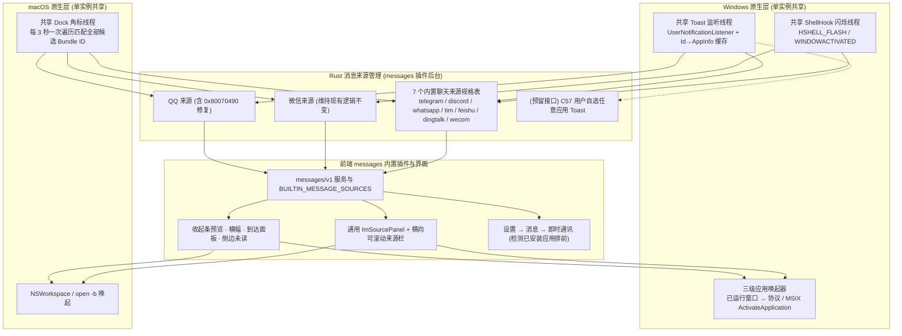

# 桌面聊天软件消息上岛与开源方案调研

> 日期：2026-11-17。问题：消息页接入 Telegram、Discord、WhatsApp、TIM、飞书、钉钉、企业微信（#642 / C102），开源社区在 Windows 与 macOS 上如何实现通知捕获、未读读取与窗口唤起，各目标客户端有哪些真实差异，浮屿应采用什么架构落地。范围：GitHub 仓库与源码检索（`eythaann/Seelen-UI`、`amnweb/yasb`、`RavelloH/WinToastRelay`、`sadeeshasathsara/dynamic-island-on-windows`、`GEORGEWWWU/NetSpeed-Dynamic`、`warpirate/pillar-dynamic-island-for-windows`、`marcimastro98/Xenon`、`xiaogdgenuine/Doll`、`djbclark/site-djbclark`、`telegramdesktop/tdesktop`、`Homebrew/homebrew-cask`），腾讯 TIM 官网版本接口与本机 macOS `lsappinfo` 实测。相关任务：[C102](/docs/tasks/C/C102.md)、[C57](/docs/tasks/C/C57.md)

## 结论

通过核查 10 余个同类桌面工具与上游客户端源码，原先「Windows 全部简单照搬 QQ 系统通知、macOS 逐个复制 Dock 轮询」的设想有 **4 处关键事实需要修正**：

1. **Telegram Desktop 在 Windows 上默认不发系统 Toast 通知**：`telegramdesktop/tdesktop` 源码 `notifications_manager_win.cpp` 明确将 Windows 的 `ByDefault()` 设为 `false`，新装默认走 Qt 自绘右下角弹窗加任务栏闪烁（`_flashBounceNotify = true`），只有用户在 Telegram 设置里手动打开「Use Windows notifications」才会进系统通知中心；此外便携版的 `AppUserModelId` 会动态拼接 32 位实例哈希（`Telegram.TelegramDesktop.<hash>`），精确匹配固定字符串会漏掉所有便携版用户。
2. **TIM 已无原生 macOS 桌面版，且 Windows 版仍是旧架构**：2026-11-17 实测腾讯 TIM 官网（`office.qq.com`）版本接口，官方仅保留 Windows（`3.5.1.22172`，2025-05-27 更新）、Android、iOS 三个平台，原生 macOS 版已下架（Homebrew Cask 亦无收录）。同时 Windows 版 TIM 仍是经典 `TXGuiFoundation` 架构而非 NTQQ（Electron），**不存在**现版 QQ 唤回所依赖的 `Electron_NotifyIconHostWindow`，不能直接照搬 [launcher.rs](/src-tauri/src/qq_notifications/launcher.rs)。
3. **未打包 Win32 应用在 Windows 上无法订阅 `NotificationChanged` 事件，但共享轮询必须缓存 `AppInfo`**：`Seelen-UI`（18.5k ★）与 `YASB`（5.8k ★）均证实 `UserNotificationListener.NotificationChanged` 仅对 MSIX/UWP 打包应用生效，普通桌面程序只能每秒轮询 `GetNotificationsAsync`（或像 `YASB` 调未公开的 `ntdll` WNF）。轮询时 `notification.AppInfo()` 是跨进程 WinRT 调用，通知中心攒有几十条通知时逐条重查开销明显——应借鉴 `YASB` 按通知 `Id` 缓存 `AppInfo` 解析结果，且绝不采用 `dynamic-island-on-windows` 篡改系统免打扰或调用 `RemoveNotification` 删用户通知中心的侵入做法。
4. **应用唤起必须兼容商店 MSIX 包，macOS 应合并为单线程 Dock 监听**：
   - Windows 上 WhatsApp Desktop（`5319275A.WhatsAppDesktop_*!App`）与商店版 Telegram 没有传统 `Uninstall` 注册表路径，需结合「已运行主窗口前置 → Toast `INotificationActivationCallback`（支持时直跳会话）→ `IApplicationActivationManager` / `shell:AppsFolder\<AUMID>` 或 URL 协议」三级唤起。
   - macOS 上经核查 `otp-banner-watch` 在 macOS 27 的实测，通知中心（`com.apple.NotificationCenter`）对 `AXObserver` 零回调，轮询其 AX 树不仅耗 CPU 且拿不到未读总数；继续采用 Dock `AXStatusLabel` 最稳妥，但应把目前「每个应用各自起线程每 3 秒扫整棵 Dock 树」改为**全局单线程一次遍历分发给所有已开来源**。

### 核心建议架构：双端共享监听 + Windows「Toast 优先、闪烁兜底」

在 Windows 上把现有的 `UserNotificationListener`（有正文）和 `RegisterShellHookWindow` 的 `HSHELL_FLASH`（无正文提醒）都抽成公共单实例总线：当 Telegram、TIM、企业微信、飞书、钉钉发出了系统 Toast 时，岛上展示「图标 + 发件人 + 消息摘要」；当客户端处于默认自绘弹窗、只闪任务栏时，自动退化展示「图标 + 有新提醒」，并在设置页提示开启软件内「系统通知」即可显示消息正文。这样开箱即有提醒，不会因为客户端默认设置而变成「开了开关却毫无反应」。

---

## 开源项目横向对比

以下仓库数据均于 **2026-11-17** 通过 GitHub API 核实：

| 项目 | 平台与技术栈 | ★（2026-11-17） | 协议 | 通知 / 未读实现方式 | 可借鉴点与局限 |
|---|---|---|---|---|---|
| [eythaann/Seelen-UI](https://github.com/eythaann/Seelen-UI) | Windows · Rust + Tauri | 18,542 | AGPL-3.0 | 优先注册 `NotificationChanged`，失败后回退 1 秒轮询 `GetNotificationsAsync`；结合 `ToastNotificationManager::History` 还原 XML 图片与动作 | 完整实现了 Rust 版 `INotificationActivationCallback` 与 `IApplicationActivationManager` 激活链路；源码明确记录了 Store 版 Telegram 无 `ToastActivatorCLSID` 的系统限制。协议为 AGPL-3.0，只看思路不拷代码 |
| [amnweb/yasb](https://github.com/amnweb/yasb) | Windows · Python (PyQt6 + WinRT) | 5,808 | NOASSERTION | 用 `ntdll!RtlSubscribeWnfStateChangeNotification`（`WNF_SHEL_NOTIFICATIONS`）做事件触发 + 100ms 防抖读取；按通知 `id` 缓存 `AppInfo` | **性能关键发现**：注释指出 `AppInfo()` 是慢速跨进程调用，按 `id` 缓存后轮询开销极低；`toast_activation.py` 清晰梳理了协议、COM 激活器、`shell:AppsFolder\<AUMID>` 三层回退 |
| [xiaogdgenuine/Doll](https://github.com/xiaogdgenuine/Doll) | macOS · Swift | 1,163 | 未声明 | 对 `com.apple.dock` 挂 `AXObserver` 监听子元素增删并缓存目标 `AXUIElement`，每秒读一次 `AXStatusLabel`；用 `AXPress` 打开应用 | 缓存 Dock 子元素避免每秒递归整棵 AX 树；但它按本地化 `AXTitle` 匹配应用名，多语言环境下不如浮屿现有的 `AXURL` 路径比对稳健 |
| [GEORGEWWWU/NetSpeed-Dynamic](https://github.com/GEORGEWWWU/NetSpeed-Dynamic) | Windows · Tauri + Rust | 318 | 未声明 | 前端定时调命令，Rust 侧 `GetNotificationsAsync` 只取当前最大的 `id` 与上次比对，提取 `ToastGeneric` 文本 | 结构最简，但**只取单次轮询的 `max_id`** 会在同一秒到达多条消息时丢通知；硬编码按标题字符串过滤微信容易误伤 |
| [RavelloH/WinToastRelay](https://github.com/RavelloH/WinToastRelay) | Windows · C# (WinUI 3 MSIX) | 46 | MIT | 因采用 MSIX 打包身份，`NotificationChanged` 事件可直接工作；支持按应用名/包名白名单过滤转发到飞书、Telegram、Discord、Bark | 验证了 `RequestAccessAsync` 必须在主线程调用（与浮屿现有 `run_on_main_thread` 一致），以及文本分段首行作标题、其余拼正文的通用规则 |
| [warpirate/pillar-dynamic-island-for-windows](https://github.com/warpirate/pillar-dynamic-island-for-windows) | Windows · Tauri 2 + React + Rust | 27 | MIT | 仅在能力表预留 `notifications: true` 标志，尚未落地真实 WinRT 通知监听实现 | 无可直接参考的原生监听实现 |
| [sadeeshasathsara/dynamic-island-on-windows](https://github.com/sadeeshasathsara/dynamic-island-on-windows) | Windows · C# WPF + WinRT | 9 | MIT | 500ms 轮询 `GetNotificationsAsync`，用 `DisplayInfo.GetLogo` 读应用图标，读完调 `RemoveNotification` 并写注册表压制原生横幅 | **反面教材**：主动删通知中心记录并修改系统免打扰状态，一旦应用异常退出会破坏用户的系统通知设置，不符合浮屿克制、只读的原则 |
| [marcimastro98/Xenon](https://github.com/marcimastro98/Xenon) | Windows · Node + 原生模块 | — | — | `match.js` 将通知的 AUMID（剥离 `!App` 和 13 位发布者哈希）与运行中窗口进程名做词元打分匹配，未命中则调 `shell:AppsFolder\<AUMID>` | 处理 Squirrel 包（`com.squirrel.Discord.Discord`）和商店包（`5319275A.WhatsAppDesktop_cv1g1gvanyjgm!App`）的窗口归属非常干净 |
| [djbclark/site-djbclark](https://github.com/djbclark/site-djbclark)（`otp-banner-watch.swift`） | macOS · Swift | — | — | 每 1 秒扫 `com.apple.NotificationCenter` 顶层窗口中 `AXNotificationCenter*` 子角色的横幅文本，用于提取短信验证码 | 2026-10 在 macOS 27 实测证实：**通知中心对 9 种 `AXObserver` 事件均为 0 回调**，且 0.25s 轮询会让 `NotificationCenter` 吃掉 30% CPU |

---

## Windows 通知与唤起机制拆解

### 1. 为什么用「1 秒单线程轮询 + `AppInfo` 缓存」而非 WNF 或 `NotificationChanged`

- **`NotificationChanged` 的打包限制**：Windows 要求调用进程具备 Package Identity（MSIX / Sparse Package）才能收到 `UserNotificationListener.NotificationChanged` 回调；浮屿是 NSIS 安装的纯 Win32 程序，注册回调会返回错误或静默不触发（`Seelen-UI` 源码中已证实同样回退到 1 秒轮询）。
- **不引入未公开的 `ntdll` WNF**：`YASB` 订阅 `WNF_SHEL_NOTIFICATIONS` 状态名虽然能省去空轮询，但状态名常量属于未文档化的内核内部约定，且浮屿规则明确将 `unsafe` 收敛在标准 Win32/WinRT 平台层。
- **真正值得借鉴的优化——缓存通知元数据**：在 [listener.rs](/src-tauri/src/qq_notifications/listener.rs) 现行实现里，每秒都会对系统通知中心里所有现存 Toast（跨所有应用，常驻几十条）逐条调用 `notification.AppInfo()?.AppUserModelId()`。抽成公共监听层后，维护一张内存 `HashMap<u32, ParsedToastMeta>`（每次仅保留仍在当前 `notifications` 集合中的 `Id`）：
  - 已见过的通知 `Id` 直接命中内存缓存，**零跨进程 COM 调用**；
  - 只有新出现的 `Id` 才读取一次 `AppInfo`（`AppUserModelId` + `DisplayInfo.DisplayName`）与 `ToastGeneric` 文本。

### 2. 双通道互补：Toast 正文 + `HSHELL_FLASH` 任务栏闪烁兜底

许多桌面聊天软件在 Windows 上同时存在「系统 Toast」和「软件自绘弹窗 + `FlashWindowEx`」两种模式：

- 若某个已启用来源收到了系统 Toast，产出带 `title`（发送人/群名）与 `body`（消息摘要）的完整通知条目；
- 若该来源支持闪烁兜底（Telegram、TIM、企业微信、飞书、钉钉），当监听到对应可执行文件（如 `Telegram.exe`、`TIM.exe`、`WXWork.exe`）触发 `HSHELL_FLASH`，且前后 1.5 秒内没有收到同一来源的新 Toast 时，产出一项无正文的「有新提醒」条目（与当前微信未开界面公开时的表现一致）。
- 收到同来源真实 Toast 时，可自动合并或覆盖刚产生的空提醒，避免同一条消息闪两次。

### 3. 点击打开对应应用的三级策略

避免「应用已最小化在托盘，点击却又拉起第二个登录框或毫无反应」，按以下优先级依次尝试：

1. **已运行可交互窗口前置**：按进程名（如 `Telegram.exe`、`Discord.exe`、`Feishu.exe`/`Lark.exe`、`DingTalk.exe`、`WXWork.exe`、`TIM.exe`）或窗口类名枚举顶层主窗口（过滤尺寸过小的悬浮窗/登录框及 `ApplicationFrameHost` 空壳），若窗口可见且可交互，直接 `AllowSetForegroundWindow` + 前置激活。
2. **客户端自有唤回通道（收进托盘时）**：
   - **QQ（NTQQ）**：保持现有 `Electron_NotifyIconHostWindow` 托盘消息双击唤回（[launcher.rs](/src-tauri/src/qq_notifications/launcher.rs)）；
   - **协议唤回**：Telegram（`tg://`）、Discord（`discord://`）、WhatsApp（`whatsapp://`）、飞书（`feishu://` / `lark://`）、钉钉（`dingtalk://`）、企业微信（`wxwork://`）均注册了系统 URL 协议，向单实例客户端发协议请求可由客户端自己从托盘恢复主窗口；
   - **MSIX 商店包激活**：对 `!` 分隔的打包 AUMID（如 WhatsApp `5319275A.WhatsAppDesktop_cv1g1gvanyjgm!App`、商店版 Telegram），调用公开的 `IApplicationActivationManager::ActivateApplication`（公开 Win32 COM 接口），无需猜安装路径。
3. **TIM 托盘恢复**：经典 `TXGuiFoundation` 架构下的 `TIM.exe` 在收进托盘时主窗口隐藏，不存在 `Electron_NotifyIconHostWindow`；需要在 Windows 真机用探测脚本确认其托盘宿主窗口类名或 `tim://` / `tencent://` 协议行为后再固化，未确认前先激活可见主窗口并在不可见时给出清晰提示（绝不强行 `ShowWindow` 破坏客户端内部状态）。

---

## macOS 未读与横幅方案对比

针对 macOS 上能否做得更好，本次对比了三条技术路线：

| 路线 | 代表项目 / 工具 | 需要权限 | 能否拿到发送人与正文 | 优缺点评估 | 结论 |
|---|---|---|---|---|---|
| **1. Dock `AXStatusLabel` 批量轮询** | 浮屿现行方案、`xiaogdgenuine/Doll` | 辅助功能（Accessibility） | 否，仅未读数角标 | 公开 AX 属性、最稳定；缺点是应用若完全退出或不在 Dock 上则无角标，且目前 QQ/微信各跑一个线程重复扫 Dock | **采用（合并为单线程共享轮询）** |
| **2. LaunchServices `lsappinfo` 查 `StatusLabel`** | SketchyBar 社区插件 | 无需辅助功能 | 否，仅未读数角标 | 本机实测 `/usr/bin/lsappinfo info -only StatusLabel <bundleID>` 可读运行中应用的角标，但每轮要派生外部子进程（违反浮屿少起子进程原则），若直接调私有 `_LSCopyApplicationInformation` 则增加私有符号风险，且辅助功能权限在浮屿 Mac 版原本就是常规引导项 | 暂不替换主路径；可留作诊断参考 |
| **3. 通知中心横幅 AX 抓取（`com.apple.NotificationCenter`）** | `otp-banner-watch.swift`、Otifier | 辅助功能 | 仅横幅弹出那几秒能抓到标题与正文 | macOS 27 实测 `AXObserver` 完全不回调，只能每秒扫窗口树；专注模式/锁屏/横幅关闭时全漏，拿不到历史与清零信号，CPU 开销高 | **不采用** |
| **4. 读 `usernoted` SQLite 数据库** | Sequoia 之前的旧工具 | 完全磁盘访问（FDA）+ 触碰 TCC 保护区 | 是 | macOS 15 Sequoia 起移入 `group.com.apple.usernoted` 受保护组容器，Apple 已将越权读取列为安全漏洞（CVE-2024-40838 等），详见 [macos-platform-apis.md](/docs/research/macos-platform-apis.md) | **坚决不做** |

因此 macOS 端保持与 Issue #642 一致的预期：**显示未读数，数字上升时上岛提醒，切到前台或角标清零时自动去掉**；架构上把 [dock_badges.rs](/src-tauri/src/macos/dock_badges.rs) 改造为「单线程每 3 秒遍历一次 Dock 树，一次性匹配所有已启用来源的候选 Bundle ID 列表」。

---

## 七款目标软件双端适配矩阵

下表汇总了本次核实的各软件进程名、Windows AUMID、协议、macOS Bundle ID 与特殊注意事项（标注「待真机核对」的字段在落地时由新增的只读探测程序在 Windows 真机一键打印确认）：

| 来源 ID | 名称 | Windows 进程名 | Windows 已知 AUMID（前缀/精确） | Windows 默认通知形态 | Windows 唤起方式 | macOS 候选 Bundle ID（按优先级） |
|---|---|---|---|---|---|---|
| `telegram` | Telegram | `Telegram.exe` | `Telegram.TelegramDesktop`（含便携版 `.` 后缀）、`TelegramMessengerLLP.TelegramDesktop`（商店版前缀） | **默认自绘弹窗 + 任务栏闪烁**；设置内开启「使用 Windows 通知」后发标准 Toast（已由 `tdesktop` 源码核实） | 已运行窗口前置 → 商店版 `ActivateApplication` / 桌面版 `tg://` | `ru.keepcoder.Telegram`（官网/MAS Swift 原生版，本机已核实）、`com.tdesktop.Telegram`（跨平台桌面版，Homebrew Cask 已核实） |
| `discord` | Discord | `Discord.exe`、`DiscordPTB.exe`、`DiscordCanary.exe` | `com.squirrel.Discord.Discord`、`com.squirrel.DiscordPTB.DiscordPTB`、`com.squirrel.DiscordCanary.DiscordCanary` | 默认发标准 Windows Toast（含发送人与频道/私信内容） | 已运行窗口前置 → `discord://` 或 `shell:AppsFolder\<AUMID>` | `com.hnc.Discord`、`com.hnc.DiscordPTB`、`com.hnc.DiscordCanary`（Homebrew Cask 已核实） |
| `whatsapp` | WhatsApp | `WhatsApp.exe`、`WhatsApp.Root.exe` | `5319275A.WhatsAppDesktop_cv1g1gvanyjgm!App`（前缀匹配 `5319275A.WhatsAppDesktop`） | Microsoft Store MSIX 应用，默认发标准 Windows Toast | `IApplicationActivationManager` 激活 AUMID 或 `whatsapp://` | `net.whatsapp.WhatsApp`（官网/MAS 原生版，Homebrew Cask 已核实） |
| `tim` | TIM | `TIM.exe` | `Tencent.TIM` / `TIM`（待 Windows 真机核对） | Windows 最新为 `3.5.1`（`TXGuiFoundation`），常见为自绘弹窗 + 任务栏/托盘闪烁，部分环境有系统通知（待真机核对） | 已运行 `TXGuiFoundation` 主窗口前置；托盘唤回待真机探测确认 | **官方已无 macOS 桌面版**（`office.qq.com` 与 Homebrew Cask 均已核实下架；仅保留 `com.tencent.tim` 供旧包或 iPad 版兜底，macOS 默认置为不支持或仅装有时才显示） |
| `feishu` | 飞书 / Lark | `Feishu.exe`、`Lark.exe` | 含 `Feishu` 或 `Lark`（Electron 构建常见 `com.squirrel.Feishu.*` / 应用名快捷方式 AUMID，待真机核对） | 支持应用内横幅或系统通知，后台来消息伴随任务栏闪烁 | 已运行窗口前置 → `feishu://` / `lark://` | `com.electron.lark`（飞书与 Lark 共用主 Bundle ID，Homebrew Cask 核实）、`com.larksuite.larkApp` |
| `dingtalk` | 钉钉 | `DingTalk.exe` | 含 `DingTalk`（待真机核对） | 默认常见钉钉自绘飘窗 + 任务栏闪烁，也可走系统通知 | 已运行窗口前置 → `dingtalk://` | `com.alibaba.DingTalkMac`、`com.dingtalk.mac`（Homebrew Cask 已核实） |
| `wecom` | 企业微信 | `WXWork.exe` | 含 `WXWork` / `WeChatWork` / `企业微信`（待真机核对） | 独立于微信（`Weixin.exe`）；客户端内支持消息浮窗与任务栏闪烁，系统 Toast 视版本与系统设置而定 | 已运行窗口前置 → `wxwork://` | `com.tencent.WeWorkMac`（Homebrew Cask 已核实） |

> **关于企业微信与微信的边界**：微信（`Weixin.exe`）的「显示联系人和消息摘要」依赖针对 `Weixin.dll`（Qt 4.x）的特征码内存开关（[gate.rs](/src-tauri/src/wechat_reminders/gate.rs)）。企业微信（`WXWork.exe`）采用完全不同的 `WeWorkWindow` / DirectUI + CEF 架构，**绝不能复用 `gate.rs`**，只复用无侵入的「系统 Toast 读取 + `HSHELL_FLASH` 任务栏闪烁兜底」。

---

## 浮屿修正方案与分步计划

### 架构流向图

### 分三步落地（每步可独立编译验证与提交）

1. **第 1 步：抽离双端共享监听底座（重构步，零行为变化）**
   - Windows：新建共享系统通知读取与 `Id → AppInfo` 缓存模块，把 QQ 迁到该模块上，预留按规则分发给多来源及未来 [C57](/docs/tasks/C/C57.md)「列出最近发过通知的应用」的只读接口；同时把 `HSHELL_FLASH` 按可执行文件名订阅的能力做成多来源可复用。
   - macOS：扩展 [dock_badges.rs](/src-tauri/src/macos/dock_badges.rs) 支持一次遍历 Dock 树查询一组 `(source_id, &[bundle_id])` 并统一跟踪前台应用切入；全部来源关闭时线程退出。
   - 验证：现有 QQ、微信单元测试与回归页 100% 不变。

2. **第 2 步：接入 7 个聊天软件后端、三级唤起与只读探测工具**
   - 用一张声明式来源表注册 `telegram`、`discord`、`whatsapp`、`tim`、`feishu`、`dingtalk`、`wecom` 七个后台 worker 到 [messages_plugin.rs](/src-tauri/src/messages_plugin.rs) 和 [builtins.json](/src/features/builtins.json)（与 `qq`、`wechat`、`mail` 并列）。
   - 提供统一的按 `source` 参数调用的 Tauri 命令（查询快照、清空、设置自动清除、打开对应应用、检测本机已安装来源列表），不膨胀几十个重复命令名。
   - 新增只读探测程序 `src-tauri/examples/im_notification_probe.rs`：在 Windows 真机运行即可打印当前通知中心里各应用的真实 `AppUserModelId`、显示名及窗口闪烁事件（不输出聊天正文），供真机核对飞书/钉钉/企业微信/TIM 的精确标识。
   - 验证：`cargo test` + `pnpm mq:try --wait` 跑通 Windows CI 编译与测试。

3. **第 3 步：前端面板、品牌图标、设置页、回归测试与文档**
   - 按 [src/assets/brands/README.md](/src/assets/brands/README.md) 规范补齐 7 个官方图标并在 [MessageSourceIcon.tsx](/src/features/messages/MessageSourceIcon.tsx) 支持。
   - 把 `QQNotificationPanel` 提炼为通用组件供 QQ 与 7 个新来源共用：有正文通知时展示发件人与摘要卡片，仅闪烁兜底或 macOS 角标时展示未读提醒；处理好 350px 窄岛面板顶部 `.message-sources` 多来源开启时的横向滚动与紧凑间距，防止溢出。
   - 在 [MessagesSettingsPage.tsx](/src/features/messages/MessagesSettingsPage.tsx)「即时通讯」子页加入 7 个来源开关、「看过后从岛上去掉」，以及针对 Telegram / 企业微信 / 钉钉等可开启系统通知以获取正文的简短说明；Mac 上若本机未装旧版 TIM 则隐藏 TIM 项并在 `platforms.md` 标明原因；重跑 `pnpm settings:index`。
   - 补齐中英文文案、单元测试、回归页，撰写 `docs/features/` 说明并同步 `contracts.md`、`platforms.md`。

---

## 已确认决定与任务拆分（2026-11-17）

以下 4 项设计已确认，并拆分为 3 个串行子任务推进：

1. **新来源默认开关**：7 个新来源**默认关闭**，在「设置 → 消息 → 即时通讯」里调原生检测把**本机已安装的应用排在前面并标「已安装」**，方便用户一键开启，避免升级后消息页顶栏突然挤出多个图标或首次启动弹权限请求。
2. **Windows「Toast 优先 + 任务栏闪烁兜底」策略**：对 Telegram（默认自绘弹窗）、TIM、企业微信、钉钉、飞书，收到系统 Toast 时显示完整发件人与摘要；没收到系统 Toast 但捕获到任务栏闪烁时，自动兜底显示「有新提醒」。
3. **TIM 在 macOS 上的处理**：鉴于腾讯官网已下架 macOS 版 TIM，Mac 端默认不在设置页展示 TIM，仅当检测到用户机器上装有历史遗留 `com.tencent.tim` 时才显示。
4. **子任务拆分**：
   - [C102.1](/docs/tasks/C/C102.1.md)（#778）：抽离消息双端共享监听底座（Windows Toast 缓存分发与闪烁复用、macOS 批量 Dock 角标轮询）
   - [C102.2](/docs/tasks/C/C102.2.md)（#779）：接入 Telegram、Discord、WhatsApp、TIM、飞书、钉钉、企业微信原生后端与三级应用唤起
   - [C102.3](/docs/tasks/C/C102.3.md)（#780）：7 个新聊天来源品牌图标、通用消息面板与设置页接入、测试与文档同步

---

## 来源

除另有注明外，以下来源均于 **2026-11-17** 查询并核对源码或接口返回：

- Telegram Desktop 官方仓库：[windows_app_user_model_id.cpp](https://github.com/telegramdesktop/tdesktop/blob/dev/Telegram/SourceFiles/platform/win/windows_app_user_model_id.cpp)（`Telegram.TelegramDesktop`、`.Store` 与便携版哈希拼接逻辑）、[notifications_manager_win.cpp](https://github.com/telegramdesktop/tdesktop/blob/dev/Telegram/SourceFiles/platform/win/notifications_manager_win.cpp)（Windows 下 `ByDefault()` 返回 `false`）、[core_settings.h](https://github.com/telegramdesktop/tdesktop/blob/dev/Telegram/SourceFiles/core/core_settings.h)（`_flashBounceNotify = true`）
- 腾讯 TIM 官网下载页与版本接口：[office.qq.com/download.html](https://office.qq.com/download.html)（版本 JSON 仅含 Windows `3.5.1.22172`、Android `4.1.0`、iOS，无 macOS 客户端）
- Homebrew Cask 应用清单（核对各应用 macOS `CFBundleIdentifier`）：[telegram.rb](https://github.com/Homebrew/homebrew-cask/blob/HEAD/Casks/t/telegram.rb)、[telegram-desktop.rb](https://github.com/Homebrew/homebrew-cask/blob/HEAD/Casks/t/telegram-desktop.rb)、[discord.rb](https://github.com/Homebrew/homebrew-cask/blob/HEAD/Casks/d/discord.rb)、[whatsapp.rb](https://github.com/Homebrew/homebrew-cask/blob/HEAD/Casks/w/whatsapp.rb)、[feishu.rb](https://github.com/Homebrew/homebrew-cask/blob/HEAD/Casks/f/feishu.rb)、[lark.rb](https://github.com/Homebrew/homebrew-cask/blob/HEAD/Casks/l/lark.rb)、[dingtalk.rb](https://github.com/Homebrew/homebrew-cask/blob/HEAD/Casks/d/dingtalk.rb)、[wechatwork.rb](https://github.com/Homebrew/homebrew-cask/blob/HEAD/Casks/w/wechatwork.rb)
- Windows 通知与激活开源参考：
  - [eythaann/Seelen-UI](https://github.com/eythaann/Seelen-UI)（18,542 ★）：`src/background/system_modules/notifications/application/windows/mod.rs`、`activation.rs`、`content.rs`
  - [amnweb/yasb](https://github.com/amnweb/yasb)（5,808 ★）：`src/core/widgets/services/notifications/windows_notification.py`、`toast_activation.py`
  - [GEORGEWWWU/NetSpeed-Dynamic](https://github.com/GEORGEWWWU/NetSpeed-Dynamic)（318 ★）：`src-tauri/src/notification.rs`
  - [RavelloH/WinToastRelay](https://github.com/RavelloH/WinToastRelay)（46 ★）：`Services/NotificationRelayService.cs`、`Services/NotificationContentParser.cs`
  - [warpirate/pillar-dynamic-island-for-windows](https://github.com/warpirate/pillar-dynamic-island-for-windows)（27 ★）：`src-tauri/src/platform/windows.rs`
  - [sadeeshasathsara/dynamic-island-on-windows](https://github.com/sadeeshasathsara/dynamic-island-on-windows)（9 ★）：`Services/NotificationListener.cs`
  - [marcimastro98/Xenon](https://github.com/marcimastro98/Xenon)：`server/notification-open/match.js`
- macOS 角标与通知中心开源参考：
  - [xiaogdgenuine/Doll](https://github.com/xiaogdgenuine/Doll)（1,163 ★）：`MonitorCore/Sources/Monitor/MonitorService.swift`、`Doll/Source/MonitorEngine.swift`
  - [djbclark/site-djbclark](https://github.com/djbclark/site-djbclark)：`macos/otp-to-clipboard/otp-banner-watch.swift`（macOS 27 `NotificationCenter` AX 实测记录）
  - 仓库内既有调研：[macos-platform-apis.md](/docs/research/macos-platform-apis.md)、[wechat-message-content.md](/docs/research/wechat-message-content.md)、[dynamic-island-desktop-projects.md](/docs/research/dynamic-island-desktop-projects.md)
