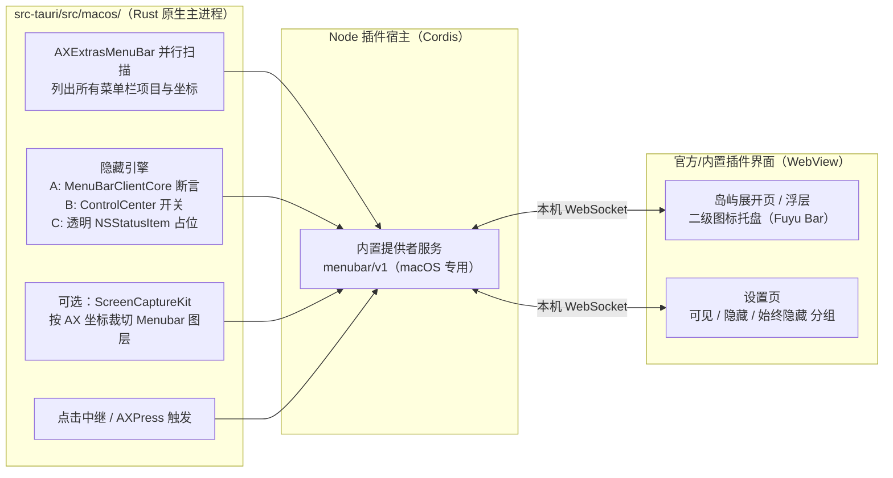

# macOS 菜单栏图标收纳与浮屿插件可行性调研

> 日期：2026-11-24。问题：开源工具 Ice 用什么语言与原理实现；macOS 27 菜单栏底层大改后，社区最新开源方案（Thaw 3、MenuBarHider、Pelmet、Bar27 等）如何隐藏与收纳图标；能否做成浮屿（Fuyu）的 macOS 菜单栏图标收纳插件，以及架构边界、签名/权限门槛与维护成本。范围：GitHub API 与源码审阅（`jordanbaird/Ice`、`thaw-app/Thaw`、`happy666End/MenuBarHider`、`ismatBabirli/pelmet`、`ATTILA-KRB/bar27`、`leonardovida/icey`、`51younglowkey/youngbar`），本机 macOS 27.2（Build `26B123`）实测（`MenuBarAgent`、`AXExtrasMenuBar`、`CGWindowListCopyWindowInfo`、`MenuBarClientCore.framework`、`group.com.apple.controlcenter`），仓库内架构与发布文档（[v3-everything-plugin.md](../architecture/plugins/v3-everything-plugin.md)、[macos-distribution.md](macos-distribution.md)、`src-tauri/Cargo.toml`、`.github/workflows/release-macos.yml`）。相关任务：无（可行性预研）。

## 结论

1. **Ice 的技术栈**：纯 **Swift**（AppKit + SwiftUI + GPL-3.0），经典版本靠「超宽透明 `NSStatusItem` 把左侧图标顶出屏幕」+ `CGEvent` 模拟 `⌘`-拖动 + `CGWindowListCopyWindowInfo` / `ScreenCaptureKit` 逐窗口截图标。**这套老办法在 macOS 27 上已彻底失效**，原版 Ice 已长期未发正式版（最近预发布停在 2025-09）。
2. **macOS 27 的核心变化（本机 27.2 实测印证）**：苹果把菜单栏重写为系统进程 **`MenuBarAgent`** + FrontBoardServices 场景，所有状态图标合并渲染在同一个 `Window Server / Menubar`（Layer 24）图层里，系统自带刘海左侧「溢出折叠（`<<` / `>>`）」，同时裁剪掉过宽的 `NSStatusItem`。因此 macOS 27 社区已分化出 **3 种新隐藏路线**（见下表）。
3. **能不能做成浮屿插件？能，但不是纯第 3 版插件**：
   - 按 [v3-everything-plugin.md](../architecture/plugins/v3-everything-plugin.md)，第 3 版插件跑在 **Node 宿主 + WebView**，且市场安全规则禁止携带可执行程序或 `.node` 原生扩展；所有系统级调用必须写在 **`src-tauri`（Rust + `objc2`）**，通过服务（例如 `menubar/v1`）暴露给官方/内置插件的 UI。
   - **产品契合度高**：把隐藏起来的菜单栏图标直接收进浮屿展开页或收起条下方的二级浮层（相当于把 Ice Bar / Thaw Bar 融进浮屿），体验非常自然；且 `src-tauri/Cargo.toml` 已经引入了 `objc2-app-kit`、`objc2-core-graphics`、`objc2-screen-capture-kit`，原生基础设施齐备。
4. **现阶段不建议立刻立项做完整隐藏引擎，核心卡点有三个**：
   - **卡点 A（签名硬门槛）**：macOS 27 主流免录屏方案 `MBAssessmentModeAssertion` 被 `MenuBarAgent` 强制要求 **Apple Developer ID 正式签名**，ad-hoc 与自签名证书会被直接拒绝；而浮屿当前发布工作流尚未配置 Developer ID 证书（见 [macos-distribution.md](macos-distribution.md)）。
   - **卡点 B（私有 API 与系统开关风险）**：替代方案「读写 `group.com.apple.controlcenter` 的 `trackedApplications`」需调用私有 `_CFPreferences*WithContainer` 接口并申请「完全磁盘访问权限」或显式目录授权；它改写的是系统持久化开关，若应用异常退出未回滚，用户图标会一直保持隐藏，必须配持久化恢复日志（recovery journal）。
   - **卡点 C（版本分裂与长期维护成本）**：macOS 15–26 与 macOS 27 完全是两套底层（连 12.9k star 的 Thaw 都被迫拆成 Thaw 2 和 Thaw 3 两条主线），且均依赖未公开私有接口，未来 macOS 28 存在再次失效的高风险。

### 推荐路径

| 阶段 | 建议做法 | 理由 |
|---|---|---|
| **现在（无 Developer ID 证书）** | **不急着写底层隐藏引擎**；个人使用先装 **Thaw 3** 或 **MenuBarHider**；如想在浮屿里低成本试水，可先验证 **Pelmet 式的零私有 API 占位 + `AXExtrasMenuBar` 岛内列表**，或做一条薄插件通过 `thaw://` 联动 Thaw | 零签名门槛、零私有 API 维护负担、不影响 v3 平台收口与验收 |
| **正式购入 Developer ID 后** | 立项做「**Rust `menubar/v1` 服务 + 浮屿官方插件**」：macOS 27 支持「系统开关（授目录权限时）+ `MBAssessmentModeAssertion`（默认兜底）」，配合 `ScreenCaptureKit` 把隐藏图标裁切进浮屿二级浮层 | 把菜单栏收纳直接整合进浮屿，形成区别于独立工具的一体化体验 |

---

## 详细

### 1. 社区开源项目现状（2026-11-24 查询）

| 项目 | 仓库 | Stars | 语言 | 协议 | 最近推送 | macOS 27 适配与定位 |
|---|---|---:|---|---|---|---|
| **Ice** | [jordanbaird/Ice](https://github.com/jordanbaird/Ice) | 30,095 | Swift | GPL-3.0 | 2026-10-06 | 原版标杆；最近一次 Release 停在 `0.11.13-dev.2`（2025-09，Tahoe Beta 2），未完成 macOS 27 重构 |
| **Thaw** | [thaw-app/Thaw](https://github.com/thaw-app/Thaw) | 12,901 | Swift | GPL-3.0 | 2026-11-24 | Ice 最活跃的社区继承者；拆为 **Thaw 2（macOS 15–26）** 与 **Thaw 3（macOS 27，`3.0.0-alpha.15`）**；支持 `thaw://` URL Scheme 与二级栏 Thaw Bar |
| **MenuBarHider** | [happy666End/MenuBarHider](https://github.com/happy666End/MenuBarHider) | 89 | Swift | **MIT** | 2026-11-10 | 专攻 macOS 27+ 的极简收纳器；双分隔符 `\|` 与 `»`，**免录屏权限**，实现「评估模式断言 + 系统开关」双引擎，代码极干净，最有参考价值 |
| **Pelmet** | [ismatBabirli/pelmet](https://github.com/ismatBabirli/pelmet) | 55 | Swift | **MIT** | 2026-10-14 | **零权限、零私有 API**；macOS ≤ 26 用 4,000pt 占位推挤，macOS 27 用多个合法宽度透明占位把图标挤进系统 `<<` 溢出区，并带 Shelf 浮层 |
| **Bar27** | [ATTILA-KRB/bar27](https://github.com/ATTILA-KRB/bar27) | 28 | Swift | GPL-3.0 | 2026-11-18 | 专攻 macOS 27 按应用隐藏（不重排顺序）；提供详细的 `docs/SPIKES.md` 实测数据 |
| **Icey** | [leonardovida/icey](https://github.com/leonardovida/icey) | 25 | Swift | GPL-3.0 | 2026-11-04 | 另一个覆盖 Sonoma / Sequoia / Tahoe / macOS 27 的 Ice 维护分支 |
| **YoungBar** | [51younglowkey/youngbar](https://github.com/51younglowkey/youngbar) | 24 | Swift | GPL-3.0 | 2026-11-22 | 面向 macOS 27 的键盘优先菜单栏管理器 |

> 注意许可证差异：Ice、Thaw、Bar27 均为 **GPL-3.0**（不能直接抄代码进闭源或非 GPL 兼容模块）；**MenuBarHider** 和 **Pelmet** 为 **MIT**，可作为设计参考。

---

### 2. macOS 27 到底改了什么（含本机 27.2 实测）

在 macOS 15 / 26 及之前，每个应用的菜单栏图标都是一个独立的 WindowServer 小窗口（Layer 25），菜单栏管理器靠三板斧工作：
1. **隐藏**：给自己的分隔符 `NSStatusItem` 设 `length = 10000`，把左边图标一路顶出屏幕外；
2. **识别与截图**：用 `CGWindowListCopyWindowInfo` 列出每个 Layer 25 窗口的 `windowID` 和坐标，逐窗口截图画到二级栏；
3. **重排与点击**：用 `CGEvent` 模拟按住 `⌘` 拖动或临时移回屏幕内点击。

在 **macOS 27.2（Build `26B123`）** 上本机实测结合 `bar27` 的 Spike 记录，底层的四大变化如下：
- **统一进程与单一图层**：系统新增 `/System/Library/CoreServices/MenuBarAgent.app`（`com.apple.MenuBarAgent`），所有菜单栏图标合入单一的 `Window Server / Menubar`（Layer 24），`CGWindowListCopyWindowInfo` 不再返回每个第三方图标的独立窗口。
- **自带刘海溢出折叠**：`MenuBarAgent` 内置 `MenuBarOverflowComponent`，当图标多到刘海左侧时，紧贴刘海右侧出现原生 `<<` / `>>`（本机实测 `AXExtrasMenuBar` 坐标 `x=999, w=18`，描述为「显示隐藏菜单栏项目」）。系统只折叠溢到刘海左侧的图标，不提供把刘海右侧图标也收起来的分隔线。
- **超宽 `NSStatusItem` 被系统裁剪**：设置 `NSStatusItem.length = 10000` 会被 macOS 27 丢弃或截断，经典「一拉顶出屏幕」直接失效。
- **位置扫描退回到 `AXExtrasMenuBar`**：各进程仍在辅助功能树里暴露 `AXExtrasMenuBar`，可拿到每个项的 `x`、`w` 与所属进程；但被收进原生 `<<` 溢出区的项坐标会堆叠在一起，且全量顺序扫描耗时约 1.9 秒（并行扫描可压到约 588 ms，来源：`bar27` `docs/SPIKES.md`）。

---

### 3. macOS 27 上已验证的三种隐藏机制对比

| 维度 | 方案 A：评估模式断言（`MBAssessmentModeAssertion`） | 方案 B：系统原生应用开关（`trackedApplications`） | 方案 C：多段合法占位挤进系统 `<<`（Pelmet 路线） |
|---|---|---|---|
| **底层接口** | 私有框架 `/System/Library/PrivateFrameworks/MenuBarClientCore.framework`（本机 27.2 实测存在），调用 `MBAssessmentModeConfiguration` 的 `initWithAllowedSystemItems:allowedBundleIdentifiers:` 与 `MBAssessmentModeAssertion` | 私有 CoreFoundation 符号 `_CFPreferencesCopyValueWithContainer` / `SetValue` / `Synchronize`，读写 `~/Library/Group Containers/group.com.apple.controlcenter` 下的 `trackedApplications`（本机 27.2 实测无权限时直接 `Operation not permitted`） | 仅用公开 AppKit `NSStatusItem`：放一个分隔符 + 若干宽度在系统允许上限内的透明 spacer |
| **隐藏效果** | 按白名单精确隐藏任意应用（包括刘海右侧），释放断言后即刻恢复 | 切换「系统设置 → 菜单栏」里每个 App 的原生显示开关，支持精确隐藏任意带 Bundle ID 的 App | 占满刘海右侧剩余空间，迫使 macOS 27 把分隔符左侧图标全部推入原生 `<<` 溢出区 |
| **所需权限** | **辅助功能**（用于扫位置/重放点击）；无需录屏、无需完全磁盘访问 | **辅助功能 + 目录访问（`group.com.apple.controlcenter`）或完全磁盘访问权限**；无需录屏 | **零特殊权限**（若要在浮层内一键触发才需要可选的辅助功能权限） |
| **签名硬门槛** | **必须 Apple Developer ID 签名**（`MenuBarAgent` 会拒绝 ad-hoc 与自签名应用） | 无 Developer ID 强制要求（但无固定签名时每次重编都会掉 TCC 授权） | 无 Developer ID 强制要求 |
| **主要副作用与坑** | ① 生效期间系统会拦截时钟/通知中心/电池/Wi-Fi 点击，必须做「悬停时钟或拦截点击 → 临时撤销断言 ≥80 ms → 重放点击」中继；② 断言会连自己 App 的图标也藏掉，只能靠快捷键/悬停唤出；③ 多个断言不叠加，后启动者覆盖前者；④ 每次应用断言阻塞 `MenuBarAgent` 约 100–150 ms | ① 修改的是系统持久化开关，崩溃或卸载前未恢复会导致用户图标永久消失，必须写持久化恢复日志（recovery journal）；② 只能隐藏有合法 Bundle ID 的第三方应用，管不了部分系统项 | ① 只能按分隔符左右整组挤过去，不能按 App 精确隐藏；② 展开/收起仍依托原生 `<<` 行为，右侧会出现一段隐形占位区；③ 若未来 macOS 限制单进程 `NSStatusItem` 总宽度也会失效 |
| **是否需要录屏权限** | 仅纯隐藏不需要；若要把隐藏图标**原样截图画进浮屿二级栏**，则需 `ScreenCaptureKit` 截取 `MenuBarAgent` 的 Layer 24 图层并按 `AXExtrasMenuBar` 坐标裁切（Thaw 3 的做法） | 同左 | 不需要（Pelmet 的 Shelf 只列应用名/应用图标，不截菜单栏位图） |

---

### 4. 在浮屿（Fuyu）里的架构落地方案

按浮屿第 3 版「万物皆插件」架构（[v3-everything-plugin.md](../architecture/plugins/v3-everything-plugin.md)），**纯第三方插件无法直接做这件事**（Node 宿主不能带原生 `.node` / Swift 可执行文件），必须拆成三层：

#### 浮屿已有资产可直接复用
查看 `src-tauri/Cargo.toml` 与 `src-tauri/src/macos/`，浮屿已经具备以下基础，不需要引入重型新依赖：
- `objc2`、`objc2-app-kit`、`objc2-core-graphics`、`objc2-core-foundation`（已用于 `accessibility.rs`、`notch.rs`、`tray_panel.rs` 等）；
- `objc2-screen-capture-kit`（已用于 `screen_capture.rs` / `screen_stream.rs`）；
- `dlopen` / `dlsym` 动态加载私有框架在 Rust `libc` 下和 Swift 一样可行，缺符号时可优雅降级为不可用状态，不影响打包与老系统运行；
- 若不想碰录屏权限，浮屿已有 `src-tauri/src/macos/app_icon.rs`，可直接用应用图标 + 应用名称渲染“岛内托盘列表”，再通过 `AXPress` 触发对应菜单栏项，省掉录屏权限和黄/紫点提示。

#### 浮屿当前尚未满足的前提条件
1. **Apple Developer ID 签名尚未就位**：`.github/workflows/release-macos.yml` 在缺少 `MACOS_CERTIFICATE` Secret 时会回退到 `APPLE_SIGNING_IDENTITY=-`（ad-hoc 签名）。这意味着**方案 A（`MBAssessmentModeAssertion`）在当前构建里根本跑不通**，且方案 B 的授权每次更新都会失效。
2. **仅限 macOS 且版本分裂**：浮屿是 Windows 优先、双平台维护的应用，这套功能是 100% macOS 独占（且 macOS ≤ 26 与 macOS 27 要写两套引擎），属于高耦合、高易碎度的系统 hack，会显著增加后续 macOS 大版本发布时的维护压力。
3. **与原生刘海交互的冲突**：浮屿本身在刘海屏上贴着刘海运行，如果叠加方案 A 的时钟悬停中继、或频繁切换菜单栏布局，容易和浮屿自己的刘海展开/鼠标热区产生联动边界问题，需要真机细调。

---

### 5. 给浮屿的决策选项

如果决定推进，建议先在以下三个选项里拍板：

1. **选项 1（最省心，推荐当下）**：不做内置隐藏引擎，先把浮屿 v3 验收与正式签名推进完；个人日常在 macOS 27 上直接用 **Thaw 3** 或 **MenuBarHider**；如希望和浮屿联动，可做一个极薄的官方/社区插件调用 `thaw://` URL Scheme（几十行 JS，零维护成本）。
2. **选项 2（低成本试验：Pelmet 占位 + 岛内 AX 列表）**：在没有 Developer ID 证书前，先在本机 macOS 27.2 做一个独立 Spike，验证「多段透明 `NSStatusItem` 挤进系统 `<<`」+「浮屿内用 `AXExtrasMenuBar` + `app_icon` 展示并 `AXPress` 触发」的实际手感，决定值不值得继续做。
3. **选项 3（完整对标 Thaw / Ice Bar）**：等浮屿完成 Apple Developer ID 正式签名公证后，再立项实现 `src-tauri` 的 `menubar/v1`（方案 B 优先 + 方案 A 兜底 + 可选 `ScreenCaptureKit` 图标裁切）和浮屿展开页二级托盘插件。

---

## 来源

- [jordanbaird/Ice](https://github.com/jordanbaird/Ice)（30,095 stars，Swift，GPL-3.0，2026-11-24 查询）
- [thaw-app/Thaw](https://github.com/thaw-app/Thaw)（12,901 stars，Swift，GPL-3.0，`development` 分支与 `3.0.0-alpha.15` 发布记录，2026-11-24 查询）
- [happy666End/MenuBarHider](https://github.com/happy666End/MenuBarHider)（89 stars，Swift，MIT，README、`MenuBarAgentBridge.swift`、`SystemTrackedApplicationsStore.swift`，2026-11-24 查询）
- [ismatBabirli/pelmet](https://github.com/ismatBabirli/pelmet)（55 stars，Swift，MIT，README 中 macOS 27 零权限多段 spacer 说明，2026-11-24 查询）
- [ATTILA-KRB/bar27](https://github.com/ATTILA-KRB/bar27)（28 stars，Swift，GPL-3.0，README 与 `docs/SPIKES.md` 在 macOS 27.0.1 上的实测数据，2026-11-24 查询）
- [leonardovida/icey](https://github.com/leonardovida/icey)（25 stars，Swift，GPL-3.0，2026-11-24 查询）
- [51younglowkey/youngbar](https://github.com/51younglowkey/youngbar)（24 stars，Swift，GPL-3.0，2026-11-24 查询）
- 本机实测（2026-11-24，macOS 27.2 Build `26B123`）：`AXExtrasMenuBar`、`CGWindowListCopyWindowInfo`、`/System/Library/CoreServices/MenuBarAgent.app`、`/System/Library/PrivateFrameworks/MenuBarClientCore.framework`、`~/Library/Group Containers/group.com.apple.controlcenter`
- 仓库内文档：[docs/architecture/plugins/v3-everything-plugin.md](../architecture/plugins/v3-everything-plugin.md)、[docs/research/macos-distribution.md](macos-distribution.md)、[src-tauri/Cargo.toml](../../src-tauri/Cargo.toml)、[.github/workflows/release-macos.yml](../../.github/workflows/release-macos.yml)
