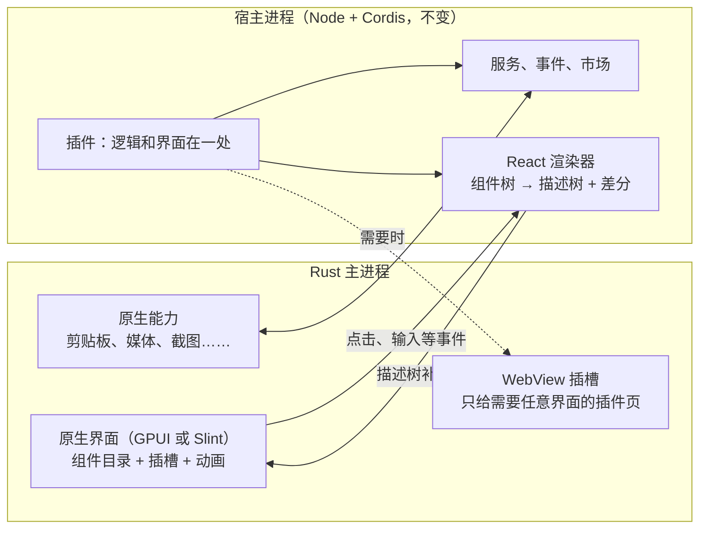

# 原生界面（不用 WebView）下怎么做「万物皆插件」

> 日期：2026-11-26。问题：回顾之前「用 Rust + GPUI 重写」的结论；再查一遍：如果界面改成跨平台原生开发（Windows + macOS，不用 WebView），有没有架构能实现现在第 3 版这种插件系统。范围：GPUI（含 `gpui-component` / `gpui-kit`、GPUIX）、Makepad、Slint、Dioxus Native / Blitz、Freya、Xilem、Floem 的仓库、文档和发布记录；Zed、Lapce 的扩展接口；Raycast v1 / 2.0、Vicinae、Shopify remote-dom、Redwood、Valdi、Lynx、React Native 桌面、Vercel Native SDK、KDE Plasma 小部件、Adobe UXP、JetBrains JCEF、Zellij、Figma 的插件界面做法。**全部是读文档和源码，没有实测**。之前的框架对比见 [desktop-frameworks.md](desktop-frameworks.md)（原生界面类细项在 [desktop-frameworks-native.md](desktop-frameworks-native.md)），本文只补那两份没有的：第 3 版落地后的新前提，和 Rust 原生界面这一支的新进展。

## 结论

- **之前的结论不变：现在不建议用 Rust + GPUI 重写**（2026-11-14，见下一节「之前怎么说的」）。理由是插件改不了编译进程序的 Rust 界面，Zed 自己的扩展到今天也加不了界面。
- **但有一个新前提让原生这条路比 11-14 时近了一步**：第 3 版的插件宿主已经是独立的 Node 进程，和界面用什么画无关。换原生界面，只需要替换「各窗口的客户端」这一层；内核、服务、事件、市场、Rust 原生层都能留。
- **能做到，但只有一种做法真正成熟：插件用 React 写，Node 里跑一个自定义渲染器把组件树变成描述，原生宿主用自己的一套组件画出来**。Raycast v1（AppKit，已在生产跑了多年）、Vicinae（Qt，1 万多星）、GPUIX（GPUI 的 Node 绑定）都是这样。
- **代价是「插件能换掉任何界面」要打折**：插件只能在宿主给的组件里拼装和替换，自定义绘制、任意 CSS 动画做不到。现有的成熟产品要么接受这个限制（Raycast v1、Vicinae），要么回到 WebView（Raycast 2.0）。想保住「插件什么都能画」，就得留一个 WebView 插槽兜底。
- **Rust 原生界面这一支，今年冒出两个直接对口的项目，但都太早**：
  - `gpui-shell`（longbridge 的 `gpui-kit` 里）：GPUI 宿主内嵌 QuickJS，脚本描述界面、能往停靠区注册面板，README 写明「首要目标是插件扩展」；自称 M0 可行性基线。
  - GPUIX：给 Node / Bun 的 GPUI 绑定，React 或 Solid 写界面，Rust 端每帧把保留树画成 GPUI 元素；1.0 之前，小应用闲置自测约 80 MB。
- **建议**：第 3 版继续在 Tauri 上验收和迭代。如果以后真要原生化，路线是「**Node 宿主不动 + React 渲染器出描述树 + GPUI（或 Slint）画岛屿 + 复杂插件页留 WebView 插槽**」，先花三五天做个只有岛屿的小样量内存，再决定。触发条件见最后「什么时候重新看」。

## 之前怎么说的

两份已有的结论，摘要如下：

**2026-11-14 会话里「开个空白分支用 Rust + GPUI 全新开发」的答复**（当时只在对话里答，没有成文，这里补记）：

- 最大的矛盾：GPUI 的界面是编译进程序的 Rust 代码。插件要改它只有两条路：动态加载 Rust 库（没有稳定的二进制接口，插件必须和主程序同一个编译器版本，出错整个程序崩），或 WASM 插件（Zed 就是这样，但扩展接口只有语言服务器、调试器、斜杠命令、MCP 这些，**加不了界面**）。
- 要做到「插件能改任何界面」，得自己再嵌一套脚本运行时、再把界面框架绑过去，工作量比现方案大得多。
- 重写代价：约 6.8 万行 Rust + 5.7 万行前端，7 种窗口、二十多个功能、中英文、Mac 适配、发布流程、插件市场都要重做；重写期间旧版还要维护，仓库规则也不允许在主工作区切分支，得另开仓库。
- GPUI 好的地方：内存和性能、一种语言、没有 WebView 的安全边界问题。浮屿要的岛屿窗口（透明、置顶、不抢焦点、穿透、刘海、动画）当时没核实。
- 建议：插件化按方案 A（后来的第 3 版）做；在意内存的话另开仓库花一两天只做岛屿小样。

**2026-11-14 的框架对比**（[desktop-frameworks.md](desktop-frameworks.md)）：GPUI 在「运行时加载 JS 插件」「插件改任何界面」两项都打 ✘；原生界面类里能保住「插件改任何界面」的只有 Qt / QML、React Native 桌面、Avalonia；「插件描述界面、宿主来画」行得通但和「内置功能也是插件」冲突；Raycast 2026-05 放弃原生渲染是最重的反面证据。

## 第 3 版落地后，原生化要换掉的是哪一层

第 3 版的结构（[v3-everything-plugin.md](../architecture/plugins/v3-everything-plugin.md)「架构」）分三层：

| 层 | 现在 | 换原生界面时 |
|---|---|---|
| Rust 主进程 | 系统接口、看管宿主 | **留**。GPUI / Slint 本身就是 Rust，原生层能直接在同一进程里用 |
| 宿主进程（Node + Cordis） | 服务、事件、副作用、插件后台部分、市场 | **留**。和界面无关 |
| 客户端（每个窗口的 WebView） | 插件往插槽里注册 React 组件，直接画 DOM | **换**。这是唯一要重新设计的部分 |

所以问题收窄成一句话：**插件的界面部分不能再是「任意 DOM + CSS」，那它是什么、在哪跑、谁来画？**

## 五种做法

| 做法 | 实例 | 插件能改到什么程度 | 成熟度 | 主要代价 |
|---|---|---|---|---|
| **A. JS 渲染器出描述树，原生宿主来画** | Raycast v1（AppKit）、Vicinae（Qt / QML）、GPUIX（GPUI） | 在宿主组件集里拼装、替换；不能自绘 | Raycast v1 生产多年；Vicinae 0.30（2026-11）三平台，macOS 细节在补；GPUIX 1.0 前 | 每个组件都要原生实现；动画只能用宿主给的声明式参数；跨进程时事件要回传 |
| **B. 宿主内嵌 JS 引擎，同进程描述界面** | gpui-shell（GPUI + QuickJS） | 同 A，另能注册停靠面板 | M0，不是稳定接口 | 不能用 Node 和 Cordis 的现有生态；QuickJS 性能和兼容性有限 |
| **C. 运行时解释界面 DSL** | Slint 解释器 / slint-node、Makepad 2.0 的 Splash、KDE Plasma 小部件（QML） | DSL 的表达力内什么都能画（QML 最完整） | QML 最成熟；Slint 的 Node 接口标「早期」；Makepad 2.0 没上 crates.io | 插件作者要学 DSL，不是 React；Slint 动态拼装第三方组件的接口偏内部 |
| **D. WASM 组件 + 自定义界面接口** | Zed、Lapce（都只做了非界面扩展）；Zellij（WASM 插件画字符界面） | 取决于自己设计的接口 | 没有图形界面的先例 | 接口要从零设计，工作量最大；插件得编成 WASM |
| **E. 原生外壳 + WebView 插件面板** | Adobe UXP（HTML 子集）、JetBrains JCEF、MyGo、gpui-shell 的 `WebView` 组件 | 面板里随便画，外壳改不了 | 成熟 | 每个面板一份 WebView 开销；风格割裂 |

对浮屿来说，**A 最合适**：宿主已经是 Node，插件的界面部分可以直接搬进宿主进程，用 React 写、由渲染器出描述树，经现有的通道发给 Rust 去画。这样插件不再分「宿主部分 + 窗口部分」两半，反而比现在简单。B、C 要么丢掉 Node 生态，要么让插件作者换语言；D 没有先例；E 只能当兜底。

## 如果真做，浮屿的原生版长什么样

要新做的：

| 件 | 内容 | 参照 |
|---|---|---|
| 组件目录 | 一套固定的原生组件：布局盒、文字、图片、图标、列表、输入框、按钮、开关、滑块、进度、滚动、手势区；外加浮屿特有的（歌词滚动、日历格、波形）。组件要版本化，像插槽一样带 `/v1` | Raycast 的组件表、Vicinae |
| 渲染器 | React 自定义渲染器，把提交变成补丁批次；宿主侧维护保留树 | GPUIX 的 `applyBatch`、Raycast 的 JSON Patch |
| 插槽 | 插槽规则（数量、顺序、替换、错误隔离、版本）原样保留，只是插槽里放的是描述树而不是 React 组件 | 现有「插槽的规则」 |
| 动画 | 插件不能逐帧驱动；用声明式参数（过渡、弹簧、出入场）由 Rust 跑 | — |
| 主题 | 颜色、圆角、字号做成令牌，插件只能引用，不能写任意样式 | Vicinae 的主题 |
| WebView 插槽 | 需要任意界面的插件页（复杂设置页、富文本编辑器、图表）按需开一个 WebView，用完关掉 | gpui-shell 的 `WebView` 组件、JetBrains JCEF |

会丢掉的：

- 插件的任意 CSS 和自绘。歌词、截图标注、笔记编辑器这类内置功能要么做成原生组件进目录，要么走 WebView 插槽。
- 现有 5.7 万行前端和全部官方插件的界面部分，都要按组件目录重写。
- 插件生态里现成的 React 组件库（它们依赖 DOM）。

能拿到的：

- 内存：GPUIX 自测的小应用闲置约 80 MB（含 JS 运行时，Apple Silicon）；Raycast v1 原生版带 Node 是 200–300 MB，2.0 改 WebView 后 350–450 MB。浮屿 Windows 现在约 330 MB。**整套重写换来的大约是 100–200 MB，而且 Node 宿主那一份（第 0 阶段实测约 22–27 MB 空载，带插件后会涨）省不掉**。
- 不再有 WebView 的降速、`emit` 泄漏、每窗口一个渲染进程这些问题。
- GPUI 主干已有 macOS 的不激活面板（`WindowKind::PopUp` 是 NSPanel + `NonactivatingPanel`）、透明和毛玻璃背景；托盘和点击穿透在 Zed 仓库没找到，要自己补。

## 各框架的最新情况

只列和插件界面有关的，版本按 2026-11-26 查询。

| 框架 | 运行时界面 | 有没有插件加界面的实例 | 岛屿窗口相关 |
|---|---|---|---|
| **GPUI** | 本身不能。crates.io 上的 `gpui` 停在 0.2.2（2025-10），落后 Zed 主干 | gpui-shell（M0）、GPUIX（1.0 前，约 3000 星）。Zed 扩展最新的接口（`since_v0.8.0`，2026-11）仍然没有界面 | macOS 不激活面板、透明 / 毛玻璃有；托盘、穿透未找到 |
| **Slint** 1.19.1 | 解释器能运行时加载 `.slint`；Node 接口标「早期」 | 没找到 | 置顶、无边框、托盘（1.17 起）有；透明在 1.19 修过；不激活面板未见文档 |
| **Makepad** 2.0（git） | Splash 脚本运行时求值、热应用 | 自带的 amp 应用加载用户写的样式和布局 | 未找到资料 |
| **Dioxus Native / Blitz** | 能渲染运行时的 HTML 字符串，但这条路缺交互；没有 JS 绑定 | 没有 | 基于 winit，未核实 |
| **Freya** 0.5.4 | 只有开发期热补丁 | 没有 | 托盘、无边框有 |
| **Xilem** 0.4 | 没有 | 没有 | 实验性 |
| **Floem / Lapce** | 没有 | Lapce 插件只能加设置项，界面扩展的需求 #3956 未关 | — |

基于 winit 的（Slint、Freya、Floem、Blitz）都能用 `set_cursor_hittest` 做整窗穿透；浮屿要的「按岛屿形状穿透」仍要自己做。

## 非 Rust 的原生方案有什么新变化

和 11-14 的 [原生界面类调研](desktop-frameworks-native.md) 比：

- **Vicinae**：Qt / QML 的 Raycast 兼容启动器，扩展是 React，自写渲染器把界面变成描述树交给 C++ 画。0.30.0（2026-11-07）已有 macOS 和 Windows，是「做法 A」在 Windows + macOS 上最新的开源实例，值得读源码。
- **Raycast 2.0** 的理由补充：Windows 的原生界面框架「远谈不上好」、两套原生界面等于两倍工作、AppKit 编译慢且难招人；Flutter、Qt、RN 桌面很早就排除了。
- **Lynx 3.7**（2026-04）把 macOS、Windows 列为一等平台，自研渲染引擎；Lynxtron 仍是「即将开源」；能不能运行时加载第三方包未核实。
- **Vercel Native SDK**（2026-05）：TS 子集编译成原生，编译式，不适合运行时插件。
- **React Native Windows 0.85**（2026-10）只剩新架构，透明窗口和内存仍没有资料。
- **Redwood / Treehouse** 已不再积极开发；**Valdi** 仍没有 Windows。

## 什么时候重新看

- GPUIX 或 gpui-shell 到 1.0，或者出现一个用它们做的、带第三方插件的常驻应用。
- Zed 的扩展接口真的开放了界面（那会是 GPUI 上「插件加界面」的官方做法）。
- 浮屿的内存成了用户最主要的抱怨，WebView 侧的优化做完仍不够。

到时的小样：另开仓库，GPUI + 一个 Node 宿主 + React 渲染器，只做岛屿收起条和一个插件展开页；在 Windows 和 Mac 上量闲置内存，看刘海贴合、展开动画、按形状穿透和不抢焦点。三五天能出结论。

## 未核实

- GPUIX 的 80 / 178 MB 是它自己在 Apple Silicon 上的测量，没有 Windows 数字。
- gpui-shell、GPUIX 在 Windows 上的透明、置顶、不抢焦点窗口表现。
- Slint 解释器动态拼装第三方组件的接口是否稳定（`FactoryContext` 在 `internal` 特性下）。
- Makepad「2.0 于 2026-02-12 发布」是社区说法。
- Vicinae 的内存、Windows 版的完成度；Raycast 2.0 的扩展是否改由 WebView 渲染。
- 「描述树 + 声明式动画」能不能做出浮屿现在岛屿开合的手感。

## 来源

- 之前的结论：2026-11-14 会话的答复（本文「之前怎么说的」补记）；[desktop-frameworks.md](desktop-frameworks.md)；[desktop-frameworks-native.md](desktop-frameworks-native.md)；[mygo-vs-tauri.md](mygo-vs-tauri.md)
- GPUI：https://crates.io/crates/gpui ；Zed 平台层 https://github.com/zed-industries/zed/blob/main/crates/gpui/src/platform.rs 、https://github.com/zed-industries/zed/blob/main/crates/gpui_macos/src/window.rs
- gpui-kit / gpui-component / gpui-shell：https://github.com/longbridge/gpui-kit 、https://github.com/longbridge/gpui-kit/blob/main/crates/shell/README.md
- GPUIX：https://github.com/remorses/gpuix
- Zed 扩展：https://github.com/zed-industries/zed/tree/main/crates/extension_api/wit/since_v0.8.0 、https://zed.dev/docs/extensions/developing-extensions 、https://zed.dev/blog/zed-decoded-extensions 、https://github.com/zed-industries/zed/discussions/6679
- Slint：https://docs.rs/slint-interpreter/latest 、https://docs.slint.dev/latest/docs/node/ 、https://docs.slint.dev/latest/docs/slint/reference/window/window/ 、https://github.com/slint-ui/slint/blob/master/CHANGELOG.md
- Makepad：https://github.com/makepad/makepad/blob/main/splash.md 、https://github.com/makepad/makepad/blob/main/apps/amp/src/layout.rs
- Blitz：https://github.com/DioxusLabs/blitz ；Freya：https://crates.io/crates/freya 、https://docs.freyaui.dev/posts/0.4 ；Xilem：https://github.com/linebender/xilem ；Floem：https://github.com/lapce/floem ；Lapce：https://github.com/lapce/lapce/issues/3956
- winit 穿透：https://docs.rs/winit/latest/winit/window/struct.Window.html
- Raycast：https://www.raycast.com/blog/how-raycast-api-extensions-work 、https://www.raycast.com/blog/a-technical-deep-dive-into-the-new-raycast
- Vicinae：https://github.com/vicinaehq/vicinae 、https://docs.vicinae.com/extensions/introduction 、https://github.com/vicinaehq/vicinae/releases
- Shopify remote-dom：https://github.com/Shopify/remote-dom ；Redwood：https://github.com/cashapp/redwood ；Valdi：https://github.com/snapchat/valdi ；Lynx 3.7：https://lynxjs.org/blog/lynx-3-7 ；RN Windows 0.85：https://devblogs.microsoft.com/react-native/react-native-windows-v0-85-is-here/ ；Vercel Native SDK：https://github.com/vercel-labs/native
- KDE Plasma 小部件：https://develop.kde.org/docs/plasma/widget/setup/ ；Adobe UXP：https://developer.adobe.com/photoshop/uxp/2021/guides ；JetBrains JCEF：https://plugins.jetbrains.com/docs/intellij/embedded-browser-jcef.html ；Zellij：https://zellij.dev/documentation/plugins ；Figma：https://developers.figma.com/docs/plugins/how-plugins-run/
