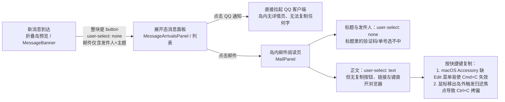

# 消息与邮件通知的文本复制及验证码提取调研

> 日期：2026-11-17。问题：[flyl1u/fly-island#83](https://github.com/flyl1u/fly-island/issues/83)（「建议：邮箱消息通知支持复制文本」，含验证码、链接、地址、订单号及任意段落复制）是否也是浮屿的问题；全网操作系统、开源通知中心、验证码提取工具与刘海岛竞品是怎么做的；浮屿应该怎么看、怎么做。范围：本仓 `src/features/messages/`、`src/windows/island/`、`src-tauri/src/` 代码核查；GitHub 搜索与 REST API（`verification code mail copy`、`MessAuto`、`SmsCode`、`SwayNotificationCenter`、`dunst`、`raycast/extensions`、`PowerToys`、`boring.notch`、`Atoll`）；Windows 11 / macOS Sonoma+ 系统通知机制文档与社区反馈。相关任务：C109（[#809](https://github.com/TixXin/fuyu/issues/809)）

## 结论

1. **明确也是浮屿的问题，而且不止于「邮箱」，而是横跨「通知弹出 → 消息列表 → 邮件阅读页 → 双端焦点与快捷键」四层的断链：**
   - **所有通知横幅与列表均无法选字或复制**：全局 `body { user-select: none }` 下，`MessageBanner`、`MessageArrivalsPanel`、邮箱列表和 QQ 通知列表整行都是 `<button>`。其中 **QQ 通知列表**没有二级阅读页，点击整行直接拉起 QQ 客户端——即便通知里已经带着验证码、快递单号或地址，用户在岛上一字也拷不出来。
   - **邮件阅读页漏掉了「主题」和「发件人」**：`MailPanel.css` 只给正文 `.qq-mail-body` 开了 `user-select: text`，邮件主题 `.qq-mail-reader__subject` 和发件人 `.qq-mail-reader__meta` 仍不可选。现实中大量服务把验证码、单号直接写在邮件标题里（如 `[GitHub] Your verification code is 123456`），点进阅读页对着标题拖选完全无效；正文里的超链接也只能点击打开浏览器，不能一键复制链接地址。
   - **非激活悬浮窗特有的复制隐患（macOS + Windows）**：macOS 端浮屿以 `ActivationPolicy::Accessory` + `NonactivatingPanel` 运行且未挂载含 `Copy` 的原生 `Edit` 菜单，`WKWebView` 内按 `Cmd+C` 存在失效风险（目前仅靠非空选区放行的右键菜单兜底）；双端 `useHoverFocus` 的 `isEditingText()` 未检查文本选区，拖选正文后鼠标一旦移出岛外触发归还焦点，紧接着按 `Ctrl+C` 就会拷空或拷到原窗口内容。
2. **外部生态的共识非常清晰：「兜底自由复制」与「高频一键复制验证码」必须两条腿走路，缺一不可。**
   - Windows 11 原生 Toast 与 Linux 的 [SwayNotificationCenter](https://github.com/ErikReider/SwayNotificationCenter) 都在不可选的通知卡片上专门为 2FA 验证码注入「一键复制」动作按钮；但只做验证码解决不了单号、地址、激活链接等长尾需求。
   - [Raycast 官方扩展库](https://github.com/raycast/extensions)中的 `qq-mail` 与 `netease-mail` 给出了最贴合中文邮箱场景的组合：识别到验证码/登录链接时置顶一键动作，同时提供「复制正文 / 复制主题 / 复制发件人」通用兜底。
   - 开源通知项目踩过两个高发大坑：①**纯数字正则无关键词门控导致满屏误报**（SwayNC 把普通通知里的年份 `2023` 识别成验证码，被迫紧急加开关）；②**悬浮通知无键盘焦点导致剪贴板写入失败**（Wayland 悬浮层调外部剪贴板失效，必须走宿主原生剪贴板接口）。
3. **建议分两期落地，优先补齐零误报的基础复制能力，再加受关键词门控的验证码提取按钮：**
   - **一期（P0，基础复制闭环，低成本高确定性）**：①放开邮件阅读页主题与发件人的 `user-select: text`，补「复制全文」按钮与链接右键「复制链接」；②修复 macOS `Cmd+C` 与选区悬停保焦；③为 QQ 通知列表项及新消息卡片补悬停「复制文本」图标按钮/右键复制，不再一点就强制跳走。
   - **二期（P1，验证码一键复制，统一覆盖邮件与 QQ 通知）**：采用 [MessAuto](https://github.com/LeeeSe/MessAuto) 验证过的「中英文触发词门控 + 干扰项过滤 + 触发词最近距离消歧」提取器，直接复用浮屿 `MessageBanner` 和 `MessageArrivalsPanel` **现成已有**的 `message.actions` 按钮槽位渲染 `复制 356407`，并在邮件阅读页标题下方显示胶囊复制条。**默认只展示按钮、不静默覆盖用户剪贴板、不模拟键盘自动粘贴。**

---

## 浮屿现状核查（为什么也是我们的问题）

先看外部 issue 的来龙去脉：[flyl1u/fly-island#83](https://github.com/flyl1u/fly-island/issues/83)（2026-11-17 提出）指出「目前小岛收到邮箱消息时只能查看内容，无法复制通知里的文字……收到验证码邮件想直接复制验证码，或收到含链接、地址、订单号的邮件想复制其中一段或全文」。核查该仓公开提交可见，其前一日（`85ee39d0`，2026-11-16）曾尝试加入邮箱验证码显示，但同日发版前（`70d739f9`）又将该功能暂时隐藏，次日即收到用户反馈（按本仓规范，我们不参考、不搬用其代码，完全基于本仓架构与开源生态独立分析）。

对照浮屿当前主线代码，用户在「从收到通知到复制出文字」的整条路径上会遇到以下卡点：

| 界面层级 | 本仓对应位置 | 当前行为 | 用户痛点 |
|---|---|---|---|
| 全局基底样式 | `/src/styles/base.css` | `body { user-select: none; }` | 桌面壳防误选的合理默认值，但意味着所有需要复制的文本区必须显式豁免或提供复制按钮 |
| 折叠岛横幅与到达面板 | `/src/features/messages/banner/MessageBanner.tsx`、`/src/features/messages/arrivals/MessageArrivalsPanel.tsx` | 整行包裹在 `<button>` 内，点击即打开；`actions` 动作按钮槽位已实现，但目前只有 `plugin` 来源传入动作，`qqMail` 和 `qq` 均传空数组 `[]` | 横幅上看得到标题里的验证码或 QQ 消息摘要，却不能点按钮复制，也不能右键复制 |
| 邮箱后台同步数据 | `/src/features/messages/mail/useMail.ts`、`/docs/features/mail.md` | 同步阶段只拉最近 20 封邮件头（发件人、主题、时间、未读），点开某封邮件时才发 `BODY.PEEK` 拉正文 | 若验证码只在邮件正文、不在主题里，到达横幅阶段还没有正文内容 |
| QQ 通知列表页 | `/src/features/messages/qq-notifications/QQNotifications.tsx` | 列表项是 `<button onClick={() => void openQQ()}>` | **死胡同**：列表里明明已经有消息正文摘要，但点哪里都直接打开 QQ，没有任何办法在岛上复制 |
| 邮件阅读页 | `/src/features/messages/mail/MailPanel.tsx`、`MailPanel.css` | 仅 `.qq-mail-body` 设了 `user-select: text`；`.qq-mail-reader__subject` 与 `.qq-mail-reader__meta` 不可选；`<a>` 点击直接调默认浏览器 | 标题里的验证码/单号选不中；发件人邮箱选不中；长登录链接无法单独复制地址；没有一键复制全文入口 |
| 窗口焦点与菜单（双端） | `/src-tauri/src/lib.rs`、`/src/windows/island/useHoverFocus.ts`、`/src/lib/browserDefaults.ts` | `browserDefaults.ts` 已为非空选区保留原生右键菜单；但 macOS 为 `Accessory` 模式且无 AppKit `Edit` 菜单；`useHoverFocus` 仅在 `input/textarea` 聚焦时锁住焦点 | macOS 下选中文字按 `Cmd+C` 可能无响应；Windows/macOS 下拖选后光标滑出岛边缘即丢焦点，按 `Ctrl+C` 失败 |

---

## 外部调研：系统、开源项目与竞品做法

> 以下项目的 Star 数与最近推送时间均于 **2026-11-17** 经 GitHub REST API 查询核实。

### 一、操作系统原生通知与开源通知守护进程

系统级通知横幅普遍不允许鼠标直接框选文字（因为卡片本身承担点击跳转、拖拽滑走手势），各平台的解法高度一致——**「横幅加动作按钮 + 历史列表支持复制/提取」**：

| 平台 / 项目 | Star / 许可 | 能否框选横幅文字 | 验证码 / 文本 / 链接的复制方案 | 值得注意的经验与缺陷 |
|---|---|---|---|---|
| **Windows 11 原生 Toast** | 系统内置 | 否（长期被社区吐槽，用户常借 [PowerToys Text Extractor](https://learn.microsoft.com/en-us/windows/powertoys/text-extractor) `Win+Shift+T` OCR 救急） | 系统内置 **Smart 2FA 识别**：检测到本地应用或「手机连接（Phone Link）」通知含验证码时，直接在 Toast 底部注入「复制」按钮 [1][2] | 证明在不可选的悬浮横幅上，「内联复制按钮」是 Windows 用户最熟悉的心智模型；但普通单号、地址仍无法从 Toast 复制 |
| **macOS Sonoma+ 通知与自动填充** | 系统内置 | 否 | 通知横幅本身无复制按钮；系统走 Safari + Apple Mail 绑定的 `autocomplete="one-time-code"` 输入框自动填充 [3] | **生态割裂严重**：一旦用户换用 Chrome / Arc / Firefox 或第三方收信工具，原生邮件验证码自动填充即断链，直接催生了下文的开源菜单栏工具群 |
| **[ErikReider/SwayNotificationCenter](https://github.com/ErikReider/SwayNotificationCenter)**（SwayNC） | ★2,652 / GPL-3.0（`pushed_at` 2026-06-25） | 弹窗受限，控制中心面板可管理 | [PR #217](https://github.com/ErikReider/SwayNotificationCenter/pull/217) 内置 2FA 识别，自动向通知追加 `COPY "123456"` 动作按钮；链接支持直接点击 | 踩了两个典型坑：①[Issue #244](https://github.com/ErikReider/SwayNotificationCenter/issues/244) 年份误报；②[Issue #775](https://github.com/ErikReider/SwayNotificationCenter/issues/775) 悬浮通知无焦点导致复制失败（详见下一节） |
| **[dunst-project/dunst](https://github.com/dunst-project/dunst)** | ★5,631 / BSD 风格（`pushed_at` 2026-10-25） | 否（极简渲染） | 内置 **URL 抓取与 `context` 上下文菜单**：左键维持关闭/默认动作，快捷键或右键调出从通知正文提取出的全部 URL 与动作列表 [4] | 把「低频多链接/多动作」收进右键或上下文菜单，不挤占横幅主视觉，非常适合窄小的悬浮岛 |
| **KDE Plasma Notifications** | 系统桌面（Qt/QML） | 现代版本支持富文本与历史面板交互 | 自动把正文 URL 转为可点链接，配合系统剪贴板组件（Klipper）做正则动作触发 | 通知中心常驻列表比瞬时横幅承担更多复制需求 |

### 二、开源验证码提取与快捷收件工具

这一类项目专门解决「不想打开邮箱网页或手机找码」的痛点，也是 [#83](https://github.com/flyl1u/fly-island/issues/83) 第一个举例场景的直接对标：

| 项目 | Star / 许可 | 平台与数据源 | 核心交互模式 | 优缺点分析 |
|---|---|---|---|---|
| **[LeeeSe/MessAuto](https://github.com/LeeeSe/MessAuto)** | ★1,598 / MIT（`pushed_at` 2026-03-06，Rust） | macOS；监听系统 Mail.app 与 Messages | 提供三种模式：①自动写入剪贴板；②模拟键盘直接输入（「不占用剪贴板」模式）+ 可选自动回车；③**光标旁弹出悬浮小按钮**，点一下才填入 | 算法扎实（触发词 + 最小距离，见下节）；但「自动粘贴/回车」强依赖辅助功能与完全磁盘访问权限，多窗口并发（尤其开着多个终端跑 AI 代理）时容易贴错窗口 |
| **[raycast/extensions](https://github.com/raycast/extensions)** 内的 `qq-mail` 与 `netease-mail` | 仓库 ★7,843 / MIT（`pushed_at` 2026-11-17） | macOS / Windows；IMAP + SMTP 直连 QQ 邮箱、163/126 邮箱 | ①专设验证码与登录链接提取，识别到时主动作变为 `Copy Code`；②通用 ActionPanel 分组提供 **`Copy Email Body`、`Copy Subject`、`Copy Sender Address`、`Copy Email as Markdown`** [5][6] | **最贴近浮屿的产品形态**：同为轻量面板 IMAP 收信，既照顾了一键拷验证码，又用结构化复制项覆盖了主题、发件人、正文的任意复制诉求 |
| **[ptrinh/Notiful](https://github.com/ptrinh/Notiful)** | ★3 / MIT（`pushed_at` 2026-11-17，Swift） | macOS 菜单栏；读取本地通知 | 纯本地提取通知里的 OTP，驻留菜单栏一键复制，支持自定义 shell 脚本，零网络请求 | 交互克制，不自动污染剪贴板，也不索取键盘注入权限 |
| **[stanczykwyatt/copy-2fa](https://github.com/stanczykwyatt/copy-2fa)** | ★18 / 开源（`pushed_at` 2026-11-16） | macOS；Mail + Messages + 内置 TOTP | 按一个全局快捷键即复制最新收到的邮件/短信验证码 | 快捷键直拷适合纯键盘流，但缺少视觉确认（「到底拷的是哪封信的码」） |
| **[tianma8023/SmsCode](https://github.com/tianma8023/SmsCode)** / **[RikkaW/SmsCodeHelper](https://github.com/RikkaW/SmsCodeHelper)** | ★119 / ★116 | Android 短信通知 | 通知栏附带「复制验证码」按钮 + 可选自动复制 + 复制后吐司提示验证码内容 | 中文验证码规则打磨最久的开源分支，支持用户自定义关键词与正则 |
| **[pppscn/SmsForwarder](https://github.com/pppscn/SmsForwarder)** | ★28,910 / BSD-2-Clause（`pushed_at` 2026-11-17） | Android 短信与 App 通知转发 | 按正则规则把手机验证码/通知转发到 Webhook、Bark、邮箱或桌面端 | 许多用户正是用它把手机短信转发到邮箱或桌面通知——这反过来加重了桌面端「从邮件/通知里一键复制验证码」的刚需 |

### 三、刘海岛竞品与开源桌面邮件客户端

- **macOS 刘海岛竞品（[boring.notch](https://github.com/TheBoredTeam/boring.notch) ★11,342、[Atoll](https://github.com/Ebullioscopic/Atoll) ★5,253、NotchNook、Alcove）**：如前序调研 [macos-notch-apps.md](macos-notch-apps.md) 所述，这些产品主打媒体、文件架、HUD 和 AI 代理状态，**均未内置 IMAP 多邮箱收件箱，也未做 QQ/通知文本复制**。浮屿已经具备完整的本机 IMAP 收信与 QQ 通知上岛能力，把「即看即拷」打磨顺畅属于人无我有的体验闭环。
- **开源桌面邮件客户端（如 [Foundry376/Mailspring](https://github.com/Foundry376/Mailspring) ★18,010）**：在阅读视图里，邮件标题、发件人名称与邮箱地址、正文段落全部可自由框选，超链接右键均提供 `Copy Link Address`。这印证了浮屿 `MailPanel` 目前只给 `.qq-mail-body` 开 `user-select: text` 而锁死标题与发件人属于明显遗漏。

---

## 验证码提取的开源算法与反面教材

开源项目在「怎么从通知/邮件里提取验证码」上已经走完了从简单正则到成熟启发式的全过程，核心教训有三条：

### 1. 反面教材：无门控的纯数字正则必然误报（SwayNC #244）

SwayNC 在 [PR #217](https://github.com/ErikReider/SwayNotificationCenter/pull/217) 初版直接对所有通知跑 4–7 位数字匹配（兼容 `1234`、`123 456`、`123-456`）。上线后立刻收到 [Issue #244](https://github.com/ErikReider/SwayNotificationCenter/issues/244)：任何包含年份（如 `2023`、`2026`）、Git PR 编号、端口号、订单尾号的通知都会挂上一个突兀的 `COPY "2023"` 按钮，维护者不得不在 [PR #260](https://github.com/ErikReider/SwayNotificationCenter/pull/260) 加开关救火。

**邮件场景比系统通知更险恶**：HTML 邮件源码里到处是 `<td width="600">`、颜色值 `#1a2b3c`、跟踪链接参数 `?utm_id=849201`、客服电话 `400-100-1111`、日期 `2026-11-17` 和账单金额。如果在未清洗的 HTML 或无上下文门控的文本上跑正则，误报率会高到不可用。

### 2. 成熟范式：触发词门控 + 干扰项剔除 + 最小距离消歧（MessAuto / SmsCode）

综合 [LeeeSe/MessAuto](https://github.com/LeeeSe/MessAuto)（`src/parser.rs`）与 `SmsCode` 系列的做法，高准确率提取遵循四步流水线：

1. **纯文本归一化**：若是 HTML 邮件，必须先剥离 `<style>` / `<script>` / 标签属性与隐藏元素，按块级标签换行转为纯文本；同时把「邮件主题 + 正文前段」拼入检索范围（因为大量国内外服务把验证码直接放在 Subject）。
2. **中英文触发词门控（Trigger Keywords）**：全文必须命中至少一个验证码语义词才允许提取，例如中文的 `验证码`、`校验码`、`动态码`、`安全代码`、`确认码`、`一次性密码`、`登录码`，英文的 `verification code`、`security code`、`confirmation code`、`one-time password`、`one-time code`、`passcode`、`2fa code`、`otp`（独立词边界匹配，避免匹配到普通单词内部）。未命中触发词时直接返回空，彻底消灭普通邮件/通知的年份与编号误报。
3. **候选码格式与黑名单剔除**：
   - 格式：4–8 位纯数字（如 `356407`）、带单个空格或连字符的分组码（如 `123-456`），或含至少一位数字的 5–8 位大写字母数字混合码（如微软安全代码 `12345X`、Steam 令牌）；
   - 剔除干扰项：先挖掉所有 `https?://\S+` URL 与邮箱地址（防止把链接里的路径数字或邮箱前缀当成码），排除多段连字符日期（`2026-11-17`）、时间（`14:30`）、电话号码段（`400...` / 11 位手机号）、带货币符号或小数点的金额（`¥128.00`）以及紧跟时间/数量单位的数字（如 `100022` 后接 `元`、`分钟`、`MB`）。
4. **触发词最小字符距离优先**：一封邮件往往同时含有账号 ID（`100022305033`）、验证码（`356407`）和客服电话（`4001001111`）。计算每个候选码与最近触发词的字符间距（通常上限设为 80–100 字符），取距离最近且优先位于触发词之后的候选码。

### 3. 悬浮窗架构教训：剪贴板写入不能依赖前端焦点（SwayNC #775）

SwayNC 的 [Issue #775](https://github.com/ErikReider/SwayNotificationCenter/issues/775) 记录了一个在 Wayland Niri 合成器下的典型故障：点击浮动通知卡片上的 `COPY` 按钮复制失败，而在打开通知中心面板时点击却能成功，根源在于浮动通知层不抢占键盘焦点，受焦点约束的剪贴板通道被拒绝。

这对浮屿有直接指导意义：浮屿在 Windows（折叠态 `WS_EX_NOACTIVATE`）和 macOS（`NonactivatingPanel` + `ActivationPolicy::Accessory`）上都刻意设计了不抢焦点的悬浮形态。因此岛上的所有「复制按钮」**应当调用后端原生剪贴板写入接口（或确保不受页面焦点限制的宿主剪贴板通道）**，而不是依赖模拟 `document.execCommand('copy')` 或假定 WebView 已持有系统输入焦点。

---

## 我们的看法与落地建议

### 核心判断

1. **不要把 [#83](https://github.com/flyl1u/fly-island/issues/83) 窄化成「只做一个邮箱验证码提取」。**
   用户举了两个场景：①复制验证码；②复制链接、地址、订单号、某一段或全文。如果只做验证码提取，用户收到顺丰单号、会议室地址、长激活链接、或者在 QQ 通知里收到同事发来的一串数字时，依然会被卡死在 `user-select: none` 和「一点就打开客户端」的交互里。**基础可复制性是地基，验证码一键按钮是加速器。**
2. **明确「三不做」，守住浮屿克制、零打扰的体验边界：**
   - **默认不自动覆盖系统剪贴板**：用户正在写代码或填表时剪贴板里往往留着刚复制的内容，后台来一封邮件就把剪贴板静默换掉非常打断心流。应当把「一键复制」放在触手可及的按钮上，由用户点一下触发。
   - **不做模拟键盘自动粘贴与自动回车**：无需引入高危按键注入权限，也彻底规避多终端/多代理并发时把验证码敲进错误窗口的事故。
   - **不在 IMAP 同步时全量预抓所有邮件正文**：保持现有邮件列表轻量只读的设计。提取验证码时先扫邮件标题；标题未命中且属于「本次新到达的未读邮件」时，最多只对最新这一封按需发一次只读小体积文本读取（复用现有 `EXAMINE` + `BODY.PEEK` 机制），不在启动建基线时批量拉正文。
3. **一次设计，同时惠及「邮箱 + QQ 通知（及后续系统通知上岛）」**：
   浮屿的横幅 `MessageBanner` 与到达面板 `MessageArrivalsPanel` 已经抽象了统一的 `actions` 按钮数组。把验证码提取放在统一的消息文本层，不仅新邮件能出 `复制 356407` 按钮，QQ 收到手机转发来的验证码（如通过 SmsForwarder 或群消息）也能零额外界面成本获得同样的按钮。

### 建议的分阶段方案

> 注：当前仓库正在推进插件平台第 3 版（万物皆插件），消息源宿主也在模块化演进中；以下改动集中在消息视图组件、岛焦点管理与邮件/消息文本工具函数，不触碰已冻结的旧插件宿主（`src-tauri/src/plugin_host/`）。

#### 第一阶段（P0）：补齐「任意文本与链接可复制」的地基（零误报、改动小、立竿见影）

1. **邮件阅读页（`MailPanel`）全字段可选 + 快捷复制**：
   - 为 `.qq-mail-reader__subject` 和 `.qq-mail-reader__meta` 开放 `user-select: text`，让标题里的验证码/订单号和发件人地址都能直接拖选；
   - 阅读页头部操作栏增加轻量的「复制正文」按钮（将当前已净化的纯文本写入剪贴板并给出短暂已复制反馈）；
   - 正文内 `<a href>` 左键保持用默认浏览器打开，右键弹出轻量菜单或放行复制链接地址（解决「想把激活链接拷到特定浏览器/无痕窗口打开」的场景）。
2. **修复双端悬浮岛的选区复制隐患**：
   - **macOS `Cmd+C`**：核查并补齐 macOS `Accessory` 模式下的标准编辑命令路由（原生隐藏 `Edit` 菜单项 `Copy` / `Select All` 或按键兜底），确保在岛内阅读页、翻译面板等任何可选文本区域按 `Cmd+C` 100% 生效；
   - **选区保焦**：在 `useHoverFocus` 的保焦条件中加入「岛内存在非折叠文本选区（`!window.getSelection()?.isCollapsed`）」，避免用户刚拖选完一段文字、鼠标微移出岛就丢失焦点导致 `Ctrl+C` 失效。
3. **QQ 通知列表与新消息卡片支持复制文本**：
   - 在 `QQNotificationPanel` 每条通知右侧增加悬停显现的轻量「复制」图标按钮（`stopPropagation`，点击仅复制该条通知文本并给勾选反馈，不触发 `openQQ()`）；
   - 在 `MessageBanner` 与 `MessageArrivalsPanel` 上支持右键复制当前消息文本（或悬停小复制图标），解决瞬时通知的任意复制问题。

#### 第二阶段（P1）：智能验证码提取与一键复制按钮

1. **高置信度验证码提取器**：
   - 实现纯函数提取器（覆盖完整单元测试用例：中英文常见模板、微软混合码、HTML 邮件标签属性干扰、URL 内数字干扰、日期/时间/手机号/金额/客服电话共现消歧）；
   - 必须命中触发词且距离 ≤ 80 字符才输出验证码，宁可极少数冷门无提示词邮件退回 P0 手动拖选，也绝不在普通邮件/通知上乱出按钮。
2. **三处无感融入现有界面**：
   - **到达横幅与新消息面板**：识别到验证码时，在 `MessageBanner` / `MessageArrivalsPanel` 现有的 `actions` 槽位填入 `复制 <code>` 按钮，点按后通过原生剪贴板接口写入并提示「已复制」，无需点进阅读页；
   - **邮件阅读页**：若主题或已加载正文识别出验证码，在主题与正文之间展示紧凑胶囊条 `验证码 356407 · 复制`；
   - **新到未读邮件的按需轻量取码**：新邮件到达触发预览时，若标题已提取出验证码则直接使用；若标题含「验证 / 安全码 / code / verify / 登录」等线索词但码在正文里，后台对这封新邮件只读预取一次文本正文（复用阅读页内存缓存，用户随后点开阅读页还能秒开）。
3. **设置项**：在「设置 → 消息」提供「识别通知中的验证码并显示复制按钮」开关（默认开启），满足类似 SwayNC #260 的可控性要求。

---

## 来源

1. Windows Central — *Windows 11 can now detect 2FA codes in notifications and give you a quick Copy button*（Windows 11 Toast 原生验证码识别与 Phone Link 联动）：https://www.windowscentral.com/software-apps/windows-11/windows-11-can-now-detect-2fa-codes-in-notifications-and-give-you-a-quick-copy-button
2. Microsoft PowerToys 文档 — *Text Extractor utility*（Windows 下不可选界面文本的 OCR 提取工具）：https://learn.microsoft.com/en-us/windows/powertoys/text-extractor
3. Apple Support — *Automatically fill in one-time verification codes on Mac*（macOS Sonoma+ Safari 与 Mail 自动填充限制）：https://support.apple.com/guide/safari/automatically-fill-in-verification-codes-ibrw9e991864/mac
4. Dunst 官方文档与仓库 — [dunst-project/dunst](https://github.com/dunst-project/dunst)（URL 抓取与 `context` 菜单配置，2026-11-17 查询 ★5,631）：https://dunst-project.org/documentation/
5. Raycast Extensions — `extensions/qq-mail`（2026-06-24 更新加入邮件验证码提取与结构化复制 ActionPanel，2026-11-17 查询仓库 ★7,843）：https://github.com/raycast/extensions/tree/main/extensions/qq-mail
6. Raycast Extensions — `extensions/netease-mail`（支持 4–8 位验证码与登录链接提取，2026-11-17 查询）：https://github.com/raycast/extensions/tree/main/extensions/netease-mail
7. SwayNotificationCenter — [ErikReider/SwayNotificationCenter](https://github.com/ErikReider/SwayNotificationCenter)（2026-11-17 查询 ★2,652）：[PR #217](https://github.com/ErikReider/SwayNotificationCenter/pull/217)（2FA 复制动作）、[Issue #244](https://github.com/ErikReider/SwayNotificationCenter/issues/244)（年份误报反馈）、[PR #260](https://github.com/ErikReider/SwayNotificationCenter/pull/260)（增加解析开关）、[PR #332](https://github.com/ErikReider/SwayNotificationCenter/pull/332)（支持 8 位验证码）、[Issue #775](https://github.com/ErikReider/SwayNotificationCenter/issues/775)（Wayland 浮动通知无焦点复制失败）
8. MessAuto — [LeeeSe/MessAuto](https://github.com/LeeeSe/MessAuto)（Rust 编写的 macOS 短信与邮件验证码提取工具，关键词门控与最小距离算法，2026-11-17 查询 ★1,598）
9. 其他开源验证码与通知工具（2026-11-17 查询）：[ptrinh/Notiful](https://github.com/ptrinh/Notiful)（macOS 通知 OTP 菜单栏复制）、[stanczykwyatt/copy-2fa](https://github.com/stanczykwyatt/copy-2fa)（★18，快捷键复制 Mail/Messages 验证码）、[tianma8023/SmsCode](https://github.com/tianma8023/SmsCode)（★119）、[RikkaW/SmsCodeHelper](https://github.com/RikkaW/SmsCodeHelper)（★116）、[pppscn/SmsForwarder](https://github.com/pppscn/SmsForwarder)（★28,910）、[Foundry376/Mailspring](https://github.com/Foundry376/Mailspring)（★18,010）
10. 外部反馈原帖 — [flyl1u/fly-island#83](https://github.com/flyl1u/fly-island/issues/83)（2026-11-17 查询）
