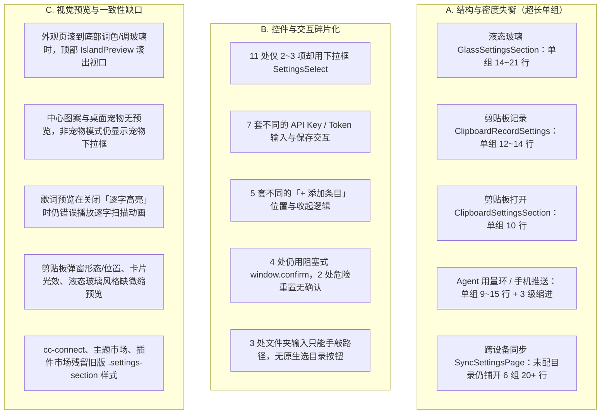
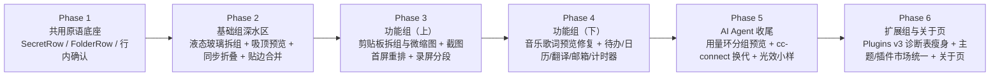

# 浮屿（Fuyu）设置窗口第 2 轮全网调研与全页优化设计计划

> **日期**：2026-11-17
> **问题**：全网调研主流现代桌面效率软件与平台设计规范，盘点浮屿当前全部 23 个侧边栏页面（共 50 个分类与子标签）的交互与视觉痛点，给出完整的设置窗口优化设计与分批实施计划。
> **搜索范围**：Apple macOS Human Interface Guidelines、Microsoft Windows 11 Fluent 2 设计规范、Nielsen Norman Group（NN/g）复杂设置渐进式披露研究、Raycast、Linear、Cursor、CleanShot X、Paste、Things 3，以及桌面刘海/灵动岛同类工具（Alcove、NotchNook、BoringNotch、DynamicLake）；并逐行审计本仓 `src/windows/settings/` 与 `src/features/*/` 下全部设置源码。
> **关联文档**：[第 1 轮设置窗口改版分析（2026-11-06）](settings-window-redesign.md) · [已确认的设置窗口约定](/docs/design/settings.md)

---

## 一、核心结论与五大设计准则

自 2026-11-06 第 1 轮改版确立「左侧可折叠分类栏 + 实时跨语言搜索 + 卡片外粗体组标题 + 即改即存」以来，浮屿的功能体量已快速增长至 **23 个侧边栏一级入口、50 个分类与子标签、260+ 个可检索设置行**。

底座方向（深色精细表面、1px 微对比描边、无保存按钮即时持久化、概览动态舞台）完全符合当代一线桌面工具水准；但在功能快速扩充过程中，出现了**单组超长行墙（最高 21 行）**、**7 套不同的密钥输入交互**、**5 套不同的列表新增方式**、**多处纯文字盲调缺少微缩预览**，以及**新旧两代插件/表单样式同页碰撞**等系统性摩擦。

结合全网标杆软件与人机交互研究，第 2 轮全量优化遵循以下 **五大设计准则**：

1. **单组 4～5 行上限与两级渐进披露（NN/g + Fluent 2）**
   - 单张 `SettingsGroup` 卡片原则上控制在 **2～5 行**；超过 6 行的长墙按「用户意图」拆组，或采用「预设卡片 + 可折叠高级微调」（如液态玻璃 21 项着色器参数、跨设备同步 8 项可选开关）。
   - 严守 **最多 2 层披露深度**（消灭目前 `agentPush` 中出现的 `indent={3}` 三级嵌套缩进）。
2. **视觉参数必配微缩预览，长页预览吸顶跟随（Alcove / CleanShot X / NotchNook）**
   - 凡涉及空间位置、窗口形态、动画、图案或光效的设置，提供微缩示意图卡片（`SettingsChoiceCards`）或行内实时小样，消灭「改数字 → 切出去看真岛 → 再切回来调」的盲调循环。
   - 外观页向下滚动调节底部色板或第 20 行玻璃参数时，顶部的 `<IslandPreview>` 自动收缩为**紧凑吸顶预览条（Sticky Mini Preview）**，始终可见。
3. **控件选型零歧义（Apple HIG + Linear / Raycast）**
   - **2～3 项互斥短词**：一律用分段按钮 `SettingsChoice`（全面清理录屏、位置、文件中转、关于页里的 2 项下拉菜单 `SettingsSelect`）。
   - **3～5 项并列条件开关**：合并为单行多选胶囊 `SettingsMultiChoice`（如贴边隐藏里连续 4 行「有待办/Agent/音乐/消息时不收起」合并为 1 行）。
   - **2～4 项空间/视觉布局**：一律用带缩略图的 `SettingsChoiceCards`。
   - **4 项以上纯文本枚举**：使用无外框 `SettingsSelect`。
4. **四大跨模块交互原语大一统（Raycast / Things 3 / Paste）**
   - **统一密钥凭据行 `<SettingsSecretRow>`**：收口全站 7 套碎片化的 API Key / Token 输入模式，支持已保存态原地覆盖替换（不必先点删除）、可选「测试连接」反馈、危险重置统一 4 秒行内二次确认，**全面淘汰阻塞式 `window.confirm`**。
   - **统一目录选择行 `<SettingsFolderRow>`**：收口路径输入框 +「选择文件夹…」原生对话框 +「在文件夹中显示」+「恢复默认」，补齐待办保存路径、数据目录、本地歌词目录只能手敲绝对路径的短板。
   - **统一列表增删与排序**：新增按钮统一右对齐 `<Plus /> 添加`，展开表单必配「取消」收起入口；拖拽排序列表补齐键盘上下移按钮（无障碍可达）；空列表必有空状态说明。
   - **统一页头与脚注**：多 Tab 功能页在父容器层共享同一个 `<FeatureHeader>`（避免切 Tab 闪烁或漏挂）；超过 1 句的组说明一律用 `<SettingsFootnote>` 收折为「了解更多」，消灭「把说明伪装成第一行假 `SettingsRow`」的反模式。
5. **抹平新旧两代 UI 容器断层**
   - 将残留在 `cc-connect`（位于 AI Agent › 提醒 › 推送与机器人下半页）、`themeMarket`、`market`、`CollapsedItemsSection` 中的旧版 `.settings-section.plugins-panel`、裸 `<SelectControl>` 与 `.plugin-card__button` 统一收敛到 `SettingsGroup` 视觉体系。（注：已冻结的第 2 版 `plugins` 页遵循仓库规则只修交互 bug，随 `E36.6` 下线自然退场。）

---

## 二、全网标杆软件与平台规范深度对标

| 参考对象 | 核心设置 UI 模式 | 对浮屿（Fuyu）的直接借鉴点 |
|---|---|---|
| **Apple macOS HIG（Settings）** | 左栏分类导航 + 右栏圆角分组表（Grouped Rows）；页面无保存按钮、即时生效；次要说明做卡片底注。 | 保持单组 2～5 行节奏，用字号与灰度（而非多档粗体）建立层级；清理把说明塞进组内假行的做法。 |
| **Windows 11 Fluent 2（`SettingsCard` / `SettingsExpander`）** | 基础单元为左「图标+标题+副文」右「控件」；复杂设置用 `SettingsExpander` 折叠展开子项，避免首屏满墙参数。 | 为「液态玻璃（21 行）」「可选同步项（8 行）」引入可折叠高级参数区，首屏只露预设与主开关。 |
| **Raycast** | 搜索直达具体命令与偏好；快捷键行内点击即录、带一键 `✕` 清空；扩展列表支持筛选与行内开关。 | 统一全站快捷键行的 `✕` 清空/停用能力（补齐翻译热键无法清空的问题），补全计时器页内热键入口。 |
| **Linear / Cursor** | 深色微对比阶梯表面（4%～10% 半透明白叠加 + 1px 细描边）；色彩只表达语义状态；全程键盘可操作。 | 给纯拖拽列表（音乐音源）补齐键盘排序；所有破坏性操作统一采用行内两步确认，彻底移除 `window.confirm`。 |
| **CleanShot X / Paste** | 按工作流阶段分 Tab（通用 / 截图 / 录屏 / 快捷键）；布局、贴图、剪贴板位置均配微缩示意图。 | 截图页把核心行为置顶、8 行快捷键下移或收紧；为剪贴板打开位置/宽窄双栏、截图卡片补上微缩示意图。 |
| **Alcove / NotchNook / BoringNotch / DynamicLake** | Alcove 极简克制、重动效实时预览；NotchNook 强调看板与文件中转；DynamicLake 功能极多导致开关拥挤。 | 浮屿功能广度已超 DynamicLake，必须用 **Alcove 式的微缩预览与预设先行** 抵消高密度配置带来的压迫感。 |
| **Nielsen Norman Group（渐进式披露）** | 披露层级超过 2 层会导致迷航率飙升；强默认值 + 任务导向预设能免去 80% 用户逐项调参的负担。 | 消除 `agentPush` 三层缩进；未开启父能力（如未设同步目录、未开岛上歌词）时收起下属无效细项并给就地开启入口。 |

---

## 三、全仓设置窗口现状诊断全景

基于 `src/features/plugin-kernel/settingsCategories.ts` 全量 23 个侧边栏入口的源码审计，当前核心摩擦归纳如下：

### 横向问题速查表

| 维度 | 现状统计 | 典型位置 | 优化对策 |
|---|---|---|---|
| **超长 `SettingsGroup`** | 9 处单组 ≥ 8 行（最高 21 行） | `GlassSettingsSection`、`ClipboardRecordSettings`、`UsageSettingsGroup`、`TuckSettingsSection` | 拆分为 3～5 行的意图分组；并列布尔项改 `SettingsMultiChoice`；低频微调进折叠区 |
| **控件错配** | 11 处 2～3 项仍用下拉框 | `RecordSettingsGroup`（连续 3 行 2 项下拉）、`PositionSettingsSection`、`ShelfSettingsPage`、`UpdateSettingsSection` | 统一改为分段选择 `SettingsChoice` 或缩略图卡片 `SettingsChoiceCards` |
| **密钥凭据碎片化** | 7 套不同写法 | 翻译 Key、GLM/Kimi Key、Bark Key（存后藏输入框）、本机接口（重置无确认）、邮箱、日历（URL 被设成 password）、cc-connect | 抽取共用 `<SettingsSecretRow>`，统一原地替换、状态徽章、可选测试与 4 秒确认 |
| **路径输入缺选择器** | 3 处纯手敲路径 | `DataHomeSection`（数据目录）、`SavePathSettingsSection`（待办目录）、`LyricsSettingsSection`（LRC 目录） | 抽取共用 `<SettingsFolderRow>`（路径框 + 选择文件夹 + 打开目录 + 恢复默认） |
| **未收折说明墙** | 24 处裸长文页脚 + 2 处假 `SettingsRow` | 快捷键各组、语音输入、翻译服务、剪贴板常用语/AI 提示词首行 | 统一改用 `<SettingsFootnote>`，删除伪装成设置行的纯文字说明 |

---

## 四、窗口外壳、概览与「基础」组优化设计

### 0. 共用底座先行（`src/components/settings/`）
在逐页改造前，先补齐 3 个高频复用原语，从根源防止各模块各自造轮子：
1. **`SettingsSecretRow`**：统一 API Key / 授权码 / Token 的输入（`password` 框 + 明文切换可选）、已保存状态提示（支持直接粘贴新值覆盖替换，不再像 Bark 那样必须先点清除）、可选「测试」动作，以及危险删除/重置的 4 秒行内确认。
2. **`SettingsFolderRow`**：统一目录展示、调用 Tauri `dialog` 选择文件夹、调用 `opener` 打开所在目录、恢复默认路径。
3. **`SettingsInlineConfirm`（或扩展 `SettingsLinkButton` 的 `confirmLabel`）**：把 `DataHomeSection`、`SettingsBackupSection`、`UpdateBackupsSection`、`SoundPacksGroup` 里的 4 处 `window.confirm` 全部替换为与关于页一致的 4 秒行内二次确认；为 `LocalApiSettings` 的「重置令牌」补上二次确认。

### 1. `overview` — 概览
- **现状痛点**：语言磁贴在仅中英 2 项时用了下拉框，与左侧深浅色分段按钮高度不一；`TimerCard` 在关闭时仍显示「设置 ›」，与其他功能卡（关闭时隐藏「设置 ›」）不一致；底部说明手写了 `.settings-group__footer`。
- **优化设计**：
  - `TimerCard` 对齐 `FeatureCard` 规则：仅开启时展示右下角「设置 ›」。
  - 底部说明改用标准 `<SettingsFootnote>`。

### 2. `general` — 通用（4 个 Tab）
- **`general`（启动与托盘）**：为 `TrayCardLayoutRow` 的 3 张骨架图补充强调色状态点细节；`SystemPermissionsSection` 页脚改用 `<SettingsFootnote>`。
- **`generalData`（数据与备份）**：
  - 将「数据文件夹」与「设置导入导出」拆成两个清晰的 `SettingsGroup`（消除单个卡片下叠放两条独立脚注的怪异排版）；
  - 数据目录接入 `<SettingsFolderRow>`，支持点击弹窗选文件夹，移除 `window.confirm`。
- **`generalSync`（跨设备同步）**：
  - **渐进式披露**：当尚未选择同步文件夹（`status.folder === null`）时，突出顶部的「同步状态 + 选择同步文件夹」引导卡，将下方的「同步内容」「可选同步项（8 行）」「已同步设备」收起或置为精简摘要，避免新用户一进来面对 6 组 20+ 行无从下手；
  - 将 `SyncOptionalSection` 的 8 行开关按「AI Agent / 界面布局 / 账号服务」分组或收进可展开折叠区；`SyncHelpSection`（4 行网盘静态说明）改为紧凑的可展开指南卡。
- **`generalApi`（本机接口）**：红色的「重新生成令牌」补上 4 秒行内二次确认；页脚接入 `<SettingsFootnote>`。

### 3. `appearance` — 外观（5 个 Tab）
- **跨 Tab 体验升级 —— 吸顶紧凑预览（Sticky Mini Preview）**：
  - 在 `theme`、`themeStyle`、`appearance` 三个长页面中，当页面向下滚动使顶部完整 `<IslandPreview>` 离开视口时，在面板顶栏下方吸顶浮现一条紧凑预览栏（左折叠小岛、右关键状态，可一键展开/收起），让用户在页面最底部调色或调玻璃折射时也能实时看到变化。
- **`themeStyle`（材质与圆角）—— 拆分全站最长的 21 行单组**：
  - 将 `GlassSettingsSection` 拆解为层次分明的 3 组：
    1. **玻璃预设与风格**：将 `look`（预设）与 `glassStyle`（静态 / 流动 / 极光 / 着色器）由文字下拉升级为带微缩材质色块的 `SettingsChoiceCards` + 总体强度滑块；
    2. **背景折射与色彩**：模糊、饱和度、噪点、颜色来源与取色器；
    3. **高光与可读性微调**（默认可收起为「高级光学参数」折叠区）：流速/团块、边缘高光、镜面高光、形变与对比度保护。
- **`appearance`（位置与尺寸）**：将窄列内的「显示在哪个屏幕（3 项）」与 macOS「菜单栏位置（2 项）」从下拉框改为直观的 `SettingsChoice`。
- **`appearanceCollapsed`（收起条项目）**：
  - **中心图案实时小样**：在 `CenterPatternSettingsGroup` 右侧或行内增加一块 32px 深色小岛胶囊实时预览当前选中的眼睛/波形/Codex 宠物动画与尺寸；
  - **条件显隐修复**：仅当中心图案选为 `"pet"` 时才缩进展示「桌面宠物」选择行（修复目前选「眼睛」时仍常驻显示无效宠物下拉框的 bug），并将裸 `SelectControl` 统一为 `SettingsSelect`；
  - 清理 `CollapsedItemsSection` 残留的旧版 `.plugin-pages__row` / `.plugin-card__button` 类名，页脚接入 `<SettingsFootnote>`。
- **`themeMarket`（主题市场）**：外层容器从旧版 `.settings-section.plugins-panel` 迁移到新版样式体系，顶部增加全部 / 深色 / 浅色胶囊筛选，底部说明改用 `<SettingsFootnote>`。

### 4. `behavior` — 行为（2 个 Tab）
- **`behavior`（展开与收起）**：`IslandMotionRow` 的 5 种开合曲线（弹簧 / 顺滑 / 快速 / Q 弹 / 无）由下拉框改为单排 `SettingsChoice`，点按即刻触发右侧预览盒回放对比，省去反复展开下拉菜单的操作；`GameModeSettingsSection` 页脚接入 `<SettingsFootnote>`。
- **`behaviorTuck`（贴边隐藏）**：将 `TuckSettingsSection` 里连续 4 行重复的缩进开关（有待办 / Agent / 音乐 / 未读消息时不收起）合并为 1 行 `<SettingsMultiChoice>` 多选胶囊，单组从 9 行精简至 5 行，一屏尽览。

### 5. `shortcuts` — 快捷键（3 个 Tab）
- **`shortcuts`（全局）**：
  - 补齐 `TranslationShortcutRows` 的 `✕` 清空/停用快捷键按钮，使全站所有全局热键录制行交互一致；
  - `VoiceInputShortcutGroup` 与 `TimerShortcutsSection` 补齐右上角 `<FeaturePageLink>` 跳转与未启用态 `<FeatureOffRow>`；
  - 6 个模块快捷键组的长页脚全部接入 `<SettingsFootnote>`。
- **`shortcutsIsland`（岛上）**：页脚接入 `<SettingsFootnote>`。
- **`shortcutsReference`（速查表）**：补充「剪贴板窗口键盘操作」（空格预览、`Alt+1~9`、筛选切换、回车粘贴）速查卡片，形成完整的双列键盘速查表。

---

## 五、「功能」组 10 页逐页优化设计

### 6. `todos` — 待办
- **去重与补齐按钮**：去掉 `TodoProjectsSection` 内与组标题重复的内层 `项目` 行标题；为「新建项目」输入框补上显式的 `<SettingsLinkButton>添加</SettingsLinkButton>`（保留回车提交，解决不按回车就丢内容的困惑）。
- **目录选择**：`SavePathSettingsSection` 接入 `<SettingsFolderRow>`，补齐「选择文件夹…」与「打开文件夹」按钮。

### 7. `calendar` — 日历
- **表单可控收起**：在 `CalendarSourcesSection` 中，当已有日历源且展开添加表单时，在提交按钮旁补上「取消」按钮以收起表单。
- **输入控件修复**：将 `.calendar-form` 内的裸 `<input>` 替换为标准 `<SettingsInput>`；修复 ICS 订阅链接被设为 `type="password"` 导致无法核对 URL 的问题（改为普通 URL 输入框或提供显隐切换，仅对 CalDAV 密码使用密码框）。

### 8. `music` — 音乐（3 个 Tab）
- **`music`（岛上显示）**：
  - 合并单行碎片卡片（将「收起条显示波形」与「贴边保持」合理归组）；
  - 为 `MusicSourceList` 拖拽行补上键盘可达的上移/下移小按钮，自定义播放器表单改用标准 `<SettingsInput>` + `<SettingsLinkButton>`，页脚接入 `<SettingsFootnote>`。
- **`musicLyrics`（歌词来源）**：本地 LRC 目录输入框升级为 `<SettingsFolderRow>`（支持弹窗选目录与一键打开目录）。
- **`musicLyricsStyle`（歌词样式）**：
  - **就地开启引导**：当未开启「岛上显示歌词」时，提供一键开启按钮而非仅一行冷冰冰的纯文字说明；
  - **修复预览失真**：当 `lyricsKaraoke === false` 时，`KaraokePreview` 真实渲染整句静态歌词与当前颜色模式，不再错误循环逐字扫描；
  - 将 10 行样式设置拆分为「逐字与模式」和「色彩与视觉效果」两组，页脚接入 `<SettingsFootnote>`。

### 9. `translation` — 翻译
- **凭据与连通性验证**：`TranslationSettingsSection` 接入 `<SettingsSecretRow>`，增加轻量「测试翻译」按钮（校验 Base URL / Model / Key 是否可用并原地给出状态反馈）；服务组页脚统一用 `<SettingsFootnote>`。

### 10. `clipboard` — 剪贴板（3 个 Tab）
- **`clipboard`（打开与粘贴）**：
  - 将 10 行长组拆分为 **「弹窗形态与位置」**（打开位置升级为与翻译页一致的双图 `SettingsChoiceCards`，弹窗定位与标准/双栏宽屏补充微缩示意图，含防截屏开关）与 **「粘贴与智能处理」**（自动粘贴、终端图片转路径、多行命令拍平、置顶收藏、复制提示卡）两组。
- **`clipboardHistory`（记录与链接）**：
  - 将 `ClipboardRecordSettings` 的 14 行大杂烩拆分为 **「采集内容」**（图片/OCR/文件/HTML）、**「隐私与过滤」**（密码管理器跳过、密钥遮罩与过期、排除应用、系统剪贴板联动）与 **「容量与保留期」**（条数上限、保留天数、单条体积、本机接口）三组；
  - 区分「链接书签导入导出」与底部「完整剪贴板历史导入导出」的文案与分组边界，消除同名混淆。
- **`clipboardSnippets`（常用语与提示词）**：
  - 移除组内第一行伪装成 `SettingsRow` 的说明文字，移入组脚注 `<SettingsFootnote>`；
  - 补充列表为空时的引导空状态；将右上角 14px 纯图标小加号升级为统一的 `<Plus /> 添加` 按钮；编辑某一条目时支持原位展开编辑或自动滚入视野。

### 11. `shelf` — 文件中转
- 将「双击项目」仅有的 2 个选项（打开文件 / 在文件夹中显示）从下拉框改为 `SettingsChoice`；清理组页脚接入 `<SettingsFootnote>`。

### 12. `screenshot` — 截图（2 个 Tab）
- **`screenshot`（截图）**：
  - **调整首屏主次顺序**：将真正高频调整的「截图体验与保存目录」（对齐辅助线、悬浮卡片停留时长、历史保留天数、保存文件夹）提到首屏顶部，8 行「快捷键」移至下方（并把长说明收进 `<SettingsFootnote>`）；为选区辅助线与截后预览卡补充简洁示意图。
- **`screenshotRecord`（录屏，Windows）**：
  - 将 `RecordSettingsGroup` 中连续 3 行仅 2 个选项的下拉框（格式 `MP4 / GIF`、帧率 `30 / 60 fps`、画质 `标准 / 高清`）全部升级为分段按钮 `SettingsChoice`，一屏直观切换。

### 13. `voiceInput` — 语音输入
- 快捷键组右上角补齐 `<AllShortcutsLink>`，两处长页脚接入 `<SettingsFootnote>`；在离线模型组旁补充麦克风权限/输入状态提示，方便排查无识别问题。

### 14. `behaviorAlerts` — 计时与提醒（2 个 Tab）
- **抽出共享页头**：消除 `timer/plugin/settings.tsx` 与 `BehaviorSettingsPage.tsx` 两处重复挂载 `<FeatureHeader feature="behaviorAlerts">` 导致的切 Tab 重挂载。
- **`timerAlerts`（计时与休息）**：
  - 在「计时器」组内补上「试听响铃」按钮（对齐 Agent 声音页体验），并把计时器全局快捷键直接展示在本页（支持跳转全部快捷键），避免只有计时器找不到热键。

### 15. `messages` — 消息（3 个 Tab）
- **`messagesIm`（QQ 与微信）**：优化微信状态动态副文案的排版样式，替代 ` ` 硬拼。
- **`messagesMail`（邮箱）**：
  - **修复空状态死代码**：移除外层 `mailboxes.length > 0` 门控，让开启邮箱但尚未绑定账号时正确展示「还没有添加邮箱」引导行；
  - 将 `+ 添加邮箱` 统一到右对齐操作位；`MailConnectForm` 改用标准 `<SettingsInput>`，并增加常见邮箱（QQ / 163 / Gmail / Outlook / 自定义）快捷自动填充 IMAP 地址，降低配置门槛。

---

## 六、「AI Agent」组、「扩展」组与「关于」页优化设计

### 16～19. `AI Agent` 分组（4 个侧栏子项）
在刚刚已完成的三轮重构中，`Agent`（顶部钩子状态卡 + 双列合并卡片网格 + 折叠未安装代理、回复标记三色胶囊与文件徽章、审批键帽）以及 `外观` / `提醒` / `SSH 远程` 的缩略图选择卡均已落地。全组剩余的深水区收口项共 4 处：
1. **用量环分组瘦身与微缩双环预览（`agentRings` → `UsageSettingsGroup.tsx`）**：
   - 目前 7 家提供商开关 + GLM/Kimi Key + 已用/剩余 + Anthropic 轮询与代理共 13 行平铺在一组内。拆分为 **「收起条用量双环」**（顶部附一枚微缩同心双环实时演示「已用 % vs 剩余 %」，下挂支持圆环显示的提供商及 `<SettingsSecretRow>`）与 **「悬停卡片附加余量 & 直连查询」** 两组。
2. **手机推送与 `cc-connect` 视觉统一（`agentPush`）**：
   - 将下半页 `CcConnectSection` 与 `CcConnectSetup` 从旧版 `.settings-section.plugins-panel` / 裸 `<input>` 迁移至新版 `SettingsGroup` 卡片体系，消除同页上下半场两代 UI 割裂；
   - Bark 设备 Key 接入 `<SettingsSecretRow>`（已保存时支持直接输入新 Key 替换）；简化 `CcConnectPushTargets` 的 `indent={3}` 三层嵌套为清晰的卡片式主机块。
3. **会话卡片光效预览（`agentSessions`）**：将 4 种卡片光效（关 / 粒子流苏 / 渐变带 / 流光边框）升级为带微缩发光示意的 `SettingsChoice` 或紧凑卡片；为隐藏会话目录规则补上「选择文件夹」按钮与空列表提示；桌面提醒的「额度提醒（4 项短百分比）」升级为 `SettingsChoice`。
4. **页脚收口**：将 `AgentProviderSwitches`、`AgentEditorExtensionSettings`、`AgentApprovalSettings` 第二组、`SoundPacksGroup`（去 `window.confirm`）、`SshTunnelSettings` 的裸页脚统一接入 `<SettingsFootnote>`。

### 20～22. `extensions` — 扩展组（3 个侧栏项）
- **`plugins`（第 2 版插件，已冻结）**：遵循 `AGENTS.md`「旧插件系统已冻结，只修 bug 不加新接口」规则，**仅修 1 个明显交互 bug**：`PluginDevSection.tsx` 在独立的「开发者」Tab 下最外层仍包着默认 `open=false` 的 `
`，导致切进 Tab 是一片空白折叠条，改为在独立 Tab 下默认展开；其余随 `E36.6` 下线一并移除。
- **`pluginsV3`（插件第 3 版）**：
  - 将页面内部自建的 `.plugins-v3__tabs-bar` 与全站顶层 `<SettingsTabs>` 视觉/交互对齐；
  - **9 列诊断表响应式收敛**：默认展示核心 5 列（插件、状态、CPU、启动耗时、错误），低频计数（服务/定时器/监听器/客户端）合并为紧凑摘要列或悬停/展开查看，彻底消除默认窗口宽度下的横向挤压；
  - 将底部连续堆叠的 3 段 `SettingsFootnote` 合并为结构化单段说明。
- **`market`（插件市场）**：将「排序（推荐 / 点赞最多）」从旧版裸 `<SelectControl>` 改为胶囊分段切换，外层容器逐步对齐 v3 卡片样式。

### 23. `about` — 关于页 & `FeatureOffPage` 关闭态页
- **`about`（关于）**：
  - 修复双栏工作台 `.about-workbench` 左栏半宽下的拥挤问题：将 `UpdateSettingsSection` 内的「提醒方式（2 项）」和「自动更新（3 项）」对齐同组的「更新通道」改为紧凑分段选择或优化窄列描述折行；`VersionHistory` 页脚接入 `<SettingsFootnote>`。
  - **严格保留已确认约定**：遵循 `docs/design/settings.md` 既有拍板结论，「退出浮屿」保持与托盘一致的一键直接退出，「重置所有设置」保持 4 秒二次确认；`FeatureOffPage` 保持「去概览 ›」引导而不重复放功能总开关（除非你希望改变这一决定，见第八节问题 4）。

---

## 七、分阶段实施路线图与验证规范

为保证多会话协作下零冲突、每批可独立回归验证、单文件严格不超过 400 行（TS/TSX）/ 500 行（CSS），计划拆分为 **6 个独立批次（Phase 1～Phase 6）** 推进：

| 阶段 | 包含范围 | 核心交付物 | 必跑验证 |
|---|---|---|---|
| **Phase 1：共用底座与全站轻量快赢** | `src/components/settings/` + 全站 2～3 项下拉改分段 + 24 处裸页脚改 `SettingsFootnote` + 移除 4 处 `window.confirm` | 新增 `SettingsSecretRow`、`SettingsFolderRow`、行内二次确认；录屏/文件中转/位置/快捷键页脚统一 | `pnpm check` + `pnpm build` + `pnpm test:regression settings settings-search` |
| **Phase 2：「基础」组体验升级** | `generalData`、`generalSync`、`generalApi`、`theme`、`themeStyle`、`appearanceCollapsed`、`behavior`、`behaviorTuck`、`shortcuts` | 液态玻璃 21 行拆 3 组 + 预设卡片；外观吸顶紧凑预览；中心图案实时动画小样与条件显隐；贴边 4 开关合并 `SettingsMultiChoice`；同步未配置态渐进折叠；剪贴板键盘速查表 | `pnpm settings:index` + `pnpm check` + `pnpm test:regression settings liquid-glass tucked-hover` |
| **Phase 3：「功能」组（剪贴板与截图）** | `clipboard`（3 Tab）、`screenshot`（2 Tab） | 剪贴板 10 行/14 行长墙拆组 + 弹窗形态/定位微缩示意图 + 常用语空状态与假行清理；截图行为置顶、热键下移 | `pnpm settings:index` + `pnpm check` + `pnpm test:regression settings clipboard screenshot` |
| **Phase 4：「功能」组（其余 8 页）** | `todos`、`calendar`、`music`（3 Tab）、`translation`、`shelf`、`voiceInput`、`behaviorAlerts`、`messages` | 待办/歌词目录选择器 + 新建项目按钮；日历取消按钮与 URL 明文修复；歌词非逐字预览修复与就地开启；翻译连通性测试；邮箱空状态修复与 IMAP 预设；计时器试听与页内热键 | `pnpm settings:index` + `pnpm check` + `pnpm test:regression settings calendar timer` |
| **Phase 5：「AI Agent」组收口** | `agentRings`、`agentPush`、`agentSessions`、`agentAlerts`、`cc-connect` | 用量环拆组与微缩双环预览；`CcConnectSection` / `CcConnectSetup` 迁移至 `SettingsGroup` 卡片体系；Bark Key 原地替换；卡片光效示意 | `pnpm settings:index` + `pnpm check` + `pnpm test:regression settings claude-usage onboarding-push` |
| **Phase 6：「扩展」组与「关于」页收尾** | `pluginsV3`、`themeMarket`、`market`、`pluginsDev`、`about` | `pluginsV3` 9 列诊断表精简为 5 核心列 + 顶栏对齐；`pluginsDev` 默认展开修复；主题市场筛选与容器统一；关于页窄列控件优化 | `pnpm settings:index` + `pnpm check` + `pnpm test:regression settings plugins-v3 version-history` |

> **实施铁律**：任何新增、删除或改名 `SettingsRow` 的批次，必须在同一次提交中运行 `pnpm settings:index` 同步更新 `src/windows/settings/searchIndex.json`，并通过浅色岛对比度检查（≥ 4.5:1 / 3:1）与 `prefers-reduced-motion` 检查。

---

## 八、待你拍板的 4 个设计取舍问题

阅读完方案后，你可以在页面各节旁点「批注」，或直接针对以下 4 个关键取舍拍板：

1. **外观页吸顶紧凑预览（Sticky Mini Preview）**：向下滚动调颜色或液态玻璃底部参数时，顶部 `<IslandPreview>` 自动缩成一条紧凑吸顶预览栏跟随滚动，是否采纳？
2. **液态玻璃 21 行拆分方式**：倾向于 **A. 直接拆成「预设与风格 / 背景折射 / 高光与微调」3 张常驻卡片**，还是 **B. 首屏只留「预设卡片 + 总体强度」，其余 18 项收进「自定义光学参数」折叠面板**？
3. **截图页首屏顺序**：当前截图页一打开首屏全是 8 行快捷键，保存目录和预览卡停留秒数被挤在最下面。把「截图体验与保存」提到首屏顶部、「快捷键」移到下方，是否同意？
4. **已关闭功能的占位页（`FeatureOffPage`）**：此前 D64 定的是「只在概览页放功能总开关，关闭态页面只放『去概览 ›』链接」。现在看，是否要维持现状，还是允许在 `FeatureOffPage` 上直接放一个「启用此功能」按钮省去跳回概览的一步？

---

## 九、参考来源

以下外部规范与标杆资料均于 **2026-11-17** 检索核实：

1. **Apple Developer** — *Human Interface Guidelines: Settings*：<https://developer.apple.com/design/human-interface-guidelines/settings>
2. **Microsoft Learn** — *Guidelines for app settings (Windows 11 / Fluent 2)*：<https://learn.microsoft.com/en-us/windows/apps/design/app-settings/guidelines-for-app-settings>
3. **Nielsen Norman Group (NN/g)** — *Progressive Disclosure*（Jakob Nielsen，最多两级披露层级与高阶选项延迟展示原则）：<https://www.nngroup.com/articles/progressive-disclosure/>
4. **Raycast Manual** — *Command Aliases and Hotkeys*（行内快捷键即时录制、清空与全局集中管理）：<https://manual.raycast.com/command-aliases-and-hotkeys>
5. **CleanShot X** — *Features & Preferences Design*（截图、贴图、录屏分模块偏好与视觉示意）：<https://cleanshot.com/features>
6. **Alcove** — *macOS Dynamic Island / Notch Utility*（克制型偏好设置与实时流体预览）：<https://tryalcove.com/>
7. **NotchNook** — *Lo.cafe Notch Dashboard & Shelf*（多模块看板与文件中转分组设计）：<https://lo.cafe/notchnook>
8. **BoringNotch** — *TheBoredTeam/boring.notch（GitHub 开源刘海岛参考）*：<https://github.com/TheBoredTeam/boring.notch>
