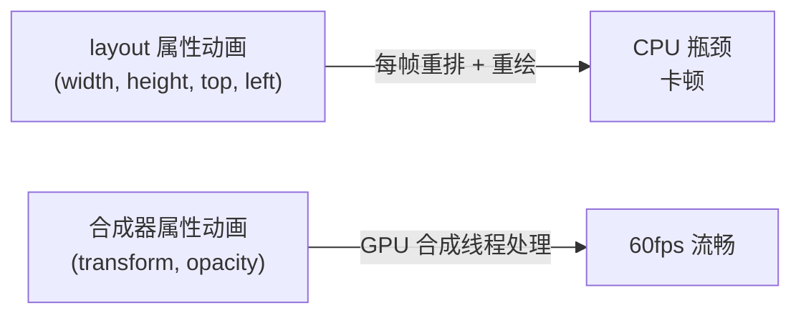

# Tauri 项目性能优化全面调研

> 调研时间：2026-11-17 | 适用版本：Tauri 2.x + Wry
> 更新：结合 [#746](https://github.com/TixXin/Fuyu/issues/746) 的实测数据补充了 GPU 进程内存、窗口生命周期和 `set_memory_usage_level` 局限性等内容

## 基线数据：Tauri vs Electron

| 指标 | Electron（典型值） | Tauri（典型值） | 差距 |
|---|---|---|---|
| 安装包体积 | 100–150+ MB | 2–15 MB | Tauri 小 90–95% |
| 空闲内存 | 150–300+ MB | 30–90 MB | Tauri 省 50–70% |
| 活跃内存（复杂应用） | 400–800+ MB | 150–350 MB | Tauri 约为一半 |
| 冷启动时间 | 1.5–3.0 s | 0.3–1.0 s | Tauri 快 2–3 倍 |

Tauri 的核心优势来自不捆绑 Chromium、使用系统原生 WebView（Windows 用 WebView2、macOS 用 WKWebView、Linux 用 WebKitGTK）和 Rust 后端的零开销抽象。

> [!IMPORTANT]
> 以上数据来自社区多个独立 benchmark，实际数值取决于前端框架复杂度、窗口数量和平台。Tauri 应用的内存大头仍然是 WebView 而非 Rust 进程。

---

## 一、内存优化

### 1.1 前端（WebView 侧）——最大的内存消耗者

| 手段 | 说明 |
|---|---|
| **虚拟滚动** | 长列表不渲染全部 DOM 节点，使用 `react-window`、`@tanstack/virtual` 等库，只渲染可视区域 |
| **依赖瘦身** | 用 `rollup-plugin-visualizer` 或 Vite visualizer 审计打包体积，去掉不用的 npm 包 |
| **内存泄漏检查** | 全局事件监听器、`setInterval`、RxJS/WebSocket 订阅、Zustand/Redux 状态在组件卸载时清理 |
| **DOM 操作节流** | 对窗口 resize 等高频事件做 debounce，避免布局抖动（Linux WebKitGTK 尤其敏感） |
| **Code Splitting** | 路由级和组件级懒加载（`React.lazy` + `Suspense`），首屏只加载核心代码 |

### 1.2 Rust 后端

```toml
# Cargo.toml —— 切换到低碎片分配器
[dependencies]
mimalloc = { version = "0.1", default-features = false }
```

```rust
// main.rs
#[global_allocator]
static GLOBAL: mimalloc::MiMalloc = mimalloc::MiMalloc;
```

| 手段 | 说明 |
|---|---|
| **mimalloc / jemalloc** | 替换系统分配器，降低长时间运行的基线内存和碎片化 |
| **减少 `.clone()`** | 大型 String / Vec / struct 尽量用引用和借用 |
| **预分配集合** | `Vec::with_capacity(n)` / `HashMap::with_capacity(n)` 避免反复 realloc |
| **IPC 数据不出 Rust** | 大数据集留在 Rust State 里，只向前端传轻量标识符或分页切片 |

### 1.3 WebView2 内存管理 API（Windows 专属，核心能力）

Wry 暴露了 `WebViewExtWindows` trait，可在应用进入后台/最小化/空闲时显式降低 WebView2 的内存目标级别：

```rust
use wry::WebViewExtWindows;

// 进入后台时：
#[cfg(target_os = "windows")]
webview.set_memory_usage_level(wry::MemoryUsageLevel::Low)?;

// 恢复前台时：
#[cfg(target_os = "windows")]
webview.set_memory_usage_level(wry::MemoryUsageLevel::Normal)?;
```

底层映射到 `ICoreWebView2_19::put_MemoryUsageTargetLevel`（WebView2 SDK 114+）：

| 级别 | 行为 |
|---|---|
| `Normal` | 默认，最大化性能，内存保持热状态 |
| `Low` | 尽力缩减内存，空闲页可能被交换到磁盘；脚本和网络仍可运行，但唤醒时有短暂页面换入延迟 |

> [!WARNING]
> **`set_memory_usage_level(Low)` 只影响 renderer 进程（JS heap 和 Blink 缓存），不影响 GPU 进程内存。** #746 实测证实：浮屿的 `webview_memory.rs` 实现了 `MemoryUsageTargetLevel::Low`，但 GPU 进程的 43 MB/窗口增量不受影响。要真正回收 GPU 内存，必须 `window.destroy()` 销毁窗口。
>
> `set_memory_usage_level(Low)` 与 `TrySuspend` 的区别：后者完全暂停渲染和脚本执行，前者保留后台脚本能力但释放 renderer 内存。微软建议不要同时使用两者。

### 1.4 多窗口内存管理（#746 实测数据）

Tauri 每个窗口拥有独立的 WebView 实例（包含完整的 JS 运行时、DOM 树和 GPU 上下文）。#746 在浮屿上的受控实测数据：

#### 窗口级内存增量（#746 实测，Windows 10，经典外观）

| 操作 | renderer 增量 | GPU 进程增量 | 全岛私有增量 |
|---|---|---|---|
| 打开设置窗口 | +53 MB | **+43 MB** | **+98 MB** |
| 关闭设置窗口（实际是 hide） | 0 | 0 | 0（一点不还） |

关键发现：
- **GPU 进程占全岛私有的比例稳定在 ~43%**，这个比例是结构性的
- 干净启动（2 窗口：main + tray-menu）：全岛 ~294 MB、GPU ~110 MB
- 运行 30 分钟后（5 窗口）：全岛 ~820 MB、GPU ~390 MB
- **内存跟着常驻窗口数量走，不是 idle 泄漏**：同一实例窗口数不变的 19 分钟内持平
- **周期性 GPU 尖峰**：约每 1–4 分钟出现一次 GPU +56–210 MB 的尖峰后回落，与毛玻璃外观无关，来源未查

#### 窗口生命周期策略

| 策略 | 适用场景 | GPU 内存回收 |
|---|---|---|
| **`window.destroy()` 销毁再重建** | 偶尔使用的窗口（如设置），冷启动代价小 | ✅ 完全回收（待 #746 验证） |
| **`navigate("about:blank")`** | 中间方案：保留窗口/renderer 进程但清空页面内容 | ⚠️ 可能释放页面纹理（待验证） |
| **`hide()` + 暂停前端** | 需要秒开的窗口，hide 后清理定时器/动画 | ❌ 不回收 |
| **`set_memory_usage_level(Low)`** | Windows 专属，配合 hide 使用 | ❌ 只降 renderer 堆，碰不到 GPU |
| **SPA 路由替代多窗口** | 把子视图做成同一个窗口内的路由面板 | ✅ 只用一个 WebView |

> [!IMPORTANT]
> 浮屿现状：所有窗口的"关闭"都拦截成了 `prevent_close()` + `hide()`（settings、tray-menu、translation、clipboard、clipboard-preview），webview 和 GPU 资源一直留着。translation 窗口已有 `window.destroy()` 路径（插件关闭时调用），可推广到其他窗口。

### 1.5 WebView 已知内存泄漏及规避

#### WebView2（Windows）
- 频繁在同域刷新页面会导致旧 JS 对象累积，渲染进程内存持续增长。规避：在重载前先 `navigate("about:blank")` 打断复用。
- 控件销毁后须显式 dispose，否则子进程残留。
- 保持 Evergreen 运行时更新，微软持续修补内存泄漏。

#### WKWebView（macOS）
- **最常见泄漏：`WKUserContentController` 循环引用。** `userContentController.add(self, name:)` 会让 VC 和 WebView 互相强引用，永远不会释放。规避：在 `viewWillDisappear` 中 `removeScriptMessageHandler`，或用弱引用代理。
- 多个 WKWebView 实例不会被 WebKit 主动回收。规避：复用 WebView 池，不用时 `loadHTMLString("", baseURL: nil)` 清空。

---

## 二、GPU 占用优化

### 2.1 按平台控制硬件加速

#### Windows（WebView2 / Chromium）

```rust
// main.rs —— 完全关闭 GPU 硬件加速
#[cfg(target_os = "windows")]
std::env::set_var(
    "WEBVIEW2_ADDITIONAL_BROWSER_ARGUMENTS",
    "--disable-gpu",
);
```

关闭 GPU 后回退到 CPU 软件渲染，会增加 CPU 负载但解决显卡驱动兼容性问题。可选的精细化参数：

| 参数 | 效果 |
|---|---|
| `--disable-gpu` | 完全关闭 GPU |
| `--disable-gpu-compositing` | 只关合成 |
| `--enable-logging` | 配合诊断 WebView2 GPU 日志 |

#### Linux（WebKitGTK）

```rust
// NVIDIA/Wayland 崩溃修复（推荐）
#[cfg(target_os = "linux")]
std::env::set_var("WEBKIT_DISABLE_DMABUF_RENDERER", "1");

// 完全关闭合成加速（极端情况）
#[cfg(target_os = "linux")]
std::env::set_var("WEBKIT_DISABLE_COMPOSITING_MODE", "1");
```

#### macOS（WKWebView）

Apple 在 OS 层面管理 GPU 加速，WKWebView 没有直接的关闭开关。优化方向是在渲染侧减少 GPU 层（见 2.2）。

### 2.2 CSS 动画与 GPU 层优化

WebView 中 GPU 性能的核心原则：**只用合成器属性做动画。**



| 优化规则 | 细节 |
|---|---|
| **只动 `transform` 和 `opacity`** | 把 width/height 变化转成 `scale()`，位移用 `translate()` |
| **谨慎使用 `will-change`** | 只给真正要动画的元素加 `will-change: transform`，不滥用 |
| **动画结束后移除** | 动画完成后移除 `will-change` 或动画 class，让 WebView 回收 GPU 层 |
| **避免大面积 `blur()`** | 大元素的 CSS blur 消耗大量 GPU 显存 |
| **避免 `translateZ(0)` hack 泛滥** | 只在确实需要强制 GPU 层提升时使用 |

> [!WARNING]
> 过度使用 `will-change` 会让 GPU 为太多元素分配独立层，反而导致显存耗尽和性能下降。在 Tauri 的原生 WebView 中尤其容易触发。

### 2.3 透明窗口的 GPU 额外开销

透明窗口（`transparent: true`）需要 GPU 维护 alpha 合成 surface。#746 实测发现浮屿 7 个窗口中除 settings 外全部设置了 `transparent: true`。但 settings（不透明）打开后 GPU 仍增长 43 MB，说明：
- **不透明窗口也要占 GPU surface**，透明只是锦上添霜
- 毛玻璃外观（`liquidGlass` + 壁纸纹理 + 多道合成）仅值约 **27 MB** GPU 增量，远非想象中的主因

### 2.4 各平台 GPU 动画差异

| 平台 | 注意点 |
|---|---|
| **macOS (WKWebView)** | WebKit 的层合成和 120Hz ProMotion 有内部节流，动画完成后必须清理 `will-change` |
| **Windows (WebView2)** | 继承 Chromium 的 GPU 加速，一般表现好；但虚拟机或老旧显卡驱动可能回退软件渲染 |
| **Linux (WebKitGTK)** | NVIDIA + Wayland 组合最容易出 GPU 问题，推荐先关 DMABUF 再排查 |

---

## 三、IPC 通信优化

IPC 是 Tauri 前后端桥梁，每次 `invoke()` 都涉及 JSON 序列化、上下文切换和反序列化。

### 3.1 批量化命令

```typescript
// ❌ 100 次 IPC 往返
for (const item of items) {
  await invoke('save_item', { item });
}

// ✅ 1 次 IPC 往返
await invoke('save_items_batch', { items });
```

### 3.2 事件节流与缓冲

| 策略 | 说明 |
|---|---|
| **Rust 端攒批发送** | 用 `tokio::time::interval(100ms)` 累积变更，定期 flush 给前端，不逐条 emit |
| **前端 RAF 消费** | 收到高频事件后存入缓冲区，在 `requestAnimationFrame` 中统一渲染 |
| **窗口级事件过滤** | 多窗口时，用 `emit_to` 而非全局 `emit`，避免事件广播到每个 WebView |

### 3.3 大数据走自定义协议

标准 `invoke` 传大二进制（图片、文件）会产生巨大 JSON 开销。用 `register_uri_scheme_protocol` 注册自定义 URI 协议，让 WebView 通过标准 fetch 直接获取二进制数据，绕过 JSON-RPC 序列化。

### 3.4 异步命令

```rust
// ❌ 同步命令阻塞主线程
#[tauri::command]
fn heavy_work() -> String { /* ... */ }

// ✅ 异步 + 线程池
#[tauri::command]
async fn heavy_work() -> Result<String, String> {
    tokio::task::spawn_blocking(|| {
        // CPU 密集工作
        Ok("done".into())
    }).await.map_err(|e| e.to_string())?
}
```

---

## 四、启动速度优化

### 4.1 Splash Screen 遮掩冷启动

```json
{
  "app": {
    "windows": [
      { "label": "main", "visible": false },
      {
        "label": "splashscreen",
        "decorations": false,
        "transparent": true,
        "url": "splashscreen.html"
      }
    ]
  }
}
```

前端 hydrate 完成后通过 `invoke` 通知 Rust 关闭 splash、显示主窗口。

### 4.2 Rust 端延迟初始化

```rust
tauri::Builder::default()
    .setup(|app| {
        let handle = app.handle().clone();
        tauri::async_runtime::spawn(async move {
            // 数据库连接、网络检查等重活放到这里
            // 不阻塞窗口创建
        });
        Ok(())
    })
```

### 4.3 前端 Bundle 优化

| 手段 | 效果 |
|---|---|
| 路由级 Code Splitting | 首屏只加载核心代码 |
| Tree Shaking（Vite 生产模式） | 去除死代码 |
| 内联关键 CSS | 避免 CSS-in-JS 阻塞首次绘制 |
| 字体子集化 | 只包含使用的字符和字重 |
| 图片转 WebP/AVIF | 减少静态资源体积 |

---

## 五、二进制体积优化

### 5.1 Rust 编译配置

```toml
[profile.release]
opt-level = "s"      # 优化体积（"z" 更激进；"3" 侧重速度）
lto = true           # 链接时优化，跨 crate 消除死代码
codegen-units = 1    # 最大化 LTO 效果（增加编译时间）
panic = "abort"      # 去掉 unwinding 代码
strip = true         # 去掉调试符号，立减 20–30%
```

> [!NOTE]
> `opt-level = "s"` 和 `"z"` 哪个更小取决于具体项目，建议都试一遍比较。`panic = "abort"` 会让 `catch_unwind` 失效，使用前确认没有依赖它。

### 5.2 依赖审计

```bash
cargo install cargo-bloat
cargo bloat --release --crates    # 找出占空间最大的 crate
```

- 关闭 crate 的 `default-features`，只启用需要的 feature
- 用轻量替代品替换大型多功能库

### 5.3 前端资源压缩

- Vite 生产模式 minify + tree shake
- 图片转 WebP/AVIF
- 字体 subset

### 5.4 高级压缩（可选）

```bash
upx --best --lzma target/release/my-app
```

> [!CAUTION]
> UPX 压缩后的 exe 可能被杀毒软件误报。在 Windows Defender / macOS Gatekeeper 上充分测试。

---

## 六、功耗与电池优化

对于常驻后台的桌面工具（如浮屿），空闲功耗直接影响用户体验。

### 6.1 前端空闲暂停

```javascript
document.addEventListener("visibilitychange", () => {
  if (document.hidden) {
    // 暂停：清除 setInterval、停止 CSS 动画、断开 WebSocket 心跳
    // animation-play-state: paused
  } else {
    // 恢复
  }
});
```

### 6.2 Rust 后台任务

```rust
// ❌ 忙等（吃满一个 CPU 核心）
loop { if check() { break; } }

// ✅ 异步等待（近零 CPU）
tokio::select! {
    _ = notify.notified() => { /* 处理 */ }
}
```

### 6.3 窗口生命周期

- 最小化到托盘时暂停所有前端渲染循环
- 隐藏的窗口调用 `set_memory_usage_level(Low)`（Windows）
- 多窗口应用：不用的窗口 close 而非 hide

---

## 七、诊断与度量工具

| 工具 | 用途 |
|---|---|
| Chrome/WebKit DevTools（`tauri dev` 模式） | 前端 Heap Snapshot、Performance Timeline、内存泄漏检测 |
| `cargo-bloat` | Rust 二进制各 crate 占用分析 |
| `rollup-plugin-visualizer` | 前端 JS Bundle 分析 |
| `cargo flamegraph` | Rust CPU 热点分析 |
| `tokio-console` | 异步任务运行状态监控 |
| Activity Monitor / Task Manager | 系统级 CPU、内存、GPU 占用实时观察 |
| WebView2 Browser Task Manager（`Ctrl+Shift+I`） | 识别 WebView2 内部哪个进程/frame 消耗资源 |

---

## 八、Fuyu 现状与可操作项

综合以上调研和 #746 的实测数据，以下是浮屿项目可以考虑的优化方向：

### 已具备的优势
- Rust 后端 + 系统 WebView，天然比 Electron 轻量
- 多窗口架构已区分常驻（hide）和按需创建（`create: false`）
- Release profile 已配置 `opt-level`、`lto`、`strip`
- `webview_memory.rs` 已实现 `MemoryUsageTargetLevel::Low`（虽然有局限）
- translation 窗口已有 `window.destroy()` 路径可供参考

### 可探索的优化项

| 优先级 | 项目 | 预期收益 | 相关 issue |
|---|---|---|---|
| 🔴 高 | **窗口按需创建、空闲后 `destroy()`**：设置窗口关闭后改 `destroy()` 而非 `hide()`，下次按需重建 | 每窗口回收 ~100 MB（含 ~43 MB GPU） | #258 (D50)、#746 |
| 🔴 高 | 隐藏窗口的前端用 `visibilitychange` 暂停定时器和动画 | 空闲 CPU 和 GPU 大幅下降 | |
| 🔴 高 | 验证 `navigate("about:blank")` 对 GPU 内存的回收效果 | 若有效，可作为 destroy 的轻量替代 | #746 待验证 |
| 🟡 中 | 排查周期性 GPU 尖峰来源（+56–210 MB，每 1–4 分钟一次） | 消除不可预测的内存波动 | #746 |
| 🟡 中 | Windows 上对真正需要常驻的隐藏窗口调 `set_memory_usage_level(Low)` | renderer 侧的 JS heap 下降（GPU 不受影响） | |
| 🟡 中 | 审计 npm 依赖体积（`rollup-plugin-visualizer`） | 减少首屏加载和 JS 堆 | |
| 🟡 中 | 审计 Rust 依赖（`cargo-bloat`），关闭不需要的 feature | 减小二进制 | |
| 🟡 中 | IPC 高频事件攒批（如窗口 resize、agent status 轮询） | 减少 IPC 开销 | |
| 🟢 低 | 切换到 mimalloc / jemalloc | 长期运行降低内存碎片 | |
| 🟢 低 | CSS 动画全面迁移到 `transform`/`opacity`（已有 motion 体系） | GPU 层更高效 | |
| 🟢 低 | 评估减少透明窗口数量的可能性 | 减少 GPU alpha 合成 surface 开销 | #746 |
