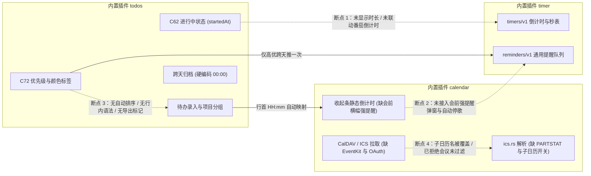
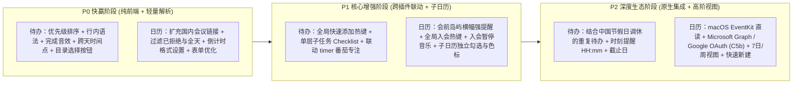

# 浮屿（Fuyu）待办与日历功能演进及设置项扩充调研报告

> 日期：2026-11-17
> 问题：用户反馈浮屿当前的「待办」与「日历」功能偏单薄、设置页几乎没有可配项（「待办和日历的功能太少了，设置里没啥选项」），需对标桌面端与菜单栏 / 灵动岛标杆产品，系统梳理功能差距并给出功能扩充与设置页重设计方案。
> 搜索范围：Cultured Code（Things 3 官方文档）、TickTick（滴答清单）、Todoist、Raycast（Apple Reminders & Focus）、NotchNook、DynamicLake、Dato、Itsycal、MeetingBar（GitHub `leits/MeetingBar`）、Meeter、Fantastical、Notion Calendar 官方文档，Apple EventKit 与 Microsoft Graph / WinRT `AppointmentStore` 开发文档，以及本仓库 `src/features/todos/`、`src/features/calendar/`、`src-tauri/src/calendar/`、`src-tauri/src/todos/` 源码与设计文档。
> 关联文档与任务：[docs/design/todos.md](../design/todos.md)、[docs/features/todo-tags.md](../features/todo-tags.md)、[docs/features/calendar.md](../features/calendar.md)、[docs/features/timer.md](../features/timer.md)、[docs/research/settings-window-redesign-v2.md](settings-window-redesign-v2.md)、[C5b](../tasks/C/C5b.md)

---

## 一、核心结论与优先级建议

浮屿现有的待办与日历在**视觉克制**与**中文特色底座**（岛内自绘月历、农历二十四节气、法定调休角标、以时间开头的待办自动变为会议倒计时）上已经打下了好底子，但之所以给人「功能太少、设置里没啥选项」的强烈落差，根源在于**停留在「能记、能看」的最小闭环，缺少高频效率工具在「捕获 → 排序组织 → 专注执行 → 提醒降噪 → 个性化偏好」五个环节的控制力**：

1. **设置页配置密度严重失衡**：对比剪贴板（3 个 Tab、二十余项开关与策略）和歌词（3 个 Tab、十余项视觉与来源控制），当前「设置 → 待办」仅有 **4 个开关 + 项目列表 + 手敲保存路径**，「设置 → 日历」在账号列表之外更是**只有 1 个下拉框 + 1 个标题开关（共 2 项配置）**。用户遇到「熬夜过零点待办被强制翻篇」「已拒绝的会议还在岛上倒计时」「想按优先级自动排在前面」「想调倒计时格式或关掉全天日程」等日常痛点时，打开设置页找不到任何开关。
2. **待办「有标签无调度、有开始无计时、缺全局入口」**：C72 虽然补上了悬停红/黄/灰优先级旗子与 6 色圆点，但**不能按优先级排序或筛选**，输入框也不认 `!1` / `明天` 等行内语法；点「开始」虽然在数据里记下了 `startedAt`，却既不显示已专注时长，也没和内置 `timer` 插件联动；更缺少桌面端最刚需的**全局「快速添加待办」热键**、**单层子任务（Checklist）**、**重复规则**与**跨天结算时间（如凌晨 04:00）**。
3. **日历「接入重、过滤少、提醒弱」**：添加日历仍停留在手工复制 CalDAV 专用密码或私密 ICS 链接（macOS 用户明明系统日历已登录却无法通过 `EventKit` 一键直读；企业 Microsoft 365 / Google Workspace 常禁公开 ICS 链接）；CalDAV 账号下的多个子日历（会议室、同事共享日历）被强行合并且无法按子日历开关或着色；`ics.rs` 未过滤已拒绝（`PARTSTAT=DECLINED`）和空闲（`TRANSP:TRANSPARENT`）日程；`meeting_link.rs` 漏掉了腾讯会议 `/s/` 短链与企业微信会议等常见链接；会前只有收起条静态文字，缺少**岛屿横幅强提醒**与**一键入会全局快捷键**。

### 最高投资回报率（ROI）扩充抓手速览

| 模块 | 痛点象限 | 最值得优先落地的核心能力 | 为什么高 ROI（浮屿独特优势） |
|---|---|---|---|
| **待办** | 捕获与排序 | **全局快速添加快捷键** + 行内轻语法（`#项目` `!1` `明天` `15:00`）+ **按优先级自动排序** | 复用现有快捷键框架与 `tags.ts` / `todoEvents.ts`，零重型界面负担即可让录入速度翻倍 |
| **待办** | 执行与反馈 | **「进行中」显示已专注时长** + 一键联动 `timer` 开启番茄倒计时 + **完成轻音效** + **自定义跨天时间（00:00–06:00）** | `TodoItem.startedAt` 和 `timers/v1`、`reminders/v1` 服务均已就绪，打通内部插件即可闭环 |
| **待办** | 结构与复盘 | **单层子任务（Checklist）** + **结合法定节假日调休的重复待办**（工作日自动含补班、跳放假） | 浮屿自带 1900–2100 农历节气与中国调休日历，比海外待办软件更懂中国「工作日」 |
| **日历** | 降噪与过滤 | **子日历独立勾选与色标** + **过滤已拒绝（`DECLINED`）/ 空闲 / 全天日程** | 仅需扩充 `ics.rs` 属性解析与 `calendar-sources.json` 子日历元数据，立竿见影消除日历刷屏 |
| **日历** | 会议必达 | **扩充国内外会议链接库**（补齐腾讯 `/s/`、企微会议、华为云等）+ **会前岛屿横幅强提醒** + **全局一键入会热键** | 复用通用提醒队列 `reminders/v1` 与全屏免打扰检测，正面追平 Dato / MeetingBar 核心体验 |
| **日历** | 无感接入 | **macOS `EventKit` 原生日历零配置直读** + **Microsoft Graph / Google OAuth 授权**（承接 `C5b`） | 彻底省去用户找 App 专用密码和私密 ICS 地址的高流失步骤 |

---

## 二、标杆产品深度对标分析

### 2.1 待办与每日笔记标杆对标

桌面端与灵动岛形态下的待办工具分化为两类：**经典桌面 GTD 标杆**（Things 3、滴答清单 TickTick、Todoist）与**轻量悬浮/命令栏标杆**（Raycast Reminders、NotchNook、DynamicLake）。对浮屿而言，面板高度（约 306–404px）决定了它绝不能做成多层级项目管理软件，而应汲取标杆产品中**「极速捕获、清晰分层、即时专注反馈」**的设计精髓。

| 维度 | Things 3 [1][3][4] | 滴答清单 TickTick [7][8] | Todoist [9][10] | Raycast Reminders & Focus [11][12] | NotchNook / DynamicLake [13][14] | 对浮屿的启示 |
|---|---|---|---|---|---|---|
| **全局快速捕获** | 双全局热键：`Quick Entry` 与 `Quick Entry with Autofill`（自动抓取当前网页/邮件标题与深链写入备注）[4][5] | 全局快捷键唤出速记条、剪贴板自动识别创建任务、桌面常驻小组件 | 全局 `Quick Add` 悬浮框，输入即解析全部属性 [9] | 全局命令 `Quick Add Reminder`，键盘流零鼠标完成创建 [11] | 悬停或点开刘海直接输入，无独立全局录入窗 [13] | **必做全局快速添加热键**，展开岛并聚焦输入框（可选带入选中文本/剪贴板链接） |
| **行内自然语言解析** | 日期栏支持自然语言输入，标题与属性分区清晰 [3] | 支持中文日期/时间（「明天下午三点开会」）、`#标签`、`!优先级` 自动高亮提取 | 行业标杆：单行同时解析日期、循环（`every weekday`）、`#项目`、`p1`–`p4` [9] | 支持 `#列表名` 与自然语言时间 [11] | 纯文本标题，无语法解析 | 不做重型 NLP，**做确定性的行内标记解析**：`#项目`（已有）+ `!1/!2/!3` + `@明天/周X` + `HH:mm` |
| **时间模型** | 严格区分 **Start Date（何时出现在今天）**、**This Evening（今晚）**、**Deadline（硬截止日）** 与具体时刻提醒 [3][6] | 开始日期/时间段、截止日期、多档提前提醒、艾森豪威尔四象限 | 截止日期 + 具体时刻 + 截止期限（Deadline）+ 周期循环 [9] | 到期日 + 具体时刻提醒，最近一条直接显示在菜单栏倒计时 [11] | 仅今日平面列表与收藏置顶 [13] | 保留现有「计划日期」，补齐 **时刻提醒（`HH:mm`）**、**「今晚」分段**与**截止日提示** |
| **子任务与备注** | 任务卡片内展开 **Checklist（检查项）** 与 Markdown 备注，列表行仅显示微缩进度点 [1] | 支持子任务树或检查项列表 + 富文本描述 | 支持无限层级子任务与评论附件 [9] | 支持备注与 URL 附件，无复杂层级 [11] | 单层简短待办 + 独立速记板（Notes）[13] | 采用 Things 3 思路：**只做单层 Checklist + 简短备注**，折叠态行右侧仅显示 `2/4` 计数 |
| **专注与计时联动** | 无内置番茄钟，靠第三方 URL Scheme 联动 [4] | **原生绑定番茄钟与正计时**，点任务直接开启专注并累计专注时长、带白噪音 [7] | 无原生番茄钟，靠第三方集成 [9] | `Raycast Focus` 设定专注目标并屏蔽干扰应用，菜单栏显示倒计时 [12] | 内置独立计时转盘与番茄钟组件，但与待办弱耦合 [13] | 浮屿已有内置 `timer` 插件和 `startedAt` 字段，**天然适合做成滴答清单式的「点开始即联动专注计时」** |
| **设置项丰富度** | 精炼但关键：快速录入热键、带入内容开关、已完成归档时机（立即/每日）、角标计数口径（全部今日/仅紧急）、日历事件并入今日视图 | 极丰富：模块显隐开关、默认优先级/日期、新任务置顶或置底、完成提示音、顺延策略、智能列表规则 | 清晰：默认视图、智能日期识别开关、完成音效开关、提醒提前量、主题色与快捷键 [10] | 按扩展配置：菜单栏显示口径、提前提醒窗口、勾选完成交互 [11] | 基础外观、自动归档与权限引导 [13] | 补齐**录入偏好、排序与分组、跨天结算点、完成音效、专注联动、归档清理**六类高频设置 |

### 2.2 菜单栏与灵动岛日历标杆对标

菜单栏与刘海日历的核心使命不是替代完整的网页端企业日历排期，而是解决**「一眼看清接下来干什么」**和**「绝不错过下一场会、一秒进会」**。在此赛道，**Dato**（Sindre Sorhus）、**MeetingBar**（开源，截至 2026-11-17 GitHub 5,405 stars [18]）与 **Itsycal**（开源，截至 2026-11-17 GitHub 4,054 stars [17]）定义了轻量级菜单栏日历的黄金标准（注：早期知名同类应用 **Meeter** 被 Bardeen 收购后现已停服下架，官网 `trymeeter.com` 返回 502、App Store 已移除，其用户群主要迁移至 MeetingBar 与 Dato）。**Fantastical** 与 **Notion Calendar** 则代表了多日历上下文切换与键盘流效率的天花板。

| 维度 | Dato [15][16] | MeetingBar [18] & Itsycal [17] | Fantastical [19][20][21] | Notion Calendar [22][23] | 对浮屿的启示 |
|---|---|---|---|---|---|
| **日历源接入方式** | 直接读取 macOS `EventKit`（零密码配置，复用系统已登录的 iCloud / Google / Exchange / CalDAV）[15][24] | 均基于 macOS `EventKit`；MeetingBar 另支持 Google OAuth 直连 [17][18] | 原生账号直连（Google / Microsoft 365 OAuth / iCloud / CalDAV）+ 系统日历 [19] | Google 与 Microsoft/Outlook OAuth 原生直连 + iCloud [22] | **macOS 端应优先补上 `EventKit` 直读**；跨端补齐 **Microsoft Graph / Google OAuth**，保留现有 CalDAV/ICS 供飞书/钉钉/企微使用 |
| **子日历与场景切换** | 支持逐个勾选要显示的日历、事件去重、按日历颜色标记 [15][16] | 支持勾选参与菜单栏倒计时的特定日历（例如排除「同事请假」日历）[17][18] | 招牌 **Calendar Sets（日历集）**：一键或按快捷键切换「工作 / 个人 / 全部」日历组合 [20] | 左侧日历树单独控制显隐与颜色，支持隐藏特定日历的菜单栏提醒 [23] | 改变当前「一个账号一锅端」做法，**支持子日历单独勾选启用、保留日历颜色，并可单独指定哪些日历参与会前倒计时** |
| **视频会议识别与入会** | 自动识别 Zoom / Meet / Teams / Webex 等几十种会议链接，支持全局热键直接入会 [15][16] | MeetingBar 内置 **50+ 视频会议服务正则** + **用户自定义正则** + 可指定打开浏览器或原生客户端（如直接唤起 Zoom 客户端而非开浏览器空白标签）[18] | 自动识别主流视频会议并在菜单栏与通知上提供 Join 按钮 [19] | 自动提取会议链接，提供系统级 **「Join meeting」全局热键** [23] | **补齐国内高频链接变体**（腾讯 `/s/`、企微会议、华为云等）+ 支持优先唤起原生协议 + **新增全局「一键入会」热键** |
| **会前强提醒与防漏会** | 招牌 **全屏强提醒（Fullscreen Notification）**，共享屏幕/录屏时自动静默，支持会前自动打开链接 [15][16] | MeetingBar 支持会前 N 分钟全屏/视觉强提醒、声音提醒、会前自动打开会议链接、入会时自动执行脚本（如暂停音乐）[18] | 多级提醒通知，带交互式推迟（Snooze）与直接入会按钮 [19] | 菜单栏实时倒计时 + 桌面提醒通知 [23] | 浮屿无需粗暴全屏遮挡，**用岛屿展开式强提醒横幅（接入 `reminders/v1`）+ 可选提示音 + 入会时自动暂停媒体播放**，体验更优雅且不打断演示 |
| **日程降噪过滤** | 隐藏全天日程、隐藏已拒绝（Declined）日程、隐藏无参会人的个人时间块、同名去重 [16] | 过滤全天日程、过滤未接受/已拒绝日程、仅对含会议链接的日程倒计时 [17][18] | 按参与状态、全天属性、日历集精细过滤 [20] | 菜单栏设置可独立开关「是否包含全天事件」「显示未来几天」[23] | **必加三项过滤开关**：隐藏已拒绝日程（`PARTSTAT=DECLINED`）、收起条倒计时仅限含会议链接或忙态日程、日历列表折叠/隐藏全天日程 |
| **菜单栏/岛上倒计时定制** | 高度可配：截断字数、显示剩余时间或开始时刻、进行中显示剩余结束时间、多时区世界时钟 [15][16] | 定制标题最大长度、时间格式（`in 8m` / `14:00` / 仅图标）、屏幕共享脱敏模式 [18] | 菜单栏显示下一场会议倒计时及时间 [19] | 可开关是否显示事件标题、调整提前显示窗口 [23] | 扩充 `CalendarSettingsPage`：支持**倒计时文案格式**、**标题最大字数**、**开会后保留时长（5 分钟 / 直至结束）** |
| **快速新建与多日视图** | 菜单栏内查看多日议程 + 月历周数 + 快速新建日程 [16] | Itsycal 支持月历显示周数（ISO Week）、高亮周末、快速新建事件并设提醒 [17] | 招牌自然语言一句话建日程（`周五 15:00 产品评审 /工作`）[21] | 菜单栏展开多日时间流，主应用提供极速键盘流周视图 [22] | 日历面板增加**「今明两天 / 未来 7 天 / 紧凑周视图」切换**、月历可选显示**周数**、点击日程看详情，以及快速新建日程 |

---

## 三、浮屿现状盘点与能力差距诊断

通过对 `src/features/todos/`、`src-tauri/src/todos/`、`src/features/calendar/` 与 `src-tauri/src/calendar/` 的源码审计，可以将浮屿当前已实现底座与核心缺口精准对照如下。

### 3.1 待办模块现状与差距（`src/features/todos/`）

- **已实现能力盘点**：
  - **四视图胶囊框架**（`TodoIslandHeader.tsx`、`TodoIslandPage.tsx`）：`今天 N`、`笔记`、`已安排 N`（仅在有计划待办时显示）、`归档`（按月分组，支持点进单日只读回看），右上角显示 `今天完成 X/Y` 细进度条与 `⋯` 菜单（保存 Markdown、清除已完成）。
  - **项目与日期选择**（`TodoIslandTasks.tsx`、`TodoDateCalendar.tsx`）：支持行首 `#项目名` 识别与持久化项目列表（`todoProjects`，默认未归类称「临时」），输入框内嵌项目选择下拉与岛内自绘月历（C61，支持键盘方向键与「今天 / 明天 / 下周一」快捷按钮）。
  - **优先级、颜色与高优跨天提醒**（`TodoTagMenu.tsx`、`dueReminders.ts`，C72）：每行悬停显示小旗子菜单，可设 `high` / `medium` / `low` 三档优先级与 6 种颜色圆点；高优先级的计划待办在跨天移入今日列表时，会向通用提醒队列发送一次 `todo-due` 到期提醒。
  - **多项进行中与收起条轮播**（`activeTodos.ts`、`useCollapsedTodo.ts`，C62）：支持多条待办同时处于「进行中」（写入 `startedAt` 时间戳），收起条优先展示最近开始的一条，无进行中任务时可按 `rotateTodos` 轮播或显示剩余数量。
  - **日历桥接与自动存盘**（`todoEvents.ts`、`useTodoRollover.ts`）：行首带时间（如 `15:00 周会`）的未完成待办自动映射为今日日程并触发会前倒计时；跨本地零点（`00:00`）每 30 秒轮询触发自动归档、重写每日 Markdown 并顺延未完成项。
- **当前「设置 → 待办」（`TodosSettingsPage.tsx`）全部控件清单**：
  1. **任务组**（`TodoSettingsSection.tsx`）：仅 4 个开关 + 1 个条件数字框——`空闲时显示剩余待办数`、`自动将未完成任务写入下一天`、`允许拖动调整任务顺序`、`多任务流动`（开启后出现 `每个任务停留时间（秒）`）。
  2. **项目组**（`TodoProjectsSection.tsx`）：项目重命名、上下移、删除、回车新建。
  3. **保存位置组**（`SavePathSettingsSection.tsx`）：单个纯文本路径输入框（连原生「选择文件夹…」按钮都尚未接入，已在 `settings-window-redesign-v2.md` 指出）。

### 3.2 日历模块现状与差距（`src/features/calendar/` + `src-tauri/src/calendar/`）

- **已实现能力盘点**：
  - **双协议拉取与容错**（`caldav.rs`、`ics.rs`、`mod.rs`）：支持 CalDAV（含 RFC 6764 `/.well-known/caldav` 探测与钉钉 `PROPFIND` + `calendar-multiget` 降级）和 HTTPS/webcal ICS 订阅（含 gzip 解压、16MB 上限、15 分钟内存缓存）；密码与私密链接存入系统凭据管理器（`com.tixxin.fuyu.calendar`）。
  - **iCalendar 解析与会议提取**（`ics.rs`、`meeting_link.rs`）：支持 `RRULE` 展开（上限 500 次）、`UNTIL`/`EXDATE`/`RECURRENCE-ID` 改期、`STATUS:CANCELLED` 过滤、15 个常用 Windows 时区名映射；按 `URL → LOCATION → DESCRIPTION` 顺序匹配 9 类会议域名（腾讯会议 `/dm/` `/p/`、VooV、飞书/Lark `/j/`、钉钉、Zoom、Teams、Google Meet、Webex）。
  - **收起条倒计时与双栏面板**（`upcoming.ts`、`meetingBeats.ts`、`CalendarPanel.tsx`）：会前 N 分钟至开会后 5 分钟在收起条显示倒计时与「加入」按钮（有歌词/消息共享收起条时按 8 秒节拍轮显）；680px 展开面板左侧列今明两天议程（底部可直接向当天添加待办），右侧为带 1900–2100 农历、节气与「休/班」角标的月历。
- **当前「设置 → 日历」（`CalendarSettingsPage.tsx`）全部控件清单**：
  1. **小岛显示组**（`IslandSection`）：仅 **1 个下拉框**（`会前倒计时`：不显示 / 5 / 10 / 15 / 30 分钟）+ **1 个缩进开关**（`显示会议标题`）。
  2. **已添加的日历组**（`CalendarSourcesSection.tsx`）：一键订阅中国节假日按钮、已添加源列表（仅能整源删除，无编辑/刷新/子日历开关）、7 项预设添加表单。

### 3.3 内部插件服务协同与断点诊断图

在插件平台第 3 版（万物皆插件）架构下，`todos`、`calendar`、`timer` 均已是独立内置插件，且仓库已具备 `reminders/v1`（通用提醒队列）与 `timers/v1`（宿主计时服务），但目前模块间存在明显的能力断点：

---

## 四、「待办与笔记」功能扩充与设置页重设计方案

设计原则：**保持岛上每一行 34px 的呼吸感与克制外观，复杂能力通过「行内轻语法 + 按需展开行 + 设置页开关」渐进暴露**，默认配置对轻度用户零打扰，重度用户打开设置即可获得完整掌控感。

### 4.1 核心功能扩充方案（7 大特性）

1. **优先级体系深化（P1–P3 排序、置顶与「今晚」分段）**
   - **现状衔接**：复用 C72 已落地的 `TodoPriority`（`high` = P1 红旗、`medium` = P2 黄旗、`low` = P3 灰旗、未设 = P4 普通），**不改存储枚举值**，完全向后兼容 `todos.json`。
   - **补齐排序与筛选**：支持在设置页或今日列表 `⋯` 菜单选择排序规则：**手动顺序（默认）** / **按优先级排列（高 → 中 → 低 → 普通，同级保持手动顺序）** / **进行中置顶 + 按优先级**。
   - **行内快捷输入语法**：在输入框内输入 `p1` / `p2` / `p3` 或 `!1` / `!2` / `!3`（以及中文 `！1`）时，回车自动提取为对应 `priority` 并从标题中剥离（可在设置中开关行内语法识别）。
   - **「今晚（This Evening）」轻量分段**（借鉴 Things 3 [3]）：在旗子菜单或右键菜单中增加「移到今晚」，把下班后才处理的琐事沉入今日列表底部的「今晚」小标题下，白天专注眼前主线任务。

2. **时刻提醒（`HH:mm`）与硬截止日（Deadline）**
   - **具体时刻提醒**：当前 `dueReminders.ts` 只支持跨天零点后的日期级提醒。扩充为：凡是标题带行首时间（如 `15:00 给客户回电话`）或显式设了提醒时刻（`remindAt?: string`）的今日待办，到点自动通过 `reminders/v1` 弹出岛屿提醒卡（支持「完成」「推迟 10 分钟」「知道了」）。
   - **截止日（`deadline?: string`）与计划日分离**：大型任务（如「周五前交周报」）计划今天开始做，设截止日为周五；行尾显示淡色 `周五截止` 微标，临近 1 天变橙、逾期变红，顺延到第二天时自动高亮逾期天数（如 `已顺延 3 天`）。

3. **单层子任务（Checklist）与行内折叠备注**
   - **克制形态**：不做多级嵌套树。点击待办行的展开小箭头（或在编辑态按 `Shift+Enter`），在当前行下方展开紧凑的子步骤清单（`subtasks?: { id: string; title: string; completed: boolean }[]`）与一行简短备注（`note?: string`）。
   - **折叠态反馈**：收起子任务时，主行标题旁仅显示一枚轻巧的微缩进度环或 `2/4` 胶囊；可选「所有子任务勾选后自动完成主待办」。导出 Markdown 时自然映射为缩进的 `  - [ ] 子步骤`，完全符合通用 Markdown 规范。

4. **懂中国调休的重复待办（Recurrence）**
   - **规则覆盖**：支持为待办设置轻量循环规则（`recurrence?: { kind: "daily" | "workdays" | "weekly" | "monthly" | "afterCompletion"; interval?: number; byDay?: number[] }`）：每天、每周几、每月几号、**法定工作日**、以及「完成后 N 天再出现」。
   - **差异化亮点**：当用户选择「法定工作日」且已订阅中国节假日时，自动识别调休「班」（周六日补班照常生成）与法定「休」（长假期间不生成打扰），解决海外工具 `every weekday` 在国内黄金周频频误报的痛点。

5. **全局快速录入快捷键（Quick Entry）与上下文带入**
   - **一键速记**：新增全局快捷键（如默认留空或推荐 `Ctrl+Alt+N` / `Cmd+Shift+Space`，统一接入 `ShortcutsSettingsPage`），在任意全屏编码或浏览网页时按下，悬浮岛立即展开到待办页并聚焦输入框；输入回车后**自动收起岛屿并把焦点归还给刚才的前台窗口**（参考 Things 3 Quick Entry 无感返回体验 [4]）。
   - **行内日期与上下文解析**：输入框除 `#项目`、`!1` 外，支持 `@今天`、`@明天`、`@下周一`、`@5/20` 直接设定 `draftDate`；可选开启「自动附带当前剪贴板 URL」，方便看到好文章或 GitHub PR 时一键存为待办。

6. **与内置计时器 / 番茄钟深度联动（Focus Binding）**
   - **激活 `startedAt` 字段**：当前点击待办行的「开始（Play）」已经在数据里写入了 `startedAt` 毫秒时间戳，但界面只写静态的「■ 进行中」。立即可在行右侧与收起条展示 `进行中 · 18m` 动态已专注时长。
   - **一键开启番茄专注**：在设置中开启「开始待办时联动专注计时」后，点击「开始」自动调用内置 `timer` 插件的 `timers/v1` 服务启动一个 25 分钟（时长可配）的专注倒计时；计时结束时弹出提醒询问「已完成该待办 / 休息 5 分钟 / 再来一轮」，并在待办项上累加 `focusMinutes`（每日归档 Markdown 可选写出专注用时）。

7. **完成音效、庆贺微动效与人性化跨天归档策略**
   - **正向反馈**：勾选完成待办时播放清脆克制的轻音效（可复用或新增轻巧滴答声，支持试听与开关）；当日所有待办全部完成（`openCount === 0 && doneCount > 0`）时，进度条闪过一道柔和微光并切换收起条简短贺词。
   - **防熬夜误归档（新一天开始时间）**：将 `useTodoRollover.ts` 硬编码的 `00:00` 升级为可配置的 **`dayStartHour`（00:00–06:00，如凌晨 04:00）**，彻底解决程序员凌晨 1 点还在写代码、今日待办突然被清空归档到昨天的挫败感。
   - **归档清理与 Markdown 格式定制**：支持设置已完成待办的清除策略（留在底部折叠区 / 完成后立即隐藏 / N 小时后清除）、历史归档保留天数，以及 Markdown 导出是否写入优先级、子任务和专注时长。

### 4.2 「设置 → 待办」重设计完整蓝图

重设计后，`TodosSettingsPage` 从原本单薄的 3 组 5 项扩充为职责清晰的 **5 个设置分组**（或拆分为 **「任务与专注」「项目与归档」2 个顶部 Tab**，与剪贴板、音乐设置页的 Tab 范式保持一致），所有控件严格复用 `src/components/settings/` 现有标准组件：

| 分组（SettingsGroup） | 设置项标题 | 控件类型 | 默认值 | 说明与交互细节 |
|---|---|---|---|---|
| **1. 小岛显示与排序** | 空闲时显示剩余待办数 | `SettingsToggleRow` | 开 | 对应现有 `showIdleTodoCount` |
| | 收起条显示进行中用时 | `SettingsToggleRow` | 开 | 开启后收起条写 `写引言 · 18m`，充分利用 `startedAt` |
| | 多任务流动 | `SettingsToggleRow` + 缩进 `SettingsNumberRow` | 关（5 秒） | 对应现有 `rotateTodos` 与 `todoRotationSeconds` |
| | 列表排序方式 | `SettingsSelect` | 手动顺序 | 选项：`手动顺序` / `优先级优先（高→低）` / `创建时间（新→旧）` |
| | 允许拖动调整任务顺序 | `SettingsToggleRow` | 开 | 对应现有 `enableTodoReorder`（手动排序或同优先级内生效） |
| **2. 快速录入与语法** | 全局快速添加待办快捷键 | 页内热键录制器 + `<AllShortcutsLink>` | 未设置（可一键设 `Ctrl+Alt+N`） | 按下展开岛并聚焦待办输入框；回车添加后自动收起岛并归还焦点 |
| | 行内快捷语法识别 | `SettingsToggleRow` | 开 | 识别 `#项目`、`!1`–`!3`（优先级）、`@明天/@周X`（日期），输入时底部微提示 |
| | 新建待办插入位置 | `SettingsChoice`（分段胶囊） | 列表底部 | 选项：`列表顶部` / `列表底部` |
| **3. 专注联动与提醒** | 开始任务时启动专注倒计时 | `SettingsToggleRow` + 缩进 `SettingsNumberRow` | 关（25 分钟） | 联动内置 `timer` 插件（若 `timer` 已关闭则显示一键启用引导） |
| | 待办提醒时机 | `SettingsMultiChoice` | 高优到期日 + 带时间待办 | 多选胶囊：`高优先级到期日`、`带时刻（HH:mm）的待办准点提醒`、`截止日前一天提醒` |
| | 勾选完成时播放轻音效 | `SettingsToggleRow` + 试听小按钮 | 开 | 提供清脆勾选反馈，遵循系统静音与全屏游戏免打扰 |
| **4. 项目管理** | 项目列表与新建 | `TodoProjectsSection`（去掉重复内层标题 + 补齐显式「添加」按钮） | 现有 `todoProjects` | 采纳 `settings-window-redesign-v2.md` 改进，可后续扩展项目专属色点 |
| **5. 跨天结算与归档保存** | 新一天开始时间 | `SettingsSelect` | `00:00`（午夜） | 选项：`00:00` / `02:00` / `03:00` / `04:00` / `05:00` / `06:00`（熬夜友好） |
| | 自动将未完成任务顺延到下一天 | `SettingsToggleRow` | 开 | 对应现有 `carryOverIncompleteTodos` |
| | 已完成任务显示方式 | `SettingsSelect` | 收起在底部折叠栏 | 选项：`收起在底部折叠栏` / `保持原位划掉` / `完成后立即移入今日归档` |
| | 每日 Markdown 保存文件夹 | `<SettingsFolderRow>`（路径框 + 选择文件夹… + 打开目录） | 空 | 升级现有 `SavePathSettingsSection`，告别纯手敲绝对路径 |
| | Markdown 导出包含扩展元数据 | `SettingsMultiChoice` | 项目名 + 子任务 | 多选胶囊：`项目名`、`优先级标记`、`子任务与备注`、`专注时长` |
| | 应用内归档保留时长 | `SettingsSelect` | 永久保留 | 选项：`90 天` / `180 天` / `1 年` / `永久保留`（不影响已写入磁盘的 `.md` 文件） |

---

## 五、「日历与会议」功能扩充与设置页重设计方案

设计原则：**让「把日历加进来」零门槛，让「不该响的日程」彻底安静，让「马上要开的会」绝对漏不掉、一秒点进去。**

### 5.1 核心功能扩充方案（7 大特性）

1. **系统原生日历零配置直读与现代 OAuth 授权**
   - **macOS `EventKit` 原生日历直读（高优）**：在 `src-tauri/src/macos/` 封装 `EKEventStore` 只读访问（请求 `NSCalendarsFullAccessUsageDescription` 权限 [24]）。用户在 macOS 系统「日历」里早已配好的 iCloud、Exchange、Google、飞书日程，只需在浮屿设置页点一下「读取系统日历」并授权，**1 秒内全部出数，无需手抄任何密码或 URL**（这也是 Dato、Itsycal、MeetingBar、NotchNook 体验丝滑的共同秘诀）。
   - **Microsoft Graph 与 Google Calendar OAuth 2.0（承接 `C5b`）**：针对 Windows 端痛点——正如 `docs/features/calendar.md` 已验证，Windows 传统 `AppointmentStore` API 要求 MSIX 包标识且新版 Outlook（WebView 架构）已不再向系统 `AppointmentStore` 写入日程 [26]；同时大量外企与高校的 Microsoft 365 / Google Workspace 管理员禁用了公开 ICS 链接发布。因此 Windows 端最稳妥的正道是提供 **Microsoft Graph API（PKCE 浏览器登录授权）[25]** 与 **Google Calendar API OAuth**，令牌同样加密保存在系统凭据管理器中。

2. **子日历独立开关、原生日历色标与场景过滤**
   - **修复子日历覆盖问题**：当前 `src-tauri/src/calendar/mod.rs` 在读取 CalDAV 后将所有事件的 `event.calendar` 统一覆写为顶层 `source.name`，导致一个飞书或 iCloud 账号下的「个人日历」「部门公共日历」「会议室预定」「同事共享日历」混成一团。
   - **子日历级控制**：在 `caldav.rs` 的 `PROPFIND` 阶段同时读取每个子日历的 `DAV:displayname` 与 `apple:calendar-color`（或 `EventKit` 的 `CGColor`），存入 `calendar-sources.json` 的 `calendars[]` 列表。用户在设置页展开任意账号即可**单独勾选显示哪些子日历**、修改色点，甚至勾选**「仅展示在月历，不触发会前倒计时」**（专门对付公共假期日历或团队请假表）。

3. **国内外视频会议链接全识别与一键入会增强**
   - **扩充 `meeting_link.rs` 规则库**：在现有 9 条规则基础上，补齐国内职场高频漏网格式：
     - **腾讯会议**：补齐高频分享短链 `meeting.tencent.com/s/`、`wemeet.tencent.com/`，以及当正文中仅有 `#腾讯会议：123-456-789` 纯会议号而无 URL 时，可合成为 `wemeet://page/inmeeting?meeting_code=123456789` 唤起客户端；
     - **企业微信会议**：`meeting.wecom.work/`、`work.weixin.qq.com/webapp/tm/`；
     - **飞书 / Lark 扩展**：`meetings.feishu.cn/`、`applink.feishu.cn/client/vc/`；
     - **钉钉扩展**：`alidocs.dingtalk.com` 预约页内的入会链接与 `dingtalk://` 会议深链；
     - **更多主流平台**：华为云会议 / WeLink、瞩目（`zhumu.com`）、飞鱼/小鱼易连、Zoom 个人会议室 `/my/`、Teams 企业短链、Slack Huddle、Discord、Jitsi Meet（`meet.jit.si`），并借鉴 MeetingBar [18] 提供**高级自定义会议域名/正则**配置项。
   - **全局「一键加入会议」快捷键 + 入会联动**：支持绑定全局热键（如 `Ctrl+Alt+J`），在有正在倒计时或刚开场的会议时一键打开会议链接；可选开启**「点击加入会议时自动暂停当前音乐播放」**，省去进会前手忙脚乱关音乐的一步。

4. **会前岛屿横幅强提醒与自动打开会议（承接 `C5b`）**
   - **双层提醒机制**：
     1. **温和层（现有收起条）**：会前 10/15 分钟在收起条静默显示倒计时；
     2. **强提醒层（新增，接入 `reminders/v1`）**：会前 1 分钟（或准点，可配）在岛屿弹出醒目的会议提醒横幅，显示会议标题、会议室/平台图标、**「立即加入」主按钮**与**「推迟 3 分钟 / 知道了」**，可选伴随轻柔提示音。
   - **防社死保护与极客选项**：当前台处于全屏演示或屏幕共享时自动降级为静默微光（复用浮屿现有全屏检测与 `calendarShowTitle` 脱敏逻辑）；另为连轴转开会的用户提供可选开关**「会议开始时自动打开会议链接」**。

5. **日程降噪三件套（过滤已拒绝 / 空闲 / 全天日程）**
   - **`ics.rs` 增加参与状态与忙闲解析**：解析 `ATTENDEE` 中的 `PARTSTAT`（匹配当前账号邮箱对应的 `DECLINED` / `NEEDS-ACTION`）以及 `TRANSP:TRANSPARENT`（空闲/透明日程，如「周五弹性办公提醒」）。
   - **降噪控制**：默认自动隐藏 `PARTSTAT=DECLINED`（我已拒绝）的会议；默认将 `TRANSPARENT` 空闲事件排除在收起条会前倒计时之外；支持在日历面板折叠全天日程，或设置「仅对包含会议链接的日程显示收起条倒计时」。

6. **岛上倒计时格式定制与会议进行中状态**
   - **倒计时文案定制**：支持在设置页选择收起条显示风格：`标题 · 8 分钟后`（默认） / `14:00 标题（8m）` / `紧凑：仅图标 + 8m + 加入按钮`；支持配置标题最大截断字数。
   - **进行中保留时长定制**：改变硬编码的 `STARTED_HOLD_MS = 5 分钟`，允许用户选择：`开始后保留 5 分钟` / `保留 15 分钟` / `整场会议期间一直显示剩余结束时间（还剩 22m）`。

7. **多日议程 / 紧凑周视图（承接 `C5b`）、详情浮层与快速新建**
   - **视图切换**：日历面板左栏顶部新增轻量分段切换：**`近两日`（默认） / `7 日议程` / `周视图`**（紧凑时间轴块，一眼看出今天下午哪段有空档）；右侧月历支持可选显示 **ISO 周数（第 N 周）** 与切换**周日 / 周一作为每周首日**。
   - **点击查看详情与复制**：点击任意日程行弹出岛内详情小卡片，展示完整时间、地点（一键复制）、可点击的会议链接、以及清洗后的会议说明摘要（方便看会议密码或议程文档链接）。
   - **扩大读取窗口与快速新建**：翻月超出当前缓存范围时按需异步拉取该月日程（消除「这一天的看不到」死胡同）；左栏底部输入框支持切换「加待办 / 加日程」（若来自可写源如 macOS `EventKit`、OAuth 或可写 CalDAV，则直接写入日历；只读 ICS 源则以带时间的待办兜底）。

### 5.2 「设置 → 日历」重设计完整蓝图

重设计后，`CalendarSettingsPage` 从原本仅 2 个开关扩充为结构清晰的 **5 个设置分组**（或拆分为 **「提醒与显示」「日历源与过滤」2 个顶部 Tab**），彻底解决「设置里没啥选项」的空洞感：

| 分组（SettingsGroup） | 设置项标题 | 控件类型 | 默认值 | 说明与交互细节 |
|---|---|---|---|---|
| **1. 小岛倒计时显示** | 会前倒计时提前量 | `SettingsSelect` | `10 分钟` | 扩充档位：`不显示` / `5` / `10` / `15` / `30` / `60 分钟` |
| | 倒计时范围限制 | `SettingsChoice` | 全部日程 | 选项：`全部非全天日程` / `仅含视频会议链接的日程` |
| | 收起条显示格式 | `SettingsSelect` | `标题 · 10 分钟后` | 选项：`标题 · 10 分钟后` / `14:00 标题 · 10m` / `仅会议图标与剩余时间` |
| | 显示会议标题（防窥开关） | `SettingsToggleRow` | 开 | 对应现有 `calendarShowTitle`，关闭后脱敏为 `会议 · 10 分钟后` |
| | 会议开始后保留时长 | `SettingsSelect` | `开始后 5 分钟` | 选项：`开始即隐藏` / `开始后 5 分钟` / `开始后 15 分钟` / `直至会议结束（显示剩余时间）` |
| **2. 会前强提醒与入会动作** | 会前弹出岛屿强提醒横幅 | `SettingsToggleRow` + 缩进 `SettingsSelect` | 开（会前 1 分钟） | 接入 `reminders/v1` 弹出带「加入」按钮的横幅；可选 `准点` / `会前 1 分钟` / `会前 3 分钟` / `会前 5 分钟` |
| | 强提醒伴随提示音 | `SettingsToggleRow` | 关 | 可选轻柔提醒音，全屏游戏/共享屏幕时自动静音 |
| | 全局一键加入当前会议热键 | 页内热键录制器 + `<AllShortcutsLink>` | 未设置（可设 `Ctrl+Alt+J`） | 有倒计时或进行中会议时，一键打开其会议链接 |
| | 点击加入会议时自动暂停媒体 | `SettingsToggleRow` | 开 | 联动内置 `music` 服务，进会前自动暂停正在播放的音乐 |
| | 会议开始时自动打开会议链接 | `SettingsToggleRow` | 关 | 高阶选项，适合高频固定例会人群 |
| **3. 日历面板与过滤规则** | 默认日程视图 | `SettingsChoice` | 近两日 | 选项：`近两日` / `未来 7 天` / `紧凑周视图` |
| | 隐藏已拒绝或空闲的日程 | `SettingsMultiChoice` | 已拒绝 + 空闲不倒计时 | 多选胶囊：`隐藏已拒绝（Declined）`、`空闲日程（Free）不参与倒计时`、`列表中折叠全天日程` |
| | 月历显示周数（第 N 周） | `SettingsToggleRow` | 关 | 在月历左侧增加紧凑周数列，方便按周对齐排期 |
| | 每周起始日 | `SettingsChoice` | 跟随语言 | 选项：`跟随语言` / `周一` / `周日` |
| | 以时间开头的待办并入日程 | `SettingsToggleRow` | 开 | 将现有隐式特性显式化（附一句清晰说明），让新用户发现这一巧妙用法，不想混排的用户也能关掉 |
| **4. 已添加的日历与子日历** | 系统原生日历（macOS `EventKit`） | 一键授权开关行 + 子日历勾选列表 | 关（点击授权） | macOS 专属零密码入口，授权后列出系统全部子日历及原色点供单独勾选 |
| | 云端账号与订阅源列表 | 增强版 `CalendarSourcesSection` | 现有源列表 | 支持：展开勾选账号下的**子日历**、自定义日历色点、单源「立即刷新」与错误详情、添加表单补齐「取消」按钮与明文 URL 输入框 |
| | 后台自动刷新间隔 | `SettingsSelect` | `15 分钟` | 选项：`5 分钟` / `15 分钟` / `30 分钟` / `1 小时` |
| **5. 视频会议识别（高级）** | 优先直接唤起会议桌面客户端 | `SettingsToggleRow` | 开 | 对腾讯会议/飞书/Zoom 等已知链接优先尝试客户端协议或减少空白浏览器中转 |
| | 自定义会议域名（可选） | `SettingsInput` | 空 | 允许输入企业私有化部署的视频会议域名（如 `vc.corp.example.com`） |

---

## 六、分阶段演进路线图（P0 快赢 → P1 核心增强 → P2 深度生态）

为控制单次改动规模、严格遵守仓库单文件行数上限（TS/TSX 400 行、Rust 800 行）与对外契约兼容性，建议按三个阶段渐进交付：

### 各阶段投入产出与技术落点矩阵

| 阶段 | 核心交付项 | 涉及主要代码路径 | 开发工作量 | 用户感知收益 | 契约与兼容风险 |
|---|---|---|---|---|---|
| **P0 快赢** | **先把设置页充实起来 + 零迁移成本体验提升**：①待办按优先级排序、`!1`/`@明天` 行内语法、进行中显示已用分钟数（读 `startedAt`）、完成轻音效、`dayStartHour` 跨天时间、保存目录接入 `<SettingsFolderRow>`；②日历 `ics.rs` 解析 `PARTSTAT`/`TRANSP` 过滤已拒绝日程、`meeting_link.rs` 补齐腾讯 `/s/` 与企微/华为云链接、收起条倒计时格式与保留时长设置、月历周数开关 | `src/features/todos/`、`src/features/calendar/`、`src-tauri/src/calendar/ics.rs`、`meeting_link.rs`、`src/lib/settings/` | 小（约 3–5 天，可拆 3–4 个独立任务） | **极高**：设置页立即从 4+2 项丰满至实用完备状态，熬夜翻篇与拒绝会议误报两大痛点当场解决 | **极低**：`todos.json` 结构零变更，新增设置字段全部带默认值向后兼容 |
| **P1 核心增强** | **打通跨插件闭环与桌面全局流**：①待办全局快速录入热键、单层 `subtasks` 检查项、点击「开始」联动 `timers/v1` 开启番茄计时；②日历接入 `reminders/v1` 会前强提醒横幅、全局一键入会热键、入会暂停媒体、`caldav.rs` 保留子日历名与颜色并支持按子日历勾选显隐 | `src/features/todos/`、`src/features/timer/`、`src/features/calendar/`、`src-tauri/src/calendar/caldav.rs`、`sources.rs` | 中（约 1.5–2 周） | **极高**：真正形成「随时录入 → 番茄专注 → 强提醒不漏会 → 一秒入会」的灵动岛核心竞争力 | **低**：`TodoItem` 新增可选 `subtasks?`/`focusMinutes?` 字段，`calendar-sources.json` 新增可选 `calendars?` 数组，旧版本忽略未知字段或平滑升级 |
| **P2 深度生态** | **消除账号接入壁垒与高阶规划**：①日历 macOS `EventKit` 原生直读（`src-tauri/src/macos/`）、Microsoft Graph / Google OAuth 2.0 登录授权（完成 `C5b`）、7 日议程与紧凑周视图、日程详情浮层与快速新建；②待办结合中国调休日历的重复规则（`recurrence`）、具体时刻准点提醒与 `deadline` 截止日（需与 `C91` 跨设备同步 HLC 字段协同设计） | `src-tauri/src/macos/`、`src-tauri/src/calendar/`、`src-tauri/src/todos/`、前后端设置与视图组件 | 大（约 3–4 周，按独立史诗拆解） | **高**：扫清 Mac 用户与 Microsoft 365 / Google 企业用户的日历接入障碍，覆盖周期性例行工作流 | **中**：macOS 需补充日历权限声明（Entitlements & `Info.plist`）；待办重复规则需与 `C91` 跨端同步模型对齐版本号 |

---

## 七、参考来源

以下外部参考链接均于 **2026-11-17** 核验为可直接访问的官方页面或文档（HTTP 200）：

1. Cultured Code — *Things 3 Features Overview*（Checklist、Today / This Evening、Upcoming、Deadlines 设计）：https://culturedcode.com/things/features/（查询日期：2026-11-17）
2. Cultured Code — *Things Support Center*：https://culturedcode.com/things/support/（查询日期：2026-11-17）
3. Cultured Code — *Scheduling To-Dos in Things*（Start Date、Today、This Evening、Upcoming 与 Deadline 区分机制）：https://culturedcode.com/things/support/articles/2803579/（查询日期：2026-11-17）
4. Cultured Code — *Things URL Scheme*（外部工具与自动化联动接口）：https://culturedcode.com/things/support/articles/2803573/（查询日期：2026-11-17）
5. Cultured Code — *Creating To-Dos With a Launcher / Quick Entry*（全局快速录入与上下文捕获）：https://culturedcode.com/things/support/articles/2803574/（查询日期：2026-11-17）
6. Cultured Code — *Setting a Reminder in Things*（时刻提醒机制）：https://culturedcode.com/things/support/articles/2803585/（查询日期：2026-11-17）
7. TickTick（滴答清单）— *Features Overview*（四象限优先级、原生番茄专注计时、习惯与桌面小组件）：https://ticktick.com/features（查询日期：2026-11-17）
8. TickTick — *Help Center*（智能日期识别、重复规则与设置项说明）：https://help.ticktick.com/（查询日期：2026-11-17）
9. Todoist — *Features Overview*（P1–P4 优先级、自然语言日期与循环解析、Quick Add）：https://www.todoist.com/features（查询日期：2026-11-17）
10. Todoist — *Help Center*（优先级、筛选排序与通知偏好文档）：https://www.todoist.com/help（查询日期：2026-11-17）
11. Raycast — *Apple Reminders Extension*（菜单栏近期提醒倒计时、`#list` 快速录入与完成交互）：https://www.raycast.com/raycast/apple-reminders（查询日期：2026-11-17）
12. Raycast — *Raycast Focus*（桌面端专注目标绑定与倒计时条设计）：https://www.raycast.com/core-features/focus（查询日期：2026-11-17）
13. lo.cafe — *NotchNook*（macOS 刘海岛日历 Live Activities、一键入会、内置待办与速记组件）：https://lo.cafe/notchnook/（查询日期：2026-11-17）
14. DynamicLake — *Dynamic Island for Mac*（刘海日历提醒、计时器与精简胶囊模式）：https://www.dynamiclake.com/（查询日期：2026-11-17）
15. Sindre Sorhus — *Dato Official Page*（macOS 菜单栏时钟日历、全屏会议强提醒、视频会议识别与丰富定制项）：https://sindresorhus.com/dato（查询日期：2026-11-17）
16. Apple Mac App Store — *Dato App Listing*（菜单栏格式定制、事件过滤去重、全局入会热键说明）：https://apps.apple.com/us/app/dato/id1470584107（查询日期：2026-11-17）
17. Mowglii — *Itsycal for Mac*（轻量菜单栏月历、周数显示、会议链接提取；开源仓库 `sfsam/Itsycal` 截至 2026-11-17 为 4,054 stars）：https://www.mowglii.com/itsycal/（查询日期：2026-11-17）
18. GitHub — *leits/MeetingBar*（开源菜单栏会议助手，支持 50+ 视频会议服务、自定义正则、全屏通知与入会钩子；截至 2026-11-17 为 5,405 stars）：https://github.com/leits/MeetingBar（查询日期：2026-11-17）
19. Flexibits — *Fantastical Overview*（跨平台日历与任务融合、菜单栏 Mini Window）：https://flexibits.com/fantastical（查询日期：2026-11-17）
20. Flexibits — *Fantastical Help: Calendar Sets*（多日历场景集切换机制）：https://flexibits.com/fantastical/help/calendar-sets（查询日期：2026-11-17）
21. Flexibits — *Fantastical Help: Adding Events and Tasks*（自然语言创建事件与任务语法）：https://flexibits.com/fantastical/help/adding-events-and-tasks（查询日期：2026-11-17）
22. Notion — *Notion Calendar Product Overview*（键盘优先时间块排期与菜单栏会议倒计时）：https://www.notion.com/product/calendar（查询日期：2026-11-17）
23. Notion — *Notion Calendar Settings Help*（菜单栏天数、全天事件开关、标题显隐与全局入会热键设置）：https://www.notion.com/help/notion-calendar-settings（查询日期：2026-11-17）
24. Apple Developer Documentation — *EventKit Framework*（macOS 原生日历与提醒事项读取接口）：https://developer.apple.com/documentation/eventkit（查询日期：2026-11-17）
25. Microsoft Learn — *Microsoft Graph REST API v1.0: calendar resource type*（新版 Outlook / Microsoft 365 日历 OAuth 读写接口）：https://learn.microsoft.com/en-us/graph/api/resources/calendar?view=graph-rest-1.0（查询日期：2026-11-17）
26. Microsoft Learn — *WinRT Windows.ApplicationModel.Appointments.AppointmentStore Class*（Windows 系统日历存储接口与包标识约束）：https://learn.microsoft.com/en-us/uwp/api/windows.applicationmodel.appointments.appointmentstore?view=winrt-26100（查询日期：2026-11-17）
