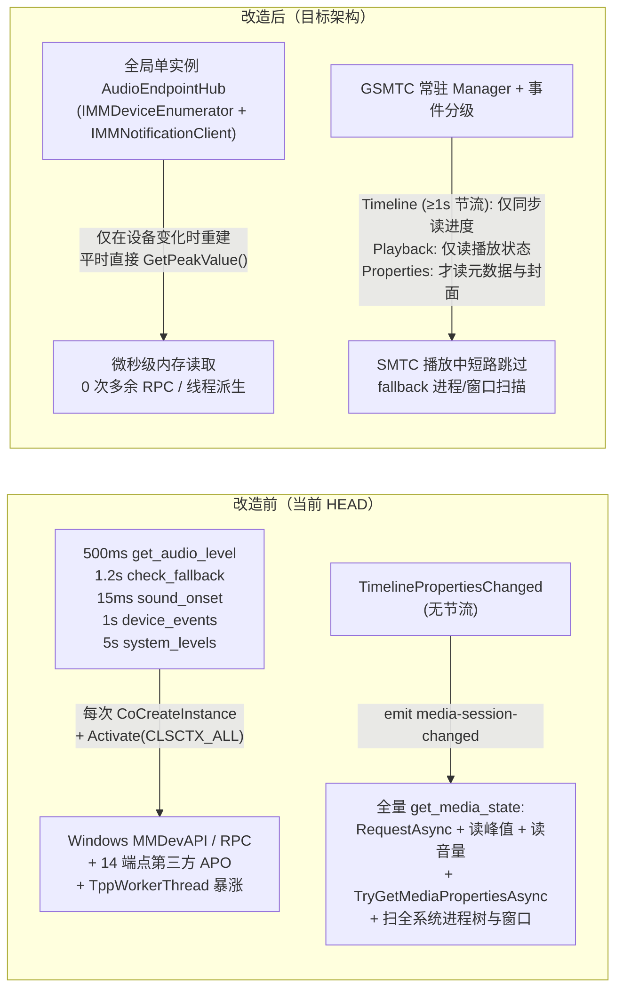

# Windows 媒体控制与音频峰值轮询高 CPU / 线程膨胀调研与修复计划

> 日期：2026-11-17。问题：`flyl1u/fly-island#75`（播放音乐时持续占用整机 ~25% CPU / 约 4 核、10 分钟线程数从 204 涨到 653）是否也是浮屿（`TixXin/fuyu`）的问题？同类开源项目和 Windows 官方文档是怎么处理 WASAPI 峰值表与 GSMTC 媒体会话的？我们的修复计划是什么？范围：上游 `flyl1u/fly-island`（#65、#75、提交 `98fcde91`）、本仓库当前 `HEAD` 源码逐行对照、Microsoft Learn（Core Audio `IMMNotificationClient` / `IAudioMeterInformation` / `CLSCTX`、`Windows.Media.Control`）、GitHub 同类开源桌面壳与音频工具（Seelen-UI、Zebar、Rainmeter、EarTrumpet、Yasb、FluentFlyout、Komorebi）。相关任务：[D98](/docs/tasks/D/D98.md)（[#804](https://github.com/TixXin/Fuyu/issues/804)）、[D52](/docs/tasks/0-archive/D/D52.md)、[D86](/docs/tasks/D/D86.md)、[D97](/docs/tasks/D/D97.md)（特别是 [D97.4](/docs/tasks/D/D97.4.md)）

## 结论

1. **这也是我们的问题，而且只靠刚合入的 D52（`24cbe95c`）和进行中的 D97 还修不掉**：
   - D52 把 `on_media_thread` 从「每次调用 `thread::spawn` 新建线程」改成了常驻单线程 `media-com-worker`，并把前端 1.5 秒定时轮询放宽到了 30 秒兜底。这修掉了我们自己显式创建的短命 Rust 线程。
   - **但 `#75` 最核心的算力黑洞和 Windows 系统线程池（`ntdll!TppWorkerThread`）膨胀根因在我们仓库里原封未动，甚至有 3 处比 `fly-island` v3.2.4 更重**：
     1. **500 ms 音频峰值轮询未缓存句柄**：`read_system_audio_peak()` 仍每 500 ms 重新调 `CoCreateInstance(MMDeviceEnumerator, CLSCTX_ALL)`，并对 `Multimedia` / `Console` / `Communications` 3 个角色逐一调 `GetDefaultAudioEndpoint` + `Activate::<IAudioMeterInformation>(CLSCTX_ALL)` [1][5][6]。在多虚拟声卡机器（如 `#75` 的 14 端点 + Nahimic + SteelSeries Sonar）上，反复跨进程协商 RPC、映射 `audiodg.exe` 共享内存页并穿过第三方 APO 驱动图的开销被成倍放大。
     2. **`TimelinePropertiesChanged` 无节流触发全量重读（比 `fly-island` v3.2.4 更重）**：`fly-island` 在 `98fcde91` 已给进度事件加了 1 秒节流并在有会话时跳过了峰值读取 [3]；而我们的 [events.rs](/src-tauri/src/media_control/events.rs#L223-L228) 把 `TimelinePropertiesChanged` 直接当成无节流、无去重的 `Signal::Playback` 推送给前端，触发全量 `get_media_state`。
     3. **`get_media_state` 内叠加了无缓存的 `RequestAsync()` + 全系统进程/窗口扫描（C107 新增回归）**：每次 `get_media_state` 不仅重新调 `MediaSessionManager::RequestAsync()`（新建跨进程 `NPSMSvc` 会话并唤醒 Windows 线程池）和 `TryGetMediaPropertiesAsync()`，还**在已有 SMTC 播放器正在播放时仍无条件执行 `discover_fallback_sessions()`**（[session.rs](/src-tauri/src/media_control/session.rs#L321)），每次遍历 2 个音频角色的进程会话、`CreateToolhelp32Snapshot` 扫全系统进程树、`EnumWindows` 扫全桌面窗口标题并逐个 `OpenProcess`。
     4. **闲置期也在高频重建音频 COM 对象（与 D86 `#730` 高度吻合）**：即使不放音乐，`media-session-events` 每 1.2 秒调一次 `read_system_audio_peak()`、`device-events` 每 1 秒枚举一次全部活跃音频端点与属性库、`system-levels` 每 5 秒销毁重建一次音量回调订阅。这与 [D86](/docs/tasks/D/D86.md) 观察到的「收起闲置时 7 个同启动地址的匿名 Windows 线程池线程持续占 ~20% 单核 CPU」指向同一机制（占比待 Windows 真机采样核实）。
2. **开源项目的通行做法高度一致**（查了 7 个项目，无一在轮询里调 `CoCreateInstance` / `Activate` / `RequestAsync`）：
   - **WASAPI 峰值与设备监听**（EarTrumpet [12]、Rainmeter [11]、Seelen-UI [8]、Zebar [9]、FluentFlyout [13]）：进程生命周期内只创建 1 个 `IMMDeviceEnumerator`（用 `CLSCTX_INPROC_SERVER` [5]），注册 `IMMNotificationClient` 监听 `OnDefaultDeviceChanged`；只在默认输出设备（仅 `eMultimedia` 角色）切换或报 `AUDCLNT_E_DEVICE_INVALIDATED` 时重新 `Activate` 一次 `IAudioMeterInformation`，平时轮询只调零跨进程开销的 `GetPeakValue()`（直接读已映射的共享内存浮点数 [6]）。且 `IMMNotificationClient` 回调里绝不加锁或调 COM，只向工作线程发信号，避免微软文档警告的重入死锁 [7]。
   - **GSMTC 会话管理与事件拆分**（Seelen-UI [8]、Zebar [9]、Yasb [10]、Rainmeter [11]）：`GlobalSystemMediaTransportControlsSessionManager::RequestAsync()` 全局只调一次并常驻缓存；把三类会话事件严格拆开——`TimelinePropertiesChanged` 只做本地同步 `GetTimelineProperties()`（微秒级，不跨进程查封面/标题、不扫音频会话），只有 `MediaPropertiesChanged` 才调 `TryGetMediaPropertiesAsync()`。
3. **建议分 3 步修复（均集中在 Rust 侧，与正在进行的 [D97.4](/docs/tasks/D/D97.4.md) 前端范围零冲突，对外契约零变更）**：
   - **第 1 步（止血核心，消除 95%+ 音频 COM 重建）**：在 `win32::audio` 实现无锁唤醒的 `IMMNotificationClient` + 常驻缓存的默认 `eMultimedia` 端点句柄（缓存 `IAudioMeterInformation` 与 `IAudioEndpointVolume`，改用 `CLSCTX_INPROC_SERVER`）；供 `media_control`、`system_levels`（去掉 5 秒强制重开）和 `device_events`（去掉 1 秒盲扫端点）共用。同时修掉切歌 `sound_onset` 66 Hz 重建枚举器的逻辑。
   - **第 2 步（GSMTC 缓存与事件分级瘦身）**：`media-com-worker` 常驻缓存 `MediaSessionManager`；`events.rs` 区分 `timeline` 与 `playback` / `track` 并对 `TimelinePropertiesChanged` 做 1 秒合并节流；`read_media_state_from_manager` 在已有活跃 SMTC 会话时跳过 `read_system_audio_peak()`，在已有 SMTC 会话正在播放时短路跳过 `discover_fallback_sessions()`（非 SMTC 兜底降频到慢速缓存快照），并按会话缓存 `Metadata` 避免进度刷新重复调 `TryGetMediaPropertiesAsync()`。
   - **第 3 步（波形采样按需化与前端收口，等 D97.4 合入后衔接）**：折叠态正在滚动歌词、音乐波形按钮未显示时停掉 `getAudioLevel` 轮询；并在 Windows 多端点真机上复测播放期 CPU、线程数及 D86 闲置期线程池占用。

---

## 上游 Issue 剖析：为什么 v3.2.2 修完 #65 后，v3.2.4 仍爆出 #75？

### 1. `#65` 与 `#75` 的实测现象对比

| 维度 | `fly-island#65`（v3.2.1 / QQ 音乐）[1] | `fly-island#75`（v3.2.4 / Apple Music）[2] |
|---|---|---|
| 测试环境 | Win11 25H2，Core Ultra 7 155H（22 逻辑核），QQ 音乐 + BetterNCM/InfLink 插件 | Win11（16 逻辑核），Apple Music UWP 版，**14 个音频端点 / 7 个声卡（含 Nahimic、NVIDIA Virtual Audio、SteelSeries Sonar）** |
| 播放时 CPU | `fly-island` **19.5%** + `NPSMSvc` 的 `svchost` **17.4%** | `fly-island` 持续 **24.83%**（**≈ 3.97 核满载**，10 分钟耗费 476.8 核·秒） |
| 线程数变化 | 未单独统计 | 10 分钟从 **204 涨到 653**（净增 449，约 +45 线程/分钟） |
| 暂停后表现 | 关音乐控制开关后立即降到 **0.23%**，`NPSMSvc` 降到 **0.06%** | **0–40 秒惯性期**仍占 23–27%，线程数从 586 缓慢退到 404；**55 秒起稳态**降到 **0.435%**，线程稳在 315 |

### 2. 为什么线程数会涨到 653 且暂停后有 40–55 秒「惯性退潮期」？

`#75` 报告者在源码阅读中注意到了 `on_media_thread` 每次 `thread::spawn(...).join()`，但有一个容易被忽略的关键推论：**同步 `.join()` 的线程在函数返回前就已经退出了，它本身不可能同时堆积出 449 个存活线程，也不会在暂停播放后继续存活 40–55 秒。**

真正堆积出数百个线程并呈现 ~45 秒退潮期的，是 **Windows 原生 COM / RPC / WinRT 隐式多线程套间（Implicit MTA）背后的系统线程池（`ntdll!TppWorkerThread`）**：

- Windows 线程池（`TppWorkerThread`）的空闲工作线程默认保活超时正是 **30–60 秒**——这与 `#75` 实测「暂停后 0–40 秒线程从 586 退到 404、55 秒起稳在 315」完全吻合。
- 当短命线程每 500 ms 调 `CoInitializeEx(COINIT_MULTITHREADED)` -> `CoCreateInstance(MMDeviceEnumerator, CLSCTX_ALL)` -> 3 次 `GetDefaultAudioEndpoint` -> 3 次 `Activate::<IAudioMeterInformation>(CLSCTX_ALL)` -> 线程退出调 `CoUninitialize()` 时：
  1. `CLSCTX_ALL` 允许跨进程本地服务激活，每次 `GetDefaultAudioEndpoint` 和 `Activate` 都要走 RPC 查询 `AudioEndpointBuilder` / `Audiosrv`，并与音频引擎进程 `audiodg.exe` 重新协商建立峰值共享内存映射 [5][6]；
  2. 在装有 **Nahimic、SteelSeries Sonar** 等虚拟声卡路由套件的机器上，14 个虚拟/物理端点挂有音频处理对象（APO）与设备拓扑钩子，每次解析 3 种角色（`Multimedia`、`Console`、`Communications`）的默认端点并激活接口，都会触发底层 COM 代理/存根与 RPC 通道向进程内 `TppWorkerThread` 派发异步工作项；
  3. 同时每 1–1.5 秒的 `MediaSessionManager::RequestAsync()` 与 `TryGetMediaPropertiesAsync()` 都是 WinRT `IAsyncOperation`，其跨进程（ALPC 到 `NPSMSvc`）完成回调同样投递在 Windows 线程池上 [4]。
- `fly-island` 的提交 `98fcde91` [3] 只节流了 `TimelinePropertiesChanged`（1 秒一次）并去掉了 `get_media_state` 里的峰值读取，**完全没动每 500 ms 一次的 `get_audio_level` -> `read_system_audio_peak()`，也没缓存 `MediaSessionManager`**，因此在 14 端点的机器上依然烧掉了近 4 个逻辑核心。

---

## 浮屿（Fuyu）当前 `HEAD` 逐项核查：现状比想象更严峻

将本仓库当前 `HEAD`（含已合入的 [D52](/docs/tasks/0-archive/D/D52.md) `24cbe95c` 与 C107 `8ba376c6`）与 `fly-island` v3.2.4 逐条对照如下：

| 检查项 | `fly-island` v3.2.4（#75） | 浮屿当前 `HEAD` 现状 | 风险评级 |
|---|---|---|---|
| `on_media_thread` 线程模型 | 每次新建 OS 线程 + `CoInitializeEx` | D52 已改为常驻 `media-com-worker` 单线程（[session.rs](/src-tauri/src/media_control/session.rs#L42-L99)）；但外层命令每次仍包一层 `tauri::async_runtime::spawn_blocking` 等待 channel（[mod.rs](/src-tauri/src/media_control/mod.rs#L48-L65)） | 🟡 已部分缓解 |
| 500 ms 峰值轮询 `read_system_audio_peak()` | 每次 `CoCreateInstance(CLSCTX_ALL)` + 遍历 3 角色 `Activate::<IAudioMeterInformation>(CLSCTX_ALL)` | **一字未改**（[audio.rs](/src-tauri/src/media_control/audio.rs#L29-L55)、[win32/audio.rs](/src-tauri/src/win32/audio.rs#L51-L88)）。且主岛折叠未贴边时，哪怕折叠栏正在显示歌词而非波形，`waveformVisible` 也恒为 `true`（[runners.tsx](/src/features/media/plugin/runners.tsx#L38-L42)） | 🔴 **完全受影响（#75 主因）** |
| `TimelinePropertiesChanged` 事件节流 | `98fcde91` 已加 80 ms 合并 + **1 秒节流** | **无任何节流或去重！** [events.rs](/src-tauri/src/media_control/events.rs#L223-L228) 将其映射为 `Signal::Playback`，第 137 行收到即 `emit("media-session-changed")`，前端收到立即调全量 `get_media_state`（注：[emit-frequency-audit.md](/docs/investigations/emit-frequency-audit.md#L50) 误以为已按播放状态去重，实际源码只对 `Signal::Track` 按歌名去了重） | 🔴 **比 `fly-island` 更重** |
| `get_media_state` 内部开销 | `98fcde91` 已在有会话时跳过读峰值；仍每次 `RequestAsync()` + `read_master_volume()` + `TryGetMediaPropertiesAsync()` | **不仅没跳过峰值，还多了全系统扫描**： 1. 每次重新 `MediaSessionManager::RequestAsync()`（[session.rs](/src-tauri/src/media_control/session.rs#L101-L107)）； 2. 每次无条件调 `read_system_audio_peak()`（第 317 行）+ `read_master_volume()`（第 319 行）； 3. **C107 新增**：哪怕 SMTC 正在正常播放，第 321 行仍**无条件调 `discover_fallback_sessions()`**（[audio_fallback.rs](/src-tauri/src/media_control/audio_fallback.rs#L187-L202)），每次打开枚举器遍历 2 个角色的全部音频会话、`CreateToolhelp32Snapshot` 扫全系统进程父子表、`EnumWindows` 扫全桌面可见窗口并逐个 `OpenProcess` 查路径！ | 🔴 **比 `fly-island` 重得多** |
| 切歌静音检测 `sound_onset` | 无 | 切歌时最多 2 秒内**每 15 ms（66 Hz）**调一次 `read_system_audio_peak()`（[events.rs](/src-tauri/src/media_control/events.rs#L250-L265)），2 秒内最多触发 **133 次** `CoCreateInstance` + **399 次** `Activate` | 🔴 **瞬时风暴** |
| 闲置期后台音频轮询（不放音乐时） | 无 `check_fallback_changes` | 1. `events.rs` 每 **1.2 s** 超时调 `check_fallback_changes` -> `read_system_audio_peak()`（[events.rs](/src-tauri/src/media_control/events.rs#L147-L163)）；若桌面有游戏/视频等非 SMTC 声音，每 1.2 s 再跑全套进程树 + 窗口扫描； 2. `device_events` 每 **1.0 s** 调 `active_outputs()` 枚举所有活跃端点并开属性库 + 查 `devnode`（[device_events/mod.rs](/src-tauri/src/device_events/mod.rs#L23-L44)）； 3. `system_levels` 每 **5.0 s** 丢弃并重建音量回调订阅（[system_levels/mod.rs](/src-tauri/src/system_levels/mod.rs#L25-L93)） | 🔴 **常驻底噪（高度关联 D86 `#730`）** |

> **关于 [D86](/docs/tasks/D/D86.md)（`#730`）的重要关联线索**：D86 记录 Windows 正式版收起闲置时 `fuyu.exe` 持续占 17–21% 单核 CPU，「平均分在 7 个没有名字、同一个启动地址（像 Windows 线程池）的线程上」。上表最后一行的 3 条常驻后台轮询（合计闲置期每分钟 **~122 次** `CoCreateInstance(MMDeviceEnumerator)` + 属性库/端点激活，加每 15 秒一次 WinRT `ble_battery` 异步查询）全部在后台持续驱动 Windows COM / RPC / WinRT 线程池（`ntdll!TppWorkerThread`）。修掉音频端点反复重建后，预计不仅解决播放音乐高占用，也会大幅削减 D86 的闲置线程池负载（具体降幅待 Windows 真机对比核实）。

---

## 外部调研：开源项目与微软官方文档怎么做？

本次共核查了 **7 个 Windows 桌面状态栏 / 悬浮窗 / 音频混音开源项目** 的源码实现（Star 数与最后推送时间均查于 2026-11-17）以及 Microsoft Learn 官方规范：

### 1. 7 个同类开源项目实现对比

| 项目（查于 2026-11-17） | 技术栈 | WASAPI 设备与峰值表（`IAudioMeterInformation`）做法 | GSMTC（`Windows.Media.Control`）做法 |
|---|---|---|---|
| **Seelen-UI** (`eythaann/Seelen-UI`，18.5k ★，2026-11-17 更新) [8] | Rust + Tauri | `media_devices` 单例持有枚举器，注册 `IMMNotificationClient`；**回调只向事件线程入队原始通知，绝不在回调内查 COM（防死锁）**。波形走单次打开的 `IAudioClient` Loopback 捕获流，不在循环里重建设备 | `GsmtcManager::RequestAsync()` 在 `init()` **只调一次**并缓存；会话按 `umid` 缓存；三类事件严格分流：`TimelineChanged` 只同步调 `GetTimelineProperties()`，只有 `PropertiesChanged` 才调 `TryGetMediaPropertiesAsync()` |
| **EarTrumpet** (`File-New-Project/EarTrumpet`，11.6k ★，2026-11-15 更新) [12] | C# / WPF | `AudioDeviceManager` 全局创建 1 个 `MMDeviceEnumerator` 并注册 `IMMNotificationClient`；每个 `AudioDevice` 初始化时**只 `Activate<IAudioMeterInformation>()` 一次并长期持有 `_meter`**，后台峰值刷新只调 `_meter.GetPeakValue()`，遇 `AUDCLNT_E_DEVICE_INVALIDATED` 忽略等待设备事件切换 | 不涉及 GSMTC（专注 CoreAudio） |
| **Komorebi** (`LGUG2Z/komorebi`，15.4k ★，2026-11-15 更新) [14] | Rust | 不读音频峰值 | `Media::new()` 启动时调一次 `RequestAsync()` 把 `GlobalSystemMediaTransportControlsSessionManager` 存入结构体字段复用 |
| **Rainmeter** (`rainmeter/rainmeter`，6.2k ★，2026-11-17 更新) [11] | C++ | `MeasureAudioLevel` 用 `CLSCTX_INPROC_SERVER` 创建枚举器，通过 `AudioLevelDeviceNotificationClient`（原子布尔标志 `m_DefaultDeviceChanged`）感知默认设备切换，平时绝不重新打开端点 | `PlayerSMTC::Worker` 独立常驻 `RoInitialize(RO_INIT_MULTITHREADED)` 线程，缓存 `ComPtr<Manager> m_Manager`（失败也有 5 秒冷却期 `m_LastRequest`），仅在 `GetCurrentSession` 失败时重置 `m_Manager` |
| **Yasb** (`amnweb/yasb`，5.8k ★，2026-11-17 更新) [10] | Python + WinRT | 音量服务缓存枚举器与回调；可视化器复用单条 WASAPI Loopback 流 | 单例 `WindowsMedia` 启动时 `await SessionManager.request_async()` 一次；`timeline_properties_changed` 只读同步属性 `(position, last_updated, duration)`，本地用 `100 ms` 计时器按 `playback_rate` 线性插值进度，零跨进程轮询 |
| **FluentFlyout** (`unchihugo/FluentFlyout`，4.9k ★，2026-11-11 更新) [13] | C# / WPF + NAudio | `AudioDeviceMonitor` 单例持有 `MMDeviceEnumerator` + `IMMNotificationClient`，仅当 `DataFlow.Render && Role.Multimedia` 默认设备变化时通知上层更换句柄 | 缓存会话管理器与当前会话，封面与元数据仅在 `MediaPropertiesChanged` 更新 |
| **Zebar** (`glzr-io/zebar`，3.1k ★，2026-09-26 更新) [9] | Rust + Tauri | `AudioProvider` 在单线程 COM 套间中持有 `com_enumerator: Option<IMMDeviceEnumerator>`，通过 `IMMNotificationClient` 投递 `crossbeam` channel 消息维护 `device_states` 字典（缓存每个设备的 `IAudioEndpointVolume`） | `MediaProvider` 启动调一次 `GsmtcManager::RequestAsync()`；`TimelinePropertiesChanged` 与 5 秒兜底 `TimelineRefresh` **只调 `update_timeline_properties`**，绝不触发 `update_media_properties` |

### 2. Microsoft Learn 关键底层规范核实

1. **`IAudioMeterInformation::GetPeakValue()` 本身极轻，重在 `Activate` 与端点解析** [5][6]：
   - 激活 `IAudioMeterInformation` 后，软件峰值表由音频引擎更新，客户端调 `GetPeakValue()` 只是读取当前映射好的峰值浮点数，耗时在微秒级以下；而每次 `CoCreateInstance` + `GetDefaultAudioEndpoint` + `Activate` 都要重新走设备枚举器与音频服务跨进程激活链路。
   - 创建 `MMDeviceEnumerator` 官方示例明确使用 **`CLSCTX_INPROC_SERVER`**（`MMDevApi.dll` 是进程内组件），不需要传 `CLSCTX_ALL` [5]。
   - 默认播放设备的音乐电平只需监听 **`eRender` + `eMultimedia`**（若 `eMultimedia` 不存在再回退 `eConsole`），无需每轮把 `Multimedia`、`Console`、`Communications` 三个角色全激活一遍（FluentFlyout [13]、Seelen-UI [8]、Zebar [9] 均只跟踪 `eMultimedia`）。
2. **`IMMNotificationClient` 回调的四条死锁禁令（必守）** [7]：
   - 微软官方文档明确规定，在 `OnDefaultDeviceChanged` / `OnDeviceStateChanged` 等回调线程里：
     1. **严禁阻塞或等待同步原语**（不要 `Mutex::lock`）；
     2. **严禁在回调内调用 `UnregisterEndpointNotificationCallback`**；
     3. **严禁在回调内释放 MMDevice 对象的最后一个引用**；
     4. **严禁在回调内直接做耗时的 COM 激活或属性读取**。
   - 安全做法（Rainmeter [11]、Seelen-UI [8]、Zebar [9] 均采用）：回调里只做 `AtomicBool::store(true, Ordering::Release)` 或无锁 `mpsc::Sender::send(())`，由我们自己的常驻工作线程在下一拍重新打开默认设备。

---

## 修复计划

### 架构改造前后对比

### 分阶段实施步骤与文件边界

> **多会话协作冲突检查**：当前进行中的 [D97.4](/docs/tasks/D/D97.4.md) 锁定了前端 `src/features/media/*`，未触碰任何 `src-tauri/` 文件；[D86](/docs/tasks/D/D86.md) 锁定了 `session_scan.rs` 与 `passthrough.rs`。因此 **阶段一、阶段二纯改 Rust 侧（`src-tauri/`），现在即可零冲突独立实施**；阶段三涉及前端 1 行条件收窄，等 D97.4 合入后再做。
>
> **对外契约核查**：Tauri 命令名（`get_media_state`、`get_audio_level` 等）、返回字段结构、事件名（`media-session-changed`、`system-level-changed`、`device-alert`）和 `localStorage` key **全部保持不变**。

#### 阶段一：WASAPI 常驻端点缓存与 `IMMNotificationClient` 事件化（止血核心）

- **涉及文件**：
  - `src-tauri/src/win32/audio.rs`（若超行数拆出 `src-tauri/src/win32/audio_notify.rs`，遵守 800 行上限与 `unsafe` 只在 `win32/` 规则）
  - `src-tauri/src/win32/audio_outputs.rs`
  - `src-tauri/src/media_control/audio.rs`
  - `src-tauri/src/media_control/events.rs`
  - `src-tauri/src/system_levels/mod.rs`、`src-tauri/src/system_levels/readers.rs`
  - `src-tauri/src/device_events/mod.rs`、`src-tauri/src/device_events/readers.rs`
- **具体改动**：
  1. **`CLSCTX_INPROC_SERVER` 替代 `CLSCTX_ALL`**：`win32/audio.rs` 与 `win32/audio_outputs.rs` 中创建 `MMDeviceEnumerator` 及激活 `IAudioMeterInformation`、`IAudioEndpointVolume`、`IAudioSessionManager2` 统一改用 `CLSCTX_INPROC_SERVER`（若个别第三方虚拟声卡对 `Activate` 需要兼容回退，可在 `INPROC_SERVER` 失败时单次降级，枚举器本身固定 `CLSCTX_INPROC_SERVER`）。
  2. **实现无死锁 `IMMNotificationClient`**：在 `win32/` 封装 `DeviceChangeNotifier`（手写 VTable 或 `windows::core::implement`，与现有 `RawVolumeCallback` 风格一致）：
     - 回调 `OnDefaultDeviceChanged`、`OnDeviceAdded`、`OnDeviceRemoved`、`OnDeviceStateChanged` 内**只写 `AtomicU64` 版本号（`fetch_add(1, Ordering::Release)`）并可选向无锁唤醒句柄发信号**，绝不加锁、绝不调 COM、绝不在回调内注销。
  3. **常驻缓存默认输出峰值表与音量接口**：
     - 在常驻 COM 工作线程内持有 `(IMMDeviceEnumerator, DeviceChangeNotifier, cached_epoch, Option<PeakMeter>, Option<OutputVolume>)`。
     - 只打开默认 `OutputRole::Multimedia`（失败时回退 `Console`），**不再每次遍历 3 个角色**。
     - `read_system_audio_peak()` 与 `read_master_volume()` 先比对 `epoch`：设备未变时直接调缓存好的 `meter.peak()` / `volume.level()`；仅当 `epoch` 变化或返回 `AUDCLNT_E_DEVICE_INVALIDATED` 时才重新 `GetDefaultAudioEndpoint` + `Activate`。
  4. **消除切歌 66 Hz 枚举器风暴与闲置重复枚举**：
     - `events.rs` 的 `sound_onset()` 复用该缓存 `PeakMeter`（且采样步长从 15 ms 放宽到 30 ms），2 秒内 0 次 `CoCreateInstance`。
     - `system_levels/mod.rs` 去掉 `DEVICE_REFRESH = 5s` 的定时强制销毁重建，改为仅在 `DeviceChangeNotifier` 版本号变化或未订阅成功时重绑 `IAudioEndpointVolumeCallback`。
     - `device_events/mod.rs` 去掉每 1 秒无条件 `active_outputs()` 枚举属性库，改为仅在 `DeviceChangeNotifier` 报告设备增删/状态改变（或首次启动、蓝牙电量 60s 到期）时才枚举 `EnumAudioEndpoints`。

#### 阶段二：GSMTC 会话管理器常驻、进度事件节流与非 SMTC 兜底短路

- **涉及文件**：
  - `src-tauri/src/media_control/session.rs`
  - `src-tauri/src/media_control/events.rs`
  - `src-tauri/src/media_control/audio_fallback.rs`
  - `src-tauri/src/media_control/mod.rs`
- **具体改动**：
  1. **常驻缓存 `MediaSessionManager`**：在 `media-com-worker` 线程局部变量中缓存 `Option<MediaSessionManager>`，不再每次 `get_media_state` / `run_command` / `seek` 都调 `MediaSessionManager::RequestAsync()`；仅当首次调用或管理器调用报错时重连（失败设 3 秒冷却，防 `NPSMSvc` 异常时忙等）。
  2. **去掉 `mod.rs` 多余的 `spawn_blocking` 嵌套（可选优化）**：将 `on_media_thread` 的回复通道改为 `tokio::sync::oneshot`，`async fn get_media_state` / `get_audio_level` 直接 `.await` oneshot，彻底省去每 500 ms 唤醒一次 Tokio `spawn_blocking` 线程池线程。
  3. **`events.rs` 拆分 `Signal::Timeline` 并合并节流**：
     - 将 `TimelinePropertiesChanged` 从 `Signal::Playback` 拆成独立的 `Signal::Timeline(id, at)`；
     - 对 `Signal::Sessions` / `Playback` / `Track` 加 **80 ms 突发合并窗口**（切歌时播放器常在几十毫秒内连发 3–5 个事件）；
     - 对 `Signal::Timeline` 限制**同一会话至少间隔 1.5–2 秒**（或仅在检测到位置跳变 > 1.5 秒即用户拖动进度条 seek 时立即发送！因为正常匀速播放时前端 `playbackPosition()` 已经在本地按时间戳线性推算进度，根本不需要每秒重拉一次后端全量状态！）。
  4. **`read_media_state_from_manager` 按需瘦身与短路**：
     - **跳过重复读峰值**：当存在有效 SMTC 会话时，不再在 `get_media_state` 中重复调 `read_system_audio_peak()`（`audio_active` 在 `is_playing` 时直接为 `true`，具体波形峰值由 `get_audio_level` 独立提供）。
     - **按会话缓存元数据**：对同一会话缓存上一次 `(title, artist, album, thumbnail, track_id)`，在收到 `MediaPropertiesChanged`（通过原子代数标记）或切换会话前，进度/暂停刷新不再跨进程调 `TryGetMediaPropertiesAsync()` 打扰 `NPSMSvc`。
     - **SMTC 播放时短路跳过 `discover_fallback_sessions`**：当已有 SMTC 会话处于 `Playing` 状态且用户未手动指定某个非 SMTC 自定义目标时，**不跑 `discover_fallback_sessions`**（省掉每次 `IAudioSessionManager2` + `CreateToolhelp32Snapshot` + `EnumWindows` + `OpenProcess`）；即使需要跑非 SMTC 兜底，也给 `discover_fallback_sessions` 加 **3–5 秒快照缓存**，避免 `events.rs` 与 `get_media_state` 双重高频扫进程和窗口。

#### 阶段三：前端波形按需轮询收口与真机验收（等 D97.4 合入后）

- **涉及文件**：`src/features/media/plugin/runners.tsx`
- **具体改动**：
  - 修正 `waveformVisible` 判断：当主岛折叠态正在展示歌词行、折叠栏上并未渲染 `MusicWaveButton` 时（或窗口被全屏应用遮挡时），`waveformVisible` 设为 `false`，暂停 500 ms 的 `getAudioLevel` 轮询；播放状态本身已由 GSMTC 事件驱动，不需要靠 500 ms 峰值轮询维持。

### 验证与验收标准

1. **自动化验证**：
   - Rust 侧：`pnpm heavy -- cargo test --manifest-path src-tauri/Cargo.toml`（为事件合并节流、seek 跳变检测、元数据缓存代数失效、fallback 快照 TTL 编写纯函数单元测试）+ `pnpm build:exe` + `pnpm mq:try --wait`（Windows CI 编译与测试通过）。
   - 前端侧（阶段三）：`pnpm check` + `pnpm build` + `pnpm test:regression`。
2. **Windows 真机实测（复现 `#75` 与 `#65` 场景）**：
   - 使用 Apple Music（Microsoft Store 版）和 QQ 音乐连续播放 10 分钟，按 `#75` 同一口径（每 5 秒采样 `TotalProcessorTime` 差分与 `Threads.Count`）：
     - `fuyu.exe` 播放期整机 CPU 应 **< 0.5%**（单核 < 5%），`NPSMSvc` 的 `svchost` 应 **< 0.5%**；
     - 10 分钟内 `fuyu.exe` 线程数**零净增长**（稳态波动 ≤ ±3）；
   - 插拔耳机 / 切换系统默认输出设备（含蓝牙与虚拟声卡），1 秒内波形峰值、系统音量回调与设备连接提示正常切换到新设备，无死锁；
   - 在播放器内拖动进度条（seek）、切歌、暂停，岛上歌词与状态在 **1 秒内** 同步；
   - 对照 [D86](/docs/tasks/D/D86.md) 口径，测量收起闲置 10 分钟时主进程匿名线程池 CPU 的下降幅度。

---

## 来源

以下外部资料查询日期均为 **2026-11-17**：

1. `flyl1u/fly-island#65`（已关闭），启用「音乐控制」后 `fly-island` 与 `NPSMSvc` 的 `svchost` 同时高占用 CPU（v3.2.1 / QQ音乐）：https://github.com/flyl1u/fly-island/issues/65
2. `flyl1u/fly-island#75`（开着），播放音乐时 `fly-island` 持续占用整机 ~25% CPU（约 4 核），暂停后归零（v3.2.4 / Apple Music）：https://github.com/flyl1u/fly-island/issues/75
3. `flyl1u/fly-island`（846 ★，2026-11-16 更新）提交 `98fcde91`，`perf(media): 降低音乐控制的 CPU 占用（issue #65）`：https://github.com/flyl1u/fly-island/commit/98fcde91
4. Microsoft Learn，`GlobalSystemMediaTransportControlsSession` 类与 `TimelinePropertiesChanged` / `TryGetMediaPropertiesAsync` 文档：https://learn.microsoft.com/en-us/uwp/api/windows.media.control.globalsystemmediatransportcontrolssession
5. Microsoft Learn，`IMMDeviceEnumerator` 与 `IMMDevice::Activate`（Core Audio APIs，`CLSCTX_INPROC_SERVER` 示例）：https://learn.microsoft.com/en-us/windows/win32/api/mmdeviceapi/nn-mmdeviceapi-immdeviceenumerator
6. Microsoft Learn，`IAudioMeterInformation::GetPeakValue`（硬件/软件峰值表与共享模式说明）：https://learn.microsoft.com/en-us/windows/win32/api/endpointvolume/nf-endpointvolume-iaudiometerinformation-getpeakvalue
7. Microsoft Learn，`IMMNotificationClient` 接口回调约束（禁止阻塞、禁止等待同步对象、禁止在回调内注销或释放最后引用）：https://learn.microsoft.com/en-us/windows/win32/api/mmdeviceapi/nn-mmdeviceapi-immnotificationclient
8. `eythaann/Seelen-UI`（18,544 ★，2026-11-17 更新），Windows GSMTC 与音频设备模块实现：
   - https://github.com/eythaann/Seelen-UI/blob/HEAD/src/background/system_modules/media_players/application/windows.rs
   - https://github.com/eythaann/Seelen-UI/blob/HEAD/src/background/system_modules/media_devices/application/windows.rs
   - https://github.com/eythaann/Seelen-UI/blob/HEAD/src/background/system_modules/media_waveform/application/windows.rs
9. `glzr-io/zebar`（3,126 ★，2026-09-26 更新），Windows MediaProvider 与 AudioProvider 实现：
   - https://github.com/glzr-io/zebar/blob/HEAD/packages/desktop/src/providers/media/media_provider.rs
   - https://github.com/glzr-io/zebar/blob/HEAD/packages/desktop/src/providers/audio/audio_provider.rs
10. `amnweb/yasb`（5,809 ★，2026-11-17 更新），WindowsMedia 单例与本地进度插值实现：https://github.com/amnweb/yasb/blob/HEAD/src/core/widgets/services/media/media.py
11. `rainmeter/rainmeter`（6,154 ★，2026-11-17 更新），`MeasureAudioLevel`（`IMMNotificationClient` 原子标记）与 `PlayerSMTC`（常驻 MTA 线程缓存 Manager）：
    - https://github.com/rainmeter/rainmeter/blob/HEAD/Library/MeasureAudioLevel.cpp
    - https://github.com/rainmeter/rainmeter/blob/HEAD/Library/NowPlaying/PlayerSMTC.cpp
12. `File-New-Project/EarTrumpet`（11,556 ★，2026-11-15 更新），`AudioDeviceManager` 与 `AudioDevice` 常驻 `_meter` 实现：
    - https://github.com/File-New-Project/EarTrumpet/blob/HEAD/EarTrumpet/DataModel/WindowsAudio/Internal/AudioDeviceManager.cs
    - https://github.com/File-New-Project/EarTrumpet/blob/HEAD/EarTrumpet/DataModel/WindowsAudio/Internal/AudioDevice.cs
13. `unchihugo/FluentFlyout`（4,929 ★，2026-11-11 更新），`AudioDeviceMonitor` 单例监听 `Multimedia` 默认播放端点：https://github.com/unchihugo/FluentFlyout/blob/HEAD/FluentFlyoutWPF/Classes/AudioDeviceMonitor.cs
14. `LGUG2Z/komorebi`（15,389 ★，2026-11-15 更新），`komorebi-bar` Media 小组件缓存 `session_manager`：https://github.com/LGUG2Z/komorebi/blob/HEAD/komorebi-bar/src/widgets/media.rs
