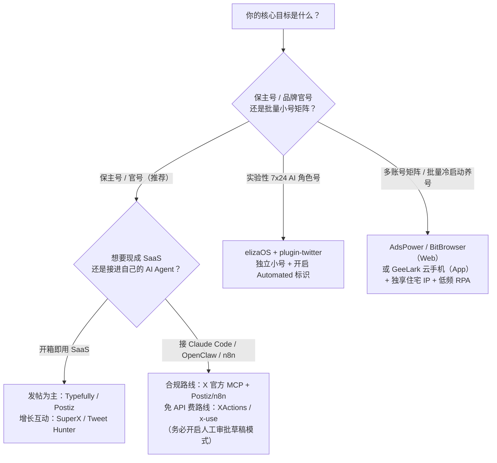

# X 平台 AI Agent 自动养号、回复评论与自动发帖调研

> 日期：2026-11-25。问题：X（Twitter）平台目前有没有基于 AI Agent 的自动养号、自动回复评论、自动发帖工具与方案？各自的实现方式、成本和封号风险如何？范围：X 官方文档（`docs.x.com`、`help.x.com`）、GitHub 开源项目（通过 GitHub API 核验 star 与活跃度）、商业 SaaS 与多账号 RPA 工具。相关任务：无。

## 结论

**现成工具非常多，但“全自动养号/主动抢评论”与 X 平台规则处于正面冲突期。** 2026 年 X 平台在技术和政策两层同时收紧了自动化：API 改为按量扣费（含外链高价税），自助 API 拦截了未被 `@`/引用触发的程序化回复，官方规则还明文要求 **AI 自动回复机器人需事先获得 X 书面批准**，且禁止任何脚本操控网页行为。

三项核心需求的现实可行性差异很大：

| 需求 | 可行性与合规度 | 现实最佳实践 |
|---|---|---|
| **自动发帖 / 排程** | 🟢 成熟且合规 | 官方 API（按量付费）或 Postiz / Typefully / n8n 定时发帖，正文尽量不直接带外链 |
| **自动回复评论** | 🟡 有条件可行 | 回复“主动 `@` 你或评论你帖子的人”可行；**主动去别人热门推文下全自动抢热评**已被官方 API 封死，走浏览器/Cookie 易触发降权或封号；强烈推荐 **AI 起草 + 人工一键审核（HITL）** |
| **自动养号** | 🔴 违背官方条款，主号高危 | 无法通过官方 API 实现，只能靠浏览器自动化或指纹浏览器/云手机 RPA 模拟真人浏览点赞；**切勿用于重要主号/品牌官号**，仅适用于可承受损耗的矩阵小号 |

### 按场景选型速查

- **个人主号 / 产品官号起号**：**Postiz（开源可自托管）或 Typefully** 做合规发帖 + **n8n / X 官方 MCP / `x-use`** 做线索监控与 AI 起草，人工花 5 分钟集中批复发出。兼顾效率与账号安全。
- **开发者用 Claude Code / OpenClaw / Cursor 顺手运营**：预算允许且重安全，接 X 官方托管 MCP（`https://api.x.com/mcp`）；不想花 API 费用，用 **`nirholas/XActions`**（开启 `XACTIONS_MCP_REQUIRE_APPROVAL=1` 与每日操作上限）或 **`ihuzaifashoukat/x-use`**（Patchright 浏览器 + 审核流）。
- **做全自动 AI 虚拟人/独立 Bot**：用 **`elizaOS/eliza`** + `@elizaos/plugin-twitter`，独立小号运行，按规则打上 Automated 账号标识。
- **批量养号 / 矩阵打标**：纯代码脚本已很难存活，业内转向 **指纹浏览器（AdsPower / BitBrowser）或云手机（GeeLark）+ 独享住宅代理 + RPA/AI Agent**，但需接受一定比例的账号损耗和基础设施成本。

---

## X 官方规则与 API 现状（2026 关键变化）

调研自动化方案前必须先看清 X 的平台约束，这直接决定了工具为什么分成了“合规发帖派”和“浏览器/Cookie 灰产派”。

### 1. API 定价全面改为按量计费（Pay-Per-Use）

根据 X 官方定价文档（2026-11-25 核实），X API 已取消面向自助开发者的固定月费套餐（旧版 Basic \$200/月、Pro \$5,000/月），改为在 Developer Console 预充点数按请求/返回资源扣费，无月租门槛；自助账号每月读取上限为 300 万条帖子，首次绑卡购点有 \$20 赠金及首次自动充值最高 \$50 匹配优惠：

| 操作类型 | 官方单价（2026-11-25 核实） | 说明 |
|---|---|---|
| **发纯文本帖（Post: Create）** | \$0.015 / 次 | 日常每天发 3 条约 \$1.35/月，极便宜 |
| **发带外链帖（Post: Create with URL）** | **\$0.200 / 次** | 针对引流外链的“链接税”，是纯文本的 13 倍 |
| **被唤醒的回复（Post: Create summoned）** | \$0.010 / 次 | 仅限对方主动 `@` 或引用你的场景 |
| **私信 / 用户互动写入** | \$0.015 / 次 | DM、关注等互动写入 |
| **读取他人推文（Posts: Read）** | \$0.005 / 条 | 批量拉时间线/搜索会快速消耗点数（读 1 万条 = \$50） |
| **读取自有数据（Owned Reads）** | \$0.001 / 条 | 读自己账号的帖子、提及、书签、粉丝等（1,000 条 = \$1） |
| **读取用户信息（User: Read）** | \$0.010 / 条 | 拉取主页或关注关系列表 |

> **成本启示**：用官方 API **只发帖、读自己的提及**成本极低（每月几美元）；但如果让 Agent **高频全网搜索/扫 KOL 时间线**，读成本会迅速放大，因此大量开源方案选择用第三方廉价抓取服务（如 Xquik、Apify）或浏览器/Cookie 读取，再决定写入方式。

### 2. 官方已推出 AI Agent 基础设施与托管 MCP

X 官方已于 `docs.x.com` 推出面向 AI Agent 的标准接入能力（2026-11-25 核实）：

- **官方托管 X MCP Server**：`https://api.x.com/mcp`（Streamable HTTP，协议 `2025-06-18`，支持标准 OAuth 2.0 PKCE 自动发现），不支持原生 OAuth 的客户端可通过官方开源本地桥接 `xurl mcp` 接入。
- **能力范围**：检索全量推文、查用户与时间线/提及、管理书签、查趋势与新闻、起草和发布长文（Articles）。
- **文档友好**：提供 `docs.x.com/llms.txt`、`AGENTS.md`、`skill.md` 以及托管文档检索 MCP（`https://docs.x.com/mcp`）。

### 3. 自动化与 AI 回复的三道红线

核实自 X 官方《Automation Rules》（更新于 2026 年 4 月）及 2026 年 2 月 API 策略变更：

1. **严禁非 API 自动化（Don't!）**：官方明确禁止通过脚本操控 X 网页（scripting the X website）或未经授权的爬虫自动化，违者可能面临**永久封号**。
2. **禁止主动蹭热评（Opt-in 原则 + 技术拦截）**：不允许仅凭关键词搜索就向未主动联系你的用户发送自动回复。自 2026 年 2 月起，自助层 API 在 `POST /2/tweets` 写入端实施技术限制——**只有原帖作者主动 `@mention` 或引用（Quote）了你的账号（被“summoned”）时，程序化回复才会放行**（企业级合同除外）。
3. **AI 自动回复需事先书面批准**：《Automation Rules》B.3 条款明确规定，部署或运营任何 **AI 驱动的自动回复机器人（AI-Powered Automated Replies）** 需事先获得 X 的明确书面批准。此外，批量自动点赞、刷关注取关（follow churn）、多号协同互刷（Engagement Pods）、多号发重复内容均属于平台操纵与垃圾行为，且 X 会定期回溯扫描历史活动触发批量封禁。

---

## 四类主流工具与开源方案

### 一、开源 AI Agent 框架与 MCP 工具（开发者首选）

以下数据均通过 GitHub API / npm registry 于 **2026-11-25** 实测核验：

| 项目 | 热度与活跃度（2026-11-25） | 协议 | 接入方式 | 发帖 | 回复 | 养号/互动 | 核心特点与定位 |
|---|---|---|---|---|---|---|---|
| [**gitroomhq/postiz-app**](https://github.com/gitroomhq/postiz-app) | ★42,400 · 更新 2026-11-24 | AGPL-3.0 | 官方 OAuth | ✅ | ❌ | ❌ | 开源多平台社媒调度与 Agentic 平台；自带 AI Copilot、CLI、MCP，原生对接 Claude Code / Cursor / OpenClaw，适合合规发帖矩阵 |
| [**elizaOS/eliza**](https://github.com/elizaOS/eliza) + `@elizaos/plugin-twitter` | ★19,919 · 更新 2026-11-25（插件 v1.2.22） | MIT | 官方 API / 客户端插件 | ✅ | ✅ | 🟡 | 最成熟的自主人格 AI Agent 框架，带长期记忆、角色卡、定时发帖、提及回复、时间线互动；Web3 与 AI 虚拟人社区标配 |
| [**nirholas/XActions**](https://github.com/nirholas/XActions) | ★667 · 更新 2026-11-20 | Apache-2.0 | 浏览器 Cookie + GraphQL 签名 | ✅ | ✅ | ✅ | 免官方 API 的全能工具箱（CLI + 160 个 MCP 工具 + Chrome 插件）；支持从本机浏览器导入 Cookie、账号池轮换、**每日写操作上限**与 **`XACTIONS_MCP_REQUIRE_APPROVAL=1` 人工审核草稿闸门** |
| [**EnesCinr/twitter-mcp**](https://github.com/EnesCinr/twitter-mcp) | ★412 · 更新 2026-11-03 | MIT | 官方 X API | ✅ | 🟡 | ❌ | 轻量 Twitter MCP Server，主打给 AI 客户端挂发帖和搜推文能力 |
| [**ihuzaifashoukat/x-use**](https://github.com/ihuzaifashoukat/x-use) | ★186 · 更新 2026-11-23 | MIT | Patchright（反检测 Chromium）+ Cookie | ✅ | ✅ | 🟡 | Python MCP Server + CLI，免 API Key，支持多账号、读主页与私信、**先审核再发布**的发帖/回复/触达流 |
| [**Xquik-dev/tweetclaw**](https://github.com/Xquik-dev/tweetclaw) | ★97 · 更新 2026-11-25（npm 12k+ 下载） | MIT | Xquik API + 账号托管 | ✅ | ✅ | ❌ | OpenClaw 生态 X 插件，自然语言搜推文/导粉丝/发帖回复，所有写操作默认等人工批准 |
| [**DataWhisker/x-mcp-server**](https://github.com/DataWhisker/x-mcp-server) / [**rafaljanicki/x-twitter-mcp-server**](https://github.com/rafaljanicki/x-twitter-mcp-server) | ★82（2026-06） / ★36（2026-05） | MIT | 官方 X API v2 | ✅ | 🟡 | ❌ | 面向 Claude Desktop / Claude Code 的官方 API MCP 实现 |
| [**browser-use/browser-use**](https://github.com/browser-use/browser-use)（+ 如 `bravian1/social-agent` ★6） | ★122,052 · 更新 2026-11-24 | MIT | 视觉操控真实浏览器 | ✅ | ✅ | ✅ | 通用浏览器 AI Agent 框架，可视觉理解 X 页面并像真人一样滚动、点赞、评论、发帖；定制自由度高，但 Token 消耗高、速度慢 |
| **底层逆向抓取库**：[`d60/twikit`](https://github.com/d60/twikit) / [`vladkens/twscrape`](https://github.com/vladkens/twscrape) / [`Rishikant181/Rettiwt-API`](https://github.com/Rishikant181/Rettiwt-API) | ★4,790（2026-03） / ★2,999（2026-11） / ★905（2026-11） | MIT | 内部 GraphQL / Cookie | 🟡 | 🟡 | 🟡 | 适合二次开发当数据抓取底座；`twikit` 支持无 Key 发帖互动但近半年未更新，X 前端接口变动时易失效 |

> 补充：还有一些社区小项目（如 `Prem95/socialautonomies` ★25、`blorm-network/ZerePy` ★575 但已自 2025-03 停更、`towardsyoung/x-smart-reply` ★2 Chrome 智能回复辅助插件），适合参考思路，不建议作为主力生产依赖。

### 二、商业 SaaS 增长与 AI 互动工具（开箱即用）

| 产品 | 核心定位 | 关键能力 | 参考定价（2026-11-25 搜索汇总） | 优缺点与适用场景 |
|---|---|---|---|---|
| [**SuperX**](https://superx.so/) | X 专用 AI 增长与线索平台 | 发帖/线程排程、爆款库、**Signal Agents（AI 线索监控）**、SuperX Engage 互动辅助、支持 API/MCP | Pro \$49/月 · Advanced \$99/月（常有 \$49 促销） · Ultra \$199/月 | 功能贴合 2026 年独立开发者/SaaS 增长需求；价格偏中高 |
| [**Typefully**](https://typefully.com/) | 创作者写作与合规排程 | 极佳的长线程编辑器、AI 润色、数据分析、多平台同步 | Free \$0 · Creator \$99/年 · Business \$20/月起 | **主号最安全、写作体验最好**；不做自动养号或自动抢评 |
| [**Tweet Hunter**](https://tweethunter.io/) | 老牌 X 增长套件 | 百万爆款推文库、AI 写作、**Auto-DM（评论关键词触发私信）**、X CRM | Discover \$29/月 · Grow \$49/月 · Enterprise \$200/月 | Auto-DM 引流模式成熟；偏重营销增长，低配不含 AI 写作 |
| [**Postiz Cloud**](https://postiz.com/) | 跨平台 Agentic 社媒调度 | 支持 20+ 平台、AI Copilot/生图/剪辑、托管 MCP 与 CLI | Standard \$29/月起（自托管免费） | 适合“一套内容发 X + LinkedIn + Reddit + Discord”且想接 AI Agent 的团队 |
| [**ReplyGuy AI**](https://replyguy.com/) | 跨平台关键词监控与回复引流 | 监控 X / Reddit / HN / YouTube 关键词、意图打分、生成/发布产品推荐回复 | Pro \$49/月（年付约 \$29/月）至 Agency \$499/月 | 面向 SaaS 获客引流；若开全自动发评论，仍需留意账号风控与社区反感 |
| **轻量浏览器互动插件**（如 ClimbX / XJumper / ReplyX 等） | 网页端 AI 智能回复 | 在 X 页面或指定列表/社区内，按人设一键生成上下文评论，部分支持限频与黑名单 | 各家按月订阅或 BYOK（细节变动快，需以官网为准） | 半自动“一键生成 → 人眼扫一眼再发”效率高且较安全；全自动挂机风险高 |

> **选型避坑**：老牌增长工具 **Hypefury** 已逐步撤出官方 X 支持，重心转向 Bluesky / Threads / LinkedIn / Instagram，不要按旧攻略直接付费。

### 三、工作流编排方案（n8n / OpenClaw）

如果你本身就是开发者，**n8n（自托管免费）+ LLM + 官方 API/Postiz** 是目前可控性最高的组合，通常拆成两条独立管线：

1. **内容生产与发布管线（全自动可行）**：定时触发或监听 GitHub Release / 博客 RSS → LLM 按账号风格指南改写成 1 条主推 + 1 条带链接自回复 → 查历史表防重复 → 校验 280 字符上限 → 经 X API 或 Postiz 定时发出。
2. **互动与评论管线（强烈建议半自动 HITL）**：定时监听 `@mention`（走 Owned Reads 仅 \$0.001/条）或通过 Apify/Xquik 监听行业关键词 → LLM 过滤广告与无关帖，对高价值帖子生成 2 个候选回复 → 推送到飞书 / Telegram / Slack 卡片 → **人工点“批准”后才调用发送**。

### 四、多账号矩阵与专业「养号」方案（指纹浏览器 / 云手机 + RPA）

跨境电商、出海营销和 Web3 团队做“从零养号”和批量矩阵时，因 X 官方 API 无法做无目的浏览/点赞养号，业内普遍采用 **“环境隔离 + 拟人 RPA + AI 决策”** 三层架构：

- **Web 端矩阵**：[**AdsPower**](https://www.adspower.com/)、**BitBrowser（比特浏览器）**。提供独立 Canvas/WebGL/UA/Cookie 指纹环境，绑定独享住宅代理 IP；内置 RPA 模板与同步器，AdsPower 已推出内置 AI Agent，支持自然语言配置环境并编排跨账号任务（如连续 3–7 天只刷时间线、随机停留、低频点赞与关注同领域大 V）。
- **App 端矩阵**：[**GeeLark**](https://www.geelark.com/) 等云手机平台。运行真实云端 Android 环境与 X 官方 App，提供无代码社媒养号 RPA 模板（浏览、点赞、评论、发帖），相比桌面浏览器脚本更能贴近真实移动端特征。
- **代价与局限**：需要持续支付环境/云手机费用 + 独享住宅 IP 费用，且本质上违反 X 服务条款，必须做好**账号分批损耗**的心理与成本预算，**绝对不应用于品牌主号或个人长期沉淀账号**。

---

## 底层技术路线与风控对比

| 技术路线 | 代表方案 | 成本结构 | 发帖 | 主动评论 | 模拟养号 | 封号 / 降权风险 |
|---|---|---|---|---|---|---|
| **官方 API / 官方 MCP** | `api.x.com/mcp`、Postiz、Typefully、n8n | 按量付费（发纯文 \$0.015/次；扫数据较贵） | ✅ 稳 | 仅限被 `@`/引用 | ❌ 不支持 | **最低**（遵守频控与内容规范几乎不封） |
| **Cookie + 逆向 GraphQL** | `XActions`、`twikit`、`Rettiwt-API` | 免费（自备 LLM Key） | ✅ | ✅ | ✅ | **中高**（违背 ToS；高频写操作或接口风控升级易触发锁号/验证） |
| **反检测浏览器 + AI Agent** | `x-use`（Patchright）、`browser-use` | 免费开源 + 较高 LLM Token 成本 | ✅ | ✅ | ✅ | **中**（节奏接近真人且开审批时较稳，但仍违背 ToS） |
| **指纹浏览器 / 云手机 + RPA** | AdsPower、BitBrowser、GeeLark | 环境费 + 独享住宅 IP + LLM 费 | ✅ | ✅ | ✅ | **中高（可隔离止损）**（靠 IP/设备隔离防连坐，单号违规仍会被封） |

### 实操保号避坑清单

1. **优先采用 Human-in-the-Loop（人机协同）**：让 Agent 干 90% 的脏活累活（24 小时扫推文、筛选高相关话题、按人设起草 3 个角度的回复），但把最后一下“发送”留给人审批（如 `XActions` 的审批模式、`x-use` 审核流、或 n8n 推 IM 卡片确认）。既避开“AI 回复失控翻车”，也能把行为节律自然拉开。
2. **杜绝“AI 味模板回复”**：像 `"Great point! Totally agree!"` 这类泛泛而谈的评论在 2026 年极易被真实用户直接 Block/Mute 或举报，而**被真人屏蔽/举报的权重远高于纯技术指纹检测**，很快就会触发 Reply Deboosting（回复折叠）或 Search Ban。
3. **正文少直接塞外链**：无论是 X 推荐算法对站外链接的天然降权，还是官方 API 对带 URL 推文收取 \$0.20/次（13 倍溢价），都建议主帖写干货 + 图/视频，链接放在自己的第一条回复里。
4. **控制节奏与冷启动**：新号前 1–2 周不要一上来就高频自动发帖和密集互动；任何自动化写入都要加随机时间抖动与严格的每日上限，避免整点定时、等间隔发帖。
5. **主号与测试号严格隔离**：不要拿重要主号的 `auth_token` / Cookie 直接喂给未经审计的第三方开源脚本或小众 SaaS；先用独立小号跑通 2 周观察是否出现限流或验证弹窗。

---

## 落地建议（分场景）

| 如果你是…… | 推荐组合 | 为什么选这套 |
|---|---|---|
| **独立开发者 / 开源项目官号**（如做产品冷启动与日常更新） | **Postiz（自托管）或 Typefully** + **X 官方 MCP / n8n 监控起草** | 主号零封号风险；发版本/发功能短片全自动排程，刷到潜在用户提问时 AI 起草、人眼确认后回复，转化率远高于纯机器人刷屏 |
| **重度 AI Coding 用户**（日常在 Claude Code / OpenClaw / Cursor 里干活） | 合规用 **X 官方 MCP**；免 API 费实验用 **`XActions`（开审批 + 限额）** 或 **`x-use`** | 直接在对话里让 Agent 调研赛道热帖、拟草稿、集中审核发出，零上下文切换 |
| **想做一个 7×24 自主 AI 角色账号** | **`elizaOS` + `@elizaos/plugin-twitter`** | 角色记忆与上下文最完整；务必用独立账号并开启官方 Automated 标识，只回复主动提及自己的用户 |
| **想做批量养号 / 出海矩阵引流** | **AdsPower / GeeLark + 独享住宅代理 + 低频拟人 RPA + LLM 生成** | 真正能解决多号环境隔离与移动端/网页端防关联的工程方案；把账号视为可消耗资产管理 |

---

## 来源

- X 官方 API 按量计费与 Credits 文档（2026-11-25 核实）：<https://docs.x.com/x-api/getting-started/pricing>
- X 官方托管 MCP Server 文档（`api.x.com/mcp`，2026-11-25 核实）：<https://docs.x.com/tools/mcp.md>
- X 官方 AI & Agent 资源索引：<https://docs.x.com/llms.txt>
- X 官方自动化规则（Updated April 2026，2026-11-25 核实）：<https://help.x.com/en/rules-and-policies/x-automation>
- Postiz（开源 Agentic 社媒平台）：<https://github.com/gitroomhq/postiz-app>
- elizaOS（开源自主 AI Agent 框架）：<https://github.com/elizaOS/eliza> / `@elizaos/plugin-twitter`（npm）：<https://www.npmjs.com/package/@elizaos/plugin-twitter>
- XActions（免 API Key 的 X 自动化与 MCP 工具箱）：<https://github.com/nirholas/XActions>
- x-use（基于 Patchright 的 X MCP Server）：<https://github.com/ihuzaifashoukat/x-use>
- TweetClaw（OpenClaw X 插件）：<https://github.com/Xquik-dev/tweetclaw>
- twitter-mcp（官方 API MCP）：<https://github.com/EnesCinr/twitter-mcp>
- browser-use（开源浏览器 AI Agent 框架）：<https://github.com/browser-use/browser-use>
- twikit / twscrape / Rettiwt-API（开源 X 内部接口与抓取库）：<https://github.com/d60/twikit> · <https://github.com/vladkens/twscrape> · <https://github.com/Rishikant181/Rettiwt-API>
- 商业 SaaS 参考：SuperX（<https://superx.so/>）、Typefully（<https://typefully.com/>）、Tweet Hunter（<https://tweethunter.io/>）、ReplyGuy（<https://replyguy.com/>）、AdsPower（<https://www.adspower.com/>）、GeeLark（<https://www.geelark.com/>）
- 2026 年 2 月 X API 程序化回复限制社区整理：<https://opentweet.io/> · <https://twitterapi.io/>（二手技术博客整理，与官方 Automation Rules 交叉印证）
