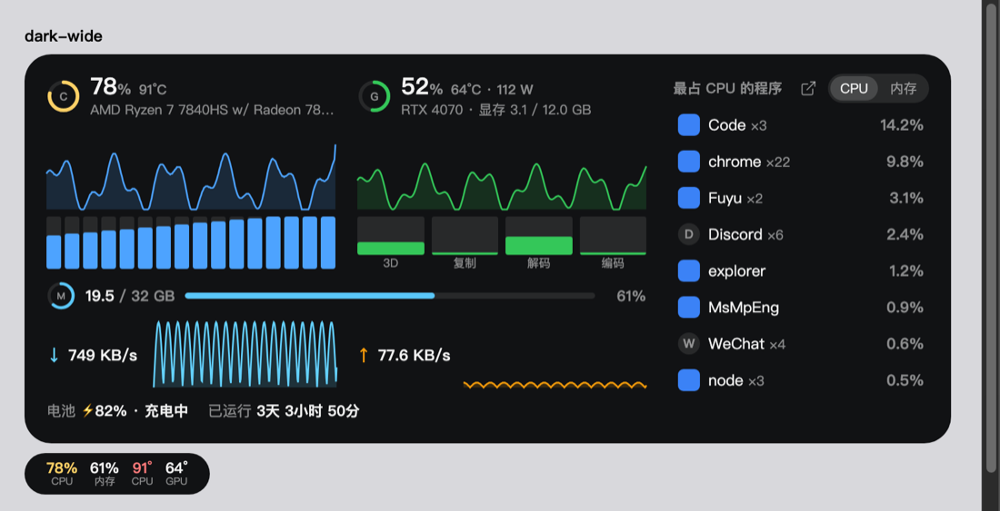
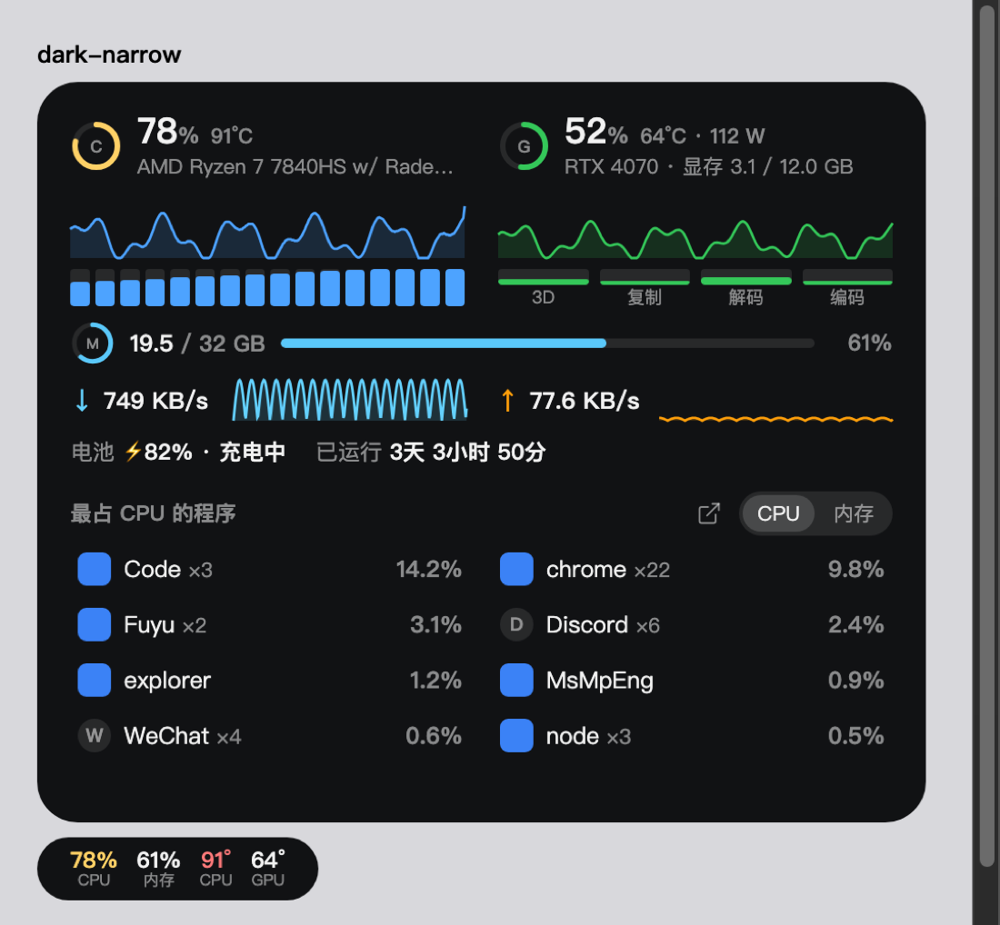
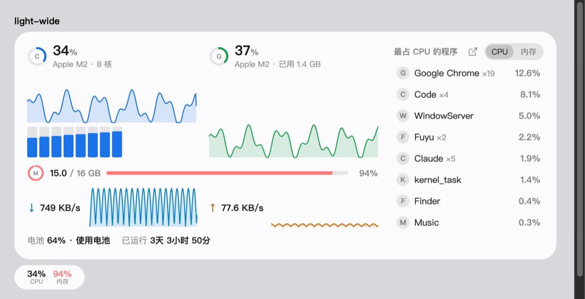
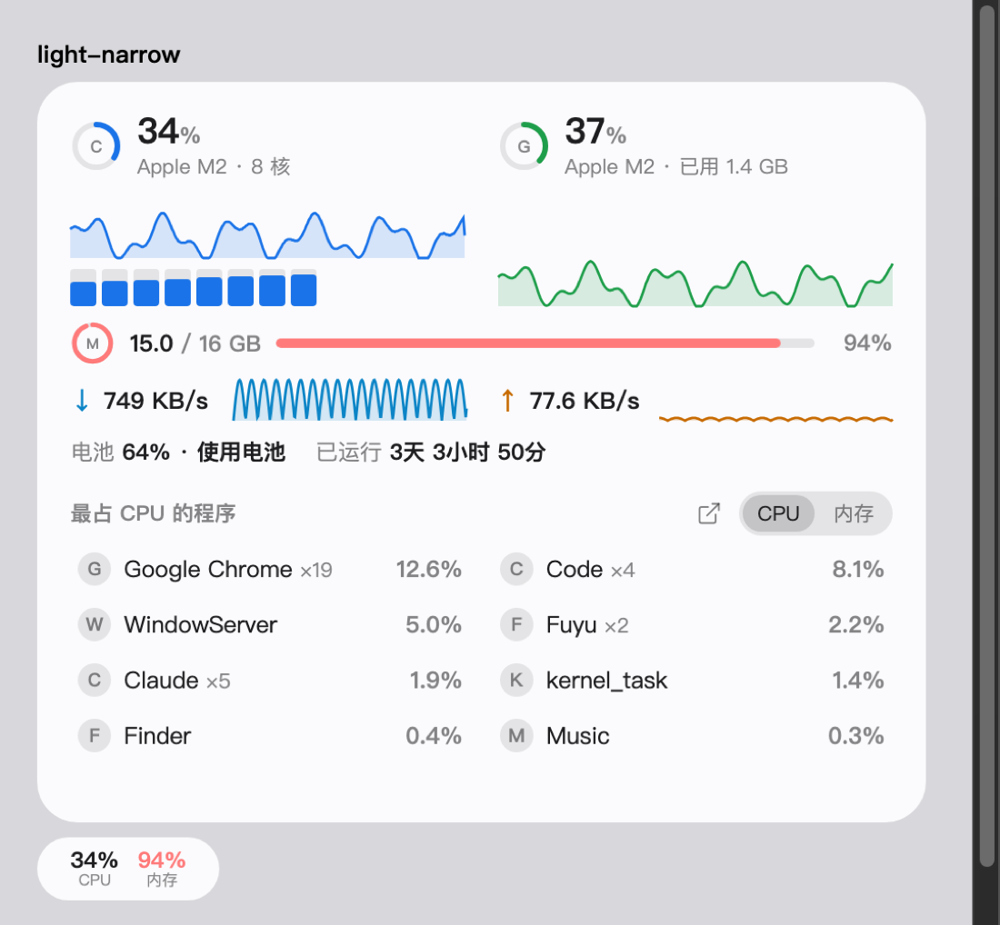

## 说明

按计划「E64.2 页面、收起条和设置」和预览页做；接口按计划「平台能力」带回退值写（E60.9 的警告色、color-scheme、收起项 opens）。同时补 E60.7 对系统监控要的岛页标题和设置入口，升 1.1.0，写 CHANGELOG、README。

## 提交

- `feat(system-monitor): draw the page on the island with GPU, network, programs and a colored collapsed bar (1.1.0)`

## 备注

### 截图（浏览器小样：真组件、假数据）

用户正在跑的 `pnpm tauri dev` 是 E60.5 之前的代码，不认插件页面（旧 1.0.0 的页面也不在页头），dev 来源的插件装上了却没加载到岛上。组长定不重启用户的 dev，先用浏览器小样截图：把 `island.tsx` 的组件接上假的宿主（Windows 样例：16 核、NVIDIA 显卡带引擎和温度、程序带图标；Mac 样例：Apple M2，GPU 只有占用，程序显示首字），按平台的 `--fuyu-plugin-*` 变量和 `.island-light` 套深浅两种岛，Chrome 无头截图。小样在会话的临时目录，不进仓库。

| 深色岛 · 宽（760×320，两栏，Windows 样例） | 深色岛 · 窄（480×400，一栏，Windows 样例） |
|---|---|
|  |  |

| 浅色岛 · 宽（760×320，两栏，Mac 样例） | 浅色岛 · 窄（480×400，一栏，Mac 样例） |
|---|---|
|  |  |

每张图下面是收起条：Windows 样例四项全开（CPU 78% 黄、CPU 温度 91° 红），Mac 样例只有 CPU 和内存（内存 94% 红）。

### 做法和取舍

- 页面组件在 `src/ui/`：`MonitorPage`（一栏两栏、量宽度）、`Units`（CPU、GPU）、`Lines`（内存、网速、电池和运行时间）、`Programs`（排序、图标、打开任务管理器、按高度算行数）、`CollapsedBar`、`Ring`、`Spark`、`useHistory`、`useElementSize`、`thresholds`。样式 `styles.css`、`ui/programs.css`、`ui/settings.css`。
- 平台合入 E60.9 之前插槽外层没有 `color-scheme`，`light-dark()` 会取浅色那一套；插件根元素先写 `color-scheme: dark`，`:where(.island-light)` 下改成 `light`。E60.9 合入后这两条可以删。
- 打开任务管理器失败时程序列表标题变红并显示「没能打开…」，鼠标停上去看原因。
- 设置分节仍挂 `pluginsV3`：E60.6 已按插件 id 找设置，挂在哪个分类都进得去。
- `tests/unit/official-plugins-v3.test.mjs` 的样式守卫按组长定的三条放宽（见提交正文）：插件样式表里自己声明的自定义属性可以用；颜色字面量只许出现在 `light-dark()` 里和 `--fuyu-plugin-warning` / `--fuyu-plugin-danger` 的回退值里；这两个变量先列为允许，等 E60.9 加进 `SLOT_THEME`。「本插件自己声明的」按整个插件的样式表算，不按单个文件：`ui/programs.css` 用的 `--sysmon-*` 在 `styles.css` 里声明，构建时它们合成一份样式。

## 交接

- 2026-11-19 03:28 e64-2：实测清单（开发版跑的是旧代码，组长定不重启用户的 dev）：1) 重启 pnpm tauri dev 后页头出现「系统监控」，深浅岛、窄宽面板和浏览器小样一致；2) 收起条显示 CPU 和内存，读数过阈值变黄变红，点收起项打开监控页（要 E60.9）；3) 设置 → 插件 → 系统监控能改排版、温度、后台记录曲线；Windows 上图标、GPU 引擎、温度归 E64.3。
